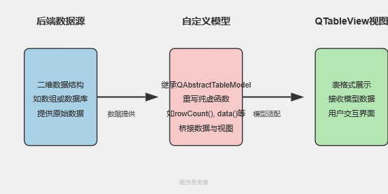
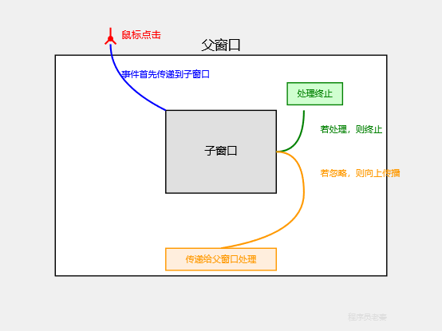

## QT

#### QGraphicsitem的使用（缩放），结合哪几个类

#### Qtextedit的使用，比如每行都不一样

#### 自定义控件（不是功能）

#### qt object可不可以拷贝

> 不可以

#### 信号槽机制（过程

> 模板把成员函数指针参数透传给 Qt 内部底层函数 `connectImpl`；把**成员函数指针的地址**作为参数传入运行时

```
用户代码 connect(A,&A::sig,B,&B::slot)
├─编译期：模板校验成员函数指针类型；moc生成staticMetaObject（每个类都有）、qt_static_metacall（会放入staticMetaObject）
└─运行时：
   1. 根据每个类的qt_static_metacall比对函数指针，得到signal_index、slot_index、callFunc(recevier)
   2. new Connection堆节点，存入sender/receiver指针、索引、callFunc(receiver)
   3. 节点挂入sender.signalVector、receiver.senders双向链表（各自对应对象类的地方）

emit A::sig()
└─QMetaObject::activate遍历sender.signalVector链表(查看是否有一致的signal_index，如果一致就取该conn节点调用callfunc)
   └─Connection.callFunc(receiver, slot_index, argv)
      └─qt_metacall 根据slot_index switch，执行业务槽函数
```

#### MOC阶段

MOC 做 4 件核心事：

1. 生成类的

   静态元对象 `staticMetaObject`

   （全局只读，rodata 段，类级别，所有实例共享）

   - 记录信号、槽名称、参数类型、返回值、方法整数 ID（0,1,2…）

2. 生成信号函数的实现：

   ```
   void S::sig(...) { QMetaObject::activate(this, ...); }
   ```

   > 你写 `emit sig()`，本质就是调用这个 moc 生成的 sig 函数。

3. 生成 

   ```
   qt_static_metacall
   ```

    静态函数：

   - 模式 1 `IndexOfMethod`：**输入 C++ 成员函数指针，if‑else 比对，返回对应的 method 整数 id**（connect 阶段用）
   - 模式 2 `InvokeMetaMethod`：**输入对象指针 + id，switch‑case，直接调用你的信号 / 槽函数**（emit 执行槽用）

4. 生成 `qt_metacall` 成员函数，内部调用上面静态函数。

#### 为什么ui线程必须是主线程

> `QApplication`（GUI 版本）实例只能在**进程主线程**构造；
>
> `QApplication::exec()`只能在进程主线程执行；
>
> 所有 QWidget、窗口控件，只能在这个进程主线程创建

> Qt 主窗口的 HWND 属于进程主线程；对话框有父窗口指向主线程 HWND。**父窗口和子窗口分属两个不同线程**，Windows 用户态 API 遇到跨线程父子窗口，行为是未定义：焦点错乱、模态卡死、消息乱掉

### 自定义控件

- **ListView的每一项里加入自定义样式，比如增加一个Label和一个Button**

> 具体方法是继承并实现一个自定义的QStyledItemDelegate。需要重写paint方法，在这个方法中使用QPainter来绘制，包括文本和按钮样式。为了响应交互，比如按钮的点击，还需要重写editorEvent方法来处理鼠标事件，判断点击位置是否在您绘制的按钮区域内，并发出自定义的信号。虽然也可以使用QListView::setIndexWidget为每一项直接设置一个真实的QWidget，但这种方法会为每个列表项都创建一个完整的窗口部件实例，当列表项非常多时，会增加性能消耗

### **使用QTableWidget，以及你是如何在项目中用它去实现你想要的功能的**

> 比如一个用户管理配置工具，我就使用了QTableWidget来集中展示和编辑用户信息。我的具体实现方式是，首先，在程序初始化时，我会根据从数据库或配置文件中读取的用户数量，使用setRowCount和setColumnCount设定表格的初始尺寸，并用setHorizontalHeaderLabels设置如“用户名”、“权限”、“创建日期”等表头。然后，我通过遍历用户数据，为每一个数据项创建一个QTableWidgetItem实例，并调用setItem方法填充到表格的单元格中。

### **QAbstractTableModel**

QAbstractTableModel专门用于将后端数据以二维表格的形式提供给像QTableView这样的视图进行展示。在开发中，我们会通过继承QAbstractTableModel并重写其关键的纯虚函数来创建自定义的数据模型。



### **如果一个父窗口上有一个子窗口，当我点击子窗口时，这个点击事件是先传递到父窗口还是先到子窗口本身**

**当点击一个位于父窗口之上的子窗口时，该点击事件会首先被直接传递到子窗口本身。**Qt的事件系统会将事件分发给鼠标光标下最顶层的那个窗口控件。如果子窗口在其事件处理函数中接受并处理了这个事件，那么事件的传递就到这边终止。如果子窗口选择忽略该事件，那么这个事件将会沿着父子关系链向上传播，传递给它的父窗口进行处理。

### **在Qt 开发中，如需展示表格数据和图表，你会使用哪些模块和类？**

**主要利用QtWidgets模块中的模型/视图框架以及Qt Charts模块**。

表格数据首选使用QTableView作为视图，并根据数据源选择合适的模型，比如使用QStandardItemModel来管理内存中的通用数据，或者使用QSqlTableModel来直接与数据库表进行交互。对于较为简单的、静态的表格，也可以使用QTableWidget。

图表展示可以集成Qt Charts模块，使用QChartView作为显示图表的视图控件，通过创建QChart对象来管理图表本身，根据需求选择具体的系列来承载和渲染数据，比如用QLineSeries绘制折线图，QBarSeries绘制柱状图，QPieSeries绘制饼图。

### **你了解或使用过Qt的哪些布局方式？**

| **布局方式**       | **主要功能** | **典型使用场景** | **关键函数**             |
| ------------------ | ------------ | ---------------- | ------------------------ |
| **QHBoxLayout**    | 水平排列控件 | 工具栏、按钮行   | addWidget(), addLayout() |
| **QVBoxLayout**    | 垂直排列控件 | 对话框内容区     | addWidget(), addLayout() |
| **QGridLayout**    | 二维网格布局 | 计算器、表单     | addWidget(row, col)      |
| **QFormLayout**    | 两列表单管理 | 登录/注册界面    | addRow(label, widget)    |
| **QStackedLayout** | 堆叠多个页面 | 向导界面         | setCurrentIndex()        |
| **QSplitter**      | 动态调整大小 | 文件浏览器       | setOrientation()         |

### qt中使用的stl容器

| **Qt**  **容器** | **标准**  **STL** **对应**   | **核心区别**  **(****一句话概括****)**                       |
| ---------------- | ---------------------------- | ------------------------------------------------------------ |
| **QVector<T>**   | std::vector<T>               | 几乎一样，内存连续，但**QVector**支持**写时复制**。          |
| **QList<T>**     | std::list<T> / std::deque<T> | **本质区别****QList**是**指针数组**，不是链表，所以随机访问很快。 |
| **QMap<K,  V>**  | std::map<K, V>               | 都是有序的红黑树，但**QMap**支持**写时复制**。               |
| **QHash<K,  V>** | std::unordered_map<K, V>     | 都是无序的哈希表，但**QHash**支持**写时复制**。              |
| **QSet<T>**      | std::unordered_set<T>        | **QSet**是**无序**哈希集合 (像 std::unordered_set)，支持写时复制。 |
| **QString**      | std::string                  | **QString**用**UTF-16**编码，原生支持Unicode，功能函数也强大得多。 |

### qt中的moc文件

- 会编译生成源文件，他会生成 对应的信号和槽的索引和函数指针
  - **索引表（Meta-Object Data）**：MOC 会为每个类生成一张静态整数表，按照顺序为类的每个**信号、槽、属性**编一个内部 ID（比如 0: signalA, 1: slotB）。
  - **函数分发**：在 qt_metacall 函数中，利用一个大 switch-case 结合这些索引，将调用请求分发给对应的槽函数。
- 有emit定义的函数
  - **负责生成这个函数的函数体**
- 生成【qt_metacall】（通过 switch 索引找到对应槽函数）

### qtimer怎么设置

```c++
    m_timerCheck = new QTimer(this);
    connect(ui->radioButton_sky_scene, &QRadioButton::toggled, this, &MainWindow::updateScene);
    connect(m_timerCheck, &QTimer::timeout, this, &MainWindow::checkFlag);
    m_timerCheck->start(3000);
```

> 创建`QTimer`对象，连接超时触发槽函数，`start`用来计时
