# 问答

### 程序的内存分区有什么

```
1. 只读数据段（.rodata）

   常量数据，类的类型信息，虚函数表

2. 代码段(.text):

3. 全局静态区(.data+.bss)

   (1) .data 已初始化全局和静态

   (2).bss未初始化或初始化为 0的全局和静态
运行时分配
4. 栈

5. 堆
```

### UNION特性

1. 存储空间是成员变量占用最大的字节
2. 只存储一个成员变量，存储的是最后覆盖的数据

### 指针数组和数组指针的区别，+1会有什么结果

> 1. **看本质（看后两个字）：**
>    - **指针数组**本质是**数组**，即“装满指针的数组”。
>    - **数组指针**本质是**指针**，即“指向某个数组的指针”。
> 2. **看 +1 的结果：**
>    - **指针数组 +1**：数组名退化为二级指针，+1 偏移**一个指针的大小**（32位是 4 字节，64位是 8 字节），指向下一个指针元素。
>    - **数组指针 +1**：+1 偏移**一整个数组的大小**（比如指向 int[5] 就偏移 20 字节），直接跨越到下一个同维度的数组。

### 类的大小由什么决定

所有非 static 成员 + vptr (虚函数 / 虚继承才加) + 最大成员变量（对齐填充 padding）

### 构造函数有哪些

默认，参数，拷贝，委托，移动、显示

### 模板是在什么时候进行实例化

模板在编译器遇到模板的具体使用时实例化，如调用或使用时

### *C++ 四种标准强制类型转换

1. dynamic cast 

   > 主要用于，多态进行向上转变的时候的类型转换；相对于`static_cast`能够检查对应的类是否能够转换

2. reinterprest_cast 

3. staic_cast 

4. const_cast

### *define宏定义和const，static的区别

1. 类型检查；2. 作用范围；3. 是否可以修改；4. 调试支持

### *new和malloc，delete和free的区别

1. 分配位置；2. 什么类型；3. 返回类型；4. 异常处理

> `malloc / free`是 C 库函数；`new / delete`是 C++ 关键字；
>
> malloc 只分配原始内存，**不会调用构造函数**；new 分配内存 + 执行构造函数；
>
> free 只释放内存；delete 先调用析构函数再释放堆内存；
>
> malloc 返回`void*`，需要强制转换；new 返回对应类型指针；
>
> malloc 失败返回 NULL；new 默认抛出异常`std::bad_alloc`。

### extern关键字

1. `extern "C"` 关闭 C++ 名字改编，以便c编译器编译，实现 **C 和 C++ 互相调用**。（C++ 会对函数名、参数做重命名，C 编译器识别不了）
2. 能够跨文件声明，仅告知编译器变量 / 函数存在，不分配内存（头文件中用 `extern` 做声明，变量真实定义只放在一个 `.cpp` 中，避免多文件包含头文件造成重复定义。）

### 编译流程

1. 预处理： 处理宏定义、头文件包含、条件编译指令
2. 编译：(词法分析、语法分析、语义分析、中间代码生成和优化），将预处理后的代码 转换为汇编代码
3. 汇编：将汇编代码转换为机器代码
4. 连接：将多个目标文件和库文件链接生成可执行文件

### *C++函数调用的压栈过程

(比如调用方，和被调用方的对比)

函数调用时从右到左将参数压入栈中，随后压入返回地址，跳转到函数代码执行，处 理返回值并清理栈，最后返回到调用位置

调用方**从右向左压入函数参数**；

`call` 压入**返回地址**（返回到调用之后的下一步代码执行），跳转目标函数；

目标函数 `push ebp + mov ebp, esp` 搭建**栈帧**；

`sub esp` 开辟**局部变量**空间；

函数执行完毕，`mov esp,ebp` 释放局部变量，`pop ebp` 恢复旧栈帧；

`ret` 按返回地址回到调用处；

#### 流程

codeText

```
===============================================================================
  模式 1: __cdecl 调用约定（C 语言默认：由调用者 main 亲自动手清理栈）
===============================================================================
初始状态: 假设此时栈顶 ESP = 0x1000

[ .text 代码段 - main 函数 (调用者 Caller) ]
0x00401000: push 20            ; ESP = 0x0FFC (1000-4), 栈中写入参数 20
0x00401002: push 10            ; ESP = 0x0FF8 (0FFC-4), 栈中写入参数 10
0x00401004: call 0x00402000    ; 硬件自动将返回地址 0x00401009 压栈, ESP = 0x0FF4
                               ; 并跳转到 add 函数执行
; -----------------------------------------------------------------------------
[ .text 代码段 - add 函数 (被调用者 Callee) ]
0x00402000: mov eax, [esp+4]   ; 读取参数 10 (基准 ESP+4)
0x00402004: add eax, [esp+8]   ; 加上参数 20 (基准 ESP+8)，计算结果 30 存入 EAX
0x00402008: ret                ; 仅弹出返回地址 0x00401009 到 EIP，跳回 main
                               ; 此时 ESP 恢复为 0x0FF8
                               ; ⚠️ 警告：此时参数 10 和 20 依然滞留在栈中！
; -----------------------------------------------------------------------------
[ .text 代码段 - 回到 main 函数 (清理工作) ]
0x00401009: add esp, 8         ; ★★★ 核心：调用者 main 亲手清理栈！
                               ; ESP = 0x0FF8 + 8 = 0x1000
                               ; ESP 指针瞬间拉回初始位置，参数 10 和 20 被废弃！
0x0040100C: mov [res], eax     ; 将返回值 30 写入变量 res


===============================================================================
  模式 2: __stdcall 调用约定（Windows API 默认：由被调用者 add 自己清理栈）
===============================================================================
初始状态: 假设此时栈顶 ESP = 0x1000

[ .text 代码段 - main 函数 (调用者 Caller) ]
0x00401000: push 20            ; ESP = 0x0FFC (1000-4), 栈中写入参数 20
0x00401002: push 10            ; ESP = 0x0FF8 (0FFC-4), 栈中写入参数 10
0x00401004: call 0x00402000    ; 硬件自动将返回地址 0x00401009 压栈, ESP = 0x0FF4
                               ; 并跳转到 add 函数执行
; -----------------------------------------------------------------------------
[ .text 代码段 - add 函数 (被调用者 Callee) ]
0x00402000: mov eax, [esp+4]   ; 读取参数 10
0x00402004: add eax, [esp+8]   ; 加上参数 20，计算结果 30 存入 EAX
0x00402008: ret 8              ; ★★★ 核心：add 函数自己清理栈！
                               ; 1. 弹出返回地址跳回 main
                               ; 2. 硬件自动执行 ESP = ESP + 8
                               ; 此时 ESP 已经直接变为 0x1000（栈已平衡）！
; -----------------------------------------------------------------------------
[ .text 代码段 - 回到 main 函数 ]
0x00401009: mov [res], eax     ; ★★★ main 函数什么都不用做，直接拿结果！
                               ; 这里没有 add esp 指令，栈已经被 add 恢复了
```

```
1. 代码段（.text 段） ──> 由 EIP (程序计数器) 控制
   【从低地址往高地址走】 (递增 +)
   
   0x00402000: mov eax, [esp+4]   │ (执行完，EIP 自动 +4)
   0x00402004: add eax, [esp+8]   │ (执行完，EIP 自动 +4)
   0x00402008: ret 8              ▼ 顺着往下执行（地址变大）


2. 栈段（.stack 段）  ──> 由 ESP (栈顶指针) 控制
   【从高地址往低地址走】 (递减 -)
   
   0x0FFC: 参数 2                 ▲
   0x0FF8: 参数 1                 │ push 压栈（地址变小）
   0x0FF4: 返回地址                │
```


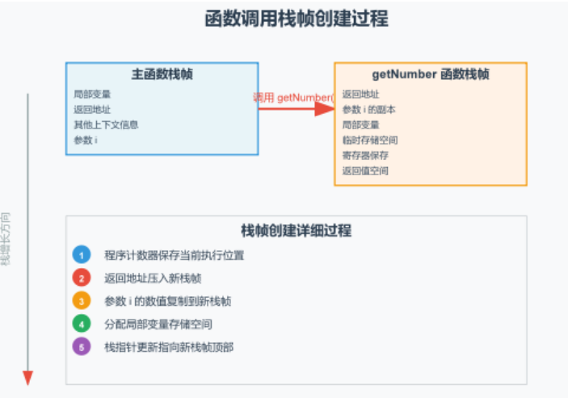

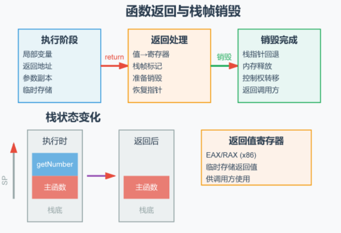

### *内联函数和宏定义的区别

1. 类型检查 
2. 是否调试
3. 处理截断
4. 定义域

### *零拷贝

(浅拷贝，深拷贝对比；mmap映射)

零拷贝技术在数据传输过程中避免了内存拷贝，直接在不同模块（如用户空间和内核 空间）之间传递数据，从而提高了系统性能，减少了CPU和内存带宽的消耗。常用于**高性能网络传输和文件I/O**操作，典型实现包括 **sendfile、mmap、splice 和 DMA 技术**。

#### 使用场景：

1）高性能网络传输：例如服务器需要快速传输大量数据时，零拷贝技术可以显著提 高传输效率。 2）文件I/O操作：例如文件复制、文件发送等场景，使用零拷贝可以减少文件在用 户空间和内核空间之间的拷贝。

#### 实现技术

1）sendfile：在Linux中，将文件数据直接从文件描述符发送到网络套接字。 2）mmap：内存映射文件，允许文件的内容直接映射到进程的地址空间。 3）splice：将数据在两个文件描述符之间移动，而无需将数据拷贝到用户空间。 4）DMA（Direct Memory Access）：允许设备直接访问主内存，减少CPU参 与数据传输。

### 临时对象在什么时候会产生

1. 函数按值返回的变量
2. 值传递的隐式类型转换
3. 运算符重载中连续运算的中间变量

```c++
class A{};
A a = A();
```

1. 直接匿名创建对象

**解决问题**：

1. 通过引用传递，或者右值引用接受函数返回值
2. 使用常量const类型进行存储，会保存到作用域内

```c++
const A& r = A(); // 合法
A&& rr = A();     // 合法，右值引用绑定临时
```

3. 直接返回匿名对象（RVO）

```c++
A func() {
    return A(); // RVO：返回匿名临时
}

int main() {
    A a = func();
}
```

4. **函数内部先定义一个**有名局部对象 **，最后 return 这个命名对象 ** 的场景。

```c++
// NRVO 场景：返回函数内【有名对象】
A test()
{
    A obj;   // 函数内有名局部对象
    return obj; // 返回命名对象 → NRVO 触发点
}

int main()
{
    A a = test();
    return 0;
}
```

### 右值引用

右值引用（T&&）：只能绑定右值的引用类型，一是绑定后临时对象生命周期延长到右值引用变量作用域结；二是实现移动语义，转移资源所有权，减少拷贝开销。

```c++
class Test
{
    public:    
    // 移动构造
    Test(Test&& t) noexcept
    {
        // 直接接管指针
        p = t.p;
        t.p = nullptr;
        cout << "移动构造,接管地址:" << p << endl;
    }

    ~Test()
    {
        if (p) delete p;
        cout << "析构" << endl;
    }
};

Test createTmp()
{
    return Test(100); // 返回临时右值
}

int main()
{
    // 1. 绑定真正临时：右值引用延长临时生命周期
    Test t1 = createTmp();

    // 2. move左值：无临时，t2的参数t是t1别名
    Test t2 = move(t1);

    return 0;
}
```

接收`createTmp()`：**绑定临时，引用延长临时生命周期到移动构造结束**；

接收`move(t1)`：**t 就是 t1 的别名，没有临时，不延长生命周期**。

第二个作用，就是能够复制右值的资源

### 局部Static变量什么时候线程安全

1. c+11标准规定，因为static是在全局静态区数据段只分配一个内存（如果在**全局**则不担心初始化线程安全问题，因为会编译时就初始化；而在**局部函数里的**只有调用该函数才进行第一次初始化，所以内置线程安全）（**只有初始化**线程安全，读写依然不安全）


- **全局静态变量和命名空间静态变量和类的静态成员变量都是没有内置的线程安全保证**

### 单例模式为什么适合用引用

**返回指针缺点**

1. 用户必须判空，忘记判空容易空指针崩溃。
2. 用户可以随便`delete getInstance()`，直接把单例销毁，后续访问灾难。
3. new 出来堆对象，程序正常退出不会自动析构，内存泄漏（除非 atexit 注册销毁）。

### volatile

告诉编译器**不要对此变量做优化，每次取值必须从原始内存读取，不能把值缓存到 CPU 寄存器**。	

> ## 场景 1：线程修改全局变量（最典型）
>
> ```
> int flag = 0;
> 
> //线程1
> void func1()
> {
>  while(flag == 0)
>  {
>  }
> }
> //线程2修改flag = 1
> ```
>
> 编译器编译`func1`的时候，发现本函数里面没有修改 flag，编译器做优化：
>
> - 循环刚开始：内存读取 flag 放到寄存器；
>
> - 之后循环判断直接读取寄存器的值，不会访问内存；
>
>   就算线程 2 修改内存里面 flag 为 1，寄存器里面依旧是 0，循环不会退出，读到旧值。
>
>   加上，每一次循环强制读取内存，可以拿到最新值。
>
>   ```
>   volatile int flag
>   ```
>
> > 但是注意：volatile 只能解决编译器缓存问题，CPU 指令乱序问题它管不到。

### 用 `#include` guard（`#ifndef`/`#define`/`#endif`）和 `#pragma once` 区别

> - 两者都能防止“重定义”，但 `#pragma once` 对同一文件的不同路径或链接/符号链接可能失效，而宏保护则不会。
>
> - 宏保护需要为宏选择唯一名称，避免与外部宏冲突；`#pragma once` 无需命名，但遇到不支持它的古老编译器会失败。
>
>   就是保证一个.cpp文件，只会有一个头文件声明

### char和wchar的区别

> ## 1. 核心区别
>
> | 对比项         | `char`          | `wchar_t`                              |
> | -------------- | --------------- | -------------------------------------- |
> | 类型           | 普通字符        | 宽字符                                 |
> | 占用空间       | 1 字节          | Windows 通常 2 字节，Linux 通常 4 字节 |
> | 字符串类型     | `char*`         | `wchar_t*`                             |
> | 字符串字面量   | `"Hello"`       | `L"Hello"`                             |
> | 字符字面量     | `'A'`           | `L'A'`                                 |
> | 字符串长度函数 | `strlen()`      | `wcslen()`                             |
> | 常见编码       | ASCII、UTF-8 等 | Windows 常用 UTF-16，Linux 常用 UTF-32 |
>
> ## 2. 代码示例
>
> ```
> #include <iostream>
> #include <cwchar>
> using namespace std;
> 
> int main() {
>     char a = 'A';
>     wchar_t b = L'A';
> 
>     cout << sizeof(a) << endl; // 1
>     cout << sizeof(b) << endl; // Windows 2，Linux 通常 4
> 
>     const char* str1 = "Hello";
>     const wchar_t* str2 = L"Hello";
> 
>     cout << strlen(str1) << endl;  // 5
>     cout << wcslen(str2) << endl;  // 5
> 
>     return 0;
> }
> ```
>
> ## 3. 为什么需要 wchar_t？
>
> 主要是为了处理更广泛的字符，例如中文、日文和特殊符号。
>
> 使用 `char`：
>
> ```
> const char* str = "你好";
> ```
>
> 如果采用 UTF-8 编码：
>
> ```
> strlen(str);  // 6
> ```
>
> 因为每个汉字在 UTF-8 中通常占用 3 个字节，所以两个汉字占用 6 个字节。
>
> 使用 `wchar_t`：
>
> ```
> const wchar_t* str = L"你好";
> 
> wcslen(str);  // 2
> ```
>
> 这里的两个汉字分别对应一个宽字符元素，因此长度是 2。
>
> 需要注意，`wchar_t` 并不保证一个元素就能表示一个完整的 Unicode 字符。例如 Windows 使用 UTF-16，某些字符（如部分 emoji）需要两个 `wchar_t` 元素。
>
> ## 4. 在 Windows 开发中的区别
>
> 如果你正在学习 Windows API，这个区别非常重要。
>
> Windows API 有两套常见的字符串接口：
>
> ```
> // ANSI 版本
> MessageBoxA(NULL, "Hello", "Title", MB_OK);
> 
> // Unicode 版本
> MessageBoxW(NULL, L"你好", L"标题", MB_OK);
> ```
>
> - `MessageBoxA`：使用 `char*` 字符串。
> - `MessageBoxW`：使用 `wchar_t*` 字符串（UTF-16）。
> - `MessageBox`：根据项目是否定义 `UNICODE`，映射到 A 或 W 版本。
>
> Windows 还有这些类型：
>
> ```
> CHAR    a = 'A';       // char
> WCHAR   b = L'A';      // wchar_t
> 
> LPCSTR  str1 = "Hello"; // const char*
> LPCWSTR str2 = L"你好";  // const wchar_t*
> ```
>
> ## 5. 应该用哪个？
>
> - 普通 C/C++ 开发、跨平台项目： 通常优先使用 `std::string` 配合 UTF-8。
> - Windows API 开发： 通常优先使用 `wchar_t`、`std::wstring` 和 `W` 版本 API。
> - 处理二进制数据或单字节字符： 使用 `char` 或其他适合的字节类型。
>
> 一句话总结：
>
> `char` 固定占 1 字节，`wchar_t` 通常占 2 或 4 字节；两者最重要的差异不仅是大小，还在于它们对应的字符串编码和 API 使用方式。
>
> 如果你是在学 C++ Windows 编程，还需要弄清楚 `char*`、`wchar_t*`、`LPCSTR`、`LPCWSTR`、`TCHAR` 之间的关系。

## 引用

### const 左值引用 和 左值引用区别

| 引用类型                  | 可以绑定左值 | 可以绑定右值 (临时、纯右值 /xvalue（将亡值）) | 能否通过引用修改对象 |
| ------------------------- | ------------ | --------------------------------------------- | -------------------- |
| `T&` 非 const 左值引用    | ✅            | ❌                                             | ✅ 可修改             |
| `const T&` const 左值引用 | ✅            | ✅（**延长临时对象生命周期**）                 | ❌ 不可修改           |

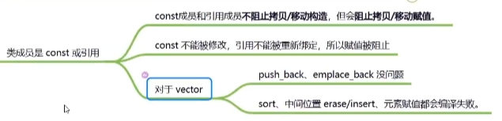

**const引用可以作为初始化被构造，但是不能被赋值；**

所以对于vector可以构造，但是不能进行赋值（数据移动，元素改动，插入删除）

### 将亡值（xvalue)和右值（prvalue)区别

| 类别                              | 来源                                   | 可以取地址吗？           | 能否移动构造 | 本质                             |
| --------------------------------- | -------------------------------------- | ------------------------ | ------------ | -------------------------------- |
| 纯右值 prvalue                    | 字面量、临时对象、返回临时对象的函数   | ❌ 不能取地址             | ✅            | 全新无名临时对象                 |
| 将亡值 xvalue(可以被转移资源属性) | `std::move(具名左值)`、返回 T&& 的函数 | ❌ 不能直接对表达式取地址 | ✅            | 原有对象，只是被强制转为右值类别 |

```c++
std::string s = "test";
std::move(s);   // ✨ 将亡值 xvalue
```

>  ⚠️重点：`s`本身还是那个左值对象，内存还在；**`std::move(s)`这个表达式的值类别是 xvalue**。 `s`本身没有被销毁，只是表达式把它标记成 “可以被移动窃取资源”。

### std::move底层原理

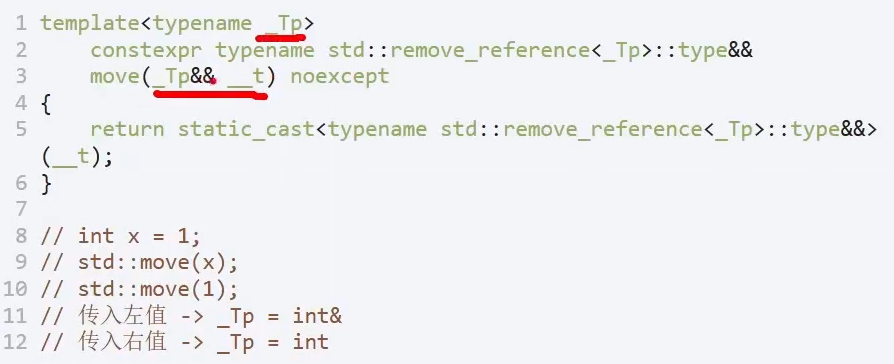

只把对应参数表达式换成右值

### 移动构造

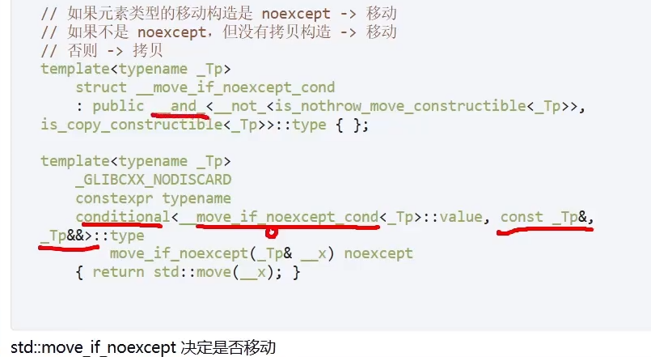

1. 没有移动构造，没有设置no except && 有拷贝构造->true(拷贝)
2. 如果不是noexcept ，但没有拷贝构造->false(移动)
3. else -> true(拷贝)

#### 类声明的移动构造变化

| 显式声明了什么             | 是否生成拷贝构造 / 拷贝赋值 | 是否生成移动构造 / 移动赋值 | 现象                 |
| -------------------------- | --------------------------- | --------------------------- | -------------------- |
| 什么都没写                 | ✅                           | ✅                           | 拷贝移动全都有       |
| 析构 / 拷贝构造 / 拷贝赋值 | ✅(deprecated)               | ❌                           | 右值降级拷贝         |
| 移动构造 / 移动赋值        | ❌                           | ✅                           | 左值拷贝操作编译报错 |

### 返回值优化

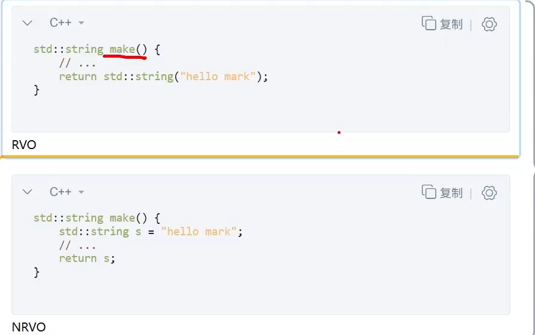

**返回值优化：** 直接再调用方内存构造

- 如果NRVO失败，发生隐式移动，局部变量当作右值做重载决议

## 虚函数类、类继承

### 类继承的内存布局（成员函数指针可能大小不一致

多重继承对象内存布局：

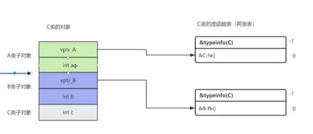

GCC虚表布局：

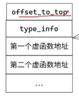

`C* pc = &c;`

- **指针值**：等于完整 C 对象起始地址，指向 A 子对象。
- **静态类型：C***，编译器掌握 C 完整内存布局。
- ✅可访问：A 全部成员、B 全部成员、C 自己新增成员；
- ✅虚函数：`pc->fa()`调用`C::fa()`；`pc->fb()`调用`C::fb()`；两张虚表都可以用。

`A* pa = &c;`

- **指针值**：等于完整 C 对象起始地址（A 是第一个基类，无偏移），指向 A 子对象。
- **静态类型：A***，编译器只认识 A 的布局。
- ✅可访问：A 的成员变量、A 声明的虚 / 非虚函数。
- ✅虚函数`pa->fa()`：走`vptr_A`→`vtable_C_for_A`，**多态调用 C::fa ()**。
- ❌编译期不可直接访问：`fb()`、B 的成员、C 自己成员`c`。虽然物理内存就在后面，编译器不知道偏移
- 内存：完整 C 对象完好存在，**没有切片，只是编译器看不见后面 B/C 部分**。

`B* pb = &c;`

- **指针值**：不等于`&c`；赋值自动做 this 指针偏移，指向对象内部 B 子对象起始。
- **静态类型：B***，编译器只认识 B 布局。
- ✅可访问：B 的成员变量、B 声明虚 / 非虚函数。
- ✅虚函数`pb->fb()`：走`vptr_B`→`vtable_C_for_B`，**多态调用 C::fb ()**。
- ❌编译期不可直接访问：`fa()`、A 成员、C 成员。
- Itanium‑ABI：虚表`vtable_C_for_B`内`offset‑to‑top`字段，运行时可以算出完整 C 对象起始地址。

#### 区别

`A a = c;`

- **不是指针！**调用 A 拷贝构造函数，**只复制 c 里面 A 子对象，生成全新独立 A 对象 a**。
- B 子对象、C 成员全部丢弃。
- 对象 a 内部`vptr_A`指向 A 原生虚表，**不再是 C 的虚表，多态完全失效**。

#### gcc虚表布局讲解

##### offset‑to‑top（vptr[-2]）

```
完整对象起始 = (char *)子对象指针 + offset‑to‑top;
```

**`dynamic_cast<void\*>`** 只拿到次级基类子对象指针（例如`B* pb = &c`），运行时读取虚表`offset‑to‑top`，计算还原出完整 C 对象的起始地址。

##### type_info*（vptr[-1]）

存放 RTTI 的类型信息结构体指针，描述**完整派生类 C 的类型，不是基类 A/B**。

例如：

> `vtable_C_for_A`（A 子对象使用的虚表）：`type_info* → &typeinfo(C)`
> `vtable_C_for_B`（B 子对象使用的虚表）：`type_info* → &typeinfo(C)`
>
> 两张完全不同的虚表，**type_info 存的都是 C，不是 A、不是 B**。

#### 子类不能继承的函数有哪些

构造，析构，赋值重载运算符，友元函数，私有成员函数

#### 什么函数不能声明为虚函数（Inline函数的定义）

构造，静态，内联（`inline` 要求编译器在**编译阶段**把函数代码直接展开到调用处，消除函数调用开销。）但是虚函数是运行时才知道调用哪个函数

#### 虚函数表，虚函数指针存放程序的位置在哪里？

虚函数表放在只读数据段中，虚函数表指针根据对象的存放位置决定，如果是栈对象则是该指针则是栈的

#### 没有虚函数的话，C++ 如何实现多态？

多态分为1.静态（重载，这个无需虚函数） 2. 运行（需要虚函数）解决办法：1. 通过模板实例化 2. 自己建表查找对应函数接口

#### 单继承下虚函数表数量？多继承为什么会有多个虚函数表及对应表头指针？菱形继承（带虚继承）

单继承：派生类只生成 1 张虚函数表，对象仅存 1 个虚表指针（vptr）

多继承：继承 N 个带虚函数的父类 → 派生类内含 N 个虚表指针、N 张独立虚表；这样能保证拿到父类对应的虚表

菱形继承：N 个虚继承 + 带虚函数的父类 = **N 个 vptr + N 个 vbptr，两类表各 N 张**（vbptr是虚基表指针）

### “重写的虚函数返回值类型必须与基类虚函数一致,除了一个例子是什么

> **当基类虚函数返回指向基类类型的指针或引用（`Base\*` 或 `Base&`）时，派生类中的重写函数可以返回指向派生类类型的指针或引用（`Derived\*` or `Derived&`）**。

```
class Base {
public:
    virtual Base* clone() const {
        return new Base(*this);
    }
    virtual ~Base() = default;
};

class Derived : public Base {
public:
    // 返回类型是 Derived*，与基类的 Base* 构成协变
    Derived* clone() const override {
        return new Derived(*this);
    }
};
```

- 作用

  > 它保证了通过基类指针或引用调用虚函数时，如果已知实际对象是派生类，派生类版本可以直接返回派生类自身类型的引用或指针，从而免去了调用者显式进行向下转型（`dynamic_cast` 或 `static_cast`）的麻烦

### 棱形继承

```
class A {
public:
    A(int x) { ... } // 有参构造
};

class B : virtual public A {
public:
    B() : A(1) { } // 这里的 A(1) 在 D 实例化时会被直接忽略！
};

class C : virtual public A {
public:
    C() : A(2) { } // 这里的 A(2) 也会被忽略！
};

class D : public B, public C {
public:
    // D 必须显式地直接调用 A 的构造函数！
    D() : A(100), B(), C() { } 
};
```

- **原因：** 因为 A 在 D 里面只有一份，如果让 B 也初始化 A、C 也初始化 A，那到底听谁的？所以 C++ 规定：**谁最后实例化（最底层派生类），谁全权负责初始化共享的虚基类。**

#### 内存布局

```
+-----------------------+ <--- 对象 D 的起始地址
|  [B 子对象]           |
|   - B 自己的成员变量  |
|   - vbptr (B 的指针)  |-----> 指向 B 的虚基类表（记录 A 在哪）
+-----------------------+
|  [C 子对象]           |
|   - C 自己的成员变量  |
|   - vbptr (C 的指针)  |-----> 指向 C 的虚基类表（记录 A 在哪）
+-----------------------+
|  [D 子对象]           |
|   - D 自己的成员变量  |
+-----------------------+
|  [A 子对象 (共享)]    | <--- 内存里只有这一份 A！
|   - A 的成员变量      |
+-----------------------+
```


> ### 虚继承里的表，装的根本不是函数！
>
> 在菱形虚继承中，B 和 C 内部多出来的指针，指向的表里**装的不是 A 的虚函数，而是数字（偏移量）**：**内存偏移量**
>
> - **B 的虚基类表（vbtable）：**
>   - 内容：+24 字节（告诉 CPU：从 B 出发，往下跳 24 字节就是 A 的数据）。
> - **C 的虚基类表（vbtable）：**
>   - 内容：+16 字节（告诉 CPU：从 C 出发，往下跳 16 字节就是 A 的数据）。

#### 例子

```
class A {
public:
    int a_val;
    virtual void funcA() {} // A 有虚函数
};

class B : virtual public A { // 虚继承 A
public:
    int b_val;
    virtual void funcB() {} // B 有自己的虚函数
};

class C : virtual public A { // 虚继承 A
public:
    int c_val;
    virtual void funcC() {} // C 有自己的虚函数
};

class D : public B, public C {
public:
    int d_val;
    virtual void funcD() {} // D 有自己的虚函数
};
```

- 对象d的内存布局

```
内存低地址 (对象 d 起始位置)
+-------------------------------------------------------------------------------+
| [B 子对象]                                                                    |
|   1. vptr   (虚函数指针)  ---> 指向 【vtable for D-in-B】 (存 funcB, funcD)    |
|   2. vbptr  (虚基类指针)  ---> 指向 【vbtable for D-in-B】(存 A 的偏移: +36)   |
|   3. int b_val (B 的成员)                                                     |
+-------------------------------------------------------------------------------+
| [C 子对象]                                                                    |
|   4. vptr   (虚函数指针)  ---> 指向 【vtable for D-in-C】 (存 funcC)          |
|   5. vbptr  (虚基类指针)  ---> 指向 【vbtable for D-in-C】(存 A 的偏移: +20)   |
|   6. int c_val (C 的成员)                                                     |
+-------------------------------------------------------------------------------+
| [D 自身数据]                                                                  |
|   7. int d_val (D 自己的成员)                                                 |
+-------------------------------------------------------------------------------+
| [A 共享子对象] (虚继承祖先，位于最末尾)                                       |
|   8. vptr   (虚函数指针)  ---> 指向 【vtable for D-in-A】 (存 funcA)          |
|   9. int a_val (A 的成员)                                                     |
+-------------------------------------------------------------------------------+
内存高地址
```

#### **在析构函数（或构造函数）中调用虚函数，能不能实现多态？**

> #### 第一步：直接给结论（现象）
>
> > “在析构函数（包括构造函数）中调用虚函数，**不会发生多态（动态绑定）**。调用的**只会是当前类自身定义的虚函数版本**，绝对不会调用到派生类（子类）重写的版本。”
>
> #### 第二步：解释底层原因（为什么会这样？）
>
> > “这是由 **C++ 对象的析构顺序** 和 **虚函数表指针（vptr）的动态更新** 决定的：
> >
> > 1. **对象析构的顺序是自顶向下（从派生类到基类）**。当基类的析构函数正在执行时，**派生类的析构函数已经执行完毕了**。
> > 2. 派生类析构完后，其持有的子类成员变量、资源都已经释放或变成未定义状态。
> > 3. 如果此时基类析构还能调用派生类的虚函数，该虚函数很可能会访问**已经被销毁的子类成员**，导致内存越界、程序崩溃（Undefined Behavior）。
> > 4. 为了防止这种灾难，C++ 编译器在执行基类析构函数时，会**把对象的 vptr 重新指向当前基类的虚函数表**。因此，此时调用的虚函数只会是基类自己的版本。”
>
> #### 第三步：说明后果与最佳实践（避坑）
>
> > “如果在基类析构函数中调用了**纯虚函数（Pure Virtual Function）**，会导致链接错误或者运行时崩溃（常见的报错如 pure virtual function call）。
> > **最佳实践是**：**永远不要在构造函数或析构函数中调用虚函数**（Effective C++ 条款 9）。”

## C++11新特性

### nullptr

因为NULL通常置为为0，用于在模板和重载场景可能有问题

1. NULL被记为是int类型

```
// 重载1：接收整型
void func(int n)
{
    cout << "调用 int 版本：" << n << endl;
}

// 重载2：接收指针
void func(char* p)
{
    cout << "调用 指针 版本" << endl;
}

int main()
{
    func(NULL);    // NULL = 0，整型
    func(nullptr); // 空指针类型
    return 0;
}
调用 int 版本：0
调用 指针 版本
```

2. 同理应用于模板

```
#include <iostream>
#include <type_traits>
using namespace std;

template <typename T>
void test(T t)
{
    // 判断是否为指针类型
    if (is_pointer_v<T>)
        cout << "推导为指针类型" << endl;
    else
        cout << "推导为非指针类型" << endl;
}

int main()
{
    test(NULL);     // 传入 0 → 推导为 int
    test(nullptr);  // 传入 nullptr → 推导为 std::nullptr_t
    return 0;
}
推导为非指针类型
推导为指针类型
```

### unique_ptr

#### 删除器细节是否影响unique_ptr变化

```c++
struct EmptyDeleter {                     // 无状态：空类
    void operator()(int* p) const { delete p; }
};

struct StatefulDeleter {                  // 有状态：带一个 int 成员
    int calls = 0;
    void operator()(int* p) { ++calls; delete p; }
};

struct BigStatefulDeleter {               // 有状态：带更大的负载
    void* a;
    void* b;
    void operator()(int* p) const { delete p; }
};

void freeIntFn(int* p) { delete p; }      // 普通函数，用于取函数指针
```

1. **EmptyDeleter（空无状态）**：`unique_ptr<T,EmptyDeleter>` **大小 = 裸指针大小**，空基类优化，删除器不占内存；
2. **StatefulDeleter / BigStatefulDeleter（有状态）**：`unique_ptr`大小 = 指针 + 删除器对象，体积膨胀；
3. **函数指针作删除器**：同样占一个指针大小。
4. **无捕获参数的lambda**：同样可以利用空基类优化（因为没有非静态成员变量->空类）

> 对比：`shared_ptr` 的删除器是控制块上动态分配，不会影响智能指针对象本身大小。

### share_ptr和weak_ptr的区别

```C++
shared_ptr<int> sp = make_shared<int>(10);
weak_ptr<int> wp = sp;
sp.reset(); //  sp 出作用域析构，对象析构
wp.reset(); //  wp 出作用域析构，控制块析构释放
```

分配两个内存指向2个地方一个在堆上分配类对象，同时分配控制块；share_ptr有2个指针指向2个地方。

控制块有2个变量：1. use_count（记录share_ptr的引用次数） 2. weak_count（记录weak_ptr）的引用次数）；只有use_count = 0,weak_count= 0，控制块才释放；而use_count = 0（强引用次数）就可以对该对象释放

weak_ptr只有1个指针，指向控制块，它没有拥有资源的所有权；

所以share_ptr可能会循环引用，weak_ptr可以打破

**引用次数安全性实现**：这是通过使用 std::atomic 类型来 实现的，保证了对共享计数和弱计数的原子操作。**但是资源访问不是线程安全的**

**weak_ptr的lock**会先查看引用次数是否为0，为0就返回空指针；如果有引用次数，那么就会增加一个引用次数进行获取对应的共享指针；

**如果只是判断是否有引用次数直接用expired()即可**

#### enabled_shared_from_this

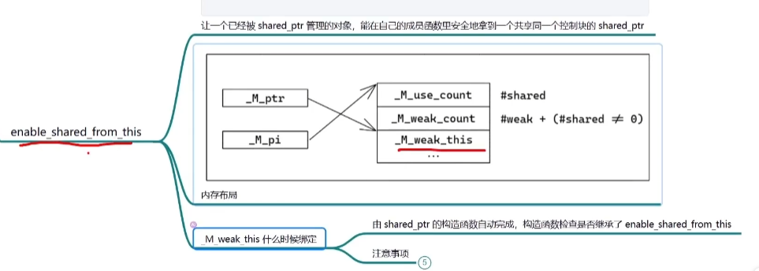

**会在enabled_shared_from_this进行构造，把weak_ptr指针构造出来**，所以不能在构造函数进行shared_from_this

**shared_from_this**本身就是从weak_ptr获取对应shared_ptr

### weak_ptr的其他作用

weak_ptr指向shared_ptr

1. 能够查看对应的对象是否被销毁，是否强引用次数为0（作为观察者模式）

### auto,auto&,auto&&区别

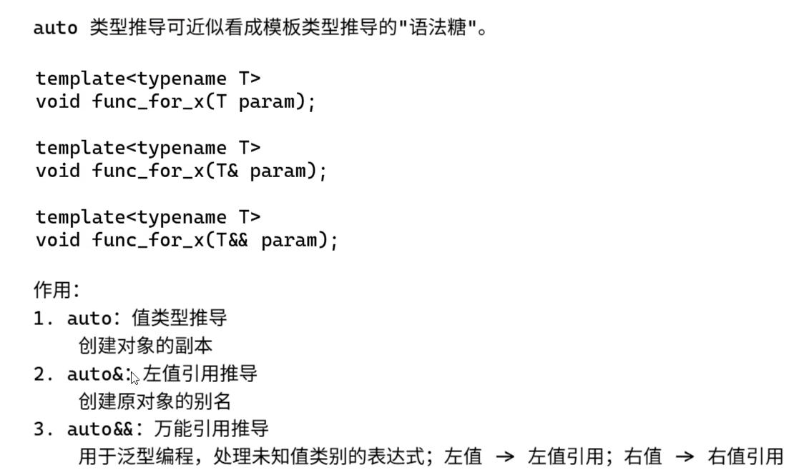

- 顶层const和底层const

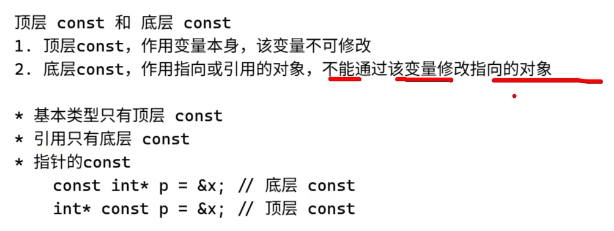

#### 类型推导区别

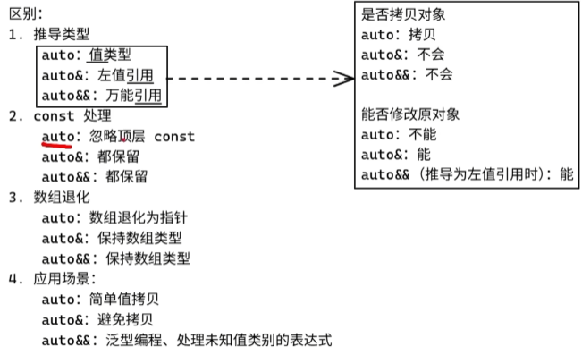

**值推导类型还会抛弃类型引用**

**auto**** 是万能引用，传入左值，类型变成（int& &&），传入右值变成右值引用（int&&），再通过引用折叠变成(int&)

### 完美转发

#### std::forward

> 传入非引用类型，返回就是右值（xvalue）；仅生成临时右值表达式
>
> 传入左值引用类型，返回就是左值

#### 万能引用 + std::forward才是完美转发

1. ```
   T&&
   ```

    万能引用（转发引用）

   - 传入左值：`T=int&`
   - 传入右值：`T=int`

2. ```
   std::forward<T>(arg)
   ```

   - 利用 `static_cast<T&&>` 还原出当初的值类别
   - 顺带使用引用折叠化简类型

**总：**万能引用根据传入实参的左 / 右值推导出 T（备忘录）；forward 拿着这份备忘录，恢复原始的值类别。引用折叠在两处负责化简非法的双重引用。

```
实参(左值/右值)
      ↓
万能引用T&&推导 → 设置备忘录 T
      ↓
引用折叠 → 得到arg的实际引用类型
      ↓
函数体内arg沦为左值（原值类别丢失）
      ↓
std::forward<T> 读取备忘录T，cast还原值类别
      ↓
inner 拿到和原始实参一样的值类别
```

**代码：**

```c++
template<typename T>
void outer(T&& arg)
{
    inner(std::forward<T>(arg));
}
```

### decltype

**基本运用**

```c++
int x = 0;
const int cx = x;
const int& rx = x;
decltype(x)  a = 1;    // int
decltype(cx) b = 1;    // const int
decltype(rx) c = x;    // const int&
```

#### 规则

```
struct Widget {
    int value;
};

Widget w;
decltype(w.value) x;   // int
```

规则 1：如果 expr 是没加括号的名字表达式或成员访问表达式，返回声明类型。

> 拓展对比：如果写成 `decltype((w.value))`，外层加上括号，就变成普通左值表达式，推导结果为 `int&`。

```c++
// expr 是 lvalue  -> decltype(expr) 是 T&
// expr 是 xvalue  -> decltype(expr) 是 T&&
// expr 是 prvalue -> decltype(expr) 是 T
#include <utility>

int x = 0;
decltype((x)) a = x;            // int&
decltype(x) b = x;              // int
decltype(std::move(x)) c = x;   // int&&
decltype(x + 1) d = x;          // int
```

**规则 2：**

1. `decltype(x)`：`x`是单独变量名，得到声明类型 `int`
2. `decltype((x))`：**双层括号**变成表达式，`(x)` 是左值 (lvalue) →推导为`int&`
3. `std::move(x)` 返回 xvalue (将亡值) →`int&&`
4. `x+1` 算术表达式是纯右值 prvalue →`int`

#### 落地场景

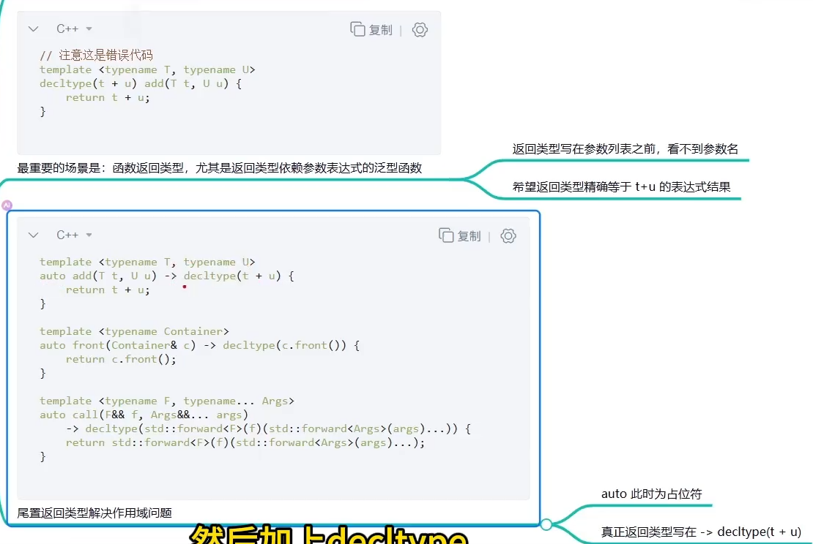

- 使用到返回值类型，用参数类型时，可以放到尾置返回类型解决作用域问题

### lambda

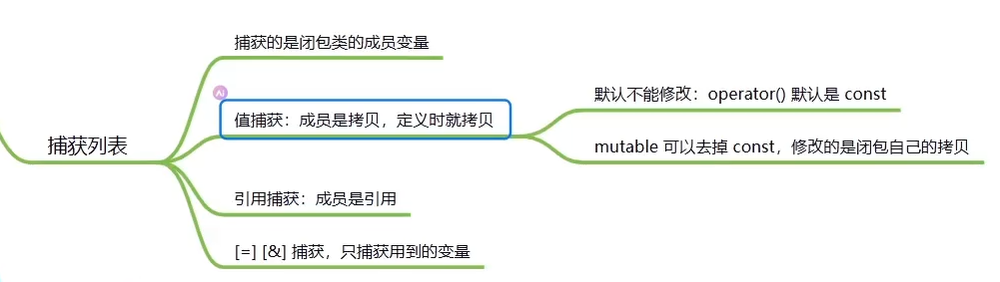

- 本身lamda生成的是类对象，重载了operator()的函数，修饰是const，所以无法改变类成员变量，如果是引用捕获则是指针（64位 8字节）

```c++
auto f1 = [](int x) mutable { return x + 1; };
```

**加了mutable之后，就可以修改值捕获变量**

#### lambda与函数指针关系

- 无捕获->无状态->可转为函数指针；因为会生成一个静态成员函数（通过转换运算符，调用函数指针来调用静态函数）
- 有捕获->带状态->装不进函数指针

#### 局限性

1. 参数类型写死->可以用万能引用变成模板进行
2. 不能捕获unique_ptr，因为是值捕获，会进行拷贝构造，但是unique_ptr不能进行拷贝构造，所以无法使用；-> 可以使用std::move进行移动资源

### 原子变量、内存序

- 原子变量用法

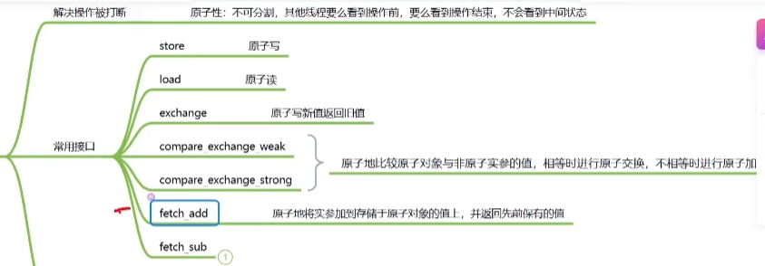

**因为每次都是完整性的，当一个线程在读写，另一个线程会等待，所以能保证线程安全性**

#### CAS

> compare_exchange_weak 和 compare_exchange_strong 是 C++ 中 CAS（Compare-And-Swap，比较并交换）的两种形式。
>
> **“如果当前值等于预期值，就改成新值并返回 true；否则把最新值填入预期值，并返回 false。”**

- **compare_exchange_strong：** 必定成功，写入新值，返回 true。
- **compare_exchange_weak：** 绝大多数时候成功，但可能因为底层硬件的某些干扰（如 CPU 中断、上下文切换、缓存行变动），**即使值完全相等，它也可能偶尔返回 false**。

> ### 为什么会有 weak 版本？（硬件原因）
>
> 你可能会想：既然 weak 会“莫名其妙地失败”，为什么不全部用 strong？
> 答案依然是：**为了不同 CPU 架构上的极致性能。**
>
> - **x86 架构（Intel / AMD）：**
>   - x86 硬件自带一条专门的汇编指令 CMPXCHG，这个指令本身就是“强”的，硬件上天然不会伪失败。
>   - 所以在 x86 上，weak 和 strong 生成的汇编代码通常**一模一样**。
> - **ARM / RISC-V / PowerPC 等架构（主流移动端和嵌入式）：**
>   - 这些 CPU 没有单个的 CAS 硬件指令，而是用一对指令来实现的（叫做 **LL/SC**：Load-Linked / Store-Conditional）。
>   - 在这两个指令执行的极其微小的间隙里，如果有任何硬件中断发生，就会导致修改失败（伪失败）。
>   - **如果要实现 strong：** 编译器必须在底层多套一层**内部循环**，如果发生伪失败就偷偷重试，直到真的成功或者真的不相等为止。这会带来额外的指令开销。
>   - **如果要实现 weak：** 编译器只需要执行一次 LL/SC，失败了就直接把结果甩给程序员。

**记住一条最简单的原则：**有循环用 weak，没循环用 strong。

- 内存序

> ## 1. `std::memory_order_seq_cst` 顺序一致（默认，代价最高）
>
> - 每个 seq_cst 操作既是 acquire 又是 release
> - 语义：最符合直觉，所有原子操作仿佛按照某一个**全局单一总顺序**依次执行
>
> ```c++
> flag.store(true, std::memory_order_seq_cst);
> flag.load(std::memory_order_seq_cst)
> ```
>
> ## 2. memory_order_release + memory_order_acquire（成对使用，线程间数据传递）
>
> - 约束：这个 load **之后**的所有读写操作，不能重排到它之前
> - 语义：相当于 “接收”：线程先读到标记，之后才能看到发布线程封装的所有数据
>
> **写线程 store‑release，读线程 load‑acquire；建立happens‑before关系**
>
> ```c++
> 	data = 100;
>     // store‑release: 本线程 store 之前所有读写不能重排到后面
>     flag.store(true, std::memory_order_release);
>     // load‑acquire: 本线程 load 之后所有读写不能重排到前面
>     while (!flag.load(std::memory_order_acquire))
>     {
>     }
>     // 保证看到 producer 在 flag 之前写入的 data=100
>     std::cout << data << std::endl;
> ```
>
> ## 3. `std::memory_order_relaxed` 宽松，代价最低
>
> - 不建立任何跨线程的顺序、可见性保证
> - 其他内存操作可以任意重排到它的前面或者后面
> - 使用场景：**只要求计数正确，不关心它和其它数据的相对顺序**，例如原子计数器
> - **我只在乎这个数字自增不会被多线程弄坏（保证原子性）**,如果不加这个参数，默认的是`std::memory_order_seq_cst`；
>
> ## 4. `std::memory_order_acq_rel` 获取‑释放（读‑改‑写操作）
>
> - 适用操作：`fetch_add`、`fetch_sub`、`compare_exchange_*` 这类读写一体的原子操作
> - 语义：**同时具备 acquire + release 两种语义**

#### compare_exchange_strong 使用 acq_rel 的例子

```c++
// 成功时: acq_rel；失败load: acquire
    val.compare_exchange_strong(expected, 1,
        std::memory_order_acq_rel,
        std::memory_order_acquire);
```


## STL容器

### STL容器是线程安全的吗？你怎么样在多线程的 环境下使用容器？

只有读是线程安全的，如果有写的情况下使用mutex或者autmoic实现

### 哈希表的底层实现，哈希平衡算法？

由数组和哈希函数（将对应数据映射到数组索引）实现

冲突处理：

1. 链地址
2. 开放地址：在数组内寻找下一个空闲位置来存储冲突的 元素。

开放地址（探测方式）：

 1. .线性探测（Linear Probing）：线性地检查下一个位置。

    依次往后找：`(原下标 + 1) % 容量`、`(原下标 + 2) % 容量`

 2.  二次探测（Quadratic Probing）：按二次函数探测下一个位置。

​		步长按平方递增：`(原下标 + i²) % 容量`（i=1,2,3…）

3. 双重哈希（Double Hashing）：使用第二个哈希函数计算探测步长。

哈希平衡算法： 1）负载因子（Load Factor）：负载因子是**元素数量**与**数组大小**的比值。高负载因 子意味着数组较满，增加冲突概率；低负载因子则浪费内存。 2）动态扩容：当负载因子超过**阈值**时，哈希表会进行扩容。扩容时通常将数组大小 增加到原来的两倍，然后重新计算所有元素的哈希值，重新插入新数组中。 3）动态缩容：当负载因子低于某个阈值时，哈希表可能进行缩容，以节省内存。缩 容同样需要重新计算所有元素的哈希值并重新插入。？

### Vector底层实现？Vector默认大小？扩容机制？

1. 数据结构，存储方式，访问效率
2. 0字节
3. 1.5~2倍

### Vector与List的区别？

1. 数据结构，存储方式，访问效率，插入、删除效率

### STL中list与deque之间的区别？

1. 数据结构，内存布局，访问效率，插入、删除效率

### map插入方式有哪几种？区别是什么？

insert ：返回插入结果的指示器和布尔值，表示是否插入成功； 

​	```	先在外层构造临时对象，再把临时对象拷贝 / 移动到容器里；```

operator[]： 插入或修改元素；

emplace ：直接构造元素，避免不必要的拷贝和移动操作，提高效率

​	``直接在容器的内存空间里原地构造对象，跳过临时对象与拷贝 / 移动，效率更高。直接在 vector 已分配的内存上创建对象``

```c++
list<Student> lst;
lst.emplace_front("Zhao", 21);
# "Zhao", 21构造的对象在容器内存中
```


### 迭代器失效情况

迭代器失效是指在容器进行插入、删除或扩容操作后，原有的迭代器可能变得无效。 不同容器的迭代器失效情况不同，

std::vector 在插入、删除、扩容操作后迭代器失效； 

std::list  std::map std::set在删除元素后，指向被删除元素的迭代器失效；std::deque 在插 入、删除、扩容操作后迭代器失效。

### vector容器避免push_back时扩展容器开销 的办法。

使用 reserve 方法预分配足够的容量，可以避免在使用 push_back 插入元素时多次 扩展容器的开销
**reserve是分配内存大小，不创建或初始化元素；vector<int> v(1000, 0)是构造初始化1000次元素，且不能用Push_back**

### vector的resize()和reserve()区别?

resize 用于改变 vector 的大小，并且如果新大小大于原大小，会初始化新元 素。reserve 用于预分配内存，但不改变 vector 的大小，仅改变容量，以减少多次分配 内存的开销

### 描述priority_queue的底层原理及使用场景

底层原理：std::priority_queue是基于堆实现的，通常使用std::vector作为底层容 器，并通过堆算法（如std::make_heap、std::push_heap和std::pop_heap）来维护 堆结构。

 使用场景：适用于需要快速访问最大或最小元素的场景，如任务调度、事件驱动的模 拟、路径搜索算法等

### insert 和 emplace 的区别

> #### 使用 insert（或 push_back）
>
> codeC++
>
> ```
> std::vector<Item> vec;
> vec.reserve(5); // 预分配，排除扩容干扰
> 
> // 插入新元素
> vec.insert(vec.end(), Item("苹果", 10));
> ```
>
> - **执行步骤**：
>   1. 在语句中先创建临时对象：调用 Item("苹果", 10) **[构造函数]**；
>   2. 传入 insert，通过右值移动进容器：**[移动构造]**；
>   3. 分号结束，销毁外部的临时对象：**[析构函数]**。
> - **总开销**：1 次构造 + 1 次移动构造 + 1 次临时对象析构。
>
> ------
>
> 
>
> #### 2. 使用 emplace（或 emplace_back）
>
> codeC++
>
> ```
> std::vector<Item> vec;
> vec.reserve(5);
> 
> // 直接传入构造参数！不要自己写 Item(...)
> vec.emplace(vec.end(), "苹果", 10);
> ```
>
> - **执行步骤**：
>   1. 容器在内部申请好 raw 内存空间；
>   2. 利用 **Placement New**，直接把参数 "苹果", 10 转发给构造函数，在目标内存上原地构造：**[构造函数]**。
> - **总开销**：**只有 1 次构造，0 次移动，0 次临时对象析构！**
>
> ------

### insert和push_back的区别

> | 维度                    | push_back                                                | insert                                            |
> | ----------------------- | -------------------------------------------------------- | ------------------------------------------------- |
> | **插入位置**            | **仅限容器尾部**                                         | **任意位置**（通过迭代器指定）                    |
> | **参数形式**            | 仅接收元素值：push_back(val)                             | 必须传迭代器：insert(pos, val)，还支持批量插入    |
> | **时间复杂度 (vector)** | **均摊 `O(1)O(1)`**（无需移动已有元素）                  | **`O(N)O(N)`**（插入点之后的元素必须全部后移）    |
> | **返回值**              | void（无返回值）                                         | **iterator**（指向新插入元素的迭代器）            |
> | **支持的容器**          | 仅支持有尾部概念的序列容器 (vector, deque, list, string) | **几乎所有 STL 容器**（包括 map, set 等关联容器） |

### 何时应使用forward_list

forward_list 的特点：std::forward_list是单向链表，内存占用更少，因为它只存 储一个指向下一个元素的指针。 使用场景：适用于内存有限且只需要单向遍历的场景，例如读取大量数据并进行线性 处理的操作

### std::vector::at() std::vector::operator[]的区别是什么

at()：提供边界检查，如果访问越界会抛出std::out_of_range异常。 operator[]：不提供边界检查，访问越界会导致未定义行为

**都返回的是元素引用**	

### STL 中排序算法如何工作？它们如何与容器互 动（stl::sort())？

由 **快速排序（QuickSort）**、**堆排序（HeapSort）** 和 **插入排序（InsertionSort）** 三者结合

```text
数据输入
                  │
                  ▼
         [ 数据量 <= 16 ? ] ─── 是 ───> 插入排序 (InsertionSort)
                  │ 否
                  ▼
       [ 递归深度 > 2*log(N) ? ] ── 是 ──> 堆排序 (HeapSort)
                  │ 否
                  ▼
         快速排序 (QuickSort)
     (三数取中选 Pivot + 分区递归)
```

> ##### ① 第一阶段：优化的快速排序（主力军）
>
> - 角色：作为主算法，负责绝大部分数据的切分和初排。快速排序在绝大多数场景下常数最小、缓存命中率最高。
> - 三数取中法（Median‑of‑Three）：为了防止快排选到极端的 Pivot（比如数组已经有序时选到最小值），STL 会取当前区间的 `first`、`mid`、`last` 三个位置的元素，取它们的中间值作为枢轴（Pivot）。
>
> ##### ② 第二阶段：堆排序（安全气囊 / 防止最坏情况）
>
> - 背景：虽然有三数取中，但极端恶意的构造数据仍可能导致快排退化为 $O(N^2)$，并且递归过深会导致调用栈溢出。
> - 机制：算法内部维护了一个最大递归深度计数器（通常设为 $2 \times \log_2(N)$）。
> - 触发条件：一旦快排的递归深度超过了这个阈值，说明分区极度不均匀，算法会立即放弃快排，直接转用堆排序（`std::partial_sort` 底层）。
> - 效果：堆排序能硬性保证最坏情况下的时间复杂度依然是稳定的 $O(N \log N)$。
>
> ##### ③ 第三阶段：插入排序（收尾 / 小数组利器）
>
> - 背景：当切分后的子序列长度很小（STL 源码中通常定义阈值为 16）时，快排的递归开销、函数调用栈代价反而比简单的 $O(N^2)$ 算法还要大。
> - 机制：
>   - 当子区间大小 $\le 16$ 时，快排直接停止切分并返回，此时整个数组处于“基本有序”(Almost Sorted) 的状态。
>   - 在所有递归结束后，对整个数组统一执行一次插入排序。
> - 效果：插入排序在面对“基本有序”或极小数据量时效率极高，接近 $(O(N))$，且几乎没有函数调用开销。

### STL迭代器和指针有什么区别

迭代器：抽象化容器的访问，不一定是指针。提供统一的接口用于访问不同类型的容 器。 

指针：实际的内存地址表示，适用于数组等

### deque的实现

数据结构：**多段连续内存块 + 一张中控索引表**，整体叫**分段数组结构**。

随机访问：通过「中控表定位块 + 块内偏移」计算地址，模拟连续访问，所以提供**随机访问迭代器**，**中控表本身也是一个动态数组**

增删 ：

​	尾部追加：当前尾块有空闲就直接放；块满则新分配内存块，把块地址加入中控表。

​	头部插入：当前头块有空闲就直接放；块满则向前分配新块，地址写入中控表前端。

​	中间插入：

1. 在**同一个内存块**的中间插入 / 删除元素，每个内存块本身是**连续数组**。会导致这块内存的所有迭代器失效
2. 中间插入导致**新增内存块 / 中控表扩容**，中间插入指针会让整个中控表元素后移**；所有迭代器里的 `node`（指向中控表的指针）全部失效；因为分配的中控表初始量比较大，所以很难失效

### 常用STL底层实现

| STL 容器         | 底层实现结构           | 特点                                 |
| ---------------- | ---------------------- | ------------------------------------ |
| `vector`         | 动态数组               | 支持快速随机访问，动态扩容。         |
| `deque`          | 多个固定大小数组       | 两端可扩展，随机访问。               |
| `list`           | 双向链表               | 支持快速插入和删除。                 |
| `set`            | 平衡二叉树（红黑树）   | 元素唯一，自动排序。                 |
| `map`            | 平衡二叉树（红黑树）   | 基于键值对，自动根据键排序。         |
| `unordered_set`  | 哈希表                 | 元素唯一，快速访问。                 |
| `unordered_map`  | 哈希表                 | 基于键值对，快速访问。               |
| `stack`          | 通常使用 deque 或 list | LIFO（后进先出）操作。               |
| `queue`          | 通常使用 deque         | FIFO（先进先出）操作。               |
| `priority_queue` | 通常使用 vector        | 堆结构，支持快速最大或最小元素访问。 |

### map和set插入删除有啥区别

只查看健是否存在，存在失败，不存在创建；底层都是红黑树

### 哈希表中的哈希冲突方法

> #### 1. 链地址法 / 拉链法（Separate Chaining）—— **最常用**
>
> - **原理**：哈希表的每个槽位（Bucket）不直接存数据，而是存一个**链表的头指针**。所有哈希值相同的元素，都依次挂在这个链表后面。
> - **优点**：处理冲突极简单，删除节点方便，绝不会出现“表满了存不下”的问题。
>
> #### 2. 开放定址法（Open Addressing）—— **这就是你提到的“探测算法”**
>
> - **原理**：所有数据都直接存在哈希数组内部（不用链表）。如果算出的位置已经被占了，就按照某种**探测规则**去寻找数组中的“下一个空闲位置”。
>
> - **常见的探测算法包括**：
>
>   - **线性探测（Linear Probing）**：冲突了就看下一个位置
>
>     - *缺点*：容易产生**聚集效应（Clustering）**，即连续的一大片区域都被占满，导致后续冲突概率急剧上升。
>
>   - **二次探测 / 平方探测（Quadratic Probing）**：冲突了跳跃着找
>
>     - *优点*：有效缓解了线性探测的聚集问题。
>
>   - **双重散列 / 双哈希（Double Hashing）**：引入第二个哈希函数 
>
>     。如果冲突，步长由第二个哈希函数决定
>
>     - *优点*：探测步长与 Key 相关，分布极其均匀，是开放定址法中最优秀的方案之一.
>
> #### 3. 再哈希法（Re-Hashing / 双/多哈希）
>
> - **原理**：准备一组不同的哈希函数 
>
>   ```
>   H1,H2,H3...H1,H2,H3...
>   ```
>
> - 当 
>
>   ```
>   H1(key)H1(key)
>   ```
>
>    发生冲突时，尝试计算 
>
>   ```
>   H2(key)H2(key)
>   ```
>
>   ；如果还冲突，再算 
>
>   ```
>   H3(key)H3(key)
>   ```
>
>   ，直到找到一个空位置。
>
> - **缺点**：增加了大量的计算时间开销。

### 哈希计算

> 1. **算位置**：用哈希算法直接算出应该去哪个位置（ 定位）。O(1)
> 2. **验身份**：进去后直接比对真实值（==）。
> 3. **出结果**：
>    - **只要发现一样** **立马停止，判定重复，直接放弃插入**。
>    - **比了一圈全都不一样**  判定为新元素，**直接存入**该位置（挂到链表末尾）。

## 策略

| **简单工厂** | **对象创建**   | 将实例化具体类的 if-else 集中到一个静态函数中。（switch type) |
| ------------ | -------------- | ------------------------------------------------------------ |
| **工厂方法** | **对象创建**   | 用继承多态来创建单个对象（最正统的“虚构造”）。<br />通过父类多态，调用对应子类来执行不同方式 |
| **抽象工厂** | **产品族创建** | 创建成套的、有关联关系的多类对象（如跨平台UI组件）。<br />一个多态类定义一个个方法，再用一个多态类封装多个之前创建的方法 |
| **策略模式** | **行为算法**   | 将不同的算法封装在独立类中，支持运行时自由切换。<br />就是根据抽象接口的父类，然后在运行时，根据创建对象来找到对应类的虚函数进行执行 |

## 锁

### std::lock_guard  std::unique_lock

| 功能对比                         | std::lock_guard        | std::unique_lock               |
| -------------------------------- | ---------------------- | ------------------------------ |
| **自动加锁/自动解锁**            | ✅ 支持 (RAII)          | ✅ 支持 (RAII)                  |
| **中途手动 .unlock() / .lock()** | ❌ **不支持**           | ✅ **支持**                     |
| **配合 std::condition_variable** | ❌ **不支持**           | ✅ **必须用它**                 |
| **延迟加锁 (std::defer_lock)**   | ❌ 不支持               | ✅ 支持                         |
| **尝试加锁 (try_to_lock)**       | ✅ 支持 (仅构造时)      | ✅ 支持随时 try_lock()          |
| **所有权移动 (std::move)**       | ❌ 不支持               | ✅ 支持                         |
| **性能/内存开销**                | **极低（零开销抽象）** | 极小（多维护一个 bool 标记位） |

**所以wait需要unique_lock，因为需要中途加锁解锁**

### 消费者和生产者

- wait的具体操作

```
void consumer() {
    std::unique_lock<std::mutex> lock(mtx); // 1. 这里加上了锁 【当前状态：有锁 🔒】

    // 2. 进入 wait：
    //    a. 内部把锁释放掉 【变成：无锁 🔓】
    //    b. 睡觉，等待被唤醒...
    //    c. 被唤醒！
    //    d. 内部重新把锁抢了回来 【变成：有锁 🔒】
    //    e. 确认 ready 为 true，wait 函数结束返回
    cv.wait(lock, [] { return ready; }); 

    // 3. 执行到这里时，锁依然牢牢在你的手里！【当前状态：有锁 🔒】
    // -------------------------------------------------------------
    // 这里做任何操作都是线程安全的！别的线程绝对进不来！
    data_queue.pop(); 
    // -------------------------------------------------------------

} // 4. 退出花括号作用域，lock 自动析构，在这里才真正释放锁 【最终释放：无锁 🔓】
```

### std::condition_variable

- notify_one：只需要一个线程操作
- notify_all：需要唤醒所有线程操作

### 动态库和静态库的区别

| 对比维度               | 静态库（Static Library）                           | 动态库（Dynamic Library）                          |
| ---------------------- | -------------------------------------------------- | -------------------------------------------------- |
| **文件后缀 (Windows)** | .lib                                               | .dll（通常伴随一个引导用的 .lib）                  |
| **文件后缀 (Linux)**   | .a (Archive)                                       | .so (Shared Object)                                |
| **文件后缀 (macOS)**   | .a                                                 | .dylib / .framework                                |
| **链接/加载时机**      | **编译链接时**打包进可执行文件                     | **程序启动或运行时**动态加载                       |
| **可执行文件体积**     | **大**（包含了库的全部代码）                       | **小**（只包含库的符号信息）                       |
| **部署便利性**         | **极高**（单个 .exe 到处跑，无需依赖）             | **较低**（必须随程序附带 .dll/.so）                |
| **更新与维护**         | **困难**（改库代码必须**全量重新编译**）           | **极方便**（只要接口不变，**直接替换库文件**即可） |
| **内存与磁盘占用**     | **浪费**（10个程序用同一个库，内存中就有10份拷贝） | **节省**（多个程序在内存中**共享同一份代码段**）   |
| **运行速度**           | **略快**（直接寻址，无间接调用开销）               | **极微小的性能损耗**（需通过符号表寻址）           |

