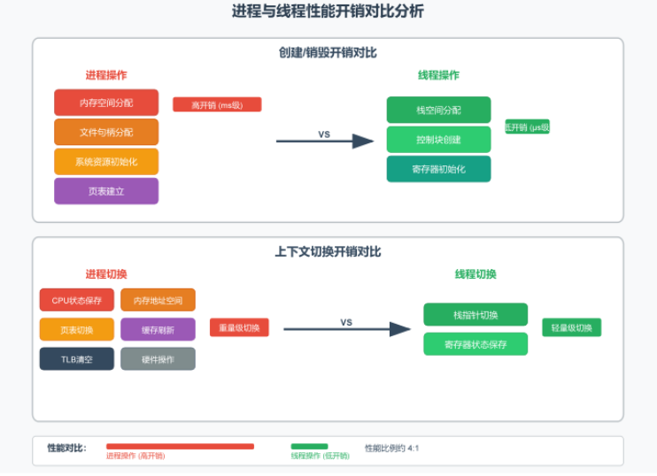
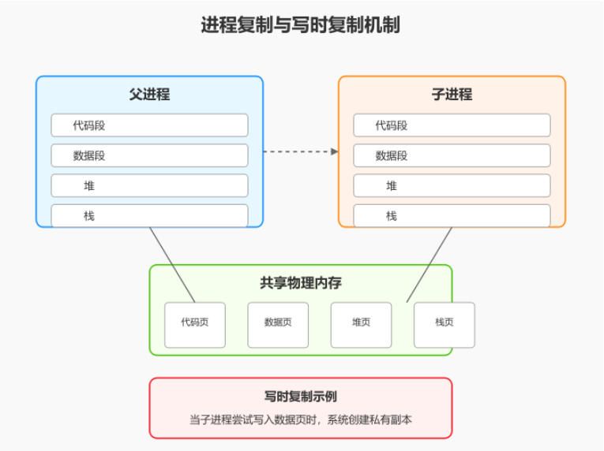
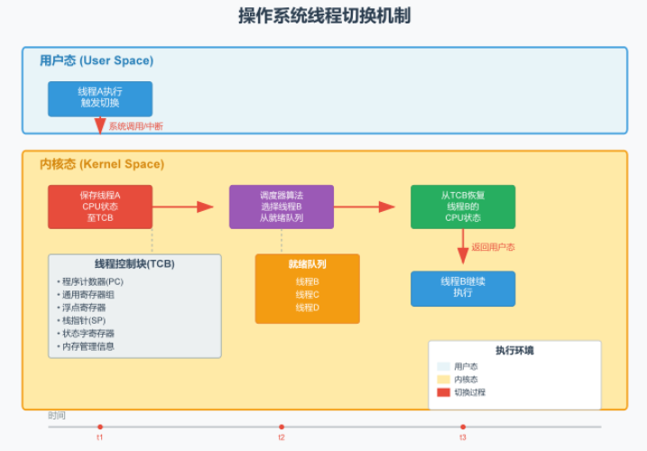
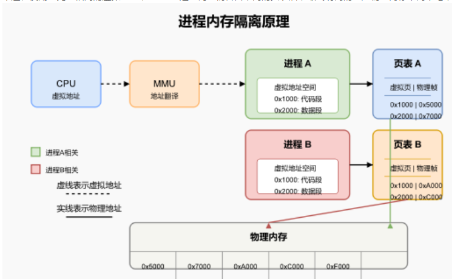
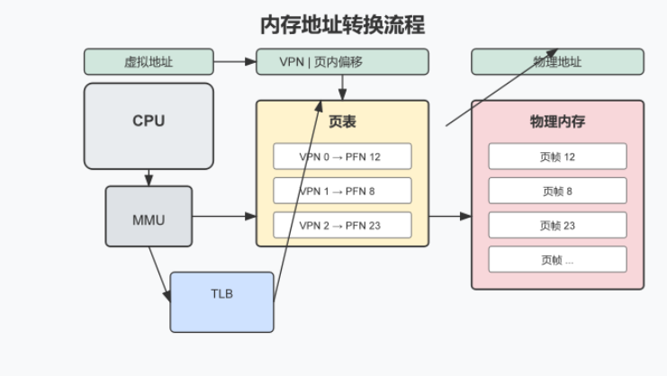
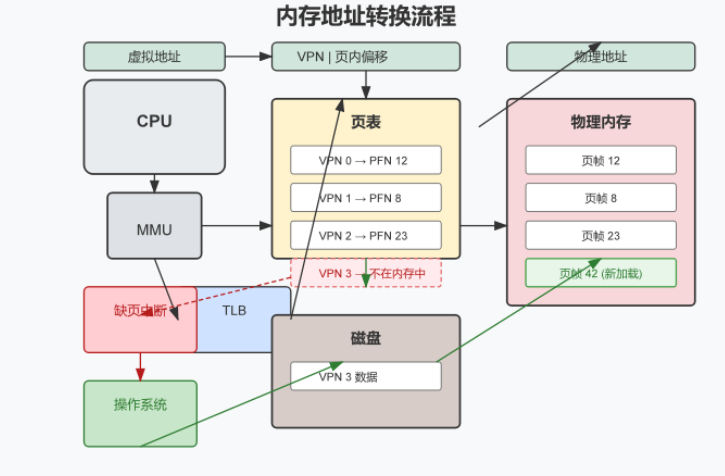

### 线程独占什么资源？在切换时内核执行了哪些操 作？

独占了程序计数器，对应寄存器（通用，索引，栈），线程栈，线程特定数据

内核操作：1. 保存线程状态，更新调度结构（将旧线程放入阻塞/就绪线程队列），从TCB（线程控制块）加载新线程状态，内核栈切换，刷新CPU处理器缓存

- **为了实现“并发执行”与“独立运行”**。用来线程上下文切换

### 线程和进程开销



### 一个可执行文件如何变成进程

创建进程->分配PCB->分配虚拟地址内存空间->加载可执行文件映射到虚拟内存->加载依赖库->初始化程序运行环境->设置程序计数器PC为程序入口地址->进程放入就绪队列，等待CPU调度进程

### 僵尸进程、守护进程和孤儿进程的区别

僵尸进程：终止了但是一直在进程表中占位置（因为父进程没有正确处理子进程终止状态）；解决：需要父进程 调用wait()来清 理。

守护进程：系统一直保留保护系统正常运行（用于处理 系统级任务）；

孤儿进程：父进程结束了但是子进程还在运行；解决：由系统自动管理

### fork与system调用的区别？

fork:是程序调用子进程，继承父进程地址空间，文件描述符，但是有独立的进程ID,PCB；父子默认并发，父不自动等待

system:内部封装 fork+exec+wait；执行一个命令字符串，通过创建子进程执行，父进程等待子进程完成

### fork进程过程



子进程还是会进行共享资源，只有到需要写的时候才会创建内存来放入对应的资源

- **在 fork() 刚创建子进程时：**
  子进程会复制父进程的“虚拟内存页表”，但**不会真正复制物理内存**。此时，父进程和子进程的虚拟内存实际上**指向同一块物理内存**。操作系统会将这些共享的物理内存页标记为**只读（Read-Only）**。
- **当发生“写”操作时（任一方）：**
  如果父进程或子进程**尝试修改**某块内存：
  1. CPU 会检测到该内存页是“只读”的，触发一个**缺页异常（Page Fault 中断）**。
  2. 操作系统捕获这个中断，发现这是写时复制的页面。
  3. 操作系统在物理内存中**开辟一块新的物理页**，把原来的数据复制过去。
  4. 修改写入方的虚拟内存映射，让它指向新的物理页，并将权限改为**可读写**。
  5. 写入方在新内存页上完成修改，而另一方依然使用原来的物理页，互不干扰。
- 例子：
  - 假设你的程序数据段有 **100MB**。子进程现在修改了其中的一个整型变量 a = 10;。
  - 操作系统只会把变量 a 所在的**那一个 4KB 大小的物理内存页**复制一份给子进程。
  - 至于数据段中剩下的 99.996MB 内存，**依然保持父子共享**，直到某一方去写其他页时，才会逐页复制。
- **父进程写，也会触发复制：**
  不仅是“子进程写”会创建新内存，如果子进程不写，而**父进程去写**，同样会触发操作系统的内存复制，操作系统会为父进程分配新内存，原来的物理内存留给子进程。
- **并非所有资源都是 COW：**
  - **普通内存（代码段、数据段、堆、栈）：** 遵循写时复制（代码段通常全程只读共享）。
  - **文件描述符（File Descriptors）：** 复制了文件描述符表，但底层的“打开文件表项”是共享的（即父子进程共享同一个文件读写偏移量 offset）。
  - **真正的共享内存（IPC Shared Memory）：** 如果程序中显式使用了 mmap(MAP_SHARED) 或 shmget，这些内存在写入时**不会**复制，而是直接被父子进程共同修改。

### fork实际操作

在父进程中，fork () 返回新创建的子进程的进程 ID（ PID ），这是一个大于 0 的整数。父进程可以利用这个 PID 来跟踪或管理子进程，比如，使用 wait () 函数等待子进程结束。在子进程中，fork () 返回 0。子进程可以通过检查这个返回值为 0 来得知自己的身份，并开始执行与父进程不同的代码路径，比如通过 exec () 系列函数加载并运行一个全新的程序。如果 fork () 调用失败，它会返回‑1，并且不会创建子进程。

### 在多进程方向中如果有其他进程挂掉你这边会怎么处理呢？

当子进程异常终止时，内核会向父进程发送一个 SIGCHLD 信号。我们会在父进程中捕获这个信号，并立即调用 waitpid () 函数。这个函数不仅能防止子进程变成僵尸进程，更重要的是，它能返回子进程的退出状态码，让我们能精确判断出进程是正常退出，还是因段错误等致命信号而被终止的。

在检测到进程崩溃后。第一步是记录详细的现场日志，包括崩溃的进程 ID、退出信号、时间戳等关键信息。然后执行资源清理，释放该进程可能持有的共享内存、文件锁或数据库连接。最后，根据预设的策略，重新拉起一个新的工作进程。

### 进程如何实现访问隔离（win vs linux）

win:

1. 引入完整性级别，确定进程与其他对象之间交互权限的机制，比如：一个低完整性的进程不能写入一个高完整性级别的对象
2. 使用访问令牌和安全描述符实施安全策略，每个进程都有关联的访问令牌，控制访问权限
3. 为每个进程分配虚拟地址，通过页表来隔离不同进程的内存访问

linux:

1. 为每个进程分配虚拟地址，通过页表来隔离不同进程的内存访问
2. 通过内核态和用户态分隔权限，只能通过中断调用系统函数
3. 使用cgroup和权限，隔离进程资源使用

### 进程不可以忽视的信号

1. SIGKILL:用于强制终止进程
2. SIGSTOP：强制停止进程的执行

### 用户级线程和内核级线程的区别？

用户级线程：

1. 线程管理：创建，管理，销毁都在用户态进行，不需要内核参与
2. 上下文切换：上下文切换都在用户态（由自己代码实现）
3. 线程运行：单个线程发起阻塞 IO → 进程整体陷入内核阻塞，该进程内所有**用户级线程**全部阻塞；（因为如果没有设置异步阻塞，而是 同步阻塞 的话，对应的内核线程就会阻塞在执行该用户线程中）
4. 多线程调用：无法利用多核 CPU，不能被内核并行调度到多个核心，因为内核看不到内部的多线程，可以在用户态进行多线程管理(用户库实现单核分时调度)

内核级线程：

1. 线程管理：内核级线程的创建，管理，销毁都由内核执行
2. 上下文切换：切换需要从用户态切换到内核态，开销比较大，切换速度慢
3. 线程运行：内核级线程在创建、阻塞、切换、IO需要系统调用，开销比较大（可以用线程池解决）
4. 多线程调用：由操作系统调度，可以利用多核CPU管理每个线程分配多个核心，来并行执行多线程

### 进程可以创建多少线程，与什么有关

默认线程+进程数不超过4096个，一个进程会分配栈空间几百kb到几mb，查看系统内存是否足够

32位和64位的操作系统分配的虚拟空间也会影响可以创建多少个线程

### 32位和64位的区别

32位使用的2的32次方自己的虚拟空间，内核空间占用1gb，用户空间3gb

64位，只会用低48位，虚拟地址不会限制线程数

### 进程的状态及其转换

创建进程->将就绪进程放入就绪队列中等待cpu调度->调度后cpu执行->可能会因为io事件阻塞进入阻塞状态，或者时间片轮转，将进程放入就绪队列->终止（执行完成）

### 进程，线程，协程的区别和使用场景

资源方面：进程是分配资源的最小单位，线程是共享进程资源，并分配自身需要的资源，协程则依附于线程运行共享线程资源（属于用户态的，切换都是在用户态上

计算方面：进程，资源需要隔离的，线程适合cpu计算密集的，协程适合使用简单的运算

切换开销：进程最大，线程比较小，协程开销几乎没有

### 进程的创建需要系统分配什么资源？

1. 内存空间
2. PCB（有PID）
3. 文件描述符表：存储进程打开的文件及其对应的文件描述符。
4. 分配的CPU时间片
5. 系统资源和权限

### 进程控制块 (PCB) 的作用是什么

存储的有：

1. PID/进程状态（标识唯一进程）
2. 程序计数器/通用寄存器，基址寄存器，限长寄存器（记录进程的当前状态，保存寄存器上下文）
3. 页表、段表（负责**虚拟地址→物理地址转换**、管控内存分配；cpu通过地址查找页表完成地址映射）
4. 优先级（进程的调度信息，通过优先级，时间片轮转分配时间来进行调度进程）
5. 用户ID和组ID（管理权限分配资源管理，防止进程获取私有资源）
6. 文件描述符表入口，IO·设备信息（记录进程打开的文件和读写的偏移量）
7. 信号处理机制/**进程间通信信息（管理进程通信，如管道、消息队列、共享内存，本地套接字）**

### 进程之间的通信

| 通信方式 | 特点                                                         | 优点                                                         | 缺点                                                         |
| -------- | ------------------------------------------------------------ | ------------------------------------------------------------ | ------------------------------------------------------------ |
| 管道     | 半双工，数据单向流动；只能在具有亲缘关系的进程间使用。       | 简单易用，无需额外库支持。                                   | 1. 只能单向通信。2. 只能用于亲缘进程。3. 缓冲区大小有限。    |
| 命名管道 | 可以在不相关的进程间进行通信；以文件形式存在于文件系统中。   | 1. 允许无亲缘关系的进程通信。2. 可用于多对一的通信。         | 1. 通信速度较慢。2. 仍然是半双工（某些系统支持全双工）。     |
| 共享内存 | 将同一块物理内存映射到不同进程的地址空间中，实现最高效的数据交换。 | 速度最快，因为数据不需要在内核和用户空间之间复制。           | 1. 需要额外的同步机制来避免竞态条件。2. 实现相对复杂。       |
| 消息队列 | 存放在内核中的消息链表，每个消息都有类型和数据。             | 1. 解决了管道的单向通信问题。2. 允许异步通信。3. 可以实现多对多通信。 | 1. 通信速度不如共享内存。2. 每个消息的大小和队列的总大小都有限制。 |
| 信号量   | 一个计数器，用于控制多个进程对共享资源的访问，主要作为同步和互斥的手段。 | 可以有效防止进程间的竞态条件，实现进程同步。                 | 1. 本身不直接传输数据。2. 使用不当可能导致死锁。             |
| 套接字   | 可用于不同主机间的进程通信，是网络编程的基础。               | 1. 通用性最强，可跨网络通信。2. 支持多种协议。3. 可实现双向通信。 | 1. 实现相对复杂。2. 对于本机通信，开销大于共享内存等方式。   |
| 信号     | 异步通知机制，用于通知接收进程某个事件已经发生。             | 用于处理异步事件，开销小。                                   | 1. 携带的信息量非常少。2. 容易中断正常的程序执行流程。3. 不适合作为主要的数据传输方式。 |
| 文件映射 | 将文件内容直接映射到进程的虚拟地址空间，进程可以像访问内存一样访问文件。 | 1. 处理大文件时非常高效。2. 内核负责数据的同步 3. 也可用于无亲缘关系的进程间通信。 | 需要同步机制来保证数据一致性。                               |

#### 匿名和命名通道的区别

- 匿名通道


> 匿名管道就像一个临时的、单向的 “水管”，它主要用于有亲缘关系的进程之间进行通信，比如父进程和子进程。当父进程创建一个子进程时，可以建立一个匿名管道，让它们之间可以互相传递数据。这个 “水管” 是无名的，只能由创建它的进程以及其后代进程看到和使用。一旦这些进程都结束了，这个管道也随之消失。它就像你们俩之间传纸条，别人看不到也用不了，你们聊完天，纸条也就扔了。


> 命名管道则更像一个公共的、有名字的 “邮箱”。它在文件系统中有一个具体的路径名，就像一个真实的文件。任何知道这个 “邮箱” 名字的进程，无论它们之间有没有亲缘关系，都可以通过这个名字找到它，并用它来通信。一个进程可以往里写信 (发送数据)，另一个不相关的进程可以从里面读信 (接收数据)。这个 “邮箱” 会一直存在，直到被明确地删除，即使创建它的进程已经结束了。它提供了一种更灵活、持久的进程间通信方式。

### 线程之间的同步方式有哪些

| 同步方式 | C++ 标准库支持                                         | 特点             | 优点                                    | 缺点                                           |
| -------- | ------------------------------------------------------ | ---------------- | --------------------------------------- | ---------------------------------------------- |
| 互斥锁   | std::mutex, std::recursive_mutex, std::timed_mutex     | 提供独占式访问   | 1. 简单、直观 2. 多种类型适应不同场景   | 1. 可能导致死锁 2. 影响性能 3. 不支持读‑读并行 |
| 条件变量 | std::condition_variable, std::condition_variable_any   | 等待特定条件成立 | 1. 避免忙等待 2. 解决生产者‑消费者问题  | 1. 使用复杂 2. 需与互斥锁一同使用              |
| 信号量   | std::counting_semaphore, std::binary_semaphore (C++20) | 控制访问资源数量 | 1. 适用于资源池管理 2. 处理资源数量同步 | 1. C++20 引入 2. 可能导致死锁                  |
| 原子操作 | std::atomic<T>                                         | 操作不可中断     | 1. 轻量，性能高 2. 适合计数器、标志位   | 1. 仅单操作原子性 2. 复杂数据结构难度高        |
| 读写锁   | std::shared_mutex (C++17)                              | 允许多读单写     | 1. 提高读多写少性能 2. 兼顾一致性和并发 | 1. C++17 引入 2. 可能导致写饥饿                |
| 屏障     | std::barrier (C++20)                                   | 线程同步点       | 1. 适用于分阶段任务 2. 简化逻辑         | C++20 引入                                     |

### 异步通信与同步通信的区别是什么

异步通信：发送方发完了可以做其他任务不阻塞，等待接收完毕再通知或者回调

同步通信：发送方等待接收方接收完毕才继续做其他任务，在期间中会阻塞等待

### 进程同步方式有哪些

1. 互斥锁
2. 读写锁
3. 信号量
4. 条件变量
5. 屏障

### 生产者消费者模型是如何工作的

依靠互斥锁保证队列安全、条件变量实现线程阻塞与唤醒，解决生产过快塞满、消费过快空取问题。

### 信号量和自旋锁的区别是什么

信号量靠的是pv操作进行同步互斥

>  P 申请资源不足 → **线程休眠阻塞，让出 CPU**，内核调度切换；
>
> V 释放资源 → 唤醒阻塞线程。

自旋锁抢不到锁**不会阻塞休眠，空转 CPU**；抢到锁后才锁住临界区。目的防止线程切换开销大；拿到锁之后执行临界代码然后解锁

### 多线程中的栈之间如何传递数据

1. 全局变量和共享内存（使用条件变量，线程安全队列用于同步）
2. 消息传递（消息队列，管道）

### 子进程修改父进程文件

子进程继承父进程的文件后，重新打开对应文件，为该进程创建独立的文件描述符表，独立的管理文件偏移量

### 管道会溢出吗？如何处理

会，但是读和写的缓冲区溢出时或者满了，空了会自动阻塞

### 操作系统最小单位是线程，那协程怎么实现？

通过用户空间实现的，创建协程，用协程调度器管理写成，用任务队列保存需要执行的任务分配到对应的写成，同步通信使用信号量来管理共享内存的同步

### 不同进程间是否可以共享内存吗？包括父子进 程。

unix_like ：可以使用shmget创建共享内存，shmat将进程的虚拟地址指针指向对应物理内存，shmctl销毁共享内存

windows：通过createfilemapping创建 / 打开内核文件映射对象获取句柄（**传 `INVALID_HANDLE_VALUE` 就是匿名共享内存（进程间共享），传磁盘文件句柄就是文件映射。**），通过mapviewoffile把映射对象映射到**进程虚拟地址空间**，返回起始指针，程序靠指针读写共享内存。

### 线程上下文切换



> 首先，通过系统调用或硬件中断，程序的执行流程从用户态陷入内核态。接着，操作系统内核会保存当前线程的上下文，包括将程序计数器、通用寄存器、浮点寄存器以及栈指针等 CPU 状态信息，保存到该线程的内核数据结构中，叫 “线程控制块”。然后操作系统的调度器会根据预设的调度算法从就绪队列中选择下一个要执行的线程。最后，内核会加载新线程的上下文，即将目标线程 TCB 中保存的寄存器状态和栈指针等信息恢复到 CPU 中。当控制权从内核态返回到用户态时，CPU 便会从新线程上一次被中断的位置继续执行，从而完成一次切换

### *如何使用互斥锁实现读写锁，特别是写者优先策 略？

1. 用互斥锁+条件变量
2. 读写锁允许多个线程同时读取共享资源，但在写入时则独占资源。其核心思想是读‑读不互斥，而读‑写与写‑写则互斥，适用于读多写少场景。通常通过 std::shared_mutex 实现：读取操作使用 std::shared_lock 来获取共享锁，允许多个并发读；写入操作则使用 std::unique_lock 来获取独占锁。

### 什么是死锁以及其条件？如何解决死锁问题

1. 互斥条件，有一个资源是非共享的，一个进程占有，则另一个进程无法占有需要等待
2. 持有和等待条件：一个资源已经持有了并且等待其他进程持有的资源
3. 非抢占条件：一个进程只有持有并且需要执行完才肯释放资源
4. 循环等待条件：每个进程都持有上一个进程资源，并等待下一个进程的资源，形成环形

解决：

1. 将资源设计共享
2. 进程要么一次性获取完毕，要么就等待申请新的资源
3. 如果无法申请资源，那么就释放自己占有资源
4. 统一所有资源申请顺序，固定从小到大申请资源

避免死锁：

银行家算法：系统在分配资源之前先检查这次分配是否可能导致系统进入不安全状 态，如果可能导致，就不分配这个资源。

### 内存屏障

1. 全局内存屏障：屏障前读写全部落到缓存，才执行屏障后读写
2. 读内存屏障：确保屏障之前完成读操作
3. 写内存屏障：同理
4. 依赖性屏障：只针对**地址依赖加载**（A 读取的地址来自前面 B 的运算），阻止依赖重排，属于特殊读屏障。保证先运算后再进行读取

> 主要用来对共享内存防止进行竞态，用来保证内存序执行，读到正确数据

### 条件变量本身**无保护临界区的能力，不能上锁**，只负责阻塞 / 唤醒线程、管理等待队列。

条件变量本身**无保护临界区的能力，不能上锁**，只负责阻塞 / 唤醒线程、管理等待队列。

资源、条件数据靠 mutex 保护

### 如何实现操作系统中的原子操作

操作系统通过**禁用中断创建临界区，防止上下文切换**，确保代码段在 执行过程中不被中断。主要用于单处理器系统或控制特定硬件交互。

### 介绍CAS中的ABA问题及其解决方案

CAS就是在写的时候写了新值，但获取的是旧值，最后又写回旧值；导致的ABA问题

> 线程 A `load`读出变量值 = A，准备 CAS；
>
> 其他线程：A→改成 B→再改回 A；
>
> 线程 A 执行 CAS：发现值仍是 A，CAS 成功，但中间数据被篡改过，逻辑出错，**这就是 ABA**。
>
> 无锁队列里就是：**节点地址 A 被释放，新节点恰好复用 A 地址**。

解决ABA问题：

使用原子操作绑定pair<变量，版本号>保证用的是最新的

### 描述不同类型的锁及其用途

1. 互斥锁：确保只有一个线程执行该代码段
2. 递归锁：允许同一个线程获取相同的锁
3. 读写锁：读可以无限读，写加锁独占，阻塞全部读 + 写
4. 自旋锁：通过空转cpu等待锁的释放来获取锁再执行

### 线程属性值如何修改？

在使用 POSIX 线程（**pthread**）编程时，可以通过 **pthread_attr_t **结构来设置和修 改线程的属性值。常见的线程属性包括栈大小、栈地址、调度策略和优先级、继承调度属 性、分离状态等

```c++
pthread_t thread;
pthread_attr_t attr;
int arg = 42;
size_t stacksize;
void* stackaddr;
// 初始化线程属性对象
pthread_attr_init(&attr);
// 修改栈大小
stacksize = 2 * 1024 * 1024; // 2 MB
pthread_attr_setstacksize(&attr, stacksize);
```

### 什么是虚拟内存和物理内存？区别和联系是什 么？

虚拟内存可以设置比物理内存大，虚拟内存通过页表，段表映射到物理内存，物理内存是存放真实的数据

### 如何将虚拟地址转换为物理地址？页表和内存管 理单元（MMU）的角色是什么



> 进程内存隔离依赖于存管管理单元 MMU 和页表管理的协作。当程序运行时，它所使用的所有地址都是虚拟地址。每当 CPU 需要访问一个内存地址时，MMU 会介入，并使用操作系统为当前进程维护的一张专属页表来进行翻译。这张页表就像一个翻译词典，记录着进程的虚拟内存 “页” 如何映射到计算机的物理内存 “帧”。因为操作系统确保了每个进程都拥有自己独一无二的页表，所以即便两个进程使用了完全相同的虚拟地址，MMU 通过查询它们各自不同的页表后，最终访问的也是物理内存中两个毫不相干的位置。

获取页目录表基地址，虚拟地址获取偏移量获取页目录索引，查找页表基址，虚拟地址获取偏移量计算页表索引，查找物理页框号，通过页框号+页内偏移量计算物理地址

> 1）获取页目录表基地址：从CR3寄存器中获取页目录表的基地址。 2）计算页目录索引：从虚拟地址中提取页目录索引。 3）查找页目录表：使用页目录索引从页目录表中查找页表的基地址。 4）计算页表索引：从虚拟地址中提取页表索引。 5）查找页表：使用页表索引从页表中查找物理页框号。 6）计算物理地址：将物理页框号与页内偏移组合，生成物理地址。

MMU：内存管理单元，负责将CPU生成的虚拟地址转换为物理地址

#### 流程

虚拟到物理的地址转换过程由 CPU 中的内存管理单元自动完成。当 CPU 需要访问一个虚拟地址时，它首先将该地址拆分为高位的 “虚拟页号” 和低位的 “页内偏移”，MMU 会查询由操作系统维护在内存中的页表。



通过虚拟页号作为索引，在页表中查找对应的条目以获取 “物理页号”。如果在查询时发现该页面数据不在物理内存中，便会触发 “缺页中断”，由操作系统从磁盘加载数据到内存并更新页表。一旦获取到物理页号，MMU 会将其与原始的 “页内偏移” 重新组合，形成最终的物理地址，CPU 便可通过此地址访问主内存中的数据。



```
[ 1. MMU 查表 ] 发现存在位为 0（物理页不存在）
       │
       ▼
[ 2. 触发缺页异常 (Page Fault) ] 硬件把 CPU 控制权交给操作系统内核
       │
       ▼
[ 3. 操作系统分配物理内存 ] 从空闲物理页框池中捞出一页 (4KB)
       │
       ▼
[ 4. 🌟 更改页表映射关系 (核心步) ] 将物理页地址填入 PTE，并将“存在位”置为 1
       │
       ▼
[ 5. 🌟 刷新 TLB (快表) ] 告诉 MMU 的硬件缓存：“映射关系变了，旧缓存作废”
       │
       ▼
[ 6. 重新执行原指令 ] CPU 再次执行刚才报错的那行汇编代码，此时 MMU 查表成功！
```

### 虚拟内存的优势

> 1. **隔离与安全**：每个进程拥有独立的地址空间，互不干扰；同时页表具备权限位控制（如读写执行分离、内核态与用户态隔离）。
> 2. **按需分配与突破物理限制**：支持**延迟分配（缺页中断）\**和\**内存换页（Swap）**，申请大内存时不占用实际物理资源，且能运行大于物理内存的程序。
> 3. **消除物理内存碎片**：页映射机制可以将物理上分散的 4KB 页面，在虚拟空间中拼接成连续的大块内存供程序使用。
> 4. **高效的数据共享**：方便了共享库、共享内存的实现，并使得 fork() 操作可以通过**写时复制（COW）**以极高的速度完成。”

### malloc底层实现原理

> ### 核心考点一：双轨制系统调用（brk vs mmap）
>
> malloc 并不是自己凭空造内存的，当它兜里没内存时，会找内核要。它会根据申请内存的大小（阈值通常是 **128 KB**）采用不同的系统调用：
>
> #### 1. 小块内存（< 128 KB）：使用 brk()
>
> - **原理**：将进程的**堆顶指针（_curbrk）向上推**。
> - **特点**：
>   - 只推指针，分配速度极快。
>   - **释放时不还给系统**：当调用 free() 时，内存**并不会立即归还给操作系统**，而是由 malloc 放入自己的**内存池（空闲链表）**缓存起来，留给下一次复用。
>   - **缺点**：容易产生内存碎片（比如堆顶的内存一直不释放，下面已经释放的内存就无法缩容还给系统）。
>
> #### 2. 大块内存（`≥≥` 128 KB）：使用 mmap()
>
> - **原理**：在进程虚拟地址空间的**文件映射区（自由空闲区）**单独找一块匿名内存映射出来。
> - **特点**：
>   - **释放时立即归还**：调用 free() 时，会立刻调用 munmap() 将这段虚拟内存彻底归还给操作系统内核。
>   - **缺点**：每次都要陷入内核态，且伴随 TLB 刷新，开销相对较大。
>
> ### 核心考点二：内存池管理与数据结构（ptmalloc 的 Chunk 和 Bin）
>
> malloc 拿到一大块内存后，如何细分切给用户？（以 Linux 默认的 ptmalloc 为例）
>
> 1. **基本单位：Chunk**
>    无论申请多大内存，malloc 返回给你的内存块前都有一个**元信息头（Header）**。
>    - Header 里记录了：上一个 Chunk 的大小、当前 Chunk 的大小、以及使用标志位（当前块是否空闲等）。
>    - 这就是为什么 free(ptr) **不需要传入内存大小**，因为指针往前移几个字节就能读出这个块有多大！
> 2. **空闲内存链表：Bins**
>    为了快速找到合适大小的空闲块，malloc 内部维护了多条链表（按大小分类）：
>    - **Fastbins**（极小内存，如 < 80B）：单向链表，采用 LIFO 策略，为了追求极致性能，**这里的块释放后不合并**。
>    - **Small bins**（小内存，如 < 512B）：双向链表，保证 FIFO。相邻的空闲块会**自动合并**成大块，防止内存碎片。
>    - **Large bins**（大内存）：按大小排序的双向链表，使用最佳适配（Best-Fit）查找。
>    - **Unsorted bin**：刚被释放的块临时呆的地方（缓冲区），下次分配时先来这里看能不能捡漏。
>
> ### 核心考点三：多线程竞争优化（Arena 机制）
>
> - 如果所有线程都用同一个内存池，多线程 malloc 时就必须加锁，导致性能暴跌。
> - **ptmalloc 的解决方案：引入 Arena（内存区）**。
>   - 有一个主内存区（Main Arena，基于 brk）。
>   - 多个线程时，会创建多个子内存区（Thread Arena，基于 mmap）。
>   - 核心数量限制：64 位系统下，Arena 的数量上限通常是 8×CPU核心
>   - 这样每个线程可以尽量访问独立的 Arena，**大大减少了多线程并发锁竞争**。
>
> ### 核心考点四：你提到的“缺页中断”放在哪一步？
>
> 把你的思路完美嵌入到整体流程中：
>
> > 无论是 brk 还是 mmap，操作系统分配的都**仅仅是虚拟内存（VMA）**。
> > 当用户第一次**真正往指针里写数据（读写访问）**时，CPU 硬件通过 MMU 发现没有对应的物理页表项，触发 **缺页中断（Page Fault）**，内核才会分配 4KB 的真实物理内存页并建立映射。

### malloc(1)分配了多少字节

> ### 原因一：管理元数据（Chunk Header 开销）
>
> 前面我们提到过，调用 free(p) 的时候，你并没有告诉系统你要释放多大的内存，那系统是怎么知道的？
> 因为 malloc 分配的每一块内存（Chunk），前面都紧跟着一个由分配器自己维护的“**头部信息（Header）**”。
>
> 在 64 位系统下，这个头部通常占用 **16 字节**：
>
> 1. **前 8 字节（prev_size）**：记录前一个相邻空闲块的大小（用于物理相邻块的合并）。
> 2. **后 8 字节（size）**：记录当前块的大小，以及几个标志位（标记前一个块是否空闲等）。
>
> 你拿到的指针 p，实际上是跳过了这 16 个字节的头部后，指向的可用数据区的起始地址。
>
> ### 原因二：内存对齐（Alignment）与最小分块（Minimum Chunk Size）
>
> 1. **硬件内存对齐要求**：
>    - 现代 CPU 读写内存不是一个字节一个字节读的，而是以 8 字节或 16 字节为单位进行的。
>    - 在 64 位 Linux 下，为了兼容所有的基础数据类型（如 long double、SIMD 指令集 __m128），glibc 规定动态分配的内存地址**必须按 16 字节对齐**。
>    - 因此，分配出的总 Chunk 大小**必须是 16 字节的整数倍**。
> 2. **最小块大小限制（Min Chunk Size）**：
>    - 在 64 位系统下，一个 Chunk 哪怕再小，也不能无限小。因为当这个内存被 free() 释放后，它需要被塞入空闲链表（如 Fastbins 或 Small bins）。
>    - 变成空闲块后，原本放用户数据的空间要被用来存放**前驱指针（fd）\**和\**后继指针（bk）**，每个指针 8 字节。
>    - 头部 16 字节 + 指针 16 字节 = **32 字节**。
>    - 所以，在 glibc 的实现中，64 位系统下一个 Chunk 的**最小尺寸通常被硬性规定为 32 字节**（即使你只申请 1 个字节）。
>
> *(注：由于某些空间复用优化，在特定版本的 glibc 中，这个最小块可能被压缩对齐到 **24 字节**，但绝不可能是 1 字节。)*
>
> - 总
>
>   > malloc(1)，首先是元信息16字节，指针8字节，对齐后总共32字节，有些优化就会优化成24字节

### 操作系统如何分配和管理内存？解释 malloc 和 new 的内存分配机制

创建虚拟内存分配页表，将数据存入物理地址，通过mmu进行转换

> 进程先分配**全量虚拟地址空间（逻辑分段）**，
>
> 物理内存**用到才分配（懒加载  **:
>
> OS 为进程建立页目录、页表，**初期只建立虚拟地址，不分配物理内存**（惰性分配）。
>
> +
>
> **缺页**:
>
> CPU 访问虚拟地址→MMU 查页表缺页→触发缺页异常：
>
> 内核从空闲物理页池中拿物理页；
>
> 建立虚拟页 ↔ 物理页映射，更新页表；
>
> 代码 / 数据从磁盘拷贝进物理内存。

将内存划分为固定大小的块，称为页（Page），虚拟内存和物理内存都按页进 行管理。每个页通常为4KB。

malloc 内存分配：

1. 在堆上分配指定大小内存

实现机制：

1. 对于小块内存，从链表（维护的空闲内存块）中查找合适的块进行分配
2. 对于大块内存（默认 > 128KB）：通过brk或mmap系统调用向操作系统申请新的内存区域(映射匿名虚拟内存；)

释放内存：通过free函数释放内存，归还到链表分配

new内存分配：

原理：new是运算符，用于在堆上分配内存调用构造函数初始化对象

实现机制：

1. 调用malloc分配内存
2. 调用构造函数：在分配的内存调用对象的构造函数进行初始化

释放内存：通过delte运算符释放内存并调用析构函数

### 虚拟内存系统中的内存分配策略有哪些？连续与 非连续内存管理的区别

（老式）连续内存管理：通过固定分区进行分配

> 缺点：容易造成内存碎片，难以动态调整内存，利用率比较低
>
> 优点：能直接通过基地址和偏移量就能找到

非连续内存管理：通过分页进行分配

> 缺点：地址转换开销过大，需要通过页表和页内偏移实现找到物理地址
>
> 优点：内存碎片比较少，内存利用率比较高，能够实现内存保护，支持动态分配

### 内部碎片和外部碎片

内部碎片：出自【分页（固定 4KB 页）】，不是连续分配

- 连续分区：按进程实际大小分配，**几乎无内部碎片**；
- 分页固定 4KB 一页，进程用不满一页，页内剩余空间 =**内部碎片**（已分配、无法复用）。

外部碎片：频繁申请释放后，空闲内存切成零散小洞，总空间够、无连续大块→**外部碎片**；

分页物理页离散存放，不需要连续整块内存，**几乎没有外部碎片**。

### 解决内存碎片

外部碎片解决方案

1. 紧凑

   暂停所有进程，把占用内存全部向一侧挪动，零散空闲拼成连续大块。

   缺点：开销大、阻塞程序，OS 很少频繁使用。

2. 空闲块合并

​		free 时检查左右相邻内存，空闲就立刻合并（malloc、堆管理在用）。

3. 改用分页机制（根治外碎片）

内部碎片解决

1. **多级页大小 / 大页 HugePage**

   小数据用 4K 小页，大数据用 2M/1G 大页，减少页内空余浪费。

2. **内存池**

   按常用尺寸预先批量申请内存，按需切割，减少页粒度带来的浪费。

### 程序从堆中动态分配内存时，虚拟内存上如何操 作的？

1. 调用内存分配(malloc)，先在运行库内部空闲堆链表找空闲块
2. 内部池不够时，通过 `brk/sbrk` 抬高进程堆边界，**仅拓展虚拟地址空间、建立虚拟页，不分配物理内存、不填页表映射**（惰性分配）。
3. malloc 从新增的虚拟堆区间划出一块，返回虚拟指针。
4. 第一次读写这块内存 → 缺页异常（真正建映射）
   1. OS 从空闲物理内存取物理页；
   2. 分配 / 填写对应页表项；
   3. 绑定「虚拟页→物理页」映射；

### 分页分配大小

> 默认的**标准页大小是 4 KB**。这是折中了内存内部碎片和页表管理开销的最优解。
>
> 另外，在 x86-64 下还支持 **2 MB 和 1 GB 的大页（Huge Pages）**。使用大页可以减少多级页表的层级，大幅降低 **TLB Miss（快表失效）**，因此在 Redis、高频交易系统和数据库等高性能大内存场景中经常被使用。”**

### 32位和64位系统单进程最大堆申请内存

> - **32 位系统**：理论总寻址是 4GB。以 32 位 Linux 为例，采用 3G/1G 划分，用户空间最多 3GB。扣除代码段、全局变量、栈和动态库的映射后，**堆内存实际最大可申请大概在 2.5G ~ 2.9GB 左右**（Windows 默认 2G/2G 划分，堆大概只能申请 1.5G 左右）。
> - **64 位系统**：理论上有 16EB。但目前主流的 64 位 CPU（如 x86-64）只使用了 **48 位虚拟地址**，其中低地址的 **128 TB** 划分为用户空间。因此，**单个进程在理论上可以申请逼近 128 TB 的虚拟堆内存**。

### 交换空间与虚拟内存的关系是什么？

交换空间是将不常用的内存放进磁盘空间，可以使得虚拟内存比物理内存设置的大小更大（物理内存+磁盘空间）

### 常见内存分配方式有哪些

1. 静态分配（编译确定内存大小）
2. 栈内存分配（函数调用分配）
3. 堆内存（动态内存分配）
4. 内存池分配（预分配固定大小内存块）

### 常见内存分配错误有哪些

1. 内存泄漏，忘记释放
2. 双重释放：多次释放内存，程序崩溃
3. 野指针：释放后无初始化

### 页表的构成和作用是什么

构成：

1. 32 位（二级页表）

   两层结构：**页目录、页表**

   1. 页目录（PD）

      整张表若干页目录项 (PDE)，每项存：某个子页表的物理地址。

   2. 页表（PT）

      若干页表项 (PTE)，每项存：物理页号（真正映射物理内存）。

   寻址：虚拟地址→查页目录→找到页表→查页表项→物理页 + 页内偏移 = 物理地址。

2. 64 位 x86（四级页表，面试常用）从上到下四层

   1. **PML4｜四级页根目录**：表项存下一级 PDPT 物理地址

   1. **PDPT｜页目录指针表**：表项存下一级 PDT 物理地址

   1. **PDT｜页目录**：表项存下一级 PT 物理地址

   1. **PT｜最底层页表**：表项 (PTE) 存**物理页编号**

> 上层全部只存「下级表格地址」，**只有最底层页表项指向物理内存页**。

### 页面置换算法有哪些

1. 先进先出算法

2. 最近最少使用

3. 最不常使用

4. 时钟算法，设置访问位（0就置换，1就换为0）

5. 未使用最近算法：每隔一段时间 OS 统一把所有页面A清零，重新统计访问。

6. 二次机会算法

   A=0,D=0：很久没用、没改动 → 直接淘汰，不用写磁盘（原版文件随时重读）

   A=0,D=1：很久没用、改过内容 → **先把新数据存 swap 硬盘 → 再释放内存**

   A=1,D=0：近期在用，清访问位A=0，往后转圈

   A=1,D=1：近期在用且改过，清A=0，往后转圈

### CPU 缓存如何影响计算性能？解释缓存的概 念。

L1缓存：内置于cpu核心内部，大小通常几十kb，最快的缓存，延迟最低

L2缓存：核心内部，几百kb到几mb，比l1慢

L3缓存：共享于多个核心之间，几mb到几十mb，比l2慢，但比主存快

缓存（Cache）是一种临时存储数据的高效存储器，位于CPU寄存器和主存之间，用 于存储经常访问的数据。

### 什么是超线程技术，它如何影响计算性能？

使一个物理处理器核心能够模拟两个或多个逻辑处理器核心，从而提高并 行处理能力

实现：在物理处理器核心上增加一些额外的硬件资源，如寄存器、队列等，以便 能够在同一时间处理多个线程的指令。；

**就是用寄存器这种快速存储的数据存储单元，能够快速传输数据，依次用来保存第二个线程的数据，可以保证能够快速转换**

### *文件系统在创建文件时进行了哪些底层操作

1. 分配inode，在indoe表中创建相应inode条目

   inode包含文件的信息，大小，权限，时间戳

2. 分配数据块

   根据文件大小，分配多个数据块，将数据块地址记录在inode中

3. 更新目录项

   在文件所在的目录中，创建一个新的目录项，记录新文件的文件名和分配 给它的inode编号

4. 更新超级快

   超级快是文件系统的控制结构，包含文件系统的总体信息，如总的inode 数量、总的数据块数量、可用的inode和数据块数量

### 直 接 I/O （ Direct I/O ） 和 页 面 缓 存 （PageCache）的作用是什么

1. 直接IO：

   一种绕过页面缓存，避免内存到缓存再到磁盘的多次拷贝，直接从用户态空间读写数据到磁盘

2. 页面缓存：

   操作系统在内存中为文件数据保留的缓存区

   作用：能够减少对磁盘的io操作减少文件读取速度

### 磁盘I/O的工作原理是什么

1. 发起io请求，调度检查
2. 请求队列：操作系统内核将收到的I/O请求放入请求队列中（I/O请求类型：请求队列中可以包含不同类型的I/O请求，如读请求、写请求、同 步请求、异步请求等。)
3. ）I/O调度算法：操作系统使用I/O调度算法优化请求的处理顺序，减少磁盘寻道时 间和旋转延迟。常见的调度算法包括电梯算法（Elevator Algorithm）、最短寻道时间优 先算法（SSTF）、循环扫描算法（C-SCAN）等。 2）调度过程：调度算法根据优化策略选择下一个要处理的请求，并将其发送给磁盘 控制器。
4. 缓存检查，页面缓存，
5. 命中直接从缓存获取，未命中去磁盘读写，数据传输，
6. 中断通知操作系统

### 用户态与内核态之间如何切换

1. 执行中断
2. 保存用户态上下文（硬件自动保存用户上下文（PC、标志寄存器等）到当前进程内核栈）
3. 查找内核处理程序并执行
4. 恢复用户态上下文（从内核栈恢复用户寄存器上下文）
5. cpu切换用户态继续执行应用程序

### 硬中断和软中断的区别

硬中断：硬件设备触发，优先级比较高，响应时间比较快

软中断：用程序调用执行

### 如何减少用户态与内核态的切换

1. 减少上下文切换，合并多个系统调用为一个
2. 使用零拷贝，减少内存交换次数，减少中断
3. 使用io多路复用

### 动态库与静态库的区别

静态库：在编译的时候将库代码复制到可执行文件中，后缀.lib (Windows), .a (Linux)，独立性强，运行时不需要依赖库文件，无需运行时加载，性能较高，无需设置环境变量

动态库：运行时加载库文件，一般后缀是.dll，.so，这样的库更新比较方便，需要设置环境变量

### 编译器按字节对齐的原因是什么

减少CPU周期：未对齐的数据需要额外处理，拆分合并，内存访问效率会降低

### 字节序及其对系统的影响?

1. 大端字节序

​	在多字节数据的最高字节存储在内存的最低地址

> 地址 | 0x00 | 0x01 | 0x02 | 0x03 | 值    | 0x12 | 0x34 | 0x56 | 0x78 |

2. 小端字节

在小端字节序中，多字节数据的最低字节存储在内存的最低地址。

> 32位整数0x12345678在小端字节序中的存储顺序为： 地址 | 0x00 | 0x01 | 0x02 | 0x03 | 值    | 0x78 | 0x56 | 0x34 | 0x12 |

### linux中设置文件权限

```
-rwxr-xr-x
```

| 用户类别       | 权限数字 | 对应字符 | 权限说明         |
| -------------- | -------- | -------- | ---------------- |
| 所有者 (user)  | 7        | rwx      | 读、写、执行权限 |
| 所属组 (group) | 5        | r‑x      | 读、执行权限     |
| 其他人 (other) | 5        | r‑x      | 读、执行权限     |

可以用 chmod 命令：

```
chmod 755 filename
```
