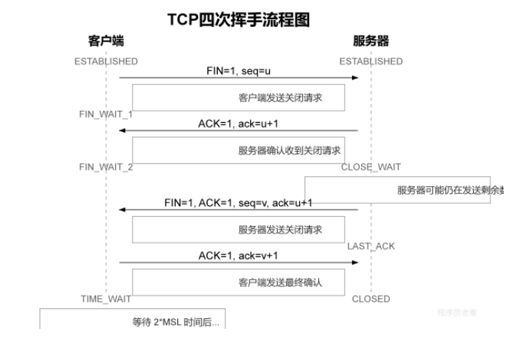
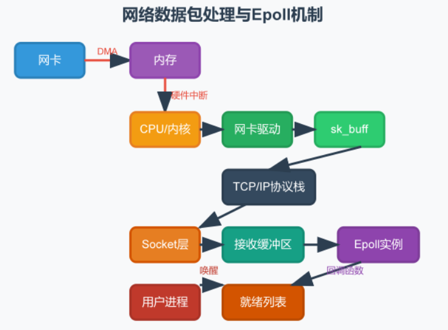
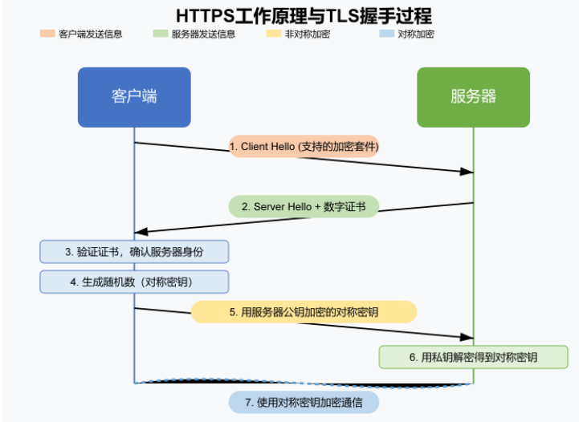
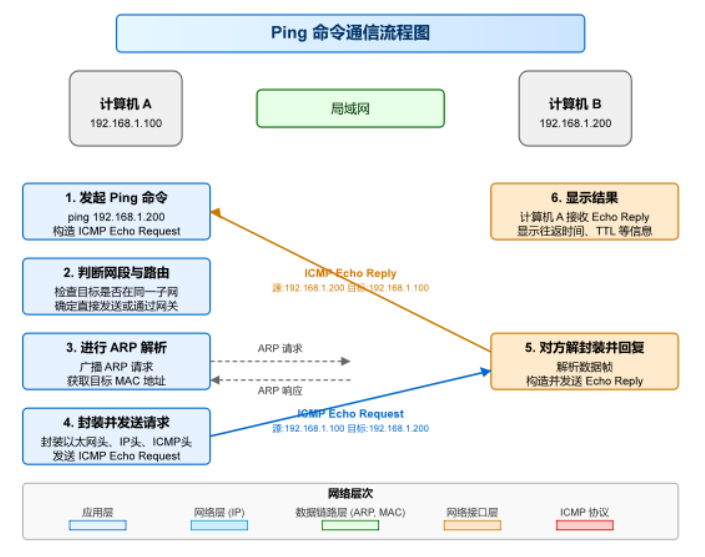

## 问答

### 3次握手

```
客户端 (Client)                                          服务端 (Server)
                                                            socket() -> bind()
                                                            listen()   <--【准备就绪，开启监听】
                                                            accept() (阻塞等待连接)
      |                                                        |
      | ------------- 1. SYN (seq=x) ------------------------> |  <-- 内核将连接放入【半连接队列】
connect() 发起                                                 |
      | <------------ 2. SYN (seq=y) + ACK (ack=x+1) --------- |
      |                                                        |
connect() 返回                                                 |
(客户端变为 ESTABLISHED)                                       |
      | ------------- 3. ACK (ack=y+1) ----------------------> |  <-- 内核将连接移入【全连接队列】
      |                                                        |
      |                                                     accept() 返回！
      |                                                     (获取已建好的连接，返回新 socket)
      |                                                        |
      | <=============== 开始正常读写数据 (read/write) ============> |
```

| **listen()**         | **握手前**     | 初始化半连接/全连接队列，允许内核处理 SYN 报文。           |
| -------------------- | -------------- | ---------------------------------------------------------- |
| *(客户端 connect())* | **第 1、2 步** | 触发发送第 1 次 SYN；收到第 2 次 SYN+ACK 后返回。          |
| **三次握手全部完成** | **第 3 步**    | 服务端内核收到 ACK，将连接放入**全连接队列**。             |
| **accept()**         | **握手后**     | 不参与握手过程。仅仅是**从全连接队列取出已建立好的连接**。 |

- **等待客户端发送应答包（第三步），就放入半连接队列，如果客户端发送了就移除，移动到全连接队列**

### 4次挥手



主动发起方：先发送fin包携带序列号，进入 **FIN_WAIT_1**（等待被动方针对这条 FIN 的 **ACK 应答**，如果没收到会重传FIN），被动方收到并回ack包，主动方进入FIN_WAIT_2（接收被动方剩余数据，它自己不发送数据了），被动方进入close_wait（等待处理逻辑完）；

被动方处理后，发送fin包携带序列号，主动方发送ack包。被动方接收到ack就close，主动方time_wait 2MSL（报文段在网络中允许存在的最大生存时间），避免发送ack包被动方没有收到。最后close

```
四次挥手：
第一次挥手：客户端发送 FIN 报文请求关闭，并进入 FIN_WAIT_1 状态。（等待被动方针对这条 FIN 的 **ACK 应答**，如果没收到会重传FIN）
第二次挥手：服务器收到后发送 ACK 确认，并进入 CLOSE_WAIT 状态（等待处理逻辑完）。客户端进入FIN_WAIT_2；（接收服务器发送的剩余数据，但是客户端不发送数据了）
第三次挥手：服务器完成完成数据发送后，再发送 FIN 报文请求关闭，并进入 LAST_ACK 状态。
第四次挥手：客户端发送最后一次 ACK 确认后进入 TIME_WAIT 状态（time_wait 2MSL，避免发送ack包服务器没有收到。**服务器没有收到应答包会重发**），服务器收到后进入 CLOSED 状态。
```

**1 个 MSL （是报文段在网络中允许存在的最长生存时间**）等旧报文消失，另 1 个 MSL 用来应对对方重传的 FIN，合起来就是 **2MSL

### TCP和UDP头部结构


TCP 报文头（TCP Header）的标准固定长度是 **20 字节**，如果加上可选的“选项（Options）”字段，最长可达 **60 字节**。

我们可以把 TCP 报文头看作一张信息卡，下面是经典的 TCP 头部结构图及各字段详细解析：

```
0                   1                   2                   3
 0 1 2 3 4 5 6 7 8 9 0 1 2 3 4 5 6 7 8 9 0 1 2 3 4 5 6 7 8 9 0 1
+-+-+-+-+-+-+-+-+-+-+-+-+-+-+-+-+-+-+-+-+-+-+-+-+-+-+-+-+-+-+-+-+
|          源端口 (16位)         |         目的端口 (16位)        |
+-+-+-+-+-+-+-+-+-+-+-+-+-+-+-+-+-+-+-+-+-+-+-+-+-+-+-+-+-+-+-+-+
|                        序列号 (Seq, 32位)                     |
+-+-+-+-+-+-+-+-+-+-+-+-+-+-+-+-+-+-+-+-+-+-+-+-+-+-+-+-+-+-+-+-+
|                        确认号 (Ack, 32位)                     |
+-+-+-+-+-+-+-+-+-+-+-+-+-+-+-+-+-+-+-+-+-+-+-+-+-+-+-+-+-+-+-+-+
| 数据偏移 |  保留  |U|A|P|R|S|F|                               |
| (4位)   | (4位)  |R|C|S|S|Y|I|            窗口大小 (16位)      |
|         |        |G|K|H|T|N|N|                               |
+-+-+-+-+-+-+-+-+-+-+-+-+-+-+-+-+-+-+-+-+-+-+-+-+-+-+-+-+-+-+-+-+
|          校验和 (16位)         |         紧急指针 (16位)        |
+-+-+-+-+-+-+-+-+-+-+-+-+-+-+-+-+-+-+-+-+-+-+-+-+-+-+-+-+-+-+-+-+
|                    选项 (Options, 0~40字节, 可选)              |
+-+-+-+-+-+-+-+-+-+-+-+-+-+-+-+-+-+-+-+-+-+-+-+-+-+-+-+-+-+-+-+-+
|                           数据 (Data)                         |
+-+-+-+-+-+-+-+-+-+-+-+-+-+-+-+-+-+-+-+-+-+-+-+-+-+-+-+-+-+-+-+-+
```

TCP：共5行，一行4b

第一行端口：2b源端口，2b目的端口

第二行序列号：4b序列号（**第一个字节的编号**Seq）

第三行ack包：4b 应答包（**这个编号之前的数据我都收到了，下一次请从这个编号开始发**）

第四行网络结构：

- **数据偏移（Data Offset，4位）**：
  - 实际上就是 **TCP 头部长度**。因为 TCP 头部带有可选字段，长度不固定，所以需要记录头部有多长，以便接收方知道**从哪里开始才是真实的用户数据**。
- **保留位（Reserved，4位）**：
  - 目前没用，全置为 0，留给未来扩展使用。
- **控制标志位（Flags，关键！决定这个包是干嘛的）**：
  - **SYN（Synchronize）**：发起连接请求（握手）。
  - **ACK（Acknowledgment）**：确认号有效。除握手的第 1 个包外，**之后的所有 TCP 包都必须置 ACK=1**。
  - **FIN（Finish）**：发送方数据已发完，请求断开连接（挥手）。
  - **RST（Reset）**：连接复位。出现严重异常时，强制断开连接并重建。
  - **PSH（Push）**：催促接收方尽快把数据交到应用层，不要在缓冲区攒着。
  - **URG（Urgent）**：表示紧急指针有效，有高优先级数据需要优先处理（罕见）。
- **窗口大小（Window Size，16位）**：
  - **滑动窗口的核心**！用来做**流量控制**。
  - 接收方告诉发送方：“**我的缓冲区现在还能装多少字节的数据**”。如果写 0，发送方就会暂停发数据，防止接收方被撑爆。

第五行数据校验：2b校验和，2b紧急指针（配合 URG（只有=1才有效），标记紧急数据位置）

- 选项

在三次握手阶段，双方用来协商高级功能：

- **MSS（最大报文段大小）**：协商双方每次最多能发多大的纯数据。

> MTU，通常是以太网的 1500 字节，这是物理层和数据链路层决定的。MSS 是 TCP 层的概念，它指的是 TCP 包里还能放多少业务数据。它的值基本上就是 MTU‑IP 头 (20 字节)‑TCP 头 (20 字节)，所以在一个典型的以太网环境下，MSS 就是 1460 字节

- 协商:

  - > 客户端发起连接时，会在 TCP 头的选项字段里带上自己的 MSS 值，比如 MSS=1460，告诉服务器：“我一次最多能收 1460 字节的数据”
    >
    > 服务器收到后，也计算自己的 MSS。然后，它会比较自己算出的 MSS 和客户端发来的 MSS，取其中较小的一个，作为这次连接的 MSS 标准。同时，它也会在返回的 SYN‑ACK 包里带上自己的 MSS 值，客户端收到后，也用同样的方式，取一个较小值。这样，双方就达成了一致，后续发送的所有 TCP 数据段的数据大小都不会超过这个协商好的 MSS

- **Window Scale（窗口扩大因子）**：让 16 位的窗口大小突破 64KB 限制，最大可达 1GB。
- **SACK（选择性确认）**：允许只重传丢失的片段，大幅提高传输效率。
- **Timestamps（时间戳）**：用于精确计算 RTT（网络往返时间）和防止序号回绕（PAWS）。

上面是基础头，后面是选项+填充（40b），整体最大60b

#### UDP:

共2行，一行4b

第一行端口：2b源端口，2b目的端口

第二行数据：2b报文长度（udp头，数据总长度），2b校验和

### tcp流量控制

#### 滑动窗口控制

发送窗口：TCP 发送窗口上限 = min(对方通告的 **接收窗口大小**（由已发送但未确认的数据（在途数据）和可以发送的最大数据量组成）,拥塞窗口）

接收窗口（rwnd）：当前接收缓冲区剩余可用空间；

**零窗口的处理：当接收方的接收窗口为0时，发送方会停止发送数据，直到接收 到非零窗口通知。发送方可以周期性地发送窗口探测包，询问接收方的接收窗口大小。**

### TCP拥塞控制机制

初始拥塞窗口为 1，慢启动阶段窗口不断翻倍；当窗口增长到慢启动阈值后，进入拥塞避免，窗口每次加 1。

如果收到 3 个重复 ACK，先把阈值设为当前窗口的一半，再将拥塞窗口赋值为这个新阈值，之后继续线性加 1；

如果发生超时（认为网络瘫痪），同样把阈值设为当前窗口一半，但拥塞窗口重置为 1，重新开始慢启动。

### KCP

根据udp添加了超时重传，流量控制，一种自适应的拥塞控制算法，可靠传输等功能

### QUIC

- 分多个流，这样就不会像tcp一样，如果未收到就会阻塞一整个流

```
       ├─► 【Stream 1 (流1)】（逻辑通道：比如正在下载 HTML）
       ├─► 【Stream 2 (流2)】（逻辑通道：比如正在下载 CSS）
       └─► 【Stream 3 (流3)】（逻辑通道：比如正在下载 图片）
```

- 然后udp发一个数据包(packet)

```
单个 UDP / QUIC Packet（一个物理数据包）：
┌───────────────────────────────────────────────────────────┐
│ IP/UDP 头 │ QUIC 头部                                      │
├───────────────────────────────────────────────────────────┤
│ 📦 Frame 1: 属于 Stream 1 的数据 (比如 HTML 的前 500 字节) │
│ 📦 Frame 2: 属于 Stream 2 的数据 (比如 CSS 的前 300 字节)  │
│ 📦 Frame 3: ACK 确认帧 (告诉对方我收到了之前的某个包)      │
└───────────────────────────────────────────────────────────┘
```

**结论：一个 Packet 可以包含多个 Stream 的数据，一个 Stream 的数据也会被拆分到很多个 Packet 中发送。**

```
QUIC 之所以引入独立的 Stream 概念，是为了解决 TCP 致命的 队头阻塞（Head-of-Line Blocking） 问题。
① 在 TCP（单流）中：
TCP 只有一个流。如果你在一个 TCP 连接里同时传输 HTML、CSS 和图片，一旦图片的那个包在网络中丢了：
整个 TCP 连接必须全部卡住！ 哪怕 HTML 和 CSS 已经完全到达了接收缓冲区，操作系统也不会把它们交给应用层，必须死等丢失的图片包重传回来。
② 在 QUIC（多流互不干扰）中：
每个 Stream 都有自己独立的偏移量（Offset）和状态。
如果某一个 Packet 丢了（假设里面装的是 Stream 3 图片的数据）：
只有 Stream 3（图片）会被阻塞等待重传。
Stream 1（HTML）和 Stream 2（CSS）完全不受影响，应用程序可以立刻读取并渲染网页！

```

### osi七层

| 层级 | 名称       | 核心功能             | 关键协议 / 概念    | 数据单元    |
| ---- | ---------- | -------------------- | ------------------ | ----------- |
| 7    | 应用层     | 提供应用服务         | HTTP, DNS          | 报文        |
| 6    | 表示层     | 数据格式、加密、压缩 | SSL/TLS, JPEG      | 数据        |
| 5    | 会话层     | 建立和管理会话       | RPC (远程调用)     | 数据        |
| 4    | 传输层     | 端到端传输、端口区分 | TCP, UDP           | 段 / 数据报 |
| 3    | 网络层     | IP 寻址与路由选择    | IP, ICMP           | 包          |
| 2    | 数据链路层 | MAC 寻址、封装成帧   | Ethernet, MAC 地址 | 帧          |
| 1    | 物理层     | 传输比特流           | 网线、光纤         | 比特        |


### 怎么保证UDP下帧与帧间的有序性

UDP 协议本身不保证数据包有序，想要做到帧有序，要在应用层实现。

**设置序列号**：发送方给每个数据包打上递增的序列号；接收端维护缓存区和期望序号，收到包后先判断序号：顺序正常就直接处理，乱序就先缓存，等前面缺失的包补齐后，再按顺序统一交付；没收到就利用ACK确认机制，告诉发送方需要的序号的包

**超时重传**：对于重复或过时的数据包直接丢弃。同时一般会加上超时和缓存限制，兼顾丢包和内存安全。

### 超时重传如何实现？超时重传时间怎么确定？

发送数据包计时，收到ack停止，作为rtt为往返时间，如果超时了没收到ack，则重新发送

### 本机向本机发送请求，IP填127.0.0.1和网 卡ip地址有区别吗

发送回环地址不会经过物理网卡，只在内核协议栈内部流转，本地的ip地址则会

###  TCP 的nagle 算法，nagle 会带来什么坏 处？

如果发送方没有接收到ack，则会将小数据包会合并成大数据包发送，等到收到ack包或者缓冲区足够大再发送

坏处：可能增加延迟

### 什么是MTU？如何处理MTU的问题？

MTU（属于**链路层**概念：指一帧里**除链路层头部之外**，能承载的上层数据上限）：是网络层协议数据包在数据链路层最大的传输字节，一般为1500字节

为什么重要：如果传输的数据包过大，会进行IP 分片（网络层分片，链路层不分片），如果过小会增加带宽开销

### MSS是什么

TCP 最大分段大小= MTU - IP 头 (20) - TCP 头 (20) = **1460 字节**

TCP 会主动控制报文不超 MSS，**尽量避免 IP 分片**。

### RTO和RTT的区别是什么

> RTO = Retransmission TimeOut，重传超时时间：
>
> ​	发出去一个包，如果过了 RTO 时间还没收到 ACK 确认，就自动重传这个包。
>
> - **RTT (Round‑Trip Time)：往返时延**，数据包从发送 → 对方收到 → ACK 回来，一趟来回耗时（动态测量出来）。
>
> - **RTO：基于 RTT 算出来的超时等待时间**
>
> - ```
>   RTO ≈ RTT * 2 （KCP/TCP都会做平滑滤波，不是简单乘2）
>   ```

### 什么是NAT？它的作用是什么？

网络地址转化，将内网私有 IP转化成公网 IP，能够多个私有网络连接一个共有网络；

作用：节省公网 IP 资源，端口映射

### 什么是ICMP协议？它的作用是什么？

是网络层中报告网络连接的错误和进行网络诊断的

**消息类型：**

回显应答，请求（用来ping的相应和ping请求）

目标不可达：数据包无法到达

重定向：重新规划路由路径

时间超时：

参数问题：数据包头错误

### *如何防止ARP攻击

### udp的socket流程

服务端

1. `socket()`：创建 UDP 套接字，SOCK_DGRAM
2. `bind()`：绑定本机 IP + 端口，固定端口等待收数据
3. `recvfrom()`：阻塞等待接收数据，顺带拿到客户端地址
4. `sendto()`：通过拿到的客户端地址回发数据；结束`close()`

客户端

1. `socket()`：创建 UDP 套接字
2. `sendto()`：直接指定服务端 IP 端口发送数据（内核自动随机分配临时端口）
3. `recvfrom()`：接收应答；用完`close()`

### socket中的close和shutdown

`close()`关闭的是文件描述符的引用。它会减少该文件描述符的引用计数。只有当引用计数变为 0 时（类似`share_ptr`的引用计数），操作系统才会真正关闭这个 Socket，并开始 TCP 的四次挥手过程来断开连接 

`shutdown()`关闭的是连接的数据传输通道，而不是 Socket 本身。它允许你单方向地关闭数据流，并且无论文件描述符的引用计数是多少，它都会立即对连接起作用

| 特性                         | int close(int fd)                                            | int shutdown(int sockfd, int how)                            |
| ---------------------------- | ------------------------------------------------------------ | ------------------------------------------------------------ |
| 作用对象                     | 通用的文件描述符（包括文件、管道、Socket 等）                | 专门用于 Socket                                              |
| 控制粒度                     | **全双工关闭**：一旦调用，读和写两个方向都不能再进行。       | **单向或双向关闭**：可以精确控制关闭哪个方向的通道。         |
| 资源释放                     | 释放文件描述符。当引用计数为 0 时，释放底层 Socket 结构和连接资源。 | 不释放文件描述符。Socket FD 依然有效，必须最后调用 close () 来释放它。 |
| 对 fork 后共享 Socket 的影响 | **只是将当前进程的引用计数减 1**。如果其他进程（如父 / 子进程）仍持有该 FD，**连接不会断开。** | 立即影响所有共享该 Socket 的进程。因为它直接作用于内核中的 Socket 连接对象，而不是进程中的 FD。**无视引用计数**，立即向对方发送 FIN 报文关闭连接 |
| 发送缓冲区数据               | close () 的默认行为是：将缓冲区中剩余的数据尝试发送给对方，然后发送 FIN 包。但这个发送过程是异步的，close () 会立即返回，不保证对方一定能收到。 | shutdown () 会立即触发 TCP 连接的关闭序列。 shutdown (SHUT_WR) 会保证将发送缓冲区的数据全部发出，然后发送 FIN 包。 |

- **想说“我话讲完了，你接着说”** 用 shutdown(SHUT_WR)（半关闭）。
- **想彻底“挂断电话并把手机放回口袋”**  用 **close()**（释放资源）。

### 说一下Linux内核网络的连接队列？

listen会创建半连接队列和全连接队列，在服务端接受客户端发送的请求包之后，会将连接放入半连接队列，等到收到ack包之后将半连接队列的连接转移到全连接队列中；`accept()`：**只从全连接队列取出连接，生成新 socket fd 返回**。

**listen 调用**：内核创建两个队列

- 半连接队列（SYN 队列）：存放`SYN_RCVD`连接
- 全连接队列（Accept 队列）：存放`ESTABLISHED`连接

队列是**内核 socket 结构体（tcp_sock）**还没绑定、没分配用户态 fd

`listen(fd, backlog)`：backlog 控制**全连接队列上限**

### 什么是多路复用？如何使select/poll/ epoll？

一个单独的进程监控多个文件描述符，查看是否有文件描述符准备进行io操作

#### select:

1. 创建一个**文件描述符集合**
2. `select`陷入内核，**内核阻塞、轮询所有 fd**，等待可读 / 可写 / 异常；
3. 如果有fd就绪，内核原地修改fd_set，只保留就绪fd，返回就绪fd_Set
4. 回到用户态，用户再自己循环遍历返回的fd_set，挨个处理

select(nfds, rfds,wfds,efds, &timeout);

```
timeout = NULL（传空指针）
无就绪 fd → 线程阻塞休眠，直到 fd 就绪被内核唤醒。

timeout={0,0}（0 秒 0 微秒）

非阻塞：内核遍历一遍 fd 立刻返回，线程不阻塞。

timeout>0（设固定时间，如 5s）

限时阻塞：没事件就阻塞等待，就绪提前返回；超时到点自动返回。=
```

**因为每次内核处理fd_set都是原地修改，所以每次调用select都需要重新填充fd_set**，可以用数组循环重新放入fd_set

**fd_set上限是1024个fd**

#### poll:

1. 创建一个pollfd结构数组，将需要的fd放入数组中
2. 调用poll函数，（文件描述符数组，超时时间）,线程阻塞
3. 返回的是准备进行io操作的文件描述符数量

```c++
struct pollfd {
    int fd;        // 要监听的fd
    short events;  // 用户设置：想要监听的事件(POLLIN/POLLOUT)
    short revents; // 内核输出：就绪事件，内核只改写此字段
};
```

**原数组不会被清空，不用每次循环全量重建**

**调用`poll`，线程阻塞**

**用户遍历数组，判断`fds[i].revents > 0`处理 IO**

#### epoll

1. 调用epoll_create创建一个epoll实例
2. 调用epoll_ctl添加，修改或删除需要监控的文件描述符
3. 调用epoll_wait等待事件，获取准备好进行io操作的文件描述符

**三者都是同步阻塞 IO 模型，但是可以设置同步非阻塞IO模型（read缓冲区没有了就EAGAIN就是非阻塞，读完了等待新数据就是阻塞）**

### *epoll底层原理

#### 底层网卡接收流程



> 具体步骤是，当网卡通过 DMA 将数据包写入内存后，会向 CPU 发起一个硬件中断。内核响应中断，调用网卡驱动的程序来处理数据。数据被封装成内核网络模块能理解的 sk_buff 结构，并沿着 TCP/IP 协议栈逐层向上传递。
>
> 当数据最终到达 Socket 层时，内核会将其放入对应 Socket 的接收缓冲区，并检查该 Socket 的等待队列上是否有正在等待的进程。由于用户进程之前调用 epoll_ctl 将这个 Socket 的文件描述符注册到了 Epoll 实例中，Epoll 内部会在此 Socket 的等待队列上注册一个回调函数。
>
> 当数据到达时，这个回调函数被触发，它会把这个已就绪的 fd 添加到一个 “就绪列表” 中并唤醒因调用 epoll_wait 而睡眠的进程，epoll_wait 随即返回，用户程序就得知该 fd 已有数据可读。

### epoll能监听所有的文件描述符吗

> 支持阻塞或非阻塞模式、且底层驱动实现了 `poll` 回调机制（即具备事件通知能力）的文件描述符都可以被监听，并且确实必须通过 `epoll_ctl` 配合 `EPOLL_CTL_ADD` 操作将其注册到 epoll 实例中才能生效。

### 水平触发和边缘触发

水平触发：读完缓冲区的数据，如果还有剩余就继续epol_wait调用直到读完

边缘触发：**只在新来数据瞬间通知一次**，调用一次read，剩余存量数据不再重复触发

**select,poll只有水平触发，epoll默认水平触发，若epoll设置边缘触发，需要对fd设置非阻塞，直到所有数据被读完，才返回eagain**

### 如何实现长连接和短连接？

长连接通过心跳包机制实现长时间连接，短连接进行请求回应发送包就结束 

### 什么是端口号

是用来区分一台主机不同应用进程，定位不同进程的

### 如何通过Socket实现可靠数据传输？

1. 通过序列号确认号，确保有序传输
2. 超时重传，确保数据到达
3. 流量控制避免缓冲区溢出
4. 拥塞控制，避免网络堵塞丢包

### 什么是VPN？它是如何工作的？

设立了一个中转服务器，在公网之上搭建加密的虚拟私有隧道，通过加密发送到中转服务器，再解密发送到目标服务器，同样的道理传输回去

### http方法

| 方法    | 主要用途             | 安全性 | 幂等性 | 请求体 | 幂等性解释                   |
| ------- | -------------------- | ------ | ------ | ------ | ---------------------------- |
| GET     | 获取 / 查询资源      | 是     | 是     | 否     | 无论请求多少次，结果相同     |
| POST    | 创建资源 / 提交数据  | 否     | 否     | 是     | 每次请求可能产生不同结果     |
| PUT     | 整体更新或创建资源   | 否     | 是     | 是     | 无论请求多少次，最终结果相同 |
| DELETE  | 删除资源             | 否     | 是     | 否     | 第一次删除后，状态不变       |
| PATCH   | 局部更新资源         | 否     | 不一定 | 是     | 取决于指令类型               |
| HEAD    | 获取资源的元数据     | 是     | 是     | 否     | 与 GET 类似，只返回头部      |
| OPTIONS | 获取服务器支持的选项 | 是     | 是     | 否     | 返回服务器能力，结果不变     |

### http的header和body的区分

body和hedaer用\r\n\r\n区分

### http的cookie的作用

是服务器给每个客户端附上其存储的登录信息，实现会话管理；是为了解决http

#### 1. 为什么不能“只在服务端保存，完全不用 Cookie”？

因为 **HTTP 协议是「无状态（Stateless）」的**。

- 服务端虽然可以在数据库/内存里存下张三、李四的登录信息，但对于服务端来说，**每一个进来的 HTTP 请求都是完全独立的**。
- 如果没有 Cookie，客户端发来一个请求：“我要看我的购物车”，服务端此时是一脸懵的：“**你是谁？我怎么知道你是张三还是李四？**”

#### 2. Cookie + Session 的真实协同过程（经典洗浴中心手牌模型）

为了解决这个问题，标准方案是 **Cookie 和 服务端共同协作**：

codeText

```
客户端 (浏览器)                                          服务端 (Server)
      │                                                        │
      │ ─── 1. POST /login (用户名: 张三, 密码: 123) ────────► │
      │                                                        │ 验证通过！
      │                                                        │ 在服务端内存/Redis创建 Session：
      │                                                        │ ID: "abc999" -> {用户: 张三, 余额: 100}
      │                                                        │
      │ ◄── 2. HTTP 200 OK                                     │
      │        Set-Cookie: session_id=abc999 ───────────────── │ (把手牌通过 Cookie 发给浏览器)
      │                                                        │
[浏览器把 abc999 存入 Cookie]                                   │
      │                                                        │
      │ ─── 3. GET /my-account                                 │
      │        Cookie: session_id=abc999 ────────────────────► │ 服务端拿着 "abc999" 去 Redis 里一查：
      │                                                        │ "原来是张三来了！余额 100。"
      │ ◄── 4. 返回张三的账户数据 ────────────────────────────── │
```

- **洗浴中心前台（服务端 Session）**：存放着张三的衣服、钱包和真实身份（**敏感数据全部保存在服务端**）。
- **储物柜手牌（客户端 Cookie）**：前台只给张三一个无意义的塑料手牌号 abc999（**客户端只存一个无含义的 ID**）。
- 张三每次要拿东西，只要出示手牌号，前台就能找到他的柜子。

#### cookie属性

| 属性     | 说明                                   |
| -------- | -------------------------------------- |
| Name     | Cookie 的名称，必需，用于标识。        |
| Value    | Cookie 的值，必需，存储数据如会话 ID。 |
| Expires  | 绝对过期时，未设置则为会话 Cookie。    |
| Max‑Age  | 相对过期时间，优先于 Expires。         |
| Domain   | 所属域，决定可访问域名，默认为主机名。 |
| Path     | 可用路径，如 / 表示所有路径。          |
| Secure   | 仅通过 HTTPS 发送，保护敏感信息。      |
| HttpOnly | 阻止脚本访问，降低 XSS 风险。          |
| SameSite | 防止 CSRF，值包括 Lax、Strict、None。  |

### 什么是HTTPS？与HTTP的区别？（SSL/TLS）

| 对比维度 | HTTP                                 | HTTPS                                                        | 面试要点                                             |
| -------- | ------------------------------------ | ------------------------------------------------------------ | ---------------------------------------------------- |
| 核心区别 | 明文传输，如同在网络上 “裸奔”。      | 加密传输，通过 SSL/TLS 协议加密。                            | 这是最根本的区别，必须先说。                         |
| 安全内涵 | 毫无安全性，数据可被轻易窃听和篡改。 | 三个安全保障：1. 机密性 (加密) 2. 完整性 (防篡改) 3. 认证性 (验证对方身份) | 能说出这三点，体现你的理解深度。                     |
| 连接过程 | TCP 三次握手后，直接传输数据。       | TCP 三次握手后，还需进行 SSL/TLS 握手。                      | 知道多了一个 “握手” 环节是关键。                     |
| 工作原理 | -                                    | SSL/TLS 握手过程：1. 交换证书 (含公钥) 2. 协商生成对称密钥 3. 使用对称密钥加密通信 | 能简述握手过程是巨大加分项，说明你懂原理。           |
| 默认端口 | 80                                   | 443                                                          | 这是基础知识，必须记住。                             |
| 所需资源 | 无                                   | 需要向 CA 机构申请 SSL 证书，会产生费用和配置成本。          | 体现你对实际部署有了解。                             |
| 性能影响 | 连接快，开销小。                     | 首次连接有延迟 (因 SSL 握手)，有少量 CPU 计算开销。          | 知道其性能代价，并了解现代技术已很大程度优化此问题。 |

### TLS握手：



codeText

```
客户端 (Client)                                          服务端 (Server)
      │                                                        │
      │ ═══════════════ 【第一阶段：TCP 三次握手】 ══════════════ │
      │ ─── 1. SYN ──────────────────────────────────────────► │
      │ ◄── 2. SYN + ACK ───────────────────────────────────── │
      │ ─── 3. ACK ──────────────────────────────────────────► │
      │                                                        │
      │ ═══════════════ 【第二阶段：TLS 1.2 四步握手】 ══════════ │
      │                                                        │
      │ ─── 4. Client Hello (第1轮RTT开始) ───────────────────► │
      │        • 支持的 TLS 版本 (如 1.2)                       │
      │        • 支持的密码套件列表                             │
      │        • 客户端随机数 (Client Random)                  │
      │                                                        │
      │ ◄── 5. Server Hello                                    │
      │        • 选定的 TLS 版本与密码套件                     │
      │        • 服务端随机数 (Server Random)                  │
      │ ◄── 6. Certificate (数字证书，内含服务器 RSA 公钥)       │
      │ ◄── 7. Server Hello Done (第1轮RTT结束) ─────────────── │
      │                                                        │
[客户端本地处理]                                               │
 ① 校验 CA 证书链合法性 (域名、有效期、签名)                    │
 ② 生成 48 字节的「预主密钥」(Pre-Master Secret)               │
 ③ 用证书里的【服务器公钥】加密预主密钥                          │
 ④ 本地用 3 个原料计算出「会话密钥」                           │
      │                                                        │
      │ ─── 8. Client Key Exchange (加密后的预主密钥) (第2轮RTT)► │
      │ ─── 9. Change Cipher Spec (通知：我以后全加密了) ──────► │
      │ ─── 10. Encrypted Handshake Message (Finished验证包) ─► │
      │                                                        │
      │                                                [服务端本地处理]
      │                                                 ① 用【私钥】解密出预主密钥
      │                                                 ② 本地用 3 个原料算出「会话密钥」
      │                                                 ③ 解密并校验客户端的 Finished 包
      │                                                        │
      │ ◄── 11. Change Cipher Spec (通知：我也全加密了) ────── │
      │ ◄── 12. Encrypted Handshake Message (Finished验证包) ── │
      │                                                        │
[客户端校验服务端的 Finished 包通过！TLS 握手彻底完成] (第2轮RTT结束)
      │                                                        │
      │ ═══════════════ 【第三阶段：加密数据通信】 ══════════════ │
      │                                                        │
      │ ─── 13. 对称加密的 HTTP 请求 (GET / Cookie...) ───────► │
      │ ◄── 14. 对称加密的 HTTP 响应 (HTML / JSON...) ──────── │
      │                                                        │
      │ ═══════════════ 【第四阶段：连接断开】 ══════════════════ │
      │ ─── 15. TLS close_notify (通知安全层关闭) ────────────► │
      │ ─── 16. TCP 四次挥手 (FIN -> ACK -> FIN -> ACK) ──────► │
```

**会话密钥 = 客户端随机数+服务器随机数+客户端生成随机数对称密钥（预主密钥）**

客户端向服务端发送连接请求，包内包含：

- **支持的最高 TLS 版本**（如 TLS 1.2）。
- **客户端随机数（Client Random）**：一段 32 字节的随机数（前 4 字节为时间戳，后 28 字节为随机字节），这是合成密钥的**第 1 个原料**。
- **支持的密码套件列表（Cipher Suites）**：告诉服务端自己支持哪些加密算法（如 TLS_RSA_WITH_AES_128_GCM_SHA256）。
- **SNI 扩展（Server Name Indication）**：告诉服务端我想访问哪个具体的域名（方便单 IP 多证书的服务器匹配证书）。

服务端收到后，把三样东西打包发回给客户端：

- **Server Hello**：确认使用的 TLS 版本、从客户端列表里选定一套密码套件，并带上**服务端随机数（Server Random）**（合成密钥的**第 2 个原料**）。
- **Certificate（服务器证书）**：向客户端出示由权威 CA 机构签发的数字证书。**证书里包含了服务端的「RSA 公钥」**、颁发机构、有效期和签名。
- **Server Hello Done**：通知客户端，“我的第一阶段信息发完了”。

客户端拿到证书后，在本地做极其严密的检查：

1. **校验证书**：检查证书是否过期、域名是否匹配、用操作系统内置的根证书公钥一层层解密验证数字签名，**确认服务器身份真实，不是黑客伪造的**。
2. **生成「预主密钥」（Pre-Master Secret）**：客户端在本地内存中随机生成一段 48 字节的高机密字符串，这是合成密钥的**第 3 个原料（最核心的秘密原料）**。

#### 校验证书，哈希摘要双方验证（**Change Cipher Spec** 和 **Finished** 验证包）

客户端拿到证书后，在本地做极其严密的检查：

1. **校验证书**：检查证书是否过期、域名是否匹配、用操作系统内置的根证书公钥一层层解密验证数字签名，**确认服务器身份真实，不是黑客伪造的**。
2. **生成「预主密钥」（Pre-Master Secret）**：客户端在本地内存中随机生成一段 48 字节的高机密字符串，这是合成密钥的**第 3 个原料（最核心的秘密原料）**。
3. **加密并发送**：
   - **Client Key Exchange**：客户端用证书里的**【服务器 RSA 公钥】**，将预主密钥加密，发送给服务端。
   - **Change Cipher Spec (CCS)**：发 1 个单字节指令，通知服务端：“我之后发的所有消息都要加密了”。
   - **Finished (Encrypted Handshake Message)**：客户端把前面所有聊天记录（Hello、证书等）打包算一个哈希，**用刚算出来的会话密钥加密发给服务端**，让对方验算。

- 服务器：
  1. 服务端解密并验证客户端发来的 Finished 包，确认哈希一致。
  2. 服务端发出自己的 **Change Cipher Spec** 和 **Finished** 验证包。

### HTTP/1.1、HTTP/2.0 和 HTTP/3.0 的区别

http1.1:

> - **特点**：
>   - **纯文本格式**：报文以 ASCII 码形式传输，可读性好，但解析效率低、体积大。
>   - **持久连接 (Keep-Alive)**：允许一个 TCP 连接复用处理多个 HTTP 请求（默认开启）。
> - **痛点**：
>   - **应用层队头阻塞 (Head-of-Line Blocking)**：同一个 TCP 连接上，请求是**串行**处理的。如果前面的请求响应变慢，后面的请求只能排队等待。
>   - **高延迟/并发差**：为了解决上述问题，浏览器通常允许对同一个域名建立 6~8 个并发 TCP 连接，但这极大地消耗了服务器资源。
>   - **头部冗余**：每次请求都必须携带大量的 HTTP Header（如 Cookie、User-Agent 等），浪费带宽。
>
> 支持了 Keep-Alive 长连接复用，但它存在**应用层的队头阻塞（Head-of-Line Blocking）**——同一个 TCP 连接上请求是串行的，前面阻塞后面就得等待。虽然浏览器可以通过建立 6 个并发 TCP 连接来缓解，但这消耗了额外资源，而且每个请求都要重复携带冗余的 Header。”

http2.0

> #### HTTP/2 —— 性能的大幅跃升（二进制与多路复用）
>
> HTTP/2 基于 Google 的 SPDY 协议开发，旨在不改变 HTTP 语义（如 GET/POST、状态码）的前提下极大提升性能。
>
> - **核心改进**：
>   - **二进制分帧 (Binary Framing)**：放弃纯文本，将数据切分成更小的“帧 (Frame)”和“流 (Stream)”，机器解析效率极高。
>   - **多路复用 (Multiplexing)**：**一个 TCP 连接**即可并发传输无数个请求和响应，彻底解决了 **HTTP 应用层的队头阻塞**。
>   - **头部压缩 (HPACK)**：双方维护一张头部索引表，只传输变化的头部字段或索引号，大幅减少报文体积。
>   - **服务端推送 (Server Push)**：服务器可以在客户端请求之前，主动推送相关资源（例如请求 HTML 时顺带推送 CSS/JS）。
> - **痛点（留给 HTTP/3 解决）**：
>   - **TCP 层的队头阻塞**：因为所有 HTTP 流量都走在**同一个 TCP 连接**上，一旦发生网络丢包，TCP 协议会强制等待重传，导致**整个连接上的所有 Stream 全部卡住**（丢包率高时性能甚至不如 HTTP/1.1）。
>   - **握手延迟高**：TCP 握手 (1-RTT) + TLS 握手 (12-RTT)，建立连接通常需要 23 个 RTT。
>
> “为了解决这些问题，HTTP/2 带来了三大核心升级：
>
> 1. **二进制分帧**：将文本解析改为二进制帧，提升解析效率；
> 2. **多路复用**：在一个 TCP 连接上并发传输多个 Stream，彻底解决了**应用层**的队头阻塞；
> 3. **HPACK 头部压缩**：大幅降低了 Header 的网络开销。
>
> **但 HTTP/2 遗留了一个严重缺陷：TCP 层的队头阻塞。** 因为所有数据流共用一个 TCP 连接，只要底层发生丢包，TCP 的按序确认机制会导致**所有 Stream 一起卡住等待重传**，在弱网环境下性能反而可能不如 1.1。”

http3.0

> - **彻底解决 TCP 队头阻塞**：QUIC 实现了传输层的多路复用。一个连接内的各个 Stream 是互相独立的，Stream A 丢包重传，**完全不会阻塞 Stream B**。
> - **超快建连 (0-RTT / 1-RTT)**：QUIC 内部直接集成了 TLS 1.3。首次连接只需 1 个 RTT 即可完成“传输+加密”握手；再次连接甚至支持 **0-RTT**（发送数据的同时完成握手）。
> - **连接迁移 (Connection Migration)**：传统 TCP 通过 [源IP, 源端口, 目的IP, 目的端口] 四元组识别连接，当手机从 **Wi-Fi 切换到 5G 移动网络**（IP 变化）时，TCP 会断开重连。而 QUIC 使用独一无二的 **Connection ID** 标识，网络切换时**连接不中断，业务完全无感知**。
> - **QPACK**：针对 QUIC 的无序传输特性，优化了 HTTP/2 的 HPACK 算法。
>
> HTTP/3 做出了革命性的改变——**把底层的 TCP 换成了基于 UDP 的 QUIC 协议**：
>
> 1. **彻底解决队头阻塞**：QUIC 在应用层自己实现了可靠传输，各个 Stream 之间完全独立，单个丢包只影响当前 Stream；
> 2. **极速建连**：QUIC 内置了 TLS 1.3，首次连接只需 **1-RTT**，再次连接支持 **0-RTT**；
> 3. **连接迁移**：QUIC 使用唯一的 Connection ID 标识连接，当用户从 Wi-Fi 切换到 5G（IP 改变）时，连接不会断开，业务无感知。”

### http状态码

表格

| 状态码 | 名称                  | 描述                         |
| ------ | --------------------- | ---------------------------- |
| 2xx    | 成功                  | 请求成功类别                 |
| 200    | OK                    | 请求成功，最常见             |
| 3xx    | 重定向                | 资源 URL 变更或缓存使用      |
| 301    | Moved Permanently     | 永久重定向，搜索引擎更新索引 |
| 304    | Not Modified          | 内容未修改，使用缓存节省传输 |
| 4xx    | 客户端错误            | 请求无效或权限问题           |
| 400    | Bad Request           | 请求无效，参数或格式错误     |
| 401    | Unauthorized          | 未认证，需要登录             |
| 403    | Forbidden             | 禁止访问，已登录但无权限     |
| 404    | Not Found             | 未找到资源或 API 端点        |
| 5xx    | 服务器错误            | 服务器端问题                 |
| 500    | Internal Server Error | 服务器内部错误，代码异常     |
| 503    | Service Unavailable   | 服务不可用，服务器忙或维护   |

### http长连接和短连接

| 特性         | HTTP 短连接                         | HTTP 长连接                       |
| ------------ | ----------------------------------- | --------------------------------- |
| 连接管理     | 每个请求新建 TCP 连接，响应后关闭。 | 一次 TCP 连接用于多次请求和响应。 |
| 性能开销     | 较高，频繁握手和挥手消耗资源。      | 较低，复用连接减少握手和挥手。    |
| 延迟         | 较高，每个请求有连接建立延迟。      | 较低，后续请求无需重新连接。      |
| 服务器压力   | 较大，频繁创建和销毁连接。          | 较小，减少连接建立和关闭负担。    |
| 适用协议版本 | HTTP/1.0 默认                       | HTTP/1.1 默认，HTTP/1.0 可指定。  |
| 适用场景     | 数据量小、请求频率低的场景。        | 请求频繁、加载大量资源的场景。    |

### FTP工作原理

> FTP 的核心在于它使用了两个独立的 TCP 连接来完成工作，一个叫作控制连接（21端口），另一个叫作数据连接（20端口。

##### 主动和被动模式

#### 模式 1：主动模式（Active Mode，也叫 PORT 模式）—— *才用到 20 端口*

在这个模式下，是**服务端“主动”连接客户端**来传输数据：

```
客户端 (Client)                                          服务端 (Server)
      │                                                        │
      │ ═══════════════ 【1. 控制连接 (已建立)】 ═══════════════ │
      │ 客户端随机端口 (如 50001) ◄────────────────► 服务端 21 端口 │
      │                                                        │
      │ ─── PORT (客户端开启了随机端口 50002，通知服务端来连) ──► │
      │                                                        │
      │ ═══════════════ 【2. 数据连接 (服务端主动发起)】 ═══════ │
      │ 客户端 50002 端口 ◄───────────────────────── 服务端 20 端口 │
      │                                 (服务端主动用 20 端口连过来)
```

1. 客户端在本地偷偷开启一个随机端口（比如 50002）。
2. 客户端通过 21 端口告诉服务端：“**我开了 50002 端口，你来连我送数据吧（PORT 命令）**”。
3. **服务端使用固定的 20 端口 主动发起 TCP 连接，去连接客户端的 50002 端口**。
4. *缺点*：现在几乎所有客户端都在家用路由器（NAT/防火墙）后面，外网服务端主动连内网客户端会被防火墙直接拦截，所以**主动模式现在很少用了**。

#### 模式 2：被动模式（Passive Mode，也叫 PASV 模式，现代主流！）—— *根本不用 20 端口！*

为了解决客户端防火墙的问题，发明了被动模式：**永远由客户端主动去连服务端**。

```
客户端 (Client)                                          服务端 (Server)
      │                                                        │
      │ ═══════════════ 【1. 控制连接 (已建立)】 ═══════════════ │
      │ 客户端随机端口 (如 50001) ◄────────────────► 服务端 21 端口 │
      │                                                        │
      │ ─── PASV (客户端发命令：我要下载文件，请告诉我连哪) ──► │
      │ ◄── 227 Entering Passive Mode (服务端开放了随机端口 30005) │
      │                                                        │
      │ ═══════════════ 【2. 数据连接 (客户端主动发起)】 ═══════ │
      │ 客户端随机端口 (如 50003) ─────────────────► 服务端 30005 端口│
      │ (客户端主动连过去)                      (服务端随机高位端口)
```

1. 客户端通过 21 端口发送 PASV 命令：“服务端，我不做监听了，你开个端口让我连你”。
2. 服务端在本地**随机打开一个高位端口（比如 30005）**，并通过控制连接把 30005 告诉客户端。
3. **客户端主动发起 TCP 连接，连接服务端的 30005 端口**。
4. *注意*：**在被动模式下，服务端的 20 端口完全不参与工作！**

### ping命令流程



> 1. 发起 Ping 命令：你在命令行输入 ping 192.168.x.x，操作系统调用内部网络功能去构造一个 ICMP Echo Request 包。Ping 命令会周期性地发送该请求并等待对方应答，从而判断连通性和延迟；
>
> 2. 判断网段与路由：系统先根据你的 IP 和子网掩码，确认对方是否在同一子网，如果在同一网段则直接发送，否则会通过默认网关路由出去。在办公室局域网环境中，大多数情况无需走网关，直接二层通信即可
>
> 3. 进行 ARP 解析：如果系统的 ARP 缓存里没有对方 IP 对应的 MAC 地址，就会广播 ARP 请求给所在网段。目标电脑看到匹配自己 IP 的请求后，会发 ARP 响应，让你知道它的 MAC 地址。
>
> 4. 装并发送请求：拿到对方 MAC 地址后，操作系统封装以太网头（含源 MAC、目标 MAC）、IP 头（含源 IP、目标 IP）和 ICMP 头（Echo Request 类型）组成完整数据帧。该数据帧通过交换机或无线 AP 被转发到对方的网卡。
>
> 5. 对方解封装并回复：目标电脑接收数据帧后，解析以太网头、IP 头和 ICMP 头，识别这是一个 Echo Request。系统会构造对应的 Echo Reply，把双方地址对换并打包，然后再通过以太网发回给你的电脑。
>
> 6. 显示结果：你的电脑收到 Echo Reply 后，Ping 命令会在终端显示 “Reply from...”、往返时间、TTL 等信息。它会持续发送 / 接收，直到你停止命令或网络出现异常导致无法收到回应。
>
> - 如果是公网
>
> ```
> 【你的电脑】
>    │  (IP: 8.8.8.8, MAC: 指向你家路由器)
>    ▼
> 【你家路由器】
>    │  (路由器查路由表，发现要送给电信运营商。它去问电信机房路由器的 MAC)
>    │  (IP: 8.8.8.8, MAC: 指向电信机房路由器)
>    ▼
> 【电信骨干网路由器】
>    │  (通过海底光缆，把包传给美国的骨干路由器)
>    │  (IP: 8.8.8.8, MAC: 指向美国骨干路由器)
>    ▼
> 【谷歌机房的最后一台路由器】
>    │  (此时才终于到了 8.8.8.8 所在的那个局域网！)
>    │  (这台路由器在谷歌机房内大喊 ARP：“谁是 8.8.8.8？把 MAC 给我！”)
>    ▼
> 【8.8.8.8 服务器】 (收到 Ping 请求包！)
> ```

### DNS解析的过程

询问浏览器缓存，操作系统，本地host ->本地DNS服务器 -> 根DNS服务器 -> 顶级DNS服务器-> 权威DNS服务器

递归是问到本地DNS服务器之后，让DNS本地服务器自己处理最后返回

迭代是一个个往上级询问请求

###  什么是负载均衡？常见的负载均衡算法？

1. 轮询，依次请求
2. 加权轮询
3. 最小连接，分配最少连接的服务器
4. 加权最小连接
5. 源地址哈希：通过ip地址的哈希值分配对应服务器
6. 随机
7. 最小相应时间：请求分配平均响应时间最短的服务器

### 什么是WebSocket？它与HTTP的区别？

通过tcp握手连接后，用http协议进行互相通信，使用帧来通信，并且不需要带头部信息，减少开销；

与http区别是：http是单向，websocket是全双工通信；连接http是每个请求一个tcp连接，websocket是单个连接多次数据传输；websocket时候频繁传输数据

### 什么是QoS？如何实现QoS？

qos是用来保证传输的可靠性、**优先级 + 控延迟 + 控丢包 + 控抖动**。

1. 根据数据包类型，地址，端口号打上标记
2. 控制流量速率
3. 拥塞控制、避免
4. 带宽管理分配，优先级调度（LLQ/WFQ，高优先级（语音 / 视频）优先转发，分配专属带宽）

**分类打标→限速→拥塞避免→队列优先级调度。**

### *sendfile，mmap + write，splice底层原理

### Reactor 和Proactor 模式的区别及应用场景

Reactor：同步非阻塞IO，内核只通知就绪，用户线程自己读写数据

Proactor：异步IO，内核自动把数据从内核缓冲区拷贝到用户缓冲区，完事通知应用

