## 音视频 

### yuv420p格式

YUV420p 核心特点是将亮度与色度信息分离存储。420 表示的是色度子采样模式，对于每 2×2 个 Y 像素块，仅对应 1 个 U 和 1 个 V 像素，就是 U 和 V 分量在水平和垂直方向上的分辨率都是 Y 分量的一半。而 p 代表平面存储方式，Y 分量、U 分量和 V 分量在内存中是独立且连续的三个数据块。内存布局是先是完整的 Y 平面，紧接着是 U 平面，最后是 V 平面。

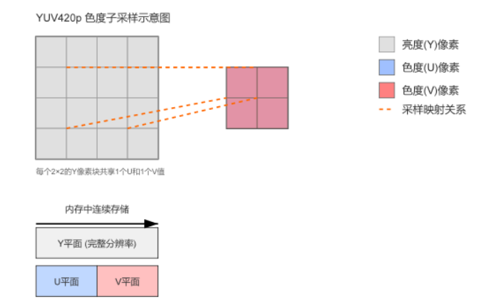

- 计算字节

  > 大小计算主要取决于图像的宽度、高度以及其采用的色度子采样格式。亮度分量 Y 始终占据 W 乘以 H 个字节，因为每个像素都有一个 Y 值。而色度分量 U 和 V 的大小则根据不同的采样模式有所不同，如下表：
  >
  > 表格
  >
  > | 格式      | 采样方式                          | 总大小            |
  > | --------- | --------------------------------- | ----------------- |
  > | YUV 4:4:4 | U 和 V 分量与 Y 分量分辨率相同    | 3 * W * H 字节    |
  > | YUV 4:2:2 | U 和 V 分量水平方向采样减半       | 2 * W * H 字节    |
  > | YUV 4:2:0 | U 和 V 分量水平和垂直方向采样减半 | ≈1.5 * W * H 字节 |

### yuv和rgb区别

RGB 是一种加色模型，直接将颜色表示为红、绿、蓝三原色的组合，用于屏幕显示、图形处理以及所有需要直接控制像素发光颜色的硬件设备，它模拟人眼视锥细胞对光线的基本感知。

YUV 是一种将亮度信息与色度信息分离的颜色模型，主要应用于视频编码、压缩和传输，因为它能够更好地利用人眼对亮度变化比对颜色变化更敏感的特性，通过对色度分量进行降采样来减少数据量而不明显降低视觉质量。

### 打开视频文件进行解码

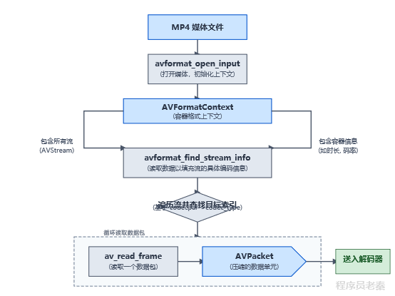

> `avformat_open_input`打开视频文件->`avformat_find_stream_info`找到视频流，获取编码参数，找到编码器->分配对应编码器作为解码器，分配对应解码器的上下文，将编码参数复制到对应解码参数中->从容器上下文通过`av_read_frame`读取一个`packet`，然后`send_packet`到解码器中

### **AV Packet和AV Frame有什么区别**

**它们的主要区别在于数据的压缩状态和所处的处理阶段。AVPacket是数据在传输和存储时的压缩形态，而AVFrame是数据在处理和播放时的解压形态。**

AVPacket用于存储经过编码的音视频数据，是从解封装器读取或者是发送给编码器的原始流数据，它包含**一个帧画面**的数据，并携带时间戳、流索引等信息。

而AVFrame则存储解码后的原始音视频数据，比如未压缩的图像像素数据或者是音频样本数据，它是解码器的输出或者是编码器的输入，是一个可直接用于播放的完整图像或音频块。

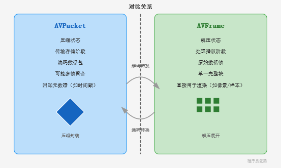

###  **了解MP4文件吗？它是由什么组成的？**

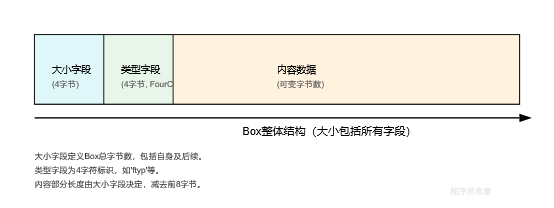

| **Box**  **类型** | **作用**                       | **备注**                                                     |
| ----------------- | ------------------------------ | ------------------------------------------------------------ |
| ftyp              | **文件类型****Box**            | 标识MP4文件及其兼容标准，没有它解析器无法处理文件。          |
| moov              | **电影****/****元数据****Box** | MP4的“目录”，包含如何找到和解析数据的信息，没有它播放器无法播放。 |
| mdat              | **媒体数据****Box**            | 包含实际的音视频流数据，文件体积最大的部分。                 |
| trak              | **轨道****Box**                | 代表文件中的一个独立媒体流，了解它可知文件里有哪些音视频内容。 |
| stbl              | **采样表****Box**              | 最关键的“子地图”，指引播放器精确找到并解码每一个音视频数据块。 |

### i帧，p帧，b帧

首先是I帧，也称为关键帧或独立帧，它不依赖于任何其他帧进行编码，只利用当前帧自身的信息进行压缩，因此其解码不依赖于其他帧，是视频播放的随机访问点，但文件尺寸通常最大。

然后是P帧，它依赖前面最近的I帧或者是P帧进行预测编码，通过运动补偿技术记录与参考帧之间的差异，压缩效率高于I帧，文件尺寸中等。

最后是B帧，它既可以依赖于前面的I/P帧，也可以依赖于后面的I/P帧进行双向预测编码，压缩效率最高，文件尺寸最小，但是解码时需要对帧进行重新排序。

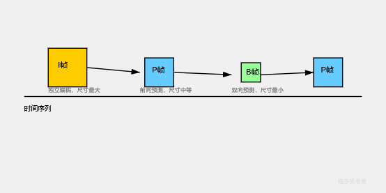

### I帧和IDR帧的区别是什么

- **普通 I 帧（Intra Frame，帧内编码帧）：**

  - I 帧自身是独立的，解码它不需要依赖前面的帧（只利用了空间冗余）。
  - **但是**，在 H.264 引入了“多参考帧”机制后，**排在 I 帧后面的 P 帧或 B 帧，允许跨过这个 I 帧，去参考 I 帧前面的帧**。
  - *影响：* 如果你从一个普通的 I 帧开始播放或剪切视频，由于它后面的 P/B 帧可能依赖它前面的帧，会导致画面**花屏或解码失败**。

- **IDR 帧（即时解码刷新帧）：**

  - IDR 帧不仅自身独立，而且在它出现时，会发出一个信号：**清空参考帧缓冲区（DPB, Decoded Picture Buffer）**。
  - 它相当于一堵**“防火墙”**：**IDR 帧之后的所有帧，绝对不允许参考 IDR 帧之前的任何帧**。
  - *影响：* IDR 帧是一个彻底的重新开始点。从 IDR 帧开始解码，不需要任何历史数据，100% 能正常播放。

- 例子

  > 假设有一串视频帧序列（显示顺序）：
  > ... P1 -> P2 -> [关键帧] -> P3 -> P4 ...
  >
  > - **情况 A：如果中间是【普通 I 帧】**
  >   - 解码 I 帧：没问题（自身独立）。
  >   - 解码 P3 帧：P3 可能会参考 I 帧，**也可能会去参考 P1 或 P2**。
  >   - 如果你直接跳（Seek）到这个 I 帧开始播放，因为没有前面的 P1/P2 数据，P3 就会解码出错，导致花屏。
  > - **情况 B：如果中间是【IDR 帧】**
  >   - 解码 IDR 帧：没问题，同时**强制清空历史参考帧缓存**。
  >   - 解码 P3 帧：P3 **只能**参考 IDR 帧（或其后的帧），绝不可能参考 P1 或 P2。
  >   - 跳到此 IDR 帧播放，绝对安全、流畅。

### 接收数据**区分一个分片是I帧还是P帧？它们各自有什么特点和区别？I帧和P帧分别包含哪些NALU单元？**

- 封装格式

- > #### ① Annex B 格式（常用于本地 .h264 文件、TS 流、RTSP 流）：
  >
  > 为了在连续的字节流中区分每个 NALU 的边界，会在 NALU 前面加上 **Start Code（起始码）**：
  >
  > codeText
  >
  > ```
  > [ 00 00 00 01 ] [ NAL Header (1B) | NAL Data (RBSP) ] [ 00 00 01 ] [ NAL Header (1B) | NAL Data (RBSP) ]
  >   ↑ 起始码             ↑ ----------------- NALU 1 ----------------- ↑     ↑ 起始码           ↑ ----------------- NALU 2 ----------------- ↑
  > ```
  >
  > - **起始码（0x000001 或 0x00000001）只是用来分割 NALU 的定界符，它不是 NALU 的一部分。**
  >
  > #### ② AVCC / MP4 格式（常用于 MP4、MKV、FLV 封装）：
  >
  > 不使用起始码，而是在每个 NALU 前面加上 **4 字节的长度字段（Length）**：
  >
  > codeText
  >
  > ```
  > [ 00 00 04 A0 ] [ NAL Header (1B) | NAL Data (RBSP) ]
  >   ↑ 长度(4字节)        ↑ ----------------- NALU ----------------- ↑
  > ```
  >
  > - **长度字段也不是 NALU 的一部分**，它只是告诉解复用器接下来的 NALU 有多长。

- NALU unit

> 标准定义中，一个 NALU 的结构如下：
>
> 
>
> ```
> NALU=NALU Header (1字节)+RBSP (原始字节序列载荷)NALU=NALU Header (1字节)+RBSP (原始字节序列载荷)
> ```
>
> ### 1. NALU 的具体组成
>
> 1. **NALU Header（NALU 头部，固定 1 字节 / 8 bits）**：
>    - **forbidden_zero_bit (1 bit)**：禁止位，必须为 0。如果为 1，说明传输过程中出现了比特错误。
>    - **nal_ref_idc (2 bits)**：重要性指示（参考级别）。值越大越重要（如 SPS/PPS/IDR 帧通常为 3，非参考帧为 0）。
>    - **nal_unit_type (5 bits)**：NALU 类型，用于区分该单元装载的是什么数据：
>      - 1: 非 IDR 图像的片（P 帧、B 帧）
>      - 5: IDR 图像的片（I 帧）
>      - 7: SPS（序列参数集）
>      - 8: PPS（图像参数集）
>      - 6: SEI（增强信息）
> 2. **NALU Data / Payload（NALU 载荷）**：
>    - 实际上是 **EBSP / RBSP / SODB**（编码后的图像数据或参数集数据）。
>    - 例如：如果是 SPS 类型的 NALU，这里面装的就是编码分辨率、Profile、帧率等配置信息；如果是 IDR 类型的 NALU，装的就是压缩后的 I 帧画面切片数据。

- Slice(当nal_unit_type 为 1 或 5)

  > ```
  > ┌──────────────────────────────────────────────────────────────┐
  > │                         一个完整的 NALU                        │
  > ├─────────────────┬────────────────────────────────────────────┤
  > │ NAL Header (1B) │               NAL Data (RBSP)              │
  > └─────────────────┴────────────────────────────────────────────┘
  >                   │                                            │
  >                   ▼                                            ▼
  >                   ┌─────────────────┬──────────────────────────┐
  >                   │  Slice Header   │        Slice Data        │
  >                   │   (切片头信息)    │  (宏块/像素等实际压缩数据)   │
  >                   └─────────────────┴──────────────────────────┘
  > ```

Slice Header 里包含的关键信息包括：

- **slice_type**：当前切片是 **I 片、P 片还是 B 片**（NAL Header 只能区分是否是 IDR，分不清 P 帧和 B 帧，必须看 Slice Header）。
- **pic_parameter_set_id**：当前切片引用的是哪个 **PPS**（图像参数集）。
- **frame_num**：帧序号（用于确定帧的解码顺序）。
- **poc (Picture Order Count)**：显示顺序（用于解决 B 帧带来的解码顺序与显示顺序不一致的问题）。
- **参考帧列表重排序（Ref Pic List Reordering）**。
- **加权预测参数、去块效应滤波参数**等。

| **slice_type**  **值**  **(0-4)** | **对应的灵活模式**  **slice_type** **值**  **(5-9)** | **描述** | **含义**           |
| --------------------------------- | ---------------------------------------------------- | -------- | ------------------ |
| **0**                             | **5**                                                | P        | **P-Slice**(预测)  |
| **1**                             | **6**                                                | B        | B-Slice (双向预测) |
| **2**                             | **7**                                                | I        | **I-Slice**(帧内)  |
| 3                                 | 8                                                    | SP       | SP-Slice (切换P)   |
| 4                                 | 9                                                    | SI       | SI-Slice (切换I)   |

### **H.264编码的流程**

编码流程大致为分块处理视频帧，然后通过帧内预测或帧间预测来消除数据冗余，生成预测块。原始块与预测块的差异形成残差，残差经过变换和量化进行有损压缩。最终，所有编码信息通过熵编码进行无损压缩，形成最终的码流。

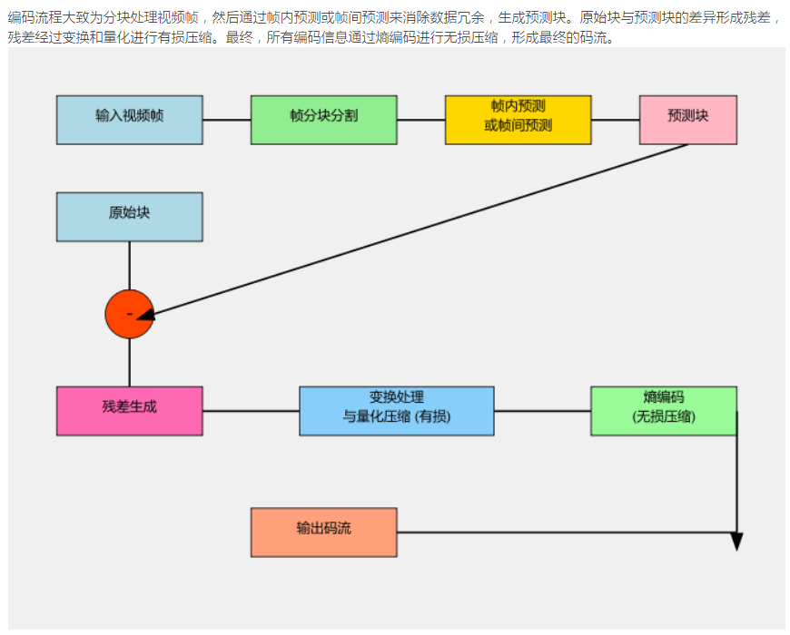

### **在编码过程中，有一个GOP的概念。你觉得GOP的大小对延迟有什么影响**

GOP的大小决定了I帧之间P帧和B帧的数量。当GOP较大时，I帧出现的频率较低，意味着在编码端，为了生成B帧，编码器可能需要缓冲后续帧来进行双向预测，会引入一定的编码延迟。

在解码端，B帧需要等待未来帧的到来才能完成解码并显示，会要求解码器进行更多的帧缓冲和重新排序，增加了端到端的解码延迟。同时，如果流在传输过程中发生错误导致某个I帧丢失，较大的GOP会使解码器需要更长时间才能遇到下一个I帧并恢复画面。较小的GOP意味着I帧更加频繁，虽然会降低压缩效率，但是能减少编码和解码所需的缓冲时间，降低B帧带来的重排序延迟，并且在丢包或切换流时能更快地恢复图像。

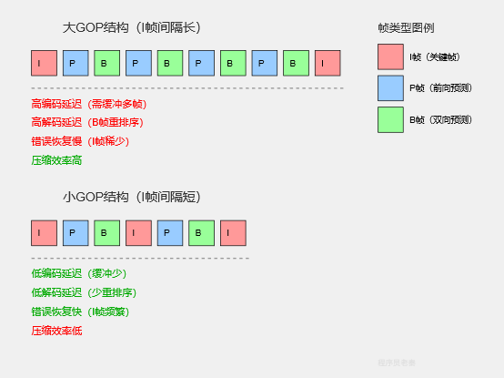

- **如果 GOP = 1 秒 (30帧)**：用户随机进入直播间，平均需要等待 **0.5 秒** 就能遇到下一个 I 帧并显示画面。
- **如果 GOP = 10 秒 (300帧)**：用户平均需要等待 **5 秒** 才能看到第一帧画面！
- *注：虽然流媒体服务器可以用“GOP 缓存”下发上一个 I 帧，但这会把历史数据发给用户，导致播放端产生几秒钟的**累积固有延迟**。*

### **GOP缓存**

没有GOP缓存时，当进行快速定位、倒放等操作时，系统可能需要重复解码整个GOP甚至更长的视频流，造成延迟和资源消耗，播放也可能出现卡顿。而加了GOP缓存后，系统会将解码好的GOP数据临时存储在内存中，当再次需要这些数据时，可以直接从缓存中快速读取，提升了视频的响应速度、流畅度，代价是会消耗额外的内存资源。

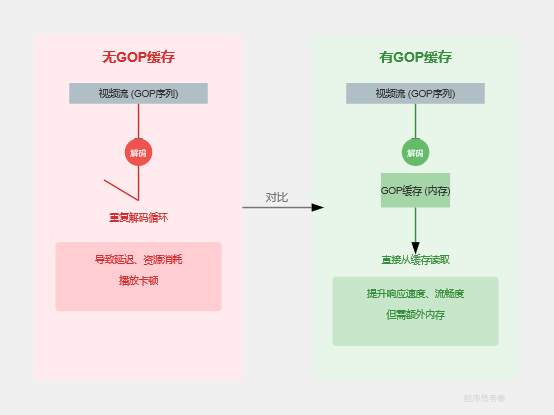

#### 设置关键帧

> `av_opt_set_int` 的第三个参数（示例中的 `0` 和 `1`）代表要设置的具体值。对于 FFmpeg 编码器（如 libx264 或 libx265）中的 `forced_idr` 选项，这两个值的区别在于是否强制生成 IDR 帧（Instantaneous Decoding Refresh，即绝对干净的关键帧）。
>
> - **`forced_idr` 设为 `0`**：表示**不强制**使用 IDR 帧。编码器会根据视频画面的复杂度、GOP 结构以及设置的关键帧间隔（如 `gop_size`）来自由决定当前帧是采用普通帧、P 帧、B 帧还是普通的非 IDR 关键帧（I 帧）。
> - **`forced_idr` 设为 `1`**：表示**强制**将当前帧（或接下来的帧）编码为 **IDR 帧**。IDR 帧是一种特殊的关键帧，它会清空解码器的参考帧缓冲区，之后的画面无法参考 IDR 帧之前的画面。这通常用于场景切换、实时互动推流中需要立即重置画面的场景，或者为了实现精准的视频seek跳转。

### **RTSP协议**

RTSP是一种应用层协议，用于控制多媒体数据流的传输，比如视频和音频。它本身不传输实际的媒体数据。RTSP使用TCP协议进行命令交换，而它控制的实际媒体数据流则使用UDP协议传输。

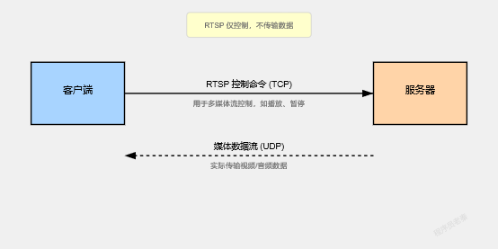

### **RTSP交互过程是**

交互过程首先是客户端发送OPTIONS获取服务器支持的命令，然后通过 DESCRIBE 获取媒体流的信息。客户端对每个媒体轨道发送 SETUP 请求，协商传输方式和端口，为接收RTP数据做好准备。一旦所有流都 SETUP 完成，客户端便发送 PLAY 命令，服务器随即开始通过RTP协议发送实际的音视频数据。在播放过程中，客户端可以发送 PAUSE 或GET_PARAMETER进行控制。最后，当播放结束或不再需要时，客户端发送 TEARDOWN 请求以释放资源，结束整个RTSP会话。

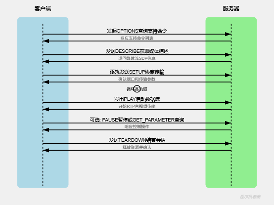

- 信令

  > | **RTSP****信令**  | **功能**                         | **开发中常用场景**                              |
  > | ----------------- | -------------------------------- | ----------------------------------------------- |
  > | **OPTIONS**       | 查询服务器支持的RTSP方法         | 会话开始时了解服务器支持的操作，比如SETUP, PLAY |
  > | **DESCRIBE**      | 获取媒体的SDP描述信息            | 获取媒体流详细信息，为SETUP做准备               |
  > | **SETUP**         | 建立媒体会话，指定传输方式和端口 | 为每个媒体流发送SETUP请求，服务器分配传输资源   |
  > | **PLAY**          | 开始或恢复媒体流传输             | 服务器开始发送媒体数据，可从暂停点恢复          |
  > | **PAUSE**         | 暂停媒体流传输                   | 停止发送媒体数据，保持会话状态                  |
  > | **TEARDOWN**      | 终止RTSP会话，释放资源           | 关闭会话，服务器释放端口和会话状态              |
  > | **GET_PARAMETER** | 获取会话或流的参数               | 查询服务器或媒体流的当前状态信息                |
  > | **SET_PARAMETER** | 设置会话或流的参数               | 发送控制命令或修改参数，比如播放速度            |
  > | **RECORD**        | 开始录制媒体流                   | 用于NVR或监控系统，指示服务器开始录制           |

### **RTMP和RTSP有什么区别**

RTMP 是 Adobe 开发的应用层协议，主要用于在基于TCP的持久连接上传输音视频和数据，设计初衷是为Flash Player提供实时流媒体服务，它同时处理数据传输和控制信令，常见于直播推流，比如OBS到流媒体服务器。

RTSP 是一种网络控制协议，专为流媒体服务器控制多媒体流而设计。它本身不传输音视频数据，而是通过发送控制命令来管理媒体会话，实际的音视频数据传输配合RTP/RTCP协议在UDP或TCP上完成，常见于IP摄像头、安防监控系统等。

| **特征**     | **RTMP**                                                     | **RTSP**                                                     |
| ------------ | ------------------------------------------------------------ | ------------------------------------------------------------ |
| **全称**     | 实时消息传输协议                                             | 实时流传输协议                                               |
| **主要目的** | **传输**音视频、数据和远程过程调用                           | **控制**媒体流，管理会话                                     |
| **协议类型** | 应用层协议                                                   | 应用层协议                                                   |
| **底层传输** | **基于****TCP**的持久连接，用于数据和控制信令                | **控制信令：****TCP**；**音视频数据：**与**RTP/RTCP**配合，RTP基于**UDP**或**TCP** |
| **数据传输** | **自身传输**音视频数据和各种消息                             | **不传输**实际音视频数据，仅传输控制命令。音视频数据通常由RTP/RTCP协议承载。 |
| **控制机制** | 数据传输与控制信令在同一TCP连接上完成，**一体化**解决方案    | 控制信令与音视频数据传输**分离**，RTSP负责控制，RTP/RTCP负责数据传输。 |
| **典型应用** | 早期Flash播放器直播/点播；直播推流；实时通信、交互式应用。   | IP摄像机、安防监控系统；VoIP、视频会议系统；网络硬盘录像机 。 |
| **主要优势** | 低延迟、高效的推流能力；易于实现互动功能，比如弹幕、信令。   | 灵活的会话控制能力；协议模块化，数据传输可选择不同传输层协议。 |
| **发展现状** | 逐渐被基于HTTP的流媒体协议取代，但在直播推流端仍有广泛应用。 | 在安防监控、IP摄像头等领域仍是主流，但点播场景不如HLS/DASH流行。 |

### RTMP 协议,amf信令，过程

| **方法名**       | **方向**         | **描述**                                                     | **用途**                                                     |
| ---------------- | ---------------- | ------------------------------------------------------------ | ------------------------------------------------------------ |
| **connect**      | 客户端 -> 服务器 | 建立与 RTMP 服务器上特定应用程序的连接。**所有** **RTMP** **会话的起点。** | 应用程序启动，连接到直播平台或视频服务器。                   |
| **_result**      | 服务器 -> 客户端 | 对**成功执行**的命令的响应。                                 | 表示连接或命令执行成功，客户端可继续后续操作。               |
| **createStream** | 客户端 -> 服务器 | 在已建立的连接上创建一个**逻辑流通道**。后续的 play 或 publish 命令都基于这个流 ID。 | 为播放或发布准备一个独立的流，是进行流操作的前提。           |
| **publish**      | 客户端 -> 服务器 | 通知服务器客户端将开始向指定流名称**发布**音频/视频数据。    | 推流器向直播服务器推送直播内容。                             |
| **play**         | 客户端 -> 服务器 | 通知服务器客户端希望**播放**指定流名称的音频/视频数据。      | 播放器从直播服务器拉取直播内容或点播视频比如VLC 播放 RTMP 流。 |
| **onStatus**     | 服务器 -> 客户端 | 服务器向客户端发送**状态更新**，指示命令执行或流的状态变化。 | 客户端接收流状态通知，如连接成功、推流开始、播放开始/停止，**非常关键的反馈机制**。 |
| **onMetaData**   | 服务器 -> 客户端 | 包含视频宽度、高度、帧率、音频采样率、时长等流的元数据信息。 | 播放器获取流的详细信息，用于正确初始化解码器和显示界面。     |

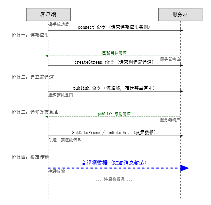

### **RTMP message和chunk**

Message代表了一个完整的应用数据，比如一个视频帧、一个音频包、一个AMF命令或者一个控制消息，具有特定的消息类型、时间戳和流ID。而块则是消息在网络传输时，被拆分或组合成的物理传输单元，每个块包含一个头部和一部分消息负载数据。一个大的消息可能会被分割成多个块进行传输，而这些块在接收端会被重新组装成完整的消息。

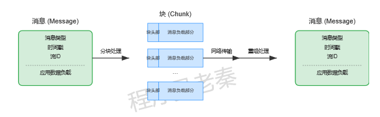

### ffmpeg编码保证传输流畅性

核心在于引入缓冲机制和多线程。，我们将编码和传输分离到不同的线程，一个编码线程负责将FFmpeg编码完成的音视频帧推入一个线程安全的队列，作为“生产者”。另一个RTMP发送线程作为“消费者”，持续从队列中取出数据并发送。
发送线程会利用音视频帧的时间戳，根据这些时间戳来控制发送速率，保证数据按照真实的播放时间间隔发送，而不是编码完成的瞬时速度。即便编码在某个时刻很快，数据会先堆积在缓冲区。如果编码变慢，发送线程会消耗缓冲区内已有的数据。同时在FFmpeg编码参数上，通过-bufsize和-maxrate参数限制输出码流的瞬时峰值

### 如果进行获取屏幕数据

核心在于通过libavdevice模块，封装了各个操作系统底层的图形API和屏幕捕获机制，这些底层API允许FFmpeg直接访问或复制显卡缓冲区中的像素数据，实时获取桌面帧。获取到原始图像数据后，再利用libavcodec库进行视频编码，最终生成视频文件或实时流。

### **FFmpeg中，你用过哪些相关的缩放函数**

主要会用到 libswscale 库提供的函数，还有 libavfilter 库构建的视频滤镜，

| **函数名**          | **所属库****/****模块** | **作用**                         | **关键参数****/****特点**                                    | **使用场景**                            |
| ------------------- | ----------------------- | -------------------------------- | ------------------------------------------------------------ | --------------------------------------- |
| **sws_getContext**  | libswscale              | **初始化缩放上下文**             | 源图像宽高、像素格式；目标图像宽高、像素格式；缩放算法       | 开始进行图像缩放或像素格式转换前        |
| **sws_scale**       | libswscale              | **执行图像缩放和色彩空间转换**   | 上下文；源图像的行指针数组和每行字节数数组；目标图像的行指针数组和每行字节数数组 | 对每一帧的像素数据进行处理              |
| **sws_freeContext** | libswscale              | **释放缩放上下文资源**           | 要释放的上下文对象                                           | 缩放操作完成后                          |
| **scale**           | libavfilter             | **通过滤镜方式对视频帧进行缩放** | FFmpeg命令行参数或API中构建滤镜链时设置其选项                | FFmpeg命令行工具或C++代码中构建的滤镜图 |

### 音频重采样

>  音频重采样指的是将数字音频信号从一个采样率转换为另一个采样率的过程，比如将44.1kHz的音频转换为48kHz。需要重采样的主要原因是为了保证音频在不同设备、系统或应用之间的兼容性，因为它们可能对采样率有特定的要求，比如专业音频设备常使用48kHz，而CD标准是44.1kHz。开发中我们可以选择降低采样率来减少音频数据量。降低CPU处理负荷，节省内存、存储空间和网络带宽，提高应用的响应速度。

### 音视频重采样接口

##### 音频

> ```
> [ 1. 初始化 ] 
>   swr_alloc_set_opts2() 配置输入输出参数
>        ↓
>   swr_init() 激活上下文
>        ↓
> [ 2. 循环处理每一帧 ]
>   swr_get_delay() 计算包括延迟在内的输出样本数
>        ↓
>   av_frame_get_buffer() 给 out_frame 分配内存
>        ↓
>   swr_convert() 执行真正的 PCM 数据转换
>        ↓
>   处理转换后的 out_frame (如送入编码器)
>        ↓
> [ 3. 结束冲刷 (Flush) ]
>   swr_convert(in=NULL, in_count=0) 导出残留在内部滤波器的尾部音频
>        ↓
> [ 4. 释放销毁 ]
>   swr_free() 释放重采样器
> ```
>
> ```c++
> // 假设全局/类成员保存上下文
> SwrContext* swr_ctx = nullptr;
> 
> // ================= 步骤 1：初始化（只做一次） =================
> void init_resampler() {
>     AVChannelLayout in_ch = AV_CHANNEL_LAYOUT_STEREO;  // 输入双声道
>     AVChannelLayout out_ch = AV_CHANNEL_LAYOUT_STEREO; // 输出双声道
> 
>     // 直接一步创建并配置
>     swr_alloc_set_opts2(&swr_ctx,
>         &out_ch, AV_SAMPLE_FMT_S16, 48000,      // 输出：48000Hz, S16
>         &in_ch,  AV_SAMPLE_FMT_FLTP, 44100,     // 输入：44100Hz, FLTP
>         0, nullptr);
> 
>     swr_init(swr_ctx); // 初始化
> }
> 
> // ================= 步骤 2：转换一帧（极简核心） =================
> AVFrame* resample_one_frame(AVFrame* in_frame) {
>     // 1. 创建输出 Frame
>     AVFrame* out_frame = av_frame_alloc();
>     
>     // 2. 只需指定输出的关键参数（无需手动计算 nb_samples 和手动分配内存！）
>     out_frame->format = AV_SAMPLE_FMT_S16;
>     out_frame->sample_rate = 48000;
>     out_frame->ch_layout = AV_CHANNEL_LAYOUT_STEREO;
> 
>     // 3. 一行代码自动完成：延迟计算 + 内存分配 + 重采样转换
>     int ret = swr_convert_frame(swr_ctx, out_frame, in_frame);
>     if (ret < 0) {
>         av_frame_free(&out_frame);
>         return nullptr;
>     }
> 
>     // 4. 透传或重算时间戳
>     out_frame->pts = av_rescale_q(in_frame->pts, 
>                                   {1, in_frame->sample_rate}, 
>                                   {1, out_frame->sample_rate});
>     return out_frame; // 直接拿去用即可
> }
> 
> // ================= 步骤 3：释放销毁 =================
> void release_resampler() {
>     if (swr_ctx) {
>         swr_free(&swr_ctx); // 会自动将 swr_ctx 置为 nullptr
>     }
> }
> ```
>
> 

##### 视频

> ```
> [ 1. 初始化 ] 
>   sws_getContext() 创建并配置转换器（输入/输出宽高、像素格式、缩放算法）
>        ↓
> [ 2. 循环处理每一帧 ]
>   创建 out_frame 并分配内存 (av_frame_get_buffer)
>        ↓
>   sws_scale_frame() 一行代码完成缩放与像素转换 (如 BGR0 -> YUV420P)
>        ↓
> [ 3. 释放销毁 ]
>   sws_freeContext() 释放转换器上下文
> ```
>
> ```c++
> SwsContext* sws_ctx = nullptr;
> 
> // 目标参数（如缩放到 1280x720，格式为 YUV420P）
> const int DST_WIDTH  = 1280;
> const int DST_HEIGHT = 720;
> const AVPixelFormat DST_PIX_FMT = AV_PIX_FMT_YUV420P;
> 
> // ================= 步骤 1：初始化（只做一次） =================
> void init_video_scaler(int src_w, int src_h, AVPixelFormat src_fmt) {
>     // 创建缩放/转换上下文
>     sws_ctx = sws_getContext(
>         src_w, src_h, src_fmt,          // 输入：宽高、格式 (如 1920x1080 BGR0)
>         DST_WIDTH, DST_HEIGHT, DST_PIX_FMT, // 输出：宽高、格式 (如 1280x720 YUV420P)
>         SWS_BILINEAR,                  // 缩放算法（双线性插值，速度与画质均衡）
>         nullptr, nullptr, nullptr
>     );
> }
> 
> // ================= 步骤 2：转换一帧画面（极简核心） =================
> AVFrame* scale_one_frame(AVFrame* in_frame) {
>     if (!sws_ctx || !in_frame) return nullptr;
> 
>     // 1. 创建输出 Frame 并配置参数
>     AVFrame* out_frame = av_frame_alloc();
>     out_frame->width  = DST_WIDTH;
>     out_frame->height = DST_HEIGHT;
>     out_frame->format = DST_PIX_FMT;
> 
>     // 2. 为输出帧分配内存（自动对齐）
>     if (av_frame_get_buffer(out_frame, 0) < 0) {
>         av_frame_free(&out_frame);
>         return nullptr;
>     }
> 
>     // 3. 核心：执行转换 (FFmpeg 新版推荐接口，直接传 Frame)
>     // 内部自动匹配 data 指针和 linesize
>     int ret = sws_scale_frame(sws_ctx, out_frame, in_frame);
>     if (ret < 0) {
>         av_frame_free(&out_frame);
>         return nullptr;
>     }
>     /** 或者用sws_scale
>     // 经典底层写法：传入 data 和 linesize
> 	sws_scale(
>    		 sws_ctx,
>     		(const uint8_t* const*)in_frame->data, in_frame->linesize, 		// 输入数据和跨度
>    						 0, in_frame->height,                                       // 从第 0 行开始，处理整屏高度
>                          out_frame->data, out_frame->linesize                       // 输出数据和跨度
> 	);
>     */
> 
>     // 4. 透传时间戳
>     out_frame->pts = in_frame->pts;
> 
>     return out_frame; // 转换完成，可直接送入编码器或渲染器
> }
> 
> // ================= 步骤 3：释放销毁 =================
> void release_video_scaler() {
>     if (sws_ctx) {
>         sws_freeContext(sws_ctx);
>         sws_ctx = nullptr;
>     }
> }
> ```

| 阶段         | 音频 (libswresample)                | 视频 (libswscale)               |
| ------------ | ----------------------------------- | ------------------------------- |
| **头文件**   | <libswresample/swresample.h>        | <libswscale/swscale.h>          |
| **上下文**   | SwrContext                          | SwsContext                      |
| **配置创建** | swr_alloc_set_opts2()               | sws_getContext()                |
| **初始化**   | swr_init()                          | *(已在 getContext 中隐式完成)*  |
| **执行转换** | swr_convert() / swr_convert_frame() | sws_scale() / sws_scale_frame() |
| **释放**     | swr_free()                          | sws_freeContext()               |

### avformat_alloc_context 和 AVFormatContext 区别

> ### 1. AVFormatContext（结构体 / 类型）
>
> - **本质**：它是一个 C 语言的 **struct（结构体）**。
> - **作用**：它是 FFmpeg (libavformat) 中**最核心的上下文结构体**，统领整个媒体文件的封装/解封装过程。
> - **包含内容**：
>   - 输入/输出格式信息（iformat / oformat）
>   - 音视频流信息（streams，包含音频流、视频流、字幕流等）
>   - 媒体元数据（metadata，如标题、作者）
>   - 文件时长（duration）、码率（bit_rate）
>   - I/O 上下文（pb，即 AVIOContext）
> - **类似概念**：类似于面向对象编程中的 **“类（Class）”**。
>
> ### 2. avformat_alloc_context（函数 / 构造器）
>
> - **本质**：它是一个 C 语言 **函数**。
> - **原型**：AVFormatContext *avformat_alloc_context(void);
> - **作用**：在内存的堆区（Heap）中**动态分配**一个 AVFormatContext 结构体的空间，并将其内部字段**初始化为默认值**。
> - **类似概念**：类似于面向对象编程中的 **new 操作符或无参构造函数**。

- 所以销毁的时候，结构体不需要手动销毁，而指针结构体需要通过`**avformat_free_context**c`来销毁

### `avcodec_send_packet `返回的错误处理

> | 操作结果            | 含义                     | 下一步                                 |
> | ------------------- | ------------------------ | -------------------------------------- |
> | send 返回 0         | 当前输入已被接受         | 可以释放调用方 packet 引用，继续取输出 |
> | send 返回 EAGAIN    | 当前输入未被接受         | 保留 packet，取输出后重试原输入        |
> | receive 返回 0      | 得到一帧输出             | 处理后继续取输出                       |
> | receive 返回 EAGAIN | 暂无可交付输出，需要输入 | 切回提交输入                           |
> | receive 返回 EOF    | 排空结束                 | 结束排空流程                           |
>
> - 正常结束时提交空 packet 进入 draining，处理提交状态后接收输出直到 EOF；排空并不等于直接丢掉缓存。
> - `avcodec_flush_buffers` 是清理解码状态，不能当作普通 EAGAIN 的解决办法。
> - 严格区分 packet 引用生命周期、输入是否被接受、输出是否被读取。

### 三种最常见 YUV 格式

| 格式名称      | UV 的宽度               | UV 的高度               | 单个 UV 的面积 (大小)         | 1 帧总大小 (Y+U+V)   | 含义与特点                                                   |
| ------------- | ----------------------- | ----------------------- | ----------------------------- | -------------------- | ------------------------------------------------------------ |
| **YUV 4:4:4** | **`WW`** (不减)         | **`HH`** (不减)         | **`W×HW×H`** (与Y一样大)      | **`3×W×H3×W×H`**     | **无损色度**。每个 Y 都有独立的 UV，画质最高，常用于专业后期、屏幕采集。 |
| **YUV 4:2:2** | **`W/2W/2`** (横向减半) | **`HH`** (纵向不减)     | **`W×H22W×H`** (Y 的一半)     | **`2×W×H2×W×H`**     | **横向抽样**。左右两个像素共享一组 UV，常用于广电、专业摄像机（如 ProRes）。 |
| **YUV 4:2:0** | **`W/2W/2`** (横向减半) | **`H/2H/2`** (纵向减半) | **`W×H44W×H`** (Y 的四分之一) | **`1.5×W×H1.5×W×H`** | **横纵都减半**。田字格4个像素共享一组 UV，**网络视频、电影、直播最常用**。 |

### yuv420p打包格式

| 格式类型                     | 代表格式                    | 内存排列方式        | 特点                                                         |
| ---------------------------- | --------------------------- | ------------------- | ------------------------------------------------------------ |
| **平面格式 (Planar)**        | **YUV420P** (如 I420, YV12) | YYYY... UU... VV... | Y、U、V **完全独立**成 3 个连续区域。                        |
| **半平面格式 (Semi-Planar)** | **NV12 / NV21**             | YYYY... UVUVUV...   | Y 是独立区域，**U 和 V 交叉混排**在另一个区域（共 2 个区域）。 |
| **打包格式 (Packed)**        | **YUYV / YVYU**             | YUYV YUYV...        | Y、U、V **全挤在一起**，像素点连续交叉存储（只有 1 个区域）。 |

#### 【NV12和NV21格式】

NV12，它的存储顺序是先存Y分量，再UV进行交替存储。

NV21，它的存储顺序是先存Y分量，再VU交替存储。

### h265对于h264的改进

| 特性 / 指标              | **H.264 (AVC)**      | **H.265 (HEVC)**                  | 带来的实际提升               |
| ------------------------ | -------------------- | --------------------------------- | ---------------------------- |
| **同画质码率节省**       | 基准                 | **节省约 40% ~ 50%**              | 带宽成本减半、存储减半       |
| **最大块大小**           | 固定的 `16×1616×16`  | 最大 `64×6464×64`（CTU 四叉树）   | 4K/8K 高分辨率下编码效率剧增 |
| **帧内预测方向**         | 9 种                 | **35 种**                         | 边缘、斜线及渐变过渡更细腻   |
| **变换尺寸 (Transform)** | `4×4,8×84×4,8×8`     | **`4×4∼32×324×4∼32×32`** 动态适应 | 能量更集中，高频细节保留更好 |
| **环路后处理滤波**       | 仅 Deblocking Filter | **Deblocking + SAO**              | 画面少噪点、无色带断层       |
| **多核并行机制**         | Slice (损耗画质)     | **Tile + WPP (无损压缩率)**       | 充分压榨多核多线程算力       |
| **主流支持分辨率**       | 1080P 为主           | **4K / 8K / 120fps / HDR**        | 专为超高清与宽色域设计       |

### h264中的nalu头部结构

```
+-------------------+-----------------+-------------------+
| forbidden_zero_bit|   nal_ref_idc   |   nal_unit_type   |
|      (1 bit)      |     (2 bits)    |      (5 bits)     |
+-------------------+-----------------+-------------------+
```

- **`forbidden_zero_bit`**：固定为 0。

- **`nal_ref_idc`（2位）**：就是你说的参考级别/重要性标记。数值范围是 `0 ~ 3`：

  - **`00`（0）**：表示该 NALU 属于非参考帧，或者是辅助信息，可以被丢弃而不影响图像序列的完整性。

  - **大于 0**：表示该 NALU 包含参考帧的片（Slice）、SPS、PPS 或 IDR 图像等重要内容，解码器必须参考或保留它们。
  
    > | 值   | 意义                 |
    > | ---- | -------------------- |
    > | 0    | 非参考 NALU          |
    > | 1    | 参考重要性指示值为 1 |
    > | 2    | 参考重要性指示值为 2 |
    > | 3    | 参考重要性指示值为 3 |

**`nal_unit_type`（5位）**：表示 NALU 的类型（如 IDR 帧、SPS、PPS、SEI 或普通 Slice 等）。

> | NALU Type | 含义          | 能否判断帧类型     |
> | --------- | ------------- | ------------------ |
> | 1         | Non-IDR Slice | 可能是 I、P、B     |
> | 5         | IDR Slice     | IDR，属于 I 类编码 |
> | 6         | SEI           | 补充增强信息       |
> | 7         | SPS           | 序列参数集         |
> | 8         | PPS           | 图像参数集         |
> | 9         | AUD           | 访问单元分隔符     |

#### slice header

>  一帧 → 一个或多个 Slice → 每个 Slice 包含 NALU Header + Slice Header + Slice Data

**Slice Header（可变长度，按比特位计算）**：紧随 NALU 头之后，记录了当前片（Slice）的各种控制参数，例如：

> 可变长度：根据sps/pps来进行判断

- 片类型（Slice Type，如 P帧、B帧、I帧）
- 图像 ID（pic_parameter_set_id、frame_num）
- 图像顺序计数（POC 相关信息）
- 参考帧列表重排序及加权预测参数
- 量化参数初始值（slice_qp_delta）等


### 编码变换的过程

```
【原始视频帧 AVFrame (YUV)】
                            │
                            ▼
    ┌──────────────── 1. 预测编码 (Prediction) ────────────────┐
    │  • 帧内预测 (Intra)：利用当前帧周围像素猜中间像素        │
    │  • 帧间预测 (Inter)：利用前后帧找运动矢量(MV)            │
    └───────────────────────┬─────────────────────────────────┘
                            │ 计算出【残差 Residual = 原始图像 - 预测图像】
                            ▼
    ┌──────────────── 2. 变换编码 (Transform) ─────────────────┐
    │  • 离散余弦变换 (DCT / DST)                              │
    │  • 把空间域的残差矩阵 ──> 转为频域系数 (能量集中到低频)  │
    └───────────────────────┬─────────────────────────────────┘
                            │ 得到【频域系数矩阵 (完全无损)】
                            ▼
    ┌──────────────── 3. 量 化 (Quantization) ─────────────────┐
    │  • 除以量化步长并四舍五入 (QP 控制)                      │
    │  • 【唯一发生有损压缩的环节】大量的微小高频系数直接归零 │
    └───────────────────────┬─────────────────────────────────┘
                            │ 得到【量化后的大量带 0 矩阵】
                            ▼
    ┌──────────────── 4. 熵编码 (Entropy Coding) ──────────────┐
    │  • CABAC / CAVLC 无损数据压缩                            │
    │  • 用短码表示高频符号，把残差、运动矢量、头信息打成二进制│
    └───────────────────────┬─────────────────────────────────┘
                            │
                            ▼
               【压缩后码流 AVPacket (H.264/H.265 NALU)】
```


### avpacket和avframe的区别

| 对比维度       | AVPacket 的数据结构属性                  | AVFrame 的数据结构属性                             |
| -------------- | ---------------------------------------- | -------------------------------------------------- |
| **关注的核心** | **时间与流传输**（何时播、属于哪个流）   | **空间与画面布局**（多大、多宽、怎么画）           |
| **内存组织**   | **一维扁平化**：只有一个 data 指针       | **多维/分平面**：有 data[8] 指针数组               |
| **几何参数**   | **完全没有** width、height、linesize     | **必须有** width、height、linesize[8]（跨度/步长） |
| **色彩/采样**  | 结构体内**不包含**像素格式（format）信息 | **必须明确包含** format（如 YUV420P、BGR0 等）     |
| **音频通道**   | 结构体内**不包含**声道布局               | **包含** ch_layout、nb_samples（采样点数）         |

### data和linesize区别

| **data**     | uint8_t *data[8] | **指针数组**。分别指向图像各个**颜色平面（Plane）**的内存起始地址。 |
| ------------ | ---------------- | ------------------------------------------------------------ |
| **linesize** | int linesize[8]  | **整数数组**。表示各个颜色平面中**一行像素所占用的实际字节数**（包含填充对齐字节）。 |

- **data**：回答的是 **“数据存放在哪？”**（内存首地址指针）。
- **linesize**：回答的是 **“每一行数据有多宽/占多少字节？”**（行步长 / Stride）。

- **data[0]**：指向 **Y 平面**起始地址；**linesize[0]**：Y 平面一行的字节数（等于或略大于 width）。
- **data[1]**：指向 **U 平面**起始地址；**linesize[1]**：U 平面一行的字节数（大约是 Y 的一半）。
- **data[2]**：指向 **V 平面**起始地址；**linesize[2]**：V 平面一行的字节数（大约是 Y 的一半）。

假设是一张分辨率为  1920x1080

- height = 1080
- linesize[0] = 7680 字节（假设是 BGR0 格式，无额外 padding）

```
data[0] ──> [ 第 1 行数据 (7680 字节) ]
            [ 第 2 行数据 (7680 字节) ]  <── data[0] + 1 * linesize[0]
            [ 第 3 行数据 (7680 字节) ]  <── data[0] + 2 * linesize[0]
            ...
            [ 第 1080 行数据 (7680 字节) ] <── data[0] + 1079 * linesize[0]
```

### 音频的48000hz，采样点，样本帧，编码帧

> 48000hz是代表一秒发送48000个样本帧，一个样本帧双声道的话有2个采样点，然后aac一个编码帧需要1024个样本帧

### rtmp中的msg_header中的timestamp,extend_timestamp以及timestamp_delta的区别

> 装的是ms单位，`timestamp `**当前这个 Message 的“绝对时间戳**，delta是上一个包相差了多少毫秒，extend_timestamp需要当timestamp全是1时，extend_timestamp才作为原本的时间戳

> 在 RTMP 协议中，出现以下 **3 种情况** 时，必须发送包含“绝对时间戳”的完整包头（Type 0，11 字节）：
>
> 1. **流刚开始建立时的【第一个包】**（比如音频流的第一个包、视频流的第一个包）；
> 2. **时间戳发生回退/跳跃时**（比如播放过程中用户点击了进度条 Seek 回退，或者推流异常重置）；
> 3. **切换了新的逻辑流通道（Stream ID 发生变化）**。

#### 发送msg_header的timestamp计算

> 会在type0的时候保存时间戳ms，然后发送type1的时候，每次获取的时间戳减去上次获取的时间戳；然后将现在的时间戳保存作为下一次计算

### 时间戳和时间基转换的接口

> #### 1. av_rescale_q() —— 单个时间戳跨时间基换算（最通用）
>
> - **函数原型**：
>
>   ```
>   int64_t av_rescale_q(int64_t a, AVRational bq, AVRational cq);
>   ```
>
> - **作用**：将时间戳 a 从源时间基 bq 换算到目标时间基 cq。
>
> - **数学计算**：
>
>   ```
>   a×bq.num×cq.denbq.den×cq.numa×bq.den×cq.numbq.num×cq.den
>   ```
>
>   （内部使用 128 位大数计算，防止乘法溢出）。
>
>   
>
> - **实战示例**（将 90k 视频 PTS 换算成毫秒 ms）：
>
>   ```
>   int64_t pts_90k = 180000;
>   // 从 1/90000 转到 1/1000 (毫秒)
>   int64_t pts_ms = av_rescale_q(pts_90k, (AVRational){1, 90000}, (AVRational){1, 1000}); 
>   // 算出来 pts_ms = 2000 ms
>   ```
>
> #### 2. av_packet_rescale_ts() —— 数据包一键全量转换（最省心）
>
> - **函数原型**：
>
>   ```
>   void av_packet_rescale_ts(AVPacket *pkt, AVRational tb_src, AVRational tb_dst);
>   ```
>
> - **作用**：**一行代码同时换算** AVPacket 内部的 pts、dts 和 duration。
>
> - **实战示例**（编码器输出写入 MP4 封装流）：
>
>   ```
>   // 编码器的 time_base (如 1/90000) -> 封装流的 time_base (如 1/1000)
>   av_packet_rescale_ts(pkt, codec_ctx->time_base, out_stream->time_base);
>   ```
>
> #### 3. av_q2d() —— 时间基转浮点秒数（做音视频同步、计算真实物理时间）
>
> - **函数原型**：
>
>   ```
>   static inline double av_q2d(AVRational a) {
>       return a.num / (double) a.den;
>   }
>   ```
>
> - **作用**：将 AVRational 分数转化为 double 小数。
>
> - **实战示例**（将 PTS 转换成真实的“秒”）：
>
>   ```
>   // 得到这一帧在现实世界的第几秒（如 1.5 秒）
>   double current_sec = frame->pts * av_q2d(stream->time_base);
>   ```
>
> ------

### RTP

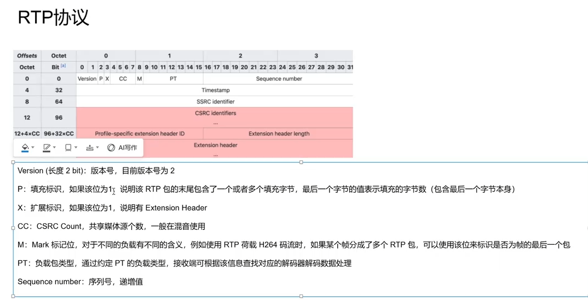

> - mark
>
>   如果是0，就不是视频帧的最后一个包，1才是帧的最后一个包；保证解码完成
>
> 相对时间戳。一个视频帧可能被拆分成多个 RTP 包，这些包的时间戳相同；不同帧的时间戳不相同。初始值是随机的，增量规则如下：
>
> - **音频**：增量等于当前 RTP 包携带的音频采样点数量。例：音频采样率 48kHz，每包携带 20ms 音频数据，增量 = 48kHz × 0.02s = 960。
>
> - 视频：每帧按照 90000 / 帧率
>
>   进行递增：
>
>   - 15fps：每帧 + 6000
>   - 25fps：每帧 + 3600
>   - 30fps：每帧 + 3000
>   - 60fps：每帧 + 1500
>
> - SSRC
>
>   媒体源标识，用来标识一条 RTP 媒体流。同一个 UDP 端口上可能同时传输多条 RTP 流，依靠 SSRC 做区分。
>
> - CSRC
>
>   标识当前 RTP 包里音频的贡献者列表。

> #### 【第 0 字节】：基础控制位
>
> 1. **V (Version，2 bits)**：版本号。当前协议固定为 **2**（二进制 10）。
> 2. **P (Padding，1 bit)**：填充标志。如果为 1，说明这个包末尾有额外的填充字节（在某些加密算法需要对齐块合大小时使用）。通常填 0。
> 3. **X (Extension，1 bit)**：扩展标志。如果为 1，说明在 12 字节固定头之后还挂着自定义的“扩展头”。通常填 0。
> 4. **CC (CSRC Count，4 bits)**：协同源标识符的数量。表示后面跟着几个 CSRC（0~15 个）。单路推流通常填 0。
>
> ------
>
> 
>
> #### 【第 1 字节】：标记与负载类型
>
> 1. **M (Marker，1 bit) 【极其重要】**：
>    - **视频中**：用来标记**“当前视频帧的最后一个分片包”**。
>      - 例如一个 I 帧切成 5 个 FU-A 包，前 4 个包的 M=0，第 5 个包（最后一个）的 M=1。播放器看到 M=1 就知道一帧收齐了，可以送去解码渲染了。
>    - **音频中**：通常用来标记静音后说话的第一声（一段语音的开始）。
> 2. **PT (Payload Type，7 bits) 【重要】**：
>    - 负载格式编号（0 ~ 127）。告诉接收端里面装的是什么编码。
>    - 常见取值：
>      - 0：PCMU (G.711u 音频)
>      - 8：PCMA (G.711a 音频)
>      - 96 ~ 127：**动态负载**（如 H.264、H.265、AAC 都在这个范围，具体对应在 SDP 的 a=rtpmap:96 H264/90000 中协商指定）。
>
> ------
>
> 
>
> #### 【第 2 ~ 3 字节】：序列号
>
> 1. **Sequence Number (16 bits) 【极其重要】**：
>    - 包序列号，初始值随机，**每发一个 RTP 包就自增 1**（到 65535 后回绕到 0）。
>    - 接收端靠它来：**检测网络丢包**、**对乱序到达的 UDP 包重新排序**。
>
> ------
>
> 
>
> #### 【第 4 ~ 7 字节】：时间戳
>
> 1. **Timestamp (32 bits) 【核心字段】**：
>
>    - 记录这个包里数据的**采样生成时刻**。
>
>    - **作用**：音视频同步（AV Sync）、抖动消除、按正确帧率播放。
>
>    - **特性**：
>
>      - 视频时钟频率一般是 90000 Hz（90kHz，即 1 秒走 90000 个滴答）。
>
>      - 如果视频是 30 fps，每两帧之间的时间戳差值就是：
>
>        ```
>        90000/30=300090000/30=3000
>        ```
>
>        。
>
>        
>
>      - **同一个视频帧拆出来的多个 FU-A 分片包，时间戳必须完全相同！**
>
> ------
>
> 
>
> #### 【第 8 ~ 11 字节】：同步源标识符
>
> 1. **SSRC (Synchronization Source，32 bits)**：
>    - 同步源 ID，在同一个 RTP 会话中必须全局唯一（通常发流端随机生成一个数字）。
>    - 作用：区分不同的流。比如一个房间有 4 个人同时在推流，接收端靠 SSRC 区分谁是谁的话筒和摄像头。
>
> ------
>
> 
>
> #### 【可选附加字段】：
>
> 1. **CSRC (Contributing Source)**：
>    - 只有在多方会议混音器（Mixer）场景下才会用到，把多个说话人的 SSRC 列在这里。通常忽略。

### RTP发送包前缀头部格式

#### TCP发送的固定前缀（udp不用加）

```c++
prefix[0] = '$'; // 一个固定帧起始标志
prefix[1] = (uint8_t)client.rtp_channel;

prefix[2] = (uint8_t)(packet.bytes.size() >> 8);
prefix[3] = (uint8_t)(packet.bytes.size() & 0xffu);
// **u = unsigned**，字面量类型变为 `unsigned int`
```

```
+--------+---------+---------+----------------+
| 0x24   | Channel | Length  | RTP Packet     |
| 1 byte | 1 byte  | 2 byte  | 1200 bytes     |
+--------+---------+---------+----------------+
```

> RTP/RTCP 通道编号，例如： 0 = RTP ;1 = RTCP

### RTSP发包格式

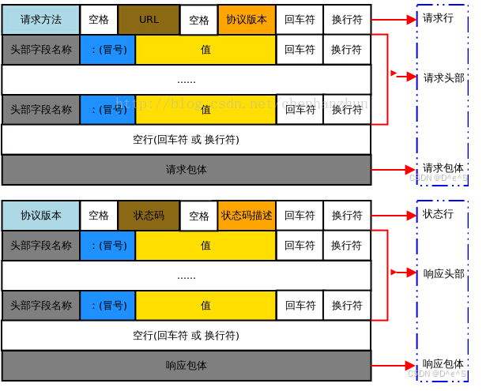

#### RTSP流程

```
① 建立 TCP 连接
   ↓
TCP connect(服务器IP:554/8554)

② OPTIONS
   ↓
告诉服务器：
“你支持哪些 RTSP 方法？”

③ DESCRIBE
   ↓
告诉服务器：
“我要这个 RTSP URL 对应的媒体信息”
   ↓
服务器返回 SDP
   ↓
SDP 告诉客户端：
- 有视频还是音频
- H264 / H265 / AAC
- payload type
- 时钟频率
- track 地址
- SPS/PPS 等参数

④ SETUP
   ↓
针对 SDP 中的具体 track 建立媒体传输
   ↓
例如：
video → trackID=0
audio → trackID=1

⑤ PLAY
   ↓
告诉服务器：
“开始给我发送媒体”

⑥ RTP / RTCP
   ↓
真正开始传输 H264 / AAC
```

### cseq有什么作用

> 哪一方发送请求就是谁维护cseq，接收方需要相应相同的cseq，每次客户端发送一次都会+1；
>
> 作用是**匹配请求与响应**，并**保证信令消息的处理顺序**

### SDP

```
v=0 // SDP 版本是 0
o=- 9172563812 1 IN IP4 192.168.1.100
t=0 0 // 这个会话没有规定开始时间和结束时间。
a=control:* // * 对应的是整个 RTSP session
m=video 0 RTP/AVP 96 
a=rtpmap:96 H264/90000
a=control:track0 // track0 对应具体的视频媒体
```

> ```
> o=
> │
> ├── -
> │   创建者名称，这里没特别指定
> │
> ├── 9172563812
> │   session id
> │
> ├── 1
> │   session version
> │
> ├── IN IP4
> │   Internet + IPv4
> │
> └── 192.168.1.100
>     地址
> ```
>
> 
>
> ```
> m=video 0 RTP/AVP 96
>   │      │   │    │
>   │      │   │    └── 96：给这个编码一个编号
>   │      │   └─────── RTP/AVP：使用 RTP
>   │      └─────────── 端口，这里暂时填 0
>   └────────────────── video：视频
> ```
>
> ```
> a=rtpmap:96 H264/90000
> 
> RTP Header
>     Payload Type = 96
>     ↓
> 客户端知道
>     ↓
> 这是 H264
> ```
>
> ```
> a=control:track0
> 
> 主URL：
> rtsp://192.168.1.100:8554/live
> 
> 视频轨道：
> track0
> ```
>
> > 可以发送 SETUP rtsp://192.168.1.100:8554/live/track0 获取视频轨道

### FU-A结构

```
0                   1                   2                   3
 0 1 2 3 4 5 6 7 8 9 0 1 2 3 4 5 6 7 8 9 0 1 2 3 4 5 6 7 8 9 0 1
+-+-+-+-+-+-+-+-+-+-+-+-+-+-+-+-+-+-+-+-+-+-+-+-+-+-+-+-+-+-+-+-+
| FU Indicator  |   FU Header   |   Original NAL payload data...
+-+-+-+-+-+-+-+-+-+-+-+-+-+-+-+-+-+-+-+-+-+-+-+-+-+-+-+-+-+-+-+-+
```

> 当使用 FU-A 打包时，每一个包含 FU-A 的 RTP 包，其负载（Payload）由两部分组成：**FU Indicator（FU 指示字节）** + **FU Header（FU 头部字节）**，紧接着才是被拆分的一部分原始 NALU 数据。

> #### 1. FU Indicator（1 字节）
>
> 它的结构和普通的 H.264 NALU 头一模一样，用来伪装成一个特殊的 NALU 类型：
>
> - `forbidden_zero_bit` (1 bit)：固定为 0。
> - `nal_ref_idc` (2 bits)：继承原来那个大 NALU 的参考级别。
> - `nal_unit_type` (5 bits)：**固定为 28**。数字 28 在 H.264 RTP 规范中专门代表 FU-A。接收端一看类型是 28，就知道：“哦，这不是一个完整的 NALU，这是一个分片包（FU-A）！”
>
> #### 2. FU Header（1 字节）
>
> 用来描述这个分片在这个大 NALU 里的位置状态：
>
> - **`S` (Start, 1 bit)**：**开始位**。如果这个 RTP 包是这个大 NALU 的**第一个分片**，S 位置 1，否则置 0.
> - **`E` (End, 1 bit)**：**结束位**：如果这个 RTP 包是这个大 NALU 的**最后一个分片**，E 位置 1，否则置 0.（这和 RTP 报头里的 M 位配合，M 位代表最后一帧，E 位代表最后一个分片）。
> - **`R` (Reserved, 1 bit)**：保留位，固定为 0。
> - **`Type` (5 bits)**：**原始 NALU 的类型**。比如原来那个大 NALU 是个 IDR 片（类型 5），那这里的 Type 就填 5，好让接收端最后重组时知道这个大 NALU 到底是个啥。

### mp4封装格式

```
文件起点 (Offset: 0)
 │
 ├── [ ftyp Box ] (约 24 ~ 32 字节)
 │    ├── [ 4 字节 Size ] -> 如 0x00000018 (24字节)
 │    ├── [ 4 字节 Type ] -> 'f','t','y','p'
 │    └── [ Data Payload] -> 'i','s','o','m', 兼容版本等...
 │
 ├── [ moov Box ] (元数据总索引，包含所有的子 Box)
 │    ├── [ 4 字节 Size ] -> 如 0x00001000 (4096字节)
 │    ├── [ 4 字节 Type ] -> 'm','o','o','v'
 │    │
 │    └── [ Data Payload: 树状嵌套子 Boxes ]
 │         ├── [ mvhd Box ] (4B Size + 'mvhd' + 全局时长/时间基/矩阵)
 │         └── [ trak Box ] (视频轨)
 │              ├── [ tkhd Box ] (4B Size + 'tkhd' + 宽高/Flags=7/矩阵)
 │              └── [ mdia Box ]
 │                   ├── [ mdhd Box ] (4B Size + 'mdhd' + 90kHz时间基)
 │                   ├── [ hdlr Box ] (4B Size + 'hdlr' + 'vide')
 │                   └── [ minf Box ]
 │                        └── [ stbl Box ] (核心索引表)
 │                             ├── [ stsd Box ] -> 包含 [ avcC Box (SPS/PPS) ]
 │                             ├── [ stts Box ] (每帧时长表)
 │                             ├── [ stss Box ] (关键帧列表)
 │                             ├── [ stsz Box ] (每帧大小表)
 │                             └── [ stco Box ] (每帧在文件的偏移指针表)
 │
 └── [ mdat Box ] (真实媒体数据块)
      ├── [ 4 字节 Size ] -> 4 字节大端整数 (payload + 8)
      ├── [ 4 字节 Type ] -> 'm','d','a','t'
      │
      └── [ Data Payload: 连续存放的 H.264 视频帧 ]
           ├── [ 4字节长度 + 第 1 帧 NALU 数据 (关键帧 IDR) ]
           ├── [ 4字节长度 + 第 2 帧 NALU 数据 (P帧) ]
           ├── [ 4字节长度 + 第 3 帧 NALU 数据 (P帧) ]
           └── ... 直到最后一帧
 │
文件终点 (End of File)
```

#### mvhd格式 全局头信息

```
+--------------+---------+-------------------------------------------------+
| 字段名称       | 字节大小  | 含义与说明                                       |
+--------------+---------+-------------------------------------------------+
| Header + Ver | 12 字节 | Size + 'mvhd' + Version(1B) + Flags(3B)         |
| Create Time  | 4 字节  | 创建时间 (距离 1904-01-01 的秒数)                  |
| Mod Time     | 4 字节  | 修改时间                                         |
| Timescale    | 4 字节  | 全局时间基 (如 90000 / 1000)                      |
| Duration     | 4 字节  | 视频总时长 (结合 Timescale 计算出秒数)               |
| Rate         | 4 字节  | 播放速率，默认 0x00010000 (代表 1.0 正常速度)       |
| Volume       | 2 字节  | 音量，默认 0x0100 (代表 1.0 最大音量)               |
| Reserved     | 10 字节 | 保留位 (填 0)                                    |
| Matrix       | 36 字节 | 视频画面变换矩阵 (默认标准视频画面映射，填默认数组)     |
| Pre-defined  | 24 字节 | 预留字段 (填 0)                                   |
| Next Track ID| 4 字节  | 下一个轨道 ID (通常填 2，因为视频占了 ID 1)          |
+--------------+---------+-------------------------------------------------+
```

#### tkhd (Track Header) —— 视频轨道头

```
+--------------+---------+-------------------------------------------------+
| 字段名称       | 字节大小  | 含义与说明                                       |
+--------------+---------+-------------------------------------------------+
| Header + Ver | 12 字节 | Size + 'tkhd' + Version(1B) + Flags(3B,通常为0x7)|
| Create/Mod   | 8 字节  | 创建和修改时间                                   |
| Track ID     | 4 字节  | 本轨道 ID (通常为 1)                             |
| Reserved     | 4 字节  | 保留 (0)                                        |
| Duration     | 4 字节  | 本轨道的总时长                                    |
| Reserved     | 8 字节  | 保留 (0)                                        |
| Layer/Group  | 4 字节  | 图层和分组 (通常为 0)                             |
| Volume       | 2 字节  | 视频填 0（如果是音频轨则填 0x0100）                 |
| Matrix       | 36 字节 | 视频画面变换矩阵                                 |
| Track Width  | 4 字节  | 视频宽度 (定点数 Fixed-Point 16.16，如 1920<<16)  |
| Track Height | 4 字节  | 视频高度 (定点数 Fixed-Point 16.16，如 1080<<16)  |
+--------------+---------+-------------------------------------------------+
```

#### hdlr (Handler Reference) —— 声明轨道类型

```
+--------------+---------+-------------------------------------------------+
| 字段名称       | 字节大小  | 含义与说明                                       |
+--------------+---------+-------------------------------------------------+
| Header + Ver | 12 字节 | Size + 'hdlr' + Version(1B) + Flags(3B)         |
| Pre-defined  | 4 字节  | 预设值 (0)                                      |
| Handler Type | 4 字节  | 轨道类型：'vide' (视频) 或 'soun' (音频)          |
| Reserved     | 12 字节 | 保留位 (填 0)                                    |
| ComponentName| N 字节  | 字符串 (以 \0 结尾，如 "VideoHandler")             |
+--------------+---------+-------------------------------------------------+
```

#### stbl (Sample Table) 核心查找表格式

> stbl 里面包含了 5 张关键查找表，它们相互配合，实现了 **“根据时间找数据”** 的完整逻辑：
>
> #### ① stsd (包含 avcC) —— 解码配置
>
> ```
> [stsd Header: 12B] 
>   └── [Entry Count: 4B (通常为 1)]
>         └── [Visual Sample Entry: 包含编码名称如 'avc1']
>               └── [avcC Box]:
>                     ├── ConfigurationVersion (1 字节, 通常为 1)
>                     ├── Profile, Compatibility, Level (各 1 字节)
>                     ├── NALULengthSizeMinusOne (1 字节, 通常为 0xFF，代表 NALU 头部占 4 字节)
>                     ├── SPS 个数 + SPS 长度 + SPS 实际二进制数据
>                     └── PPS 个数 + PPS 长度 + PPS 实际二进制数据
> ```
>
> #### ② stts (Time-to-Sample) —— 帧时长表（代码里的 dur）
>
> 采用 **Run-Length 压缩**，如果连续多帧时长相同，可以合并成一条记录：
>
> ```
> +--------------+---------+-------------------------------------------------+
> | Entry Count  | 4 字节  | 记录项的总条数 (N)                               |
> +--------------+---------+-------------------------------------------------+
> | Sample Count | 4 字节  | 连续有多少帧                                     |
> | Sample Delta | 4 字节  | 这一批帧每帧的时长 (比如 3000)                     |
> +--------------+---------+-------------------------------------------------+
> (如果所有帧时长一样，Entry Count 只要填 1，就能代表成千上万帧)
> ```
>
> #### ③ stss (Sync Sample) —— 关键帧表（代码里的 sync）
>
> 只记录关键帧（IDR 帧）的编号列表（从 1 开始计数）：
>
> ```
> +--------------+---------+-------------------------------------------------+
> | Entry Count  | 4 字节  | 关键帧总数 (K)                                   |
> +--------------+---------+-------------------------------------------------+
> | Sample ID 1  | 4 字节  | 第 1 个关键帧的编号 (通常为 1)                     |
> | Sample ID 2  | 4 字节  | 第 2 个关键帧的编号 (比如 31)                      |
> | Sample ID 3  | 4 字节  | 第 3 个关键帧的编号 (比如 61)                      |
> | ...          | ...     | ...                                             |
> +--------------+---------+-------------------------------------------------+
> ```
>
> #### ④ stsz (Sample Sizes) —— 每一帧的大小（代码里的 sizes）
>
> 记录每一帧实际占用了多少字节：
>
> ```
> +--------------+---------+-------------------------------------------------+
> | Sample Size  | 4 字节  | 如果所有帧一样大填固定大小，否则填 0                  |
> | Entry Count  | 4 字节  | 帧总数 (Total Samples)                           |
> +--------------+---------+-------------------------------------------------+
> | Entry Size 1 | 4 字节  | 第 1 帧的字节大小 (比如 45120)                    |
> | Entry Size 2 | 4 字节  | 第 2 帧的字节大小 (比如 1204)                     |
> | ...          | ...     | ...                                             |
> +--------------+---------+-------------------------------------------------+
> ```
>
> #### ⑤ stco (Chunk Offset) —— 每一块在文件中的绝对字节偏移（代码里的 base/off）
>
> 记录数据在整个 MP4 文件中的字节起点（从文件第 0 字节算起）：
>
> ```
> +--------------+---------+-------------------------------------------------+
> | Entry Count  | 4 字节  | Chunk 的总数量 (如果一帧一个 Chunk，那就是帧总数)    |
> +--------------+---------+-------------------------------------------------+
> | Offset 1     | 4 字节  | 第 1 块在整个文件中的偏移位置 (比如 base=0x1A20)    |
> | Offset 2     | 4 字节  | 第 2 块在整个文件中的偏移位置                    |
> | ...          | ...     | ...                                             |
> +--------------+---------+-------------------------------------------------+
> ```

### mp4分段保存流程

> ## FFmpeg 分段录像完整流程
>
> ### 第 1 步：创建 MP4 输出上下文
>
> ```c++
> avformat_alloc_output_context2(
>     &fmt_ctx,
>     nullptr,
>     "mp4",
>     filename
> );
> ```
>
> | 参数       | 含义                                        |
> | ---------- | ------------------------------------------- |
> | `&fmt_ctx` | 输出参数，接收创建好的 `AVFormatContext*`   |
> | `nullptr`  | 不指定格式对象，让 FFmpeg 自动选择          |
> | `"mp4"`    | 指定输出封装格式                            |
> | `filename` | 当前分段的文件路径，例如 `"record_001.mp4"` |
>
> 作用：创建当前 MP4 文件对应的封装上下文。
>
> ### 第 2 步：创建视频流
>
> ```c++
> AVStream *stream = avformat_new_stream(
>     fmt_ctx,
>     nullptr
> );
> ```
>
> | 参数      | 含义                               |
> | --------- | ---------------------------------- |
> | `fmt_ctx` | 当前 MP4 的封装上下文              |
> | `nullptr` | 不指定编码器对象，由 FFmpeg 分配流 |
>
> 作用：在当前 MP4 中创建一个视频流，用来描述视频编码参数、时间基等信息。
>
> ### 第 3 步：复制编码器参数
>
> ```c++
> avcodec_parameters_from_context(
>     stream->codecpar,
>     enc_ctx
> );
> ```
>
> | 参数               | 含义                              |
> | ------------------ | --------------------------------- |
> | `stream->codecpar` | 当前 MP4 视频流的编码参数目标     |
> | `enc_ctx`          | 已经初始化好的 H.264 编码器上下文 |
>
> 作用：把编码器的参数复制到输出流，包括编码格式、宽高、像素格式相关信息，以及可用的 `extradata` 等。
>
> 注意：这里复制参数，并不意味着重新创建编码器。
>
> ### 第 4 步：打开输出文件
>
> ```c++
> avio_open(
>     &fmt_ctx->pb,
>     filename,
>     AVIO_FLAG_WRITE
> );
> ```
>
> | 参数              | 含义                                    |
> | ----------------- | --------------------------------------- |
> | `&fmt_ctx->pb`    | 输出参数，保存 FFmpeg 的文件 I/O 上下文 |
> | `filename`        | 当前分段的文件路径                      |
> | `AVIO_FLAG_WRITE` | 以写入模式打开文件                      |
>
> 作用：打开文件，让 FFmpeg 可以向其中写入数据。
>
> ### 第 5 步：写入 MP4 文件头
>
> ```c++
> avformat_write_header(
>     fmt_ctx,
>     nullptr
> );
> ```
>
> | 参数      | 含义                |
> | --------- | ------------------- |
> | `fmt_ctx` | 当前 MP4 封装上下文 |
> | `nullptr` | 不额外传入封装选项  |
>
> 作用：写入当前 MP4 的初始化信息。对于 H.264 MP4，封装器会根据可用的编码参数构造相应的配置记录，其中通常包含 SPS/PPS 信息。
>
> 每创建一个新分段，都要重新调用一次。
>
> ### 第 6 步：持续写入编码包
>
> ```c++
> av_interleaved_write_frame(
>     fmt_ctx,
>     pkt
> );
> ```
>
> | 参数      | 含义                               |
> | --------- | ---------------------------------- |
> | `fmt_ctx` | 当前正在写入的 MP4 封装上下文      |
> | `pkt`     | 编码器输出的压缩数据包 `AVPacket*` |
>
> 作用：把编码包写入当前 MP4。
>
> 在写入之前，通常需要完成时间戳转换和流索引设置：
>
> ```c++
> av_packet_rescale_ts(
>     pkt,
>     enc_ctx->time_base,
>     stream->time_base
> );
> 
> pkt->stream_index = stream->index;
> ```
>
> 这两步分别负责转换时间戳的时间基，以及指定编码包所属的输出流。
>
> 第 6 步会随着每个编码包不断重复，直到当前分段结束。
>
> ### 第 7 步：结束当前 MP4
>
> ```c++
> av_write_trailer(fmt_ctx);
> ```
>
> | 参数      | 含义                |
> | --------- | ------------------- |
> | `fmt_ctx` | 当前 MP4 封装上下文 |
>
> 作用：完成当前文件的容器收尾，例如写入必要的索引和元数据。
>
> 注意：它不会自动刷新 H.264 编码器内部缓存。切段时需要妥善处理已经编码、尚未写出的包。
>
> ### 第 8 步：关闭文件
>
> ```c++
> avio_closep(&fmt_ctx->pb);
> ```
>
> | 参数           | 含义                      |
> | -------------- | ------------------------- |
> | `&fmt_ctx->pb` | 文件 I/O 上下文指针的地址 |
>
> 作用：关闭输出文件，并将 `pb` 置空。
>
> ### 第 9 步：释放封装上下文
>
> ```c++
> avformat_free_context(fmt_ctx);
> fmt_ctx = nullptr;
> ```
>
> | 参数      | 含义                  |
> | --------- | --------------------- |
> | `fmt_ctx` | 当前 MP4 的封装上下文 |
>
> 作用：释放当前分段使用的封装资源。之后创建下一段时，再重新执行第 1 步。
>
> 每一段 MP4 都执行以下流程
>
> 1. `avformat_alloc_output_context2()`：创建封装上下文，传入文件路径。
> 2. `avformat_new_stream()`：创建视频流，传入封装上下文。
> 3. `avcodec_parameters_from_context()`：复制编码参数，传入视频流参数和编码器上下文。
> 4. `avio_open()`：打开当前分段的输出文件。
> 5. `avformat_write_header()`：写入 MP4 文件头。
> 6. `av_interleaved_write_frame()`：反复写入编码包，传入当前封装上下文和 `AVPacket`。
> 7. `av_write_trailer()`：结束当前分段。
> 8. `avio_closep()`：关闭输出文件。
> 9. `avformat_free_context()`：释放当前封装上下文。
>
> 其中，第 1～5 步在每段开始时执行，第 6 步持续执行，第 7～9 步在每段结束时执行。切换下一段后，重复这个流程，而编码器 `enc_ctx` 通常继续复用。

### sps/pps是什么有什么作用

> 1. **SPS（Sequence Parameter Set，序列参数集）**：作用于**整个视频序列**。主要包含全局参数，比如：编码的 Profile 和 Level、视频宽高（分辨率）、帧率信息、最大参考帧数、色彩格式（如 YUV420）等。
> 2. **PPS（Picture Parameter Set，图像参数集）**：作用于**连续的某一帧或几帧图像**。主要包含图像级别的参数，比如：熵编码模式（CABAC 或 CAVLC）、初始量化参数（QP）、Slice 分组信息等。
>
> **它们的应用场景主要有两个：**
>
> - **解码初始化**：解码器在解析具体的 I/P/B 帧图像数据之前，必须先解析 SPS 和 PPS 来初始化解码器环境，否则无法解码。在网络推流或直播中，SPS/PPS 通常会周期性地放在 IDR 关键帧之前发送，确保后进入直播间的观众能正常解码。
>
>   ```c++
>   avcodec_parameters_to_context(codecCtx_, codecParamer);
>   // 将sps和pps的配置放入到解码器上下文中
>   codecCtx_->extradata
>   codecCtx_->extradata_size
>   ```
>
>   
>
> - **容器封装**：在封装 MP4、FLV 等格式时（比如 AVCC 模式），SPS 和 PPS 会被提取出来作为 extradata（如 MP4 的 avcC box），写入文件头部，供播放器在起播时读取。”
>
>   ```c++
>   // 去掉annex-b的起始码
>   // 将纯数据内容放入mp4中的avcc中
>   moov (Movie Box: 文件的全局元数据)
>    └── trak (Video Track: 视频轨)
>         └── mdia (Media Box)
>              └── minf (Media Information Box)
>                   └── stbl (Sample Table Box: 样本表)
>                        └── stsd (Sample Description Box: 样本描述)
>                             └── avc1 (H.264 视频样本条目)
>                                  └── avcC (AVC Configuration Box) ★【SPS/PPS 就在这里！】
>   ```
>
>   
