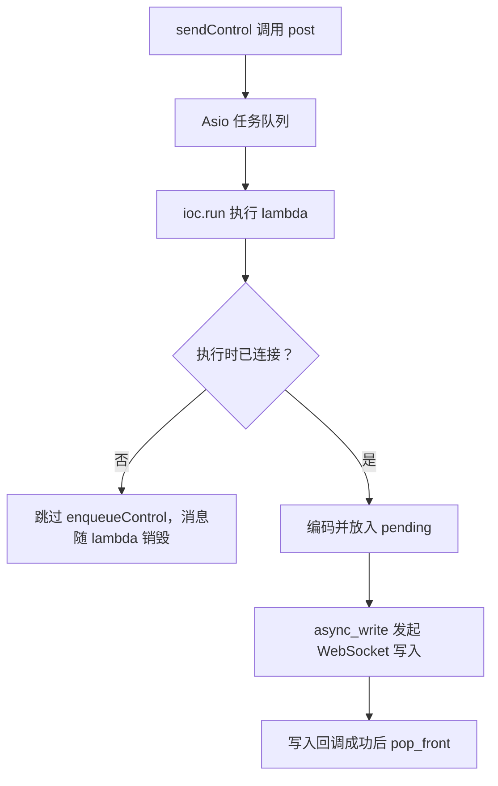

# Boost.Asio

Asio 不只是一个队列，也不是 WebSocket 库。它主要负责：**发起异步 I/O，并在操作完成时调度回调**。

一次异步操作大致经历：

```text
发起操作 → 等待操作完成 → Asio 调用完成回调
```

例如，`async_connect()` 发起连接后会立即返回；连接结果就绪后，Asio 才调用对应的回调。Boost 文档把这种回调称为 completion handler。[异步操作的生命周期](https://www.boost.org/doc/libs/latest/doc/html/boost_asio/overview/model/async_ops.html)

理解它还要分清三个概念：

- **`io_context`**：Asio 的事件循环，负责调度任务和 I/O 完成回调。这里叫 `ioc`。[项目中的定义](D:/csevent/client/src/uploader.cpp:36)
- **`ioc.run()`**：让当前线程开始处理事件；它会一直运行，直到没有工作或被停止。它本身不会创建线程。[Boost 文档](https://www.boost.org/doc/libs/develop/doc/html/boost_asio/reference/io_context/run.html)
- **线程**：实际由项目的 `std::thread` 创建；那条线程运行 `doConnect()` 和 `ioc.run()`。[项目中的启动代码](D:/csevent/client/src/uploader.cpp:350)

## 事件循环、异步操作和定时器

### Asio 里的队列和 WebSocket 发送队列不同

这个项目有两个需要区分的队列：

1. **Asio 的任务队列**：存放待执行的 lambda 和已就绪的 I/O 回调。
2. **`WsUploader` 的 `pending` 队列**：存放已经编码、准备通过 WebSocket 写出的数据。[队列定义](D:/csevent/client/src/uploader.cpp:40)

`post()` 只负责把任务交给 Asio 调度；它不直接发送网络消息，也不保证 WebSocket 连上后再发送。[`post()` 的作用](https://www.boost.org/doc/libs/latest/doc/html/boost_asio/reference/post/overload1.html)



这里有一个重要细节：**是否丢弃，取决于 lambda 执行时的连接状态**。如果在 WebSocket 握手完成前执行，就跳过 `enqueueControl()`；如果执行时已经连接，就进入 `pending`。代码没有专门保存“启动前发来的消息、等连接成功后统一发送”，所以不能把 `post()` 理解成“连接后发送队列”。[`sendControl()`](D:/csevent/client/src/uploader.cpp:306)

## 用项目里的 `WsUploader` 走一遍

- `start()` 创建 I/O 线程并发起连接。连接依次经过 DNS 解析、TCP 连接和 WebSocket 握手；这些步骤是异步的，所以 `start()` 返回不等于已经连上。[连接流程](D:/csevent/client/src/uploader.cpp:195)
- 握手完成后，代码把 `connected` 设为 `true`，开始读取消息、启动心跳和超时定时器。
- `sendControl()` 可以从其他线程调用。`post()` 把实际处理安排到 I/O 线程，避免外部线程直接改动连接状态和发送队列。
- 若已连接，`enqueueControl()` 把控制消息编码后放入 `pending`。`doWrite()` 每次发起一个 `async_write`；成功回调再移除这一条并继续发送下一条。[写入流程](D:/csevent/client/src/uploader.cpp:78)
- `doRead()` 发起 `async_read`。收到服务器消息后处理它，再发起下一次读取。[读取流程](D:/csevent/client/src/uploader.cpp:111)
- 心跳、接收看门狗和重连等待都用 Asio 定时器；连接失败时，代码安排后续重连。[定时器](D:/csevent/client/src/uploader.cpp:161) · [失败与重连](D:/csevent/client/src/uploader.cpp:247)

## Asio、Beast 和线程各自负责什么

在这个项目里，分工是：

- **Asio**：`io_context`、`post()`、DNS/TCP 异步操作和定时器。
- **Beast**：WebSocket 协议；`websocket::stream` 提供 WebSocket 握手、读取和写入接口。[WebSocket 类型](D:/csevent/client/src/uploader.cpp:37)
- **`std::thread`**：启动运行 `ioc.run()` 的线程。

目前只有一个线程调用这个 `ioc.run()`，因此这些回调按顺序执行。若以后让多个线程同时运行同一个 `io_context`，回调可能并发执行，就需要用 `strand` 或锁来保护共享状态；Asio 提供 `strand` 来保证回调串行执行。[Strand 说明](https://www.boost.org/doc/libs/1_66_0/doc/html/boost_asio/overview/core/strands.html)

再记两点：

- 异步写入完成代表这次本地 WebSocket 写操作完成，**不代表服务器应用已经处理了消息**。
- 异步操作会晚于发起函数完成，因此缓冲区要在操作期间保持有效。项目用 `shared_ptr` 持有写入数据，直到写入回调完成。[写入回调](D:/csevent/client/src/uploader.cpp:87)

一句话总结：**Asio 管“什么时候执行网络操作和回调”；Beast 管“这些字节如何组成 WebSocket 消息”；项目自己的 `pending` 管“哪些消息还等着写”。**