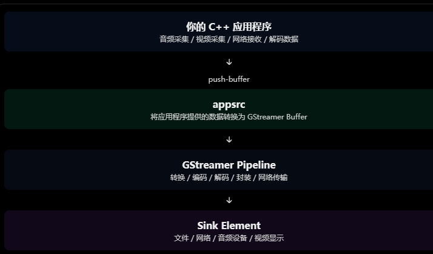
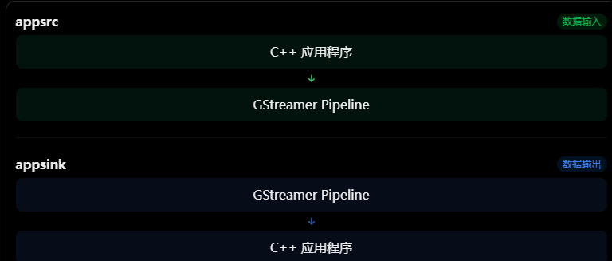

# GStreamer

## appsrc

`appsrc` 是 GStreamer 中的一个 Source Element（数据源元素）。

它的核心作用是：

> 允许应用程序自己产生音视频数据，然后主动送入 GStreamer Pipeline 进行后续处理。

简单来说，如果音视频数据不是 GStreamer 自己采集的，而是你通过 C++ 代码、SDK、设备驱动等方式拿到的，就可以通过 `appsrc` 把数据送进 GStreamer。

### 1. appsrc 在 Pipeline 中的位置



例如，你自己通过 C++ 获取 PCM 音频数据：

```
std::vector<int16_t> pcm;
```

想把这些 PCM 数据交给 GStreamer 编码成 AAC，就可以使用 `appsrc`。

### 2. appsrc 的基本使用

例如构建一个音频 Pipeline：

```
appsrc
   |
   v
audioconvert
   |
   v
avenc_aac
   |
   v
filesink
```

```c++
#include <gst/gst.h>
#include <gst/app/gstappsrc.h>

int main()
{
    gst_init(nullptr, nullptr);

    GstElement* pipeline = gst_pipeline_new("pipeline");

    GstElement* src = gst_element_factory_make("appsrc", "src");
    GstElement* convert = gst_element_factory_make("audioconvert", "convert");
    GstElement* encoder = gst_element_factory_make("avenc_aac", "encoder");
    GstElement* sink = gst_element_factory_make("filesink", "sink");

    // 设置音频格式
    GstCaps* caps = gst_caps_from_string(
        "audio/x-raw, "
        "format=S16LE, "
        "layout=interleaved, "
        "rate=48000, "
        "channels=2"
    );

    gst_app_src_set_caps(GST_APP_SRC(src), caps);
    gst_caps_unref(caps);

    g_object_set(sink, "location", "output.aac", nullptr);

    gst_bin_add_many(
        GST_BIN(pipeline),
        src, convert, encoder, sink,
        nullptr
    );

    gst_element_link_many(src, convert, encoder, sink, nullptr);

    gst_element_set_state(pipeline, GST_STATE_PLAYING);

    // 后续通过 gst_app_src_push_buffer() 推送 PCM 数据
}
```

这里主要关注：

```c++
gst_app_src_set_caps(GST_APP_SRC(src), caps);
```

它告诉 GStreamer：

我送进来的数据是什么格式。

例如：

- PCM 还是压缩音频。
- 采样率是多少。
- 声道数是多少。
- 数据格式是什么。

### 3. 如何向 appsrc 推送数据？

核心 API 是：

```
gst_app_src_push_buffer()
```

例如：

```c++
GstBuffer* buffer = gst_buffer_new_allocate(
    nullptr,
    pcm.size() * sizeof(int16_t),
    nullptr
);

// 填充 PCM 数据
gst_buffer_fill(
    buffer,
    0,
    pcm.data(),
    pcm.size() * sizeof(int16_t)
);

// 设置时间戳
GST_BUFFER_PTS(buffer) = pts;
GST_BUFFER_DURATION(buffer) = duration;

// 推送数据
GstFlowReturn ret = gst_app_src_push_buffer(
    GST_APP_SRC(src),
    buffer
);
```

这里有几个重点：

| API / 字段                    | 作用             |
| ----------------------------- | ---------------- |
| `gst_app_src_set_caps()`      | 设置输入媒体格式 |
| `gst_app_src_push_buffer()`   | 推送媒体数据     |
| `GST_BUFFER_PTS`              | 设置呈现时间戳   |
| `GST_BUFFER_DURATION`         | 设置数据持续时间 |
| `gst_app_src_end_of_stream()` | 通知数据输入结束 |

注意：`push_buffer` 会为队列持有 Buffer 引用，调用者仍应释放自己持有的引用。

### 4. appsrc 和 appsink 有什么区别？

这两个经常一起出现，但方向正好相反。



| 对比     | appsrc               | appsink                    |
| -------- | -------------------- | -------------------------- |
| 方向     | 应用程序 → GStreamer | GStreamer → 应用程序       |
| 类型     | Source               | Sink                       |
| 主要 API | `push_buffer()`      | `pull_sample()`            |
| 主要用途 | 输入自定义音视频数据 | 获取 Pipeline 处理后的数据 |

### 5. 在实际音视频项目中的用途

例如你正在开发一个 C++ 音视频系统：

| 数据来源                    | GStreamer 接入方式 |
| --------------------------- | ------------------ |
| 自己采集的 PCM              | appsrc             |
| RTP 接收后自行解包的 H264   | appsrc             |
| SDK 获取的视频帧            | appsrc             |
| 摄像头由 GStreamer 直接采集 | 通常不需要 appsrc  |
| GStreamer 解码后的 PCM      | appsink            |
| GStreamer 解码后的视频帧    | appsink            |

最重要的理解：

`appsrc` 相当于 GStreamer 给 C++ 应用程序提供的一个数据入口。

你负责获取数据、组织数据和推送数据；GStreamer 负责后续的媒体处理 Pipeline。

> [!NOTE]
>
> 没经过gstreamer处理的都放在appsrc
>
> 从gstreamer获取处理后的数据都用appsink

官方文档：[GStreamer appsrc](https://gstreamer.freedesktop.org/documentation/app/appsrc.html?utm_source=chatgpt.com)

## Pad、Segment 与 Running Time

在 GStreamer 里，`Element` 是做工作的组件，例如采集源、格式转换器、编码器；`Pad` 是 Element 的输入口或输出口。多个 Element 通过 pad 连接，数据和事件都沿着这些连接流动。

```text
采集源 Element                         编码器 Element
  src pad  ───→ 中间 Element ───→       sink pad
  输出                                  输入
```

`src` 和 `sink` 是从所属 Element 的角度命名的：`src` 向下游输出，`sink` 从上游接收。它们不是独立处理数据的 Element，也不是队列；真正做采集、转换或编码的是各个 Element。Pad 则是 Element 之间传递 buffer、事件和查询的接口。一个 Element 的 `src` pad 通常连接下一个 Element 的 `sink` pad。

### Pad 上传递什么

`GstBuffer` 是 GStreamer 承载一块媒体数据的对象。它包含媒体数据，并可带有 PTS（Presentation Time Stamp，呈现时间戳）、DTS 和 duration 等信息。`GstBuffer` 是通用容器，不天然等于“一帧”：音频 buffer 往往包含一批采样；当前 WGC 视频管线中，送到编码器输入端的 buffer 通常对应一帧待编码画面。

`GstEvent` 则承载流的控制信息，例如格式协商用的 `CAPS` 事件，以及说明时间戳规则的 `SEGMENT` 事件。它们不是视频帧数据，也不是 buffer 的一部分。

采集管线可以简化成下面的顺序：

```text
时间先后 ─────────────────────────────────────────────────────→

capture.src             中间 Element                 encoder.sink
    │                        │                            │
    ├── SEGMENT 事件 ────────┴───────────────────────────→│ 保存当前时间规则
    │                                                     │
    ├── GstBuffer A（PTS=10.5 秒）───────────────────────→│ 用当前规则解释 PTS
    │                                                     │
    └── GstBuffer B（PTS=10.533 秒）─────────────────────→│ 继续用同一规则解释 PTS
```

`SEGMENT` 事件先于它描述的 buffer 到达下游。当它到达某个 pad 时，GStreamer 会在该 pad 上留存当前的 `SEGMENT`；这个被留存的事件称为 sticky event。后续 buffer 到达同一个 pad 时，代码可以查询这条已留存的规则，而不用等编码器处理完帧，也不用为每个 buffer 重发一次 `SEGMENT`。一条 `SEGMENT` 会供它之后的一批 buffer 使用；新的 `SEGMENT` 到达后，当前规则才会更新。[GStreamer 事件说明](https://gstreamer.freedesktop.org/documentation/additional/design/events.html) [GstPad 文档](https://gstreamer.freedesktop.org/documentation/gstreamer/gstpad.html)

### Segment 是什么

`SEGMENT` 事件携带一个 `GstSegment`，里面存的是时间戳的解释规则，例如时间单位 `format`、有效范围 `start`/`stop`、播放速率 `rate`，以及换算到管线时间轴时使用的 `base` 和 `offset`。它不存视频帧，也不存每一帧的 PTS；它适用于该事件之后、下一个 `SEGMENT` 生效之前的 buffer。

`SEGMENT` 是事件类型；`GstSegment` 是这个事件携带的时间规则结构体。两者不是同一个对象：代码先拿到 `GstEvent*`，再用 `gst_event_parse_segment()` 从事件中取出 `GstSegment`。和本节 PTS 换算直接相关的字段如下：

| `GstSegment` 字段 | 含义 |
| --- | --- |
| `format` | 时间戳的单位/格式；视频时间戳通常使用 `GST_FORMAT_TIME`，单位是纳秒。 |
| `start` | 当前 segment 接受的起始时间戳。低于它的 buffer 通常不属于当前 segment。 |
| `stop` | 当前 segment 的结束边界；实时流中可能没有已知结束值。 |
| `rate` | 播放速率和方向。普通正向播放通常为 `1.0`。 |
| `base` | 当前 segment 开始前，已经累计的 running time。 |
| `offset` | 对 segment 起止位置应用的时间偏移；计算 running time 时会与 `start` 一起使用。 |

在当前采集管线中，上游发出的 `SEGMENT` 会先到达编码器的 `sink` pad，并留存在这个输入 pad 上。因此编码器还没处理视频帧时，`captureVideo()` 已经可以查询到它。这里读取的是“后续输入 buffer 应按什么规则解释 PTS”，不是编码器编码后才产生的标记。

### Running Time 是什么

`running time` 是 GStreamer 用来安排和同步媒体数据的管线时间轴。管线处于 `PLAYING` 时，当前管线时钟的 running time 等于时钟时间减去管线的 `base_time`：

```text
pipeline_running_time = pipeline_clock_time - pipeline_base_time
```

首次进入 `PLAYING` 时，这条时间轴从 0 开始前进；管线进入 `PAUSED` 时，running time 停住，恢复 `PLAYING` 后接着走。因此它不是系统墙上时钟，也不是进程启动到现在的总时长。[GStreamer running time 说明](https://gstreamer.freedesktop.org/documentation/additional/design/synchronisation.html)

和 buffer 有关时，还会看到 **buffer 的 running time**：它不是再次读取“现在的管线时钟”，而是用该 buffer 的 PTS 和当前 `GstSegment` 换算出来的、位于同一管线时间轴上的时刻。管线时钟的 running time 表示“现在走到哪”；buffer 的 running time 表示“这帧应当处于哪”。同步播放时，sink 会等管线时钟走到 buffer 对应的 running time，再呈现它。

在当前采集实现中，Publisher 父管线先进入 `PLAYING`，窗口采集源之后才启动。因此 running time 是从父管线的 `base_time` 建立后开始计算，不是从窗口捕获到第一帧时才开始计时。

### PTS 和 Running Time 的区别

每个 buffer 自己带 PTS。应用代码把这个 PTS 和当前 `GstSegment` 一起交给 `gst_segment_to_running_time()`，算出这帧在管线时间轴上的 running time。正向播放（`rate > 0`）时，换算关系是：

```text
buffer_running_time =
    (PTS - (segment.start + segment.offset)) / abs(segment.rate)
    + segment.base
```

例如，假设当前 segment 是 `format=GST_FORMAT_TIME`、`start=8s`、`stop` 未设置、`offset=0`、`base=0`、`rate=1`。这组值表示当前规则按时间戳工作，从媒体时间 8 秒开始，按正常速率播放，segment 开始前累计的 running time 为 0。下面用秒展示数值；代码中的 `GST_FORMAT_TIME` 时间实际以纳秒计。现在有两个连续 buffer：

| buffer | 自己携带的 PTS | 按当前 segment 换算的 running time |
| --- | ---: | ---: |
| A | 10.5 秒 | `(10.5 - (8 + 0)) / 1 + 0 = 2.5 秒` |
| B | 10.533 秒 | `(10.533 - (8 + 0)) / 1 + 0 = 2.533 秒` |

因此，A 的 PTS 是 `10.5s`，但它在管线时间轴上的 running time 是 `2.5s`；B 使用同一条 segment 规则，只是代入自己的 PTS，所以得到 `2.533s`。示例中的数值用于说明换算方式，不代表当前 WGC 运行时一定采用这些 segment 参数。

如果初始 segment 是 `start=0`、`offset=0`、`base=0`、`rate=1`，PTS 和 running time 的数值刚好相等；这是特例，不应假设所有 segment 都如此。`gst_segment_to_running_time()` 会根据实际 segment 字段完成换算。反向播放有另一种换算方式；当前实时采集按正向时间处理。[GStreamer 同步与时间戳换算](https://gstreamer.freedesktop.org/documentation/additional/design/synchronisation.html)

### Segment 保持不变与更新

每个 buffer 到来时，`captureVideo()` 都会查询当前 segment；这只是重复读取 pad 上留存的规则，不代表每帧都生成一个新 segment。只要上游没有发出新的 `SEGMENT` 事件，后续 buffer 就继续使用同一组 `start`、`offset`、`base`、`rate` 参数；改变的是每个 buffer 自己的 PTS。

#### 连续采集：segment 不变

假设当前规则为 `start=0`、`offset=0`、`base=0`、`rate=1`：

| buffer | PTS | 使用当前 segment 得到的 running time |
| --- | ---: | ---: |
| A | 0.033 秒 | 0.033 秒 |
| B | 0.066 秒 | 0.066 秒 |
| C | 0.100 秒 | 0.100 秒 |

三帧使用同一个 segment；各自的 PTS 不同，所以各自换算出的 running time 不同。正常连续采集时，不会因为新帧到来而改写 `start` 或 `offset`。

#### 上游发出新 segment：时间规则更新

当上游开始一个新的流段并发送新的 `SEGMENT` 事件时，下游 pad 上当前留存的规则会更新。新规则可能改变 `start`，也可能改变 `rate`、`base` 或 `offset`；不保证每次都只改 `start`。例如 seek 到媒体时间 8 秒后，假设新规则是 `start=8s`、`offset=0`、`base=0`、`rate=1`，那么 PTS 为 `10.5s` 的 buffer 会从原先 `start=0` 时的 `10.5s` running time，变为 `2.5s` running time。buffer 的 PTS 是输入值，变化的是用哪条 segment 规则解释它。

收到新的 `SEGMENT` 事件不代表所有数字字段一定不同：更换流时，新事件可能重新建立了时间上下文，但部分参数仍可能与上一条相同。对 `captureVideo()` 来说，它只查询当时 pad 上当前生效的事件，并用其中的规则换算当前 buffer。

> [!note]
> 在本项目中，正常连续采集同一个采集源时，segment 不会随帧变化；更换采集源时会重新建立采集流并发送新的 `SEGMENT`。新事件中的数字参数由采集源提供，不代表 `start` 和 `offset` 一定都变了。每帧变化的是 `GstBuffer` 自己的 PTS；`captureVideo()` 每帧查询 segment 只是读取当前规则，不会创建或修改 segment。

### 对照当前 WGC 采集代码

当前 Publisher 在采集源的 `src` pad 上监听下游事件，并在编码器的 `sink` pad 上检查输入 buffer。`captureVideo()` 在编码器尚未处理当前帧时，从该输入 pad 读取已经到达的 sticky `SEGMENT`：

```c++
auto *event = gst_pad_get_sticky_event(pad, GST_EVENT_SEGMENT, 0);
if (!event)
  return GST_PAD_PROBE_DROP;

const GstSegment *segment = nullptr;
gst_event_parse_segment(event, &segment);
const auto running_time = segment->format == GST_FORMAT_TIME
                              ? gst_segment_to_running_time(
                                    segment, GST_FORMAT_TIME,
                                    GST_BUFFER_PTS(buffer))
                              : GST_CLOCK_TIME_NONE;
gst_event_unref(event);
```

逐行看这段逻辑：

1. `pad` 是编码器的 `sink` pad；`gst_pad_get_sticky_event()` 查询已经经过这个 pad 的第 0 个 `SEGMENT` sticky event。它不是去编码器的输出端找事件，也不是等待编码器产生事件。
2. 如果没有 segment，代码无法可靠解释当前 buffer 的 PTS，于是丢弃这一帧。按 GStreamer 的事件顺序，segment 应先于对应的 buffer 到达；正常收到输入帧时通常已经可查询。
3. `gst_event_parse_segment()` 取出事件携带的 `GstSegment`。这里的 `segment` 指针来自 `event`，只在该事件仍有效时使用。
4. 代码只接受 `GST_FORMAT_TIME`。若 segment 用的不是时间格式，就把结果设为无效值；否则将 `GST_BUFFER_PTS(buffer)` 按 segment 规则转换为 running time。
5. 转换完成后调用 `gst_event_unref(event)` 释放查询得到的事件引用。之后若 running time 无效，当前帧也会被丢弃。

Publisher 再把管线时间轴映射到客户端的单调时钟时间轴：

```text
origin_us = client_monotonic_now_us - pipeline_running_time_us
capture_us = origin_us + buffer_running_time / GST_USECOND
```

`GST_USECOND` 用于把 GStreamer 的纳秒时间换成微秒。`origin_us` 表示管线 running time 为零时对应的客户端单调时钟位置；加上 buffer 的 running time 后，得到用于帧身份关联的客户端时间。这个换算只统一时间轴，**不会把来源不精确的 PTS 变成硬件采集时间戳**。当前 WGC 路径将采集时间质量标记为估算值。

因此，在这段代码中：`pad` 回答“我在哪个管线接口观察数据”，`SEGMENT` 回答“如何解释这个 buffer 的时间戳”，`running time` 回答“这个 buffer 对应管线时间轴上的哪个时刻”。

## ICE

WebRTC 中的 ICE（Interactive Connectivity Establishment，交互式连接建立），简单来说就是：

帮助通信双方找到一条能够互相通信的网络路径，让两台设备即使处于不同网络、不同路由器后面，也能尽可能建立 P2P 连接。

比如你和朋友进行视频通话：

- 你在家里，使用 WiFi。
- 朋友在公司，使用公司网络。
- 两个人的设备可能都有自己的内网 IP。

这时候 WebRTC 就需要 ICE 来帮助双方找到可以通信的方式。**解决 NAT 穿透问题。**

```
可以简单理解为下面几个步骤：
1. 收集候选地址（ICE Candidate Gathering）
   
   获取设备可能使用的 IP 和端口，例如本地地址、公网映射地址、TURN 中继地址。
2. 交换候选地址
   
   双方通过信令服务器交换 SDP 和 ICE Candidate 信息。
   
   注意：信令服务器负责传递信息，不一定负责传输音视频数据。
3. 连通性检测（Connectivity Checks）
   
   双方使用 STUN Binding 请求测试候选地址之间能不能通信。
4. 选择可用路径
   
   ICE 对可用的候选路径进行选择，确定最终使用的连接路径。
5. 开始传输数据
   
   连接建立后，就可以进行音视频数据传输了。
```

- ICE candidate类型

  | 类型  | 含义                               |
  | ----- | ---------------------------------- |
  | host  | 本机网卡的本地 IP 地址             |
  | srflx | 通过 STUN 获取的公网映射地址       |
  | relay | 通过 TURN 获取的中继地址           |
  | prflx | 连通性检测过程中发现的对端映射地址 |

## WebRTC offer

WebRTC 中的 Offer（SDP Offer），简单来说就是：

通信发起方先生成一份连接提议，告诉对方：我想和你建立什么样的音视频连接，以及我支持哪些通信参数。

你可以把它理解成：打电话之前，先告诉对方自己支持什么样的通话方式。

**1. Offer 主要有什么用？**

主要有三个作用：

1. 告诉对方媒体信息：我想进行音频通话、视频通话，还是两者都有。
2. 告诉对方支持的编码格式：比如音频支持 Opus，视频支持 VP8、H.264 等。
3. 协商连接参数：包括媒体传输方向、ICE 参数、DTLS 指纹等。

这些信息会放在 SDP（Session Description Protocol，会话描述协议）里面。

- 流程


