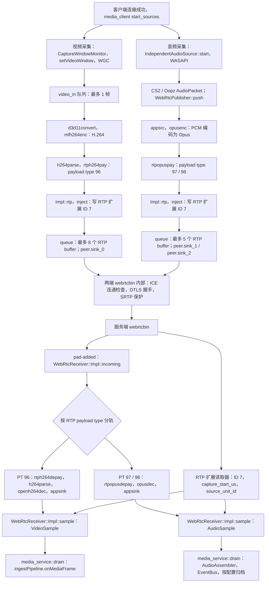

# WebRTC 流程

> 本页只描述客户端连接远端服务端的真实传输路径。启动方式见 [启动.md](启动.md)，配置项见 [配置.md](配置.md)。客户端主流程和 Publisher 管线源码见 [WebRTC实现.md](WebRTC实现.md)，信令、ICE 和媒体回调源码见 [WebRTC信令与回调实现.md](WebRTC信令与回调实现.md)。

## 信令与建链

Offer/Answer、ICE candidate 和运行状态通过 WebSocket 传递；视频和音频样本不走 WebSocket。客户端与服务端设置 SDP、加入对端 candidate 后，通过 ICE 选路和 DTLS 建立 WebRTC 媒体通道。

~~~mermaid
sequenceDiagram
    participant C as media_client
    participant P as WebRtcPublisher
    participant W as 客户端 webrtcbin
    participant WS as WebSocket
    participant H as ws_handler
    participant M as media_service
    participant R as 服务端 WebRtcReceiver

    C->>WS: start(media_transport=webrtc)
    WS-->>C: started(session_id, media_epoch)
    C->>P: begin(media_epoch) / publisher.start()
    P->>W: Impl::negotiate() / create-offer
    W-->>P: GstPromise 返回 SDP Offer
    P->>P: offerReady() 建 tracks 映射并 outgoing()
    C->>P: 主循环 stats() 驱动 poll()
    P->>W: setRemote(offer, local=true)
    Note over P,W: local=true 实际调用 set-local-description
    P-->>C: Signal 回调交出 webrtc_offer
    C->>WS: 添加 session_id 后 controls.sendControl()
    WS->>H: webrtc_offer
    H->>H: 校验 session_id、media_epoch
    H->>M: 命令队列
    M->>R: WebRtcReceiver::offer()
    R->>R: set-remote-description(Offer)
    R->>R: create-answer / set-local-description(Answer)

    par SDP Answer
        R-->>M: outgoing(webrtc_answer: sdp, tracks)
        M->>WS: receiver.poll() / signal 回调
        WS-->>C: webrtc_answer
        C->>C: post() 放入 incoming 队列
        C->>P: publisher.remote(answer)
        P->>P: 校验 media_epoch 和 tracks
        P->>W: setRemote(answer, local=false)
        Note over P,W: 默认 local=false 实际调用 set-remote-description
    and ICE candidate trickle
        W-->>P: on-ice-candidate
        P->>P: Impl::ice() / outgoing(webrtc_ice: candidate, sdp_mline_index)
        C->>P: stats() / poll()
        P-->>C: Signal 回调交出 webrtc_ice
        C->>WS: controls.sendControl()
        WS->>H: webrtc_ice
        H->>M: 校验并入命令队列
        M->>R: WebRtcReceiver::ice()
        R->>R: add-ice-candidate(客户端 candidate)
        R-->>M: Impl::candidate() / outgoing(webrtc_ice: candidate, sdp_mline_index)
        M->>WS: receiver.poll() / signal 回调
        WS-->>C: 服务端 webrtc_ice
        C->>C: post() 放入 incoming 队列
        C->>P: publisher.remote(candidate)
        alt Answer 已应用
            P->>W: iceRemote() / add-ice-candidate
        else Answer 尚未应用
            P->>P: 暂存 candidate，应用 Answer 后再加入
        end
    end

    Note over P,R: Offer/Answer 与 ICE candidate 交换可以交错进行
    W-->>P: ICE 连通并完成 DTLS，connection-state=CONNECTED
    P-->>C: stats().connected=true
    C->>C: start_sources()
~~~

客户端的 <code>setRemote()</code> 名字容易误解：Offer 调用传 <code>local=true</code>，设置的是本地描述；Answer 默认 <code>local=false</code>，设置的才是远端描述。<code>WebRtcPublisher::remote(message)</code> 处理 WebSocket 收到的 Answer/ICE 信令，不处理音视频 RTP 数据。

信令流程的实现入口：

- 客户端生命周期与 <code>begin()</code>、<code>start_sources()</code>：[WebRTC实现.md：媒体客户端主流程](WebRTC实现.md#client-lifecycle)
- WebSocket 的 <code>start_message</code>、<code>received</code>、<code>disconnected</code>、<code>stop_message</code> 回调：[WebRTC实现.md：WebSocket 控制回调](WebRTC实现.md#websocket-control-hooks)
- <code>negotiate()</code>、<code>offerReady()</code>、ICE 回调和信令队列：[WebRTC信令与回调实现.md：信令回调](WebRTC信令与回调实现.md#signaling-callbacks)
- <code>WebRtcPublisher::remote()</code> 分派 Answer/ICE 并应用 Answer：[WebRTC信令与回调实现.md：远端信令](WebRTC信令与回调实现.md#remote-signaling)
- <code>Impl::iceRemote()</code> 校验并调用 <code>add-ice-candidate</code>：[WebRTC信令与回调实现.md：加入远端 ICE candidate](WebRTC信令与回调实现.md#remote-ice-apply)
- <code>self.outgoing()</code> 给信令补 <code>media_epoch</code> 并入队，<code>poll()</code> 再取出交给发送回调：[WebRTC信令与回调实现.md：信令入队与取出](WebRTC信令与回调实现.md#signal-queue-routing)
- 服务端 <code>ws_handler</code>、<code>media_service</code>、<code>WebRtcReceiver::offer()/ice()</code>：[WebRTC信令与回调实现.md：服务端 ICE 信令处理](WebRTC信令与回调实现.md#server-ice)

## 媒体数据到达服务端

连接进入 CONNECTED 后，客户端启动采集。视频和两路音频进入 Publisher 的媒体轨，由客户端 <code>webrtcbin</code> 通过选定的网络路径发送；网络上传输使用 SRTP。服务端 <code>webrtcbin</code> 解密并按轨道输出 RTP，再由接收支路解包、解码并转换为业务样本。

图中客户端的前置队列、编码器、RTP payloader 和 <code>peer.sink_*</code> 表示媒体包进入 <code>webrtcbin</code> 的顺序；<code>Impl::rtp()</code>/<code>inject()</code> 在发送前补上采集元数据，不负责网络发送。应用代码通过 WebSocket 交换 Offer/Answer 和 ICE candidate，校验信令后调用 <code>set-remote-description</code>、<code>add-ice-candidate</code> 等接口把信息交给 <code>webrtcbin</code>。随后 ICE 连通性检查、DTLS 握手与密钥协商、SRTP 加解密和网络收发都由 <code>webrtcbin</code> 内部完成；应用不自行实现这些协议。应用侧仍负责配置轨道和媒体管线、编码并打包 RTP。服务端 RTP 扩展读取器恢复 ID 7 中的采集时间和源单元编号；<code>incoming()</code> 按 payload type 为新轨道接入解码支路；<code>sample()</code> 从 appsink 拉取解码结果并组装为 <code>VideoSample</code>/<code>AudioSample</code>。<code>media_service::drain()</code> 再把视频送入感知入口、把两路音频送入各自的组装与语音处理路径。

媒体发送和服务端接收的实现入口：

- 视频采集启动、窗口查找与 HWND 绑定：[采集.md：采集启动时序](采集.md#采集启动时序)、[目标窗口发现](采集.md#目标窗口发现)、[HWND 启用采集源](采集.md#hwnd-启用采集源)
- CS2 / Oopz 双路 WASAPI 采集与 `IndependentAudioSource::start()`：[采集.md：WASAPI 音频采集](采集.md#wasapi-音频采集)
- Publisher 媒体管线、RTP 轨道及 <code>peer.sink_0/1/2</code>：[WebRTC实现.md：Publisher 管线](WebRTC实现.md#publisher-pipeline)
- 发送前执行的 <code>Impl::rtp()</code>/<code>inject()</code> 与 RTP 扩展 ID 7：[WebRTC信令与回调实现.md：RTP 发送回调与身份扩展](WebRTC信令与回调实现.md#impl-rtp-inject)
- 服务端 <code>incoming()</code>、<code>sample()</code>、元数据恢复与下游队列：[WebRTC信令与回调实现.md：服务端真实媒体接收与处理](WebRTC信令与回调实现.md#server-media-receive)
- 视频/音频采集何时启动：[WebRTC实现.md：媒体客户端主流程](WebRTC实现.md#client-lifecycle)
