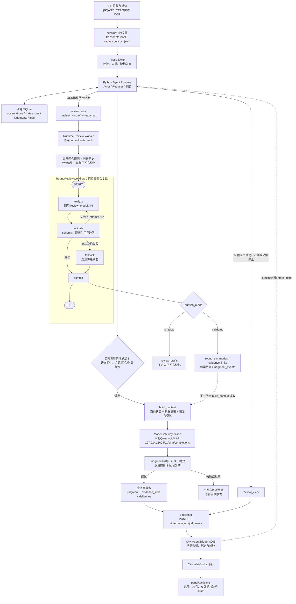

# TacticLens 战术 Agent 全流程：实时判断与 LangGraph 复盘

> 本文记录战术 Agent 从接入采集会话、多源观测入库、实时调用本地文本模型，到回合结束后调用复盘 API、LangGraph 校验并保存结果的完整链路。源码节点对照见[实现.md](实现.md)。

## 全链路总览

这张图是完整 Agent 链路。**实时判断由 Runtime 直接调用本地 Qwen HTTP API；只有回合复盘进入 LangGraph，并由图内节点调用独立复盘 API。**

## Agent 启动与输入数据

`tacticlens-agent` 启动后，Runtime 同时启动归档跟随、状态 Actor、判断投递和复盘 worker。它通过 C++ AgentBridge 查询当前采集会话；有 active capture 才绑定 session、media epoch、match 和 round。Python 服务 API 在 8010 端口，主要用于健康/状态/记忆查询和手动排复盘任务；模型推理不是发给 8010。

FileFollower 读取当前 session 的三个归档文件，并把完整观测写入 Agent 业务 SQLite：

| 文件与事件 | 入库内容 | 语义边界 |
|---|---|---|
| `transcripts.jsonl`，`type=transcript` 且 `final=true` | 转写文本、音轨来源、起止时间 | 表示队友报告；报告不是独立目击，也不确定说话人身份。 |
| `observations/radar.jsonl` | YOLO 检测类别、置信度、裁剪位置、可用时的 world 坐标 | world 坐标只有通过标定验证后才可作地图定位；当前 Agent 不把检测框等同于稳定敌人跟踪。 |
| `observations/ocr.jsonl` | 状态字段、置信度、比分、计时、phase、自身位置、正式回合标记 | 自身位置不等于敌方位置；比分和计时用于状态与回合边界识别。 |

入库时校验 session/epoch、时间和 schema，以 `event_id` 去重；坏行留档，半写入行等下一轮再读。Agent 推理使用这些 JSON 观测，不把实时视频帧传给本地文本模型。

## 实时判断：本地部署模型 API

### 状态何时触发调用

Runtime Reducer 按事件时间更新状态，并忽略超过来源 TTL 的迟到观测：ASR 8 秒、YOLO 3 秒、OCR 5 秒。下列语义有变化才触发在线判断：

- ASR 出现新转写文本或文本变化；同一文本持续超过 2 秒也可重新触发。
- YOLO 检测类别计数或量化后的雷达标记格变化。此签名用于触发，不代表 Agent 已完成敌人跟踪。
- OCR 的 `self_area`、双方比分或 `phase` 变化。

触发后先合并 200 ms 内的事件；同一 match 两次实时请求至少间隔 500 ms，同一 match 已有请求时不并发启动下一次。调用还必须满足：本地 `online_model` 已配置；当前 active C++ binding 的 match/round 与状态一致；monotonic 时钟映射已验证；回合边界非 uncertain；存在至少一条新鲜证据。任一条件不满足就不发推理请求。

### 发给本地 Qwen 的输入与 HTTP 请求

上下文由 `build_context()` 在每次实时请求前冻结，包含当前 match/round 状态、比分/自身位置/雷达标记与来源健康；最近 8 秒且仍在来源 TTL 内的观测（ASR 最多 4 条、YOLO 最多 1 条、OCR 最多 1 条）；活动判断 ID；回合之前最多 3 条已发布摘要与最新对手档案；以及 `input_manifest` 中的状态版本、source watermark、event cutoff 和可引用 event IDs。未发布的当前回合复盘草稿不会进入 prior memory。

`ModelGateway.infer("online", bundle)` 将 `online-brief-v2` 放入 system prompt，将压缩后的 bundle JSON 放入 user message，发出 OpenAI-compatible Chat Completions POST，URL 为 `online_model.base_url + /chat/completions`。仓库配置对应 `http://127.0.0.1:8004/v1/chat/completions`，served name 是 `tacticlens-text-qwen3-4b`，目标为服务器本机 vLLM 服务；[2026-10-26 联调记录](D:/csevent/docs/文本Qwen与API复盘联调验收.md:9)确认当时在 8004 加载 `Qwen/Qwen3-4B-Instruct-2507`（GPU0、vLLM 0.10.2），并以该 served name 提供接口。请求配置为 JSON object、`temperature=0`、最多 128 个输出 tokens、1500 ms deadline；密钥只从 `TACTICLENS_LLM_API_KEY` 环境变量读取。请求 ID 临时改成 `e1`、`j1` 等短别名，响应后再恢复原 ID。见 [`model.py`](D:/csevent/agent/tactical_agent/model.py:55) 和 [`config/agent.yaml`](D:/csevent/config/agent.yaml:11)。

模型返回 `assessment`、`suggestion`、`evidence_ids`、`valid_for_s`。Runtime 将 `OnlineBrief` 适配为统一 `Judgment`，再检查 schema、证据 ID 是否属于本次 bundle、证据是否过期/来自未来。模型响应到达后，还会复核当前 round、边界、ASR/YOLO/OCR 语义依赖、session/epoch 和 C++ binding revision 是否仍与请求快照一致。消息有效期取模型建议时间与证据来源 TTL 中较早的截止点。超时、格式/证据错误、回合变化或证据过期时，本次结果记失败或被丢弃，不进入 outbox；实时模型没有 LangGraph 那种失败修复回环，等待后续新观测再次触发。

## 实时输出到副屏

通过校验后，Runtime 在一个业务 SQLite 事务中把旧 active 判断标记为 superseded，插入新 judgment 和 `judgment_events`、建立 `evidence_links`，并写一条 delivery outbox。发出的 `tactical_judgment` 带当前 session/epoch/match/round/binding revision、递增 `decision_seq`、evidence IDs、assessment/suggestion 和 `valid_until_server_s`。

Publisher 从 outbox 调用 C++ `POST /internal/agent/judgments`；C++ AgentBridge 检查采集仍 active、绑定一致、序号较新、消息未过期和 payload 合法，再经 WebSocket 下行。网页 `TacticalView` 仅接受当前 session/epoch、递增序号、未过期且带 evidence IDs 的消息，显示判断并回 ACK。新观测改变判断依赖、TTL 到期、回合或 binding 改变、采集停止时，Runtime 会发送 `tactical_clear` 清除旧提示。链路源码见 [`runtime.py`](D:/csevent/agent/tactical_agent/runtime.py:220)、[`agent_bridge.cpp`](D:/csevent/server/libs/core/agent_bridge.cpp:145)、[`tactical.js`](D:/csevent/panel/tactical.js:1)。

## 回合关闭与复盘 API 触发

实时本地 Qwen 在采集中处理新鲜观测；复盘只在 OCR 状态机确认回合关闭后排队。比分 OCR 必须标记 `formal_round=true`，比分与计时置信度至少 0.9 且值域有效；两个不同 OCR 观测在 3 秒内确认相同新比分，比分变化也必须合理（单回合只增加一分且双方分数不倒退）。满足后关闭上一回合、建立下一回合并创建 review job。不合理跳分令 `boundary_uncertain=true`，实时判断暂停，等待可信边界。

Review Worker 到期后取该回合最大 `commit_seq` 作为 watermark，构造完整回合 bundle：全部归属该回合且不超过 watermark 的观测、最多 24 条该回合判断、比分/胜方、prior memory。受鉴权的 Agent 管理接口 `POST /rounds/{round_uid}/review` 可给已结束回合排一个 revision；它只建任务，不同步等待模型。

复盘模型是另一个 HTTP API：LangGraph `analyze` 节点经 `review_model` 调用。当前仓库配置为 `https://api.siliconflow.cn/v1/chat/completions`，模型 `deepseek-ai/DeepSeek-R1-0528-Qwen3-8B`，走 IPv6，密钥从 `TACTICLENS_REVIEW_API_KEY` 读取。它与本地在线 Qwen 使用独立 endpoint、模型额度和 deadline；`independent_endpoint=true` 时，长复盘不会占住实时模型锁。复盘输出包含 `round_summary`、`judgment_reviews`、`tactical_hypotheses`、`next_round_prior`、`unknowns` 和 evidence IDs。

上述地址来自仓库 `config/agent.yaml`；[2026-10-26 双模型联调记录](D:/csevent/docs/文本Qwen与API复盘联调验收.md:5)记载了当时本地 Qwen 已加载且实时调用已验证，复盘 API 也完成过真实 HTTP 联调。本次改笔记没有读取服务器实际启动配置，也没有调用任何推理/API；线上当前值仍以 systemd 的 `TACTICLENS_CONFIG` 为准。

## LangGraph 在回合复盘路径中的位置

下面这张图只放大回合复盘支路：归档读取、在线状态维护和实时本地模型调用已在前文说明。回合关闭后，Runtime 创建复盘任务，冻结该任务可读取的证据水位，并在进入图之前构建复盘上下文；图本身不负责轮询媒体文件、识别回合边界或查询实时画面。

~~~mermaid
flowchart LR
    Sources["session归档 ASR / YOLO / OCR 观测"] --> Follower["FileFollower 按活动 session 跟随归档"]
    Follower --> DB["业务 SQLite observations / rounds / judgments"]
    DB --> Actor["Runtime Actor Reducer 与回合边界"]
    Actor --> Job["review_jobs 回合结束后排队；迟到证据可升 revision"]
    Manual["POST /rounds/{round_uid}/review"] --> Job
    Job --> Scheduler["Runtime._review 挑选到期任务与模型锁"]
    Scheduler --> Bundle["build_context(review=True) 按 round_uid + commit watermark 冻结证据包"]

    subgraph Graph["RoundReviewWorkflow：LangGraph StateGraph"]
        Start([START]) --> Analyze["analyze 调用 review_model"]
        Analyze --> Validate["validate schema、证据引用与边界校验"]
        Validate -->|通过| Commit["commit"]
        Validate -->|"失败且 attempt < 2"| Analyze
        Validate -->|第二次仍失败| Fallback["fallback 观测降级摘要"]
        Fallback --> Commit
        Commit --> End([END])
    end
    Bundle --> Start

    Commit --> Mode{"publish_mode"}
    Mode -->|"当前 shadow"| Draft["review_drafts review_jobs.status=shadow"]
    Mode -->|"validated"| Published["round_summaries / evidence_links 档案版本 / judgment_events"]
    Published -. "供后续上下文读取" .-> DB
~~~

LangGraph 图的标准结构是共享 State、节点和边；节点执行业务代码或模型调用，边决定下一步。[官方 Graph API 文档](https://docs.langchain.com/oss/python/langgraph/graph-api) 对这些概念的定义与本项目的 `StateGraph` 用法一致。

## 图开始之前：建任务与冻结上下文

1. Runtime 把同一轮的观测归入 `round_uid`。可靠地确认回合关闭后，在 `review_jobs` 中创建 revision 1，默认延迟 1 秒再执行。
2. 晚到的旧回合观测若赶在任务开始前到达，会推进该任务的 cutoff；若旧 revision 已处理，则创建新 revision。受鉴权的 `POST /rounds/{round_uid}/review` 也会为已结束回合创建一个新 revision。
3. 独立 Review Worker 选择一个已到期任务，读取该轮的最大 `commit_seq` 作为 watermark，再调用 `build_context(..., review=True)`。
4. 证据包包含该回合截至 watermark 的观测、最近最多 24 条该轮判断、回合结果字段、输入清单，以及回合之前可用的摘要和对手档案。当前回合不会混入 prior memory；本次图执行期间新提交的观测不会追加入已冻结的 bundle，迟到观测按 revision 规则另行处理。
5. 证据包构建完后，Runtime 调用 `RoundReviewWorkflow.run(round_uid, revision, bundle)`。从这里开始 LangGraph 才开始执行。

Runtime 负责 review worker 的串行调度、模型锁和总 deadline。`independent_endpoint=true` 时，复盘使用独立 review 模型网关，不占在线判断所用的模型锁；若复盘与在线任务共享模型，Runtime 会在采集活动期间延后复盘，避免长复盘阻塞在线请求。

## 图内执行路径

~~~mermaid
sequenceDiagram
    participant R as Runtime / Review Worker
    participant G as RoundReviewWorkflow
    participant L as review_model
    participant C as Review / evidence 校验
    participant DB as 业务 SQLite
    participant CP as SQLite checkpointer

    R->>G: run(round_uid, revision, bundle)
    G->>CP: 读取 thread_id = round_uid-rrevision 的状态
    alt 没有旧状态
        G->>G: START → analyze
    else 存在未完成的节点
        G->>G: 从 checkpoint 恢复未完成图
    else 图已结束
        G->>DB: 重试幂等 commit，覆盖业务提交与 checkpoint 之间的崩溃窗口
    end
    G->>L: analyze(bundle)
    L-->>G: 候选复盘 + 模型元数据
    G->>C: validate(candidate, bundle)
    alt 结构与引用通过
        G->>DB: commit
    else 第一次失败
        G->>L: analyze(bundle, error=校验或模型错误)
        L-->>G: 修复后的候选结果
        G->>C: 再校验
        alt 再次通过
            G->>DB: commit
        else 仍失败
            G->>G: fallback → commit
        end
    end
~~~

图最多调用模型两次：第一次失败后，第二次 `analyze` 会收到前一次模型错误或校验错误；这是同一个节点回环，没有单独的“修复节点”。两次仍未得到可校验结果时才走 `fallback`。图节点发生无法处理的异常（例如业务库写入失败）会退出当前调用，由 Runtime 标记任务失败；这类异常不会被误报为“已降级完成”。

## 结果落点与下一回合记忆

项目使用两种 SQLite 文件，职责不同：

| 存储 | 保存内容 | 读取方 |
|---|---|---|
| `var/agent/tactical-memory.sqlite` | 观测、回合、判断、复盘任务、复盘结果和档案版本 | Agent Runtime 业务逻辑 |
| `var/agent/review-checkpoints.sqlite` | LangGraph 当前 `thread_id` 的执行状态与节点 checkpoint | LangGraph 恢复未完成复盘 |

`thread_id` 为 `<round_uid>-r<revision>`，所以每个回合复盘版本有各自的图状态。checkpoint 记录的是流程推进位置；它不取代业务库中的摘要或对手档案。LangGraph 官方也把 checkpointer 描述为 thread 范围的图状态持久化，并将长期业务记忆交给应用存储。[持久化文档](https://docs.langchain.com/oss/python/langgraph/persistence)

当前服务器的 `publish_mode` 是 `shadow`：图仍可运行和校验模型结果，但 `commit` 只写 `review_drafts` 并把任务标记为 `shadow`，不更新已发布摘要、对手档案或判断复核事件。切换到 `validated` 后，业务事务才会写 `round_summaries`、证据关联、来源覆盖贡献、对手档案新版本和 `judgment_events`。后续在线上下文只读取已发布结果，因此 shadow 草稿不会变成下一回合已确认记忆。

## 与旧教学示例的边界

[完整回合示例](D:/csevent/docs/战术Agent完整回合示例.md:231) 使用合成比赛数据，展示了一个说明性流程；其中“代码提取可观察行为贡献”等示意步骤不等于当前生产 LangGraph 节点。当前生产图只注册 `analyze`、`validate`、`fallback`、`commit` 四个节点。来源覆盖统计在 `commit` 里按 ASR、YOLO、OCR 写入，当前没有独立的战术行为特征提取节点，也没有 LangGraph 内的“读取证据”或“构建下一回合上下文”节点。

## 现场部署检查点

2026-11-11 现场只读检查确认：Linux 上 `tacticlens-agent.service` 为 active，进程参数使用 `--config config/agent.yaml`；Agent 服务与 C++ `tacticlens.service` 是独立进程。服务器和 Windows 两端的 `review.py`、`runtime.py`、`context.py`、`contracts.py`、`repository.py`、`model.py` 及 `config/agent.yaml` SHA-256 一致。

运行配置开启独立 review endpoint，并设 `publish_mode: shadow`。服务进程 active 只能证明 Agent 服务在运行，不能单独证明最近一次 LangGraph 复盘成功；本次没有查询或读取线上复盘草稿，也没有发起模型/API 推理调用。

## 相关笔记

- [源码实现](实现.md)：定位 LangGraph 的节点与 Runtime 调度代码。
- [Agent 首版搭建与验收](D:/csevent/docs/战术Agent首版搭建与验收.md:1)：整体数据链与持久化边界。
- [文本 Qwen 与 API 复盘联调验收](D:/csevent/docs/文本Qwen与API复盘联调验收.md:1)：线上 shadow 模式和历史接口验证记录。

## 总结

- 实时判断由 Runtime 直接调用本地 vLLM/Qwen Chat Completions API；回合结束复盘由 Review Worker 调用独立复盘 API，并由 LangGraph 编排。
- 生产图由 `analyze`、`validate`、`fallback`、`commit` 四个节点构成，最多两次模型调用。
- 当前服务器采用 `shadow`，复盘结果留在草稿表，不写入已发布摘要或对手档案。
- Agent 服务 active 和代码已部署不能单独证明某次复盘成功；本次没有请求线上草稿或发起推理。
