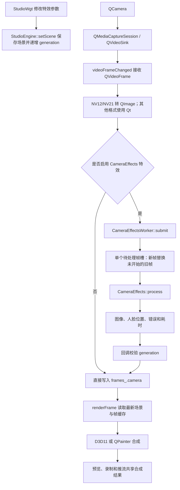

# CameraEffects 摄像头特效实现流程

本文沿着摄像头图像从采集、转换、异步处理到导播合成的路径，说明 `CameraEffects.cpp`。它负责摄像头图像上的 OpenCV 磨皮、美白、对比度、锐化、人脸检测和贴纸绘制；不负责设备管理、音视频编码，也不负责旧屏幕推流中的 HLSL 滤镜。

主要代码位置：

- `ClientStreamLive/Pusher/CameraEffects.h`：处理结果和 worker 接口。
- `ClientStreamLive/Pusher/CameraEffects.cpp`：图像处理、人脸检测、贴纸绘制和后台线程。
- `ClientStreamLive/Pusher/StudioEngine.cpp`：接收相机帧、提交特效任务并接收处理结果。
- `ClientStreamLive/Pusher/StudioScene.h`、`StudioScene.cpp`：参数保存、读取和范围校验。
- `ClientStreamLive/UI/center/StudioWgt.cpp`：导播工作台中的特效控件。

## 1. 一帧图像的完整流程



相机回调只负责把帧转为 `QImage`、读取当前场景参数，并决定直写缓存还是提交 worker。OpenCV 磨皮和 YuNet 推理在线程中运行，避免较慢的图像处理阻塞采集回调。合成器从缓存读取最新结果，处理完成的图像会在后续合成帧中显示。

## 2. 参数如何进入处理链

`StudioScene` 保存以下参数：

| 字段 | 含义 | 默认值与范围 |
| --- | --- | --- |
| `cvSmooth` | 磨皮强度 | 0，范围 0–100 |
| `cvWhiten` | 美白强度 | 0，范围 0–100 |
| `cvContrast` | 对比度倍率百分数 | 100，范围 50–150 |
| `cvSharpen` | 锐化强度 | 0，范围 0–100 |
| `faceTrack` | 显示人脸跟踪框 | 默认关闭 |
| `faceSticker` | 绘制人脸贴纸 | 默认关闭 |
| `faceModel` | 可选 ONNX 模型路径 | 留空时使用程序目录中的 YuNet 模型 |
| `stickerPath` | 可选贴纸图片路径 | 留空或图片无效时绘制皇冠 |

这些值由 `StudioWgt` 控件写回场景。设置场景时会调用 `sanitize()` 裁剪范围，再由 `StudioScene` 负责 JSON 序列化和持久化。

`StudioEngine` 仅在磨皮、美白、锐化非零，对比度不等于 100，或人脸框/贴纸开启时提交特效任务。全部关闭时，相机图像直接写入 `frames_.camera`，绕过 worker。

`cameraBeauty` 是另一个旧的柔化开关，不属于 `CameraEffects::process()`：`renderFrame()` 会把图像缩小到约三分之一再放大，并以 30% 透明度叠回。它与本文件里的 OpenCV 磨皮分别控制。

## 3. 输入帧转换与线程边界

`StudioEngine.cpp` 中的 `cameraFrameToImage()` 将 Qt 的 `QVideoFrame` 转为 `QImage`。NV12/NV21 帧会映射两个平面，通过 OpenCV 双平面颜色转换写入 `QImage::Format_RGB32)，并处理方向、旋转和镜像；其他格式使用 `frame.toImage()`。转换成功后，接收回调获取当前 `StudioScene` 快照。

启用特效时，回调调用：

```cpp
effects_->submit(std::move(image), options, effectsGeneration_.load());
```

worker 内部通过互斥锁、条件变量和一个待处理槽保存图像、场景快照及 generation。工作线程取出任务、释放锁，再调用 `CameraEffects::process()`；图像算法不会在持锁期间运行，也不会形成无限增长的处理队列。

如果新任务到来时待处理槽里已有尚未开始的帧，`submit()` 会覆盖那一帧并增加 `dropped`。正在处理的帧会继续完成。这个策略丢弃过时的中间帧，让输出尽量追上实时画面。

## 4. CameraEffects::process 的处理顺序

函数先启动耗时计时，将输入转换为独立的 `QImage::Format_RGB32` 图像，再以其内存构造 `cv::Mat`。处理结果累积在这张图像上，输出尺寸保持不变。

### 4.1 磨皮

当 cvSmooth 大于 0 时，先缩小图像做双边滤波，再放大并与原图混合。对应源码：

```cpp
if (s.cvSmooth > 0) {
    cv::resize(image, p.small, cv::Size(), .25, .25, cv::INTER_LINEAR);
    cv::cvtColor(p.small, p.bgr, cv::COLOR_BGRA2BGR);
    cv::bilateralFilter(p.bgr, p.blurred, 5,
                        10 + s.cvSmooth * .5, 5);
    cv::cvtColor(p.blurred, p.small, cv::COLOR_BGR2BGRA);
    cv::resize(p.small, p.full, image.size());
    const double alpha = std::min(.8, s.cvSmooth / 100.);
    cv::addWeighted(p.full, alpha, image, 1 - alpha, 0, image);
}
```

逐行看参数和数据流：

- resize 的第二个参数 p.small 是输出缓存；cv::Size() 表示不直接指定输出宽高，改由两个缩放因子 .25 决定宽、高各缩到四分之一。INTER_LINEAR 指定双线性插值。像素总量约降为原来的 1/16，降低后续滤波成本。
- cvtColor 的 BGRA2BGR 把四通道图像转成三通道 BGR，去掉 alpha，供双边滤波使用；滤波结果随后再用 BGR2BGRA 转回四通道。
- bilateralFilter(src, dst, d, sigmaColor, sigmaSpace) 中，p.bgr 是输入，p.blurred 是输出；d=5 是邻域直径，sigmaColor=10+s.cvSmooth×0.5 控制颜色差异对平滑的影响，sigmaSpace=5 控制空间距离影响。强度越高，颜色 sigma 越大。
- 第二次 resize 将滤波图放大到 image.size()，存入 p.full。
- alpha 是这里的混合权重，不是图像的透明度通道。cv::addWeighted 的参数依次是第一张图、第一权重、第二张图、第二权重、加到结果上的偏移、输出图。当前计算为 p.full×alpha + image×(1-alpha) + 0，并把结果写回 image。alpha 最大限制为 0.8，因此最高强度时仍保留 20% 原图。

**计算为什么能产生磨皮效果：** 双边滤波会把邻域像素按“空间距离”和“颜色相似度”加权求平均。平滑肤色区域中，相邻像素颜色相近，彼此权重较大，局部细小起伏会被平均掉；跨过明显边缘时，颜色差异会降低另一侧像素的权重，因此边缘相对保留。最后的混合公式是“滤波结果×alpha + 原图×(1-alpha)”，把滤波造成的变化按 alpha 缩小，既能柔化细节，也保留一部分原始纹理。

**为什么这样做：** 降采样减少双边滤波的计算量；双边滤波依据颜色差异平滑邻近像素，比普通模糊更容易保住明显边缘；最后与原图混合可调节效果强弱，避免滤波结果完全覆盖原图。

**坑点：**

- 处理作用于整张图，不是只处理脸部或皮肤；背景、头发和文字也会变软。
- 先缩小再放大会损失细节，双边滤波无法恢复已经丢掉的高频信息。
- s.cvSmooth 不是线性对应观感：它同时改变颜色 sigma 和混合权重，而且 alpha 在 0.8 封顶。强度高时仍可能有塑料感。

### 4.2 美白：逐步理解查找表映射

这段代码先建立“每种输入亮度对应什么输出亮度”的表，再把表应用到图像。for 循环本身只填表，还没有改动 image；真正改图像的是最后的 cv::LUT。

```cpp
if (s.cvWhiten > 0) {
    p.lut.create(1, 256, CV_8UC1);
    for (int i = 0; i < 256; ++i)
        p.lut.at<uchar>(i) =
            cv::saturate_cast<uchar>(
                std::pow(i / 255., 1. - s.cvWhiten * .004) * 255.);
    cv::LUT(image, p.lut, image);
}
```

#### 先看循环下标 i

for 循环让 i 依次取 0 到 255。因为一张 8 位图像的单个通道可以是 0–255，循环正好为每一种可能的输入值生成一个输出值。p.lut 是前面创建的 1×256 单通道表；p.lut.at<uchar>(i) 表示把对应结果写到第 i 个表项。

#### 把整数亮度变成 0 到 1

表达式 i / 255. 把输入值归一化：

```text
i = 0   -> 0 / 255   = 0
i = 64  -> 64 / 255  ≈ 0.251
i = 128 -> 128 / 255 ≈ 0.502
i = 255 -> 255 / 255 = 1
```

这里的 255. 带小数点，表示浮点数 255.0，所以 i 会按浮点除法计算。如果写成 i / 255，两个操作数都是整数，0 到 254 大多会先被整除成 0，查找曲线就会失效。

#### 强度如何改变指数

s.cvWhiten 是场景里的美白强度，正常范围是 0–100。指数由 1. - s.cvWhiten * .004 算出：

```text
cvWhiten = 0   -> exponent = 1.0
cvWhiten = 50  -> exponent = 0.8
cvWhiten = 100 -> exponent = 0.6
```

本代码只有在 cvWhiten > 0 时才进入这个分支。对 0 到 1 之间的输入 x，当指数小于 1 时，x 的幂通常会大于 x，所以中低亮度被抬高；输入 0 仍是 0，输入 1 仍是 1，也就是 0 仍输出黑、255 仍输出白。强度越高，指数越小，同一个输入值被抬得越多。

#### pow 之后为什么还要乘 255

```cpp
std::pow(i / 255., 1. - s.cvWhiten * .004) * 255.
```

std::pow(base, exponent) 在归一化的 0–1 范围计算非线性曲线。它的结果仍大致在 0–1 之间；再乘 255.，把它换回图像通道使用的 0–255 亮度范围。

举例：设 cvWhiten=50，输入通道值 i=64：

```text
exponent = 1 - 50 × 0.004 = 0.8
normalized = 64 / 255 ≈ 0.251
mapped = 0.251 ^ 0.8 × 255 ≈ 84
```

因此查找表把 64 映射到约 84。若强度为 0，指数是 1，64 仍映射为 64；若强度为 100，指数是 0.6，64 会映射到约 111。

#### saturate_cast 和 LUT 分别做什么

```cpp
p.lut.at<uchar>(i) =
    cv::saturate_cast<uchar>(mappedValue);
cv::LUT(image, p.lut, image);
```

saturate_cast<uchar> 把浮点结果取整并转换成 uchar（8 位无符号整数），超出 0–255 时限制在该范围内，随后写入第 i 个表项。

等 256 个表项填好后，cv::LUT(image, p.lut, image) 才逐通道查表：某像素通道若原值是 64，就用 p.lut[64] 替换它；原值是 128，就用 p.lut[128] 替换。输入和输出都传 image，所以处理结果原位写回，不需要再创建一张输出图。这个表对整张图所有像素使用，不只作用于人脸或皮肤。当前 image 是四通道图，LUT 也会处理第四通道；不透明的 255 在这条曲线上仍映射成 255，后面的 alpha 收尾则统一保证结果不透明。

**计算为什么能产生美白效果：** 归一化输入 x 在 0 到 1 之间，强度大于 0 时指数 e 小于 1；此时 0<x<1 通常满足 x^e>x，所以输出通道值比输入亮。0 和 1 两端保持不变，主要抬高中低亮度，而不是给每个通道统一加一个常数。例如指数为 0.8 时，64 会映射到约 84。LUT 是按输入值查表替换，不是把 RGBA 与表相乘；RGB 各通道分别查同一张表。

**为什么这样做：** 每帧只计算 256 个曲线值，然后对图像大量像素做查表。这样避免对每个像素都重复调用 pow()，同时用可调的非线性曲线提升中低亮度。

**坑点：**

- 这 256 项在每次进入 process() 的美白分支时都会重新计算；不是整个程序生命周期只计算一次。不过相较于对每个像素计算 pow()，每帧计算固定的 256 项仍然更省。
- 强度越大，中低亮度越接近高亮值，画面可能发白、层次变浅；美白之后还会接着执行对比度和锐化。
- 这是对整幅图、各颜色通道的数值映射，不是只改变皮肤；背景也会一起变亮。

### 4.3 对比度

当 cvContrast 不等于 100 时，对图像做线性缩放。对应源码：

```cpp
if (s.cvContrast != 100)
    image.convertTo(image, -1, s.cvContrast / 100., 0);
```

convertTo(dst, rtype, alpha, beta) 的核心关系是 dst = src×alpha + beta：

- 第一个 image 是输出目标；这里输入和输出相同，原位更新图像。
- rtype=-1 表示保留输入图像的数据类型和通道数。
- 第三个参数 s.cvContrast / 100. 是像素缩放倍率。100 对应 1.0；例如 120 对应 1.2。写成 100. 可让除法按浮点数进行。
- 最后的 0 是 beta 偏移，也就是不额外加亮度偏移。OpenCV 会把结果转换回原数据类型；对于 8 位通道，超范围数值会被截到可表示范围。

**计算为什么能改变对比度：** 这段计算近似为“输出值 = 输入值×k”，其中 k=cvContrast/100。两个像素值 a、b 的差值会变为 k×(a-b)：k 大于 1 时差值拉大，明暗层次更分开；k 小于 1 时差值缩小，层次更接近。由于公式的偏移 beta 是 0，缩放基准落在黑色，不是中灰，所以对比度变化也会带动画面整体变亮或变暗。

**为什么这样做：** 100 是直观的中性值，滑块或配置值除以 100 就得到倍率。乘法加零偏移的实现简单，且能直接在当前图像上更新。

**坑点：**

- beta 为 0 时是围绕黑色基准缩放，不是围绕中灰调对比度。因此值大于 100 会同时抬高整体亮度，低于 100 会整体变暗；它不只是增加或降低明暗差异。
- 高亮区域可能被截成纯白，暗部可能被压得更黑。
- 这里参数名 alpha 表示 convertTo 的数值缩放系数；它与 BGRA 图像中的 alpha 透明度通道不是同一个概念。由于 image 有四个通道，变换也会影响第四通道，后面会统一恢复不透明值。

### 4.4 锐化与通道收尾

当 cvSharpen 大于 0 时，先生成高斯模糊图，再用反遮罩方式增强细节；最后无论是否启用锐化，都会把第四通道设为 255。对应源码：

```cpp
if (s.cvSharpen > 0) {
    cv::GaussianBlur(image, p.sharp, {0, 0}, 1.5);
    const double amount = s.cvSharpen / 100.;
    cv::addWeighted(image, 1 + amount, p.sharp, -amount, 0, image);
}
// Keep BGRA alpha opaque even when brightness/contrast touches it.
for (int y = 0; y < image.rows; ++y)
    for (int x = 0; x < image.cols; ++x)
        image.ptr<cv::Vec4b>(y)[x][3] = 255;
```

锐化部分的参数含义：

- GaussianBlur 的参数依次是输入、输出、核尺寸、sigmaX。核尺寸 {0, 0} 表示按 sigma 自动计算核；sigmaX=1.5 控制模糊范围，模糊图写入 p.sharp。
- amount = s.cvSharpen / 100. 把 0–100 的设置换成 0–1 的强度。
- addWeighted 按“原图×(1+amount) + 模糊图×(-amount) + 0”计算，等价于原图 + amount×(原图-模糊图)。原图减模糊图主要留下边缘和细节变化，按比例加回会让轮廓更清楚。输出仍写入 image。
- 最后的双重循环逐像素访问四通道 Vec4b，并把索引 3 的通道设为 255。前面的 LUT、convertTo 和 addWeighted 会按四通道处理，可能改变 alpha；这里把结果重新保证为不透明。

**计算为什么能产生锐化效果：** 高斯模糊图近似保留缓慢变化的低频部分；原图减去模糊图后，留下的主要是边缘和细节变化。最终公式可写成“原图 + amount×(原图-模糊图)”。平坦区域的原图与模糊图接近，差值小，变化不大；边缘处差值大，amount 会把边缘两侧的明暗差进一步放大，于是轮廓看起来更清晰。

**为什么这样做：** 在磨皮之后锐化，可以补回一部分边缘清晰度；在所有颜色处理之后统一恢复 alpha，则能避免数值运算意外改变图像透明度。

**坑点：**

- 反遮罩会增强所有高频内容，噪声、压缩痕迹和皮肤纹理也可能被增强；强度高时边缘会出现亮边或暗边，且 8 位结果可能被截断。
- 锐化仍是全图处理，没有人脸蒙版。
- alpha 收尾需要额外遍历每个像素；图像越大，额外内存访问越多。代码也假设 image 始终是四通道格式，若以后修改图像格式或 Mat 通道数，需要同步调整索引 3。

## 5. YuNet 人脸检测与贴纸

人脸处理位于 CameraEffects::process() 的后半段：前面的磨皮、美白、对比度和锐化已经作用于 image，随后才做 YuNet 检测和绘制。因此检测输入是经过上述图像处理的当前帧，贴纸也直接画进同一张结果图像。

触发条件是 faceTrack 或 faceSticker 任意一个开启。只开 faceTrack 会检测并画框；只开 faceSticker 也会检测，但只画贴纸；两者都关闭时不加载模型，并清空缓存的人脸框。

### 5.1 哪些状态会跨帧保留

CameraEffects::Impl 保存 detector、模型路径、最近人脸框与双眼坐标、上次检测时间，以及贴纸图像和路径。CameraEffectsWorker 的线程循环中只创建一个 CameraEffects 对象，重复调用 process()，所以这些状态能在连续相机帧之间复用。

```cpp
cv::Ptr<cv::FaceDetectorYN> detector;
QString modelPath, modelError;
bool attempted = false;
QRectF face;
QPointF leftEye, rightEye;
std::chrono::steady_clock::time_point lastDetection{}, lastFace{};
QImage sticker;
QString stickerPath;
```

其中 detector 避免每帧重建模型；face 用来保存上一次人脸框；leftEye 和 rightEye 用来计算贴纸倾角；sticker 与 stickerPath 用来缓存贴纸图片。

### 5.2 选择并加载模型

模型路径优先取场景设置 faceModel；留空时使用程序运行目录下的默认 YuNet 模型。模型路径变化时，旧 detector 和人脸框都会重置。

```cpp
const QString model = s.faceModel.isEmpty()
    ? QCoreApplication::applicationDirPath() +
          "/assets/face_detection_yunet_2023mar.onnx"
    : s.faceModel;

if (p.modelPath != model) {
    p.detector.release();
    p.modelPath = model;
    p.modelError.clear();
    p.attempted = false;
    p.face = {};
}

if (!p.attempted) {
    p.attempted = true;
    QFile file(model);
    if (file.open(QIODevice::ReadOnly)) {
        auto data = file.readAll();
        std::vector<uchar> bytes(data.begin(), data.end());
        p.detector = cv::FaceDetectorYN::create(
            "onnx", bytes, {}, cv::Size(320, 320), .65f, .3f, 5000,
            cv::dnn::DNN_BACKEND_OPENCV, cv::dnn::DNN_TARGET_CPU);
    } else {
        result.error = QStringLiteral("无法读取人脸模型：") + model;
    }
}
```

ONNX 文件通过 QFile 读入内存，再交给 FaceDetectorYN。检测器使用 320×320 输入、0.65 置信度门槛、0.3 的 NMS 阈值和 5000 个候选上限，后端及目标均设为 OpenCV CPU。

attempted 在第一次尝试前设为 true，因此同一路径加载失败后不会每帧重复读取；换一个模型路径才会重新尝试。模型不可用时会设置错误，但 process() 已经先创建并处理了 result.image，所以普通相机画面仍可返回。错误状态如何显示见下一节“结果回写、错误和退出”。

### 5.3 输入准备、执行检测与解析 p.faces

进入这一段前，image 是已经完成前置图像处理的四通道图像。代码先控制检测频率，再整理输入格式和尺寸，最后运行 YuNet：

```cpp
const auto now = std::chrono::steady_clock::now();
if (p.detector &&
    now - p.lastDetection >= std::chrono::milliseconds(125)) {
    p.lastDetection = now;
    cv::cvtColor(image, p.bgr, cv::COLOR_BGRA2BGR);
    cv::resize(p.bgr, p.input, {320, 320});
    p.detector->setInputSize({320, 320});
    p.detector->detect(p.input, p.faces);
}
```

这几行各自负责不同的事：

- p.lastDetection = now 记录本轮检测时间。外层条件要求距上一次检测至少 125 ms，因此检测频率最高约 8 Hz。
- cv::cvtColor 将四通道 BGRA 图像转为三通道 BGR，alpha 通道不参与人脸识别。
- cv::resize 把图像实际缩放为 320×320，结果放在 p.input。
- setInputSize 告诉检测器当前网络输入尺寸是 320×320。它本身不缩放 p.input；缩放由前一行完成。模型创建时也已指定相同尺寸，所以当前每次检测重复设置相同值，尺寸不变时属于冗余设置。
- detect 才真正运行推理：它读取 p.input，并将检测结果写到 p.faces。FaceDetectorYN 接口文档也把 faces 定义为检测结果输出矩阵。

p.faces 是 CameraEffects::Impl 中的 cv::Mat 成员，不是一个单独的人脸对象。检测到 N 张候选脸时，它有 N 行，每行 15 个浮点值；没有检测到脸时没有可处理的行。当前代码用 p.faces.ptr<float>(i) 取第 i 行，再按下表读取：

| 索引 | 含义 | 本代码如何使用 |
| --- | --- | --- |
| f[0], f[1] | 人脸框左上角 x、y | 与宽、高一起构造 QRectF |
| f[2], f[3] | 人脸框宽、高 | 计算框面积，并构造 QRectF |
| f[4], f[5] | 第一个眼睛关键点 x、y | 写入 p.leftEye |
| f[6], f[7] | 第二个眼睛关键点 x、y | 写入 p.rightEye |
| f[8]–f[13] | 鼻尖、嘴角等其他关键点 | 当前贴纸逻辑没有使用 |
| f[14] | 人脸置信度 | 过滤低于 0.65 的候选 |

OpenCV 文档列出的完整结果格式是：[FaceDetectorYN 检测结果说明](https://docs.opencv.org/4.8.0/df/d20/classcv_1_1FaceDetectorYN.html)。代码先保留 f[14] >= 0.65 的候选，再按 f[2] × f[3] 选择面积最大的一张脸；0.3 的 NMS 阈值则在创建检测器时用于抑制重叠候选框。

### 5.3.1 检测坐标如何换回原图

p.faces 中的人脸框和关键点坐标以 320×320 的 p.input 为基准。设原图宽、高分别为 W、H，代码分别计算横向和纵向的反向缩放比例：

```cpp
const double sx = image.cols / 320.;
const double sy = image.rows / 320.;
```

因此 sx = W / 320，sy = H / 320。人脸框的左上角、宽和高按对应方向分别换算：

```cpp
QRectF face(f[0] * sx, f[1] * sy, f[2] * sx, f[3] * sy);
p.leftEye = {f[4] * sx, f[5] * sy};
p.rightEye = {f[6] * sx, f[7] * sy};
```

x 坐标和宽度乘 sx；y 坐标和高度乘 sy。眼睛关键点同样是 x 乘 sx、y 乘 sy。换算后的位置属于原图坐标系，所以能直接用于在原尺寸的 QImage 上画框和贴纸。

例如，原图是 1280×720：

- sx = 1280 / 320 = 4
- sy = 720 / 320 = 2.25

如果检测器在 320×320 输入上返回框 (80, 100, 60, 80)，映射回原图为 (320, 225, 240, 180)：x=80 乘 4 得 320，y=100 乘 2.25 得 225，宽 60 乘 4 得 240，高 80 乘 2.25 得 180。

坐标映射和图像形状是两件事。1280×720 直接缩放为 320×320 时，横向缩放比例是 0.25，纵向约 0.444；脸在送入 YuNet 前已经被压窄、拉高。sx、sy 能把输出框和关键点放回原图坐标，却不能恢复检测器看到的原始脸部比例，也不能消除拉伸可能带来的检测偏差。若要避免形变，需要按同一比例缩放后补边到 320×320（letterbox），再在映射时扣除补边偏移；当前代码没有采用补边方式。

### 5.4 人脸框如何保持平稳

```cpp
QRectF face(f[0] * sx, f[1] * sy, f[2] * sx, f[3] * sy);

if (!p.face.isEmpty() &&
    now - p.lastFace < std::chrono::milliseconds(400)) {
    face = {
        p.face.x() * .6 + face.x() * .4,
        p.face.y() * .6 + face.y() * .4,
        p.face.width() * .6 + face.width() * .4,
        p.face.height() * .6 + face.height() * .4
    };
}

p.face = face;
p.leftEye = {f[4] * sx, f[5] * sy};
p.rightEye = {f[6] * sx, f[7] * sy};
p.lastFace = now;
```

新框与最近旧框按 40% 新值、60% 旧值混合，减少位置和尺寸的跳动。只有旧框不到 400 毫秒时才平滑；更久的旧框不参与计算。眼睛坐标直接取本次检测结果，没有跟人脸框一起平滑，因此贴纸角度有时会比贴纸位置更容易抖动。

如果一轮检测没有找到合格的人脸，代码不会立刻清空 p.face，而是保留最近位置；超过 350 毫秒没有刷新时才清空：

```cpp
if (now - p.lastFace > std::chrono::milliseconds(350))
    p.face = {};

result.face = p.face;
```

这套“检测框缓存 + 时间平滑 + 超时清除”就是源码里的跟踪逻辑。它没有人脸 ID、运动模型或多目标关联；多人画面中最大脸发生变化时，框可能转到另一张脸上。

### 5.5 贴纸定位、坐标变换与绘制

这一段把检测得到的人脸框和双眼坐标转换成 QPainter 的绘图位置，再把贴纸图片或默认皇冠画进 result.image。绘图只在人脸框有效时发生。faceTrack 控制绿色人脸框，faceSticker 控制贴纸；二者可以分别开启。

```cpp
if (!p.face.isEmpty()) {
    QPainter painter(&result.image);
    painter.setRenderHint(QPainter::Antialiasing);

    if (s.faceTrack) {
        painter.setPen(QPen(QColor(0, 220, 140), 2));
        painter.drawRoundedRect(p.face, 6, 6);
    }

    if (s.faceSticker) {
        if (p.stickerPath != s.stickerPath) {
            p.stickerPath = s.stickerPath;
            p.sticker = QImage(s.stickerPath);
        }

        const QPointF center = p.face.center();
        const qreal width = p.face.width() * 1.25;
        const qreal height = width * .45;
        painter.translate(center.x(), p.face.top());
        painter.rotate(
            std::atan2(p.rightEye.y() - p.leftEye.y(),
                       p.rightEye.x() - p.leftEye.x()) * 180 /
            3.141592653589793);

        if (!p.sticker.isNull()) {
            painter.drawImage(
                QRectF(-width / 2, -height * .8, width, height),
                p.sticker);
        } else {
            painter.setPen(QPen(QColor(255, 220, 40), 3));
            painter.setBrush(QColor(255, 190, 0, 180));
            QPolygonF crown;
            crown << QPointF(-width / 2, 0)
                  << QPointF(-width / 2, -height)
                  << QPointF(-width / 4, -height * .4)
                  << QPointF(0, -height * 1.2)
                  << QPointF(width / 4, -height * .4)
                  << QPointF(width / 2, -height)
                  << QPointF(width / 2, 0);
            painter.drawPolygon(crown);
        }
    }
}
```

#### 5.5.1 画人脸框

painter 是绑定到 result.image 的 QPainter；后面的绘图都会直接修改这张输出图。Antialiasing 用于平滑线条和多边形边缘，减少旋转或斜线上的锯齿。

QPen(QColor(0, 220, 140), 2) 创建绿色画笔，颜色分量依次是红、绿、蓝，线宽为 2。drawRoundedRect(p.face, 6, 6) 使用 p.face 作为矩形位置和尺寸，两个 6 分别是 x、y 方向的圆角半径；默认按绘图坐标的绝对单位计算，也就是这里约 6 个图像像素。绘制顺序在贴纸之前，所以贴纸与框重叠时，贴纸会盖在框上面。

#### 5.5.2 读取并缓存贴纸图

p.stickerPath 保存上一次使用的文件路径。只有场景中的路径变化时，才重新执行 QImage(s.stickerPath) 读取图片；相同路径的后续视频帧会复用 p.sticker，避免每帧重复读盘。

QImage::isNull() 用于判断图片是否有效：路径为空、文件不存在或解码失败时会返回空图，代码就转入默认皇冠分支。由于缓存判断只比较路径，如果贴纸文件在原路径被替换但路径字符串没变，当前实现不会主动重新加载。

#### 5.5.3 计算贴纸大小和锚点

p.face 是 YuNet 检测后映射回原图坐标的 QRectF。它的 width() 返回人脸框宽度，单位是当前 result.image 的图像坐标单位；处理图像是按像素绘制的 QImage，所以这里可按像素理解。

```cpp
const QPointF center = p.face.center();
const qreal width = p.face.width() * 1.25;
const qreal height = width * .45;
```

qreal 是 Qt 定义的浮点数类型别名，用于几何坐标、尺寸和变换角度等数值。Qt 6 默认将它定义为 double；如果 Qt 构建时使用 -qreal float 选项，则会是 float。[Qt qreal 类型说明](https://doc.qt.io/qt-6/qttypes.html)

这里选 qreal 而不是 int，是为了保留小数尺寸和坐标，避免先取整再绘制造成尺寸跳变或位置偏差。QRectF、QPointF 和 QPainter 的几何接口也使用浮点值；最终光栅化到 QImage 像素时，由绘图系统处理这些小数坐标。

两行尺寸计算的含义是：

- width = 人脸框宽度 × 1.25：贴纸比人脸框宽 25%，稍微伸到脸框两侧。
- height = width × 0.45：贴纸高度固定为其宽度的 45%，所以目标宽高比约为 2.22:1。这个比例只由代码设定，不读取 PNG/WebP 文件的原始宽高比。

例如，人脸框宽 160 像素时，width = 160 × 1.25 = 200，height = 200 × 0.45 = 90。即使计算得到小数，qreal 也会保留它，直到 QPainter 执行绘制。贴纸图片如何适配这个目标矩形，以及宽高比不一致时的拉伸影响，见 5.5.5 小节。

center 保存人脸框的几何中心点。本代码随后调用：

```cpp
painter.translate(center.x(), p.face.top());
```

QPainter::translate(dx, dy) 改变的是画笔使用的坐标系：dx 是横向偏移，dy 是纵向偏移。调用前，绘图原点通常在 result.image 左上角 (0, 0)；调用后，后续绘图使用的新原点位于 (center.x(), p.face.top())。它不会移动 p.face，也不会直接移动或改写 result.image，只会改变之后绘制坐标如何映射到图像上。

第一个参数 center.x() 是人脸框中心的 x 坐标，也就是 p.face.x() + p.face.width() / 2；第二个参数 p.face.top() 是人脸框上边缘的 y 坐标。虽然 center 也有 center.y()，这里故意不用：贴纸锚点选择人脸框顶部的水平中心，而不是人脸正中，这样贴纸能放在额头上方。

这行之后的 rotate() 会围绕已经平移到的人脸框顶部中心旋转。drawImage() 中的 QRectF 使用相对新原点的局部坐标，例如 x=-width/2 表示从锚点向左半个贴纸宽度，y=-height*0.8 表示从锚点向上 80% 的贴纸高度。

数值例子：若 p.face = QRectF(320, 225, 240, 180)，则 center = (440, 315)，但平移调用得到的锚点是 (440, 225)，不是人脸框中心 (440, 315)。若贴纸宽高为 300×135，目标矩形在不旋转时相当于图像坐标中的 x=290..590、y=117..252。Qt 的平移和坐标变换规则见 [QPainter 文档](https://doc.qt.io/qt-6/qpainter.html) 和 [坐标系统文档](https://doc.qt.io/qt-6/coordsys.html)。

#### 5.5.4 根据双眼连线旋转

```cpp
painter.rotate(
    std::atan2(p.rightEye.y() - p.leftEye.y(),
               p.rightEye.x() - p.leftEye.x()) * 180 /
    3.141592653589793);
```

令 dx = rightEye.x - leftEye.x，dy = rightEye.y - leftEye.y。atan2(dy, dx) 根据双眼连线得到弧度角；乘 180 / π 转成角度，因为 QPainter::rotate() 接收的是角度值。

当前 Qt 坐标系, (0, 0) 就是图像左上角；x 正方向向右，y 正方向向下。 x 轴向右、y 轴向下，所以正角度的视觉旋转方向为顺时针。代码先平移锚点，再旋转坐标系，因此图片或皇冠会围绕人脸框顶部中心旋转，而不是围绕图像左上角旋转。双眼坐标来自最近一次检测，未做时间平滑，检测点轻微波动时贴纸角度也可能抖动。

#### 5.5.5 把图片缩放后画入目标矩形

```cpp
painter.drawImage(
    QRectF(-width / 2, -height * .8, width, height),
    p.sticker);
```

drawImage(targetRect, image) 的第一个参数是目标绘制矩形，第二个参数是要绘制的完整 QImage。Qt 会把图片缩放到目标矩形大小，再按当前 QPainter 的平移和旋转变换画到 result.image 上。若素材本身的宽高比例与 width / height 不同，图片会被拉伸或压扁；选择贴纸素材时应让素材比例接近这里设定的比例。透明 PNG 的透明区域会保留，绘制时与相机图像合成。[QPainter::drawImage 文档](https://doc.qt.io/qt-6/qpainter.html)

#### 5.5.6 图片无效时画默认皇冠

贴纸图为空时，代码用 QPolygonF 列出皇冠的七个顶点，再由 drawPolygon() 连线、填充成多边形：

- QPen(QColor(255, 220, 40), 3) 设置金黄色轮廓和 3 像素线宽。
- QColor(255, 190, 0, 180) 设置金色填充；第四个值 180 是 alpha，表示半透明。
- crown 中每个 QPointF 都相对于已平移的锚点定义；这些点也会应用前面的旋转变换，所以皇冠同样跟着人脸移动、倾斜。

图片和默认皇冠都是画在 result.image 上。process() 返回结果后，StudioEngine 将它写入相机帧缓存，后续合成阶段再把这张图用于预览、录制和推流。

QPainter 的平移、旋转以及 y 轴向下的坐标约定见 [Qt 坐标系统文档](https://doc.qt.io/qt-6/coordsys.html)；drawRoundedRect 的圆角参数见 [QPainter 文档](https://doc.qt.io/qt-6/qpainter.html)。

### 5.6 实际效果的边界

- 每轮最多选一个人脸：满足置信度门槛的候选里，面积最大者优先。
- 位置平滑只作用于人脸框，双眼关键点没有平滑，旋转角度可能轻微抖动。
- 检测上限约 8 Hz；如果 CPU 处理繁忙，worker 会替换尚未开始的旧帧，实际检测频率还可能降低。
- 图像整体缩放到正方形做检测，非正方形输入会被拉伸。
- 贴纸宽高按人脸框比例固定计算，没有针对不同贴纸素材单独校准锚点。

## 6. 结果回写、错误和退出

`CameraEffects::Result` 包含处理后的 `image`、`face`、`error` 和 `elapsedUs`。耗时从进入 `process()` 开始计时，不包含 worker 等待任务的排队时间。OpenCV 异常会被捕获并放入 `error`。

worker 完成后调用 `StudioEngine` 回调。回调比较结果中的 generation 与当前 `effectsGeneration_`：相同才在互斥锁保护下更新 `frames_.camera`；不同则丢弃过期结果。每次场景更新都会递增 generation，因此旧设置下正在处理的帧不会覆盖新场景的相机画面。错误变化时会记录日志，并通过队列把状态栏更新投递回 Qt 对象线程。

YuNet 模型无法打开或初始化失败时，错误会显示；结果仍携带已创建的图像，因此检测不可用时，摄像头画面和普通图像特效仍可继续显示。关闭客户端时，worker 析构会设置退出标记、唤醒线程并等待退出；尚未开始的待处理帧会被丢弃。

## 7. 与导播合成及其他滤镜的关系

处理结果写回 `frames_.camera` 后，`renderFrame()` 读取场景与各路缓存，进入 D3D11 合成；GPU 路径不可用时由 `StudioCompositor` 使用 `QPainter` 合成。相机特效位于摄像头帧进入场景合成之前，预览、录制和 RTMP 使用后续的合成结果。

这条 OpenCV CPU 路径与 `Pusher/FilterPass.cpp` 的 HLSL 路径不同：后者用于旧的屏幕直推纹理，提供肤色平滑、LUT 和水印处理。屏幕 shader 的处理步骤不属于 `CameraEffects.cpp` 的相机算法。

性能日志中，`cameraEffectUs` 记录最近一次特效处理用时，`effectReplaced` 对应 worker 待处理帧替换计数，可用于观察算法耗时和处理压力。
