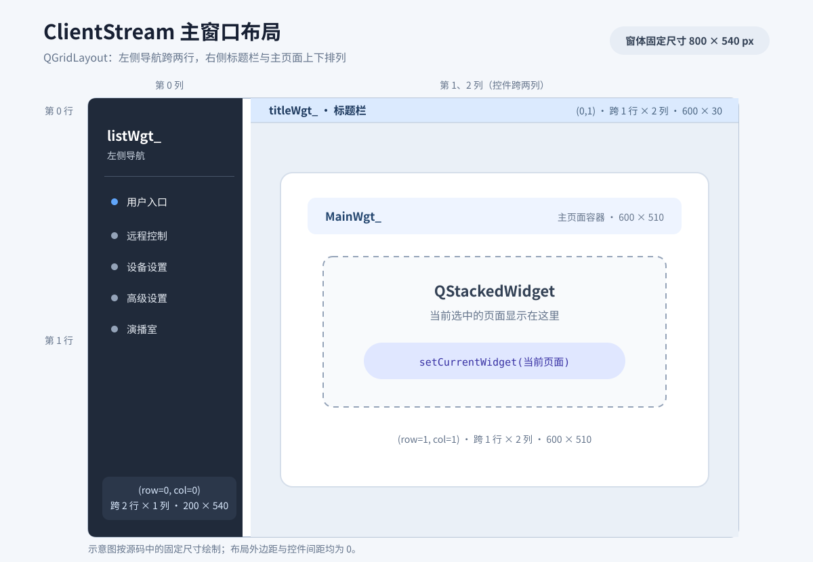

# ClientStream 主窗口的网格布局

## 窗口整体

`ClientStream` 是客户端外层主窗口，大小固定为 `800 × 540`。它用 `QGridLayout` 排列三个子控件：左侧导航 `listWgt_`、顶部标题栏 `titleWgt_` 和主页面区域 `mainWgt_`。



图中尺寸依据源码中的 `setFixedSize()` 标注。左侧导航占满整个高度；右侧区域由上方 30 像素高的标题栏和下方 510 像素高的主页面容器组成。

## 网格参数怎么读

`QGridLayout::addWidget(widget, row, column, rowSpan, columnSpan)` 的参数依次是控件、起始行、起始列、跨越行数和跨越列数。行列从 `0` 开始：

| 代码 | 起始位置 | 跨越范围 | 结果 | 控件固定尺寸 |
| --- | --- | --- | --- | --- |
| `addWidget(listWgt_, 0, 0, 2, 1)` | 第 0 行、第 0 列 | 2 行 × 1 列 | 左侧导航从顶部延伸到底部 | `200 × 540` |
| `addWidget(titleWgt_, 0, 1, 1, 2)` | 第 0 行、第 1 列 | 1 行 × 2 列 | 标题栏横跨右侧区域的两列 | `600 × 30` |
| `addWidget(mainWgt_, 1, 1, 1, 2)` | 第 1 行、第 1 列 | 1 行 × 2 列 | 主页面容器横跨右侧区域的两列 | `600 × 510` |

可以把它理解为一个有两行、三列逻辑位置的网格：`listWgt_` 跨两行；标题栏和主页面分别占据右边两列。控件跨列后，右侧整体宽度为 600 像素。

## 间距和边距

```cpp
QGridLayout* layout = new QGridLayout(this);
layout->setSpacing(0);

layout->addWidget(listWgt_, 0, 0, 2, 1);
layout->addWidget(titleWgt_, 0, 1, 1, 2);
layout->addWidget(mainWgt_, 1, 1, 1, 2);
layout->setContentsMargins(0, 0, 0, 0);
setLayout(layout);
```

- `setSpacing(0)`：相邻网格项之间不留空隙。
- `setContentsMargins(0, 0, 0, 0)`：布局与窗口四边之间不留内边距(是指一个容器内部，内容与容器边框之间的距离)。
- `setLayout(layout)`：把这个网格布局安装到 `ClientStream` 上，由布局管理三个子控件的位置和尺寸。

## 主页面区域与页面切换

`mainWgt_` 自身内部还有一个 `QStackedWidget`，用于显示登录、远程控制、设备设置、高级设置和演播室页面。外层 `QGridLayout` 只负责把 `mainWgt_` 放在窗口右下区域；具体显示哪个页面由 `MainWgt` 的 `setCurrentWidget()` 负责。页面切换说明见 [MainWgt 页面管理](./MainWgt.md)。

对应源码：`ClientStreamLive/clientstream.cpp`、`ClientStreamLive/UI/list/ListInfoWgt.cpp`、`ClientStreamLive/UI/title/TitleWgt.cpp`、`ClientStreamLive/UI/center/MainWgt.cpp`。