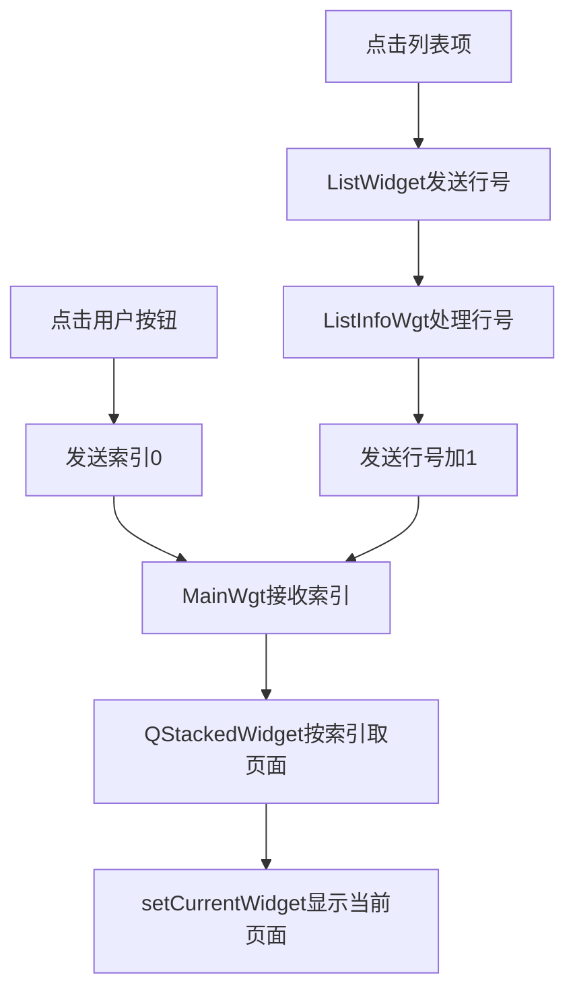
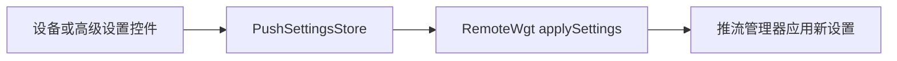

# MainWgt：主页面容器与设置同步

## MainWgt 在界面中的位置

`MainWgt` 是客户端主窗体中的页面区域，负责管理登录、远程控制、设备设置、高级设置和演播室这几个页面。应用外层窗口是 `ClientStream`：它使用 `QGridLayout` 放置左侧导航、标题栏和 `MainWgt`。

左侧导航与页面切换的连接在 `clientstream.cpp` 中建立：

```cpp
connect(listWgt_, &ListInfoWgt::sig_Select,
        mainWgt_, &MainWgt::slot_ItemClicked);
```

因此，左侧导航本身不直接操作 `QStackedWidget`。它发出带页面索引的 `sig_Select`，`MainWgt` 收到后再切换页面。

## 导航如何选择并显示页面

左侧的 `ListInfoWgt` 有两类入口：顶部用户按钮对应登录页；下面的列表项对应远程控制、设备设置、高级设置和演播室。

- 点击用户按钮时，`ListInfoWgt` 直接发出 `sig_Select(0)`，索引 0 对应登录页。
- 点击列表项时，`ListWidget` 发出 `itemClicked(row)`；`ListInfoWgt::HandleItemClicked(row)` 再发出 `sig_Select(row + 1)`。加 1 是因为索引 0 已留给用户按钮。
- `ClientStream` 已将 `sig_Select` 连接到 `MainWgt::slot_ItemClicked`。槽函数用索引从 `QStackedWidget` 取出页面，再调用 `setCurrentWidget()` 显示它。



## 用 QStackedWidget 管理页面

`MainWgt` 创建一个 `QStackedWidget`，再用垂直布局将它放入自身：

```cpp
stackWgt_ = new QStackedWidget(this);

QVBoxLayout* mainLay = new QVBoxLayout(this);
mainLay->setContentsMargins(0, 0, 0, 0);
mainLay->addWidget(stackWgt_);
```

`QStackedWidget` 像一叠页面，一次只显示当前选中的一页。这里的 `QVBoxLayout` 布局的是整个堆栈控件；页面本身由 `QStackedWidget` 管理。四个内容边距设为 0 后，堆栈控件会铺满 `MainWgt` 的内容区域。

页面按加入 `QStackedWidget` 的顺序取得索引：

| 索引 | 页面 | 对应导航入口 | 成员或创建方式 |
| --- | --- | --- | --- |
| 0 | 登录 | 顶部用户按钮 | `login_` |
| 1 | 远程控制 | 列表第 1 项 | `remoteWgt_` |
| 2 | 设备设置 | 列表第 2 项 | `deviceWgt_` |
| 3 | 高级设置 | 列表第 3 项 | `settingWgt_` |
| 4 | 演播室 | 列表第 4 项 | `new StudioWgt(this)` |

构造函数最后调用 `stackWgt_->setCurrentWidget(login_)`，所以程序启动时先显示登录页。

`MainWgt::slot_ItemClicked()` 收到索引后，通过索引取页面并切换：

```cpp
QWidget* widget = stackWgt_->widget(index);
if (widget) {
    stackWgt_->setCurrentWidget(widget);
}
```

索引无效时 `widget()` 返回空指针，页面不会切换。

## 设置变化如何传到推流器

主窗口还建立了这条信号槽连接：

```cpp
connect(&PushSettingsStore::instance(), &PushSettingsStore::changed,
        remoteWgt_, &RemoteWgt::applySettings);
```

它把全局配置仓库 `PushSettingsStore` 的 `changed` 信号接到远程控制页的 `applySettings()`。设置页不需要直接调用 `RemoteWgt`，只要更新配置仓库，Qt 就会把变化通知给已连接的接收者。

实际流程如下：



`PushSettingsStore::set()` 更新并校验内存中的配置后，会立即执行 `emit changed(settings_)`。设备设置页通过 `mutate()` 修改仓库中的部分字段；高级设置页则提交新的配置。仓库收到变更后，`RemoteWgt::applySettings()` 会在 `manager_` 已创建时调用 `manager_->applySettings(settings)`。

`connect()` 可以理解为登记一个回调关系。Qt 在 `emit changed(...)` 时找到这条关系，并调用 `applySettings()`。默认连接类型是 `Qt::AutoConnection`：发送者和接收者在同一线程时，槽函数会直接执行；本项目这些界面对象在主线程创建，因此通常是立即调用。跨线程时，Qt 会根据连接类型将调用排入接收者线程的事件队列。

如果远程管理器尚未创建，`applySettings()` 不会转发给推流器，但设置仍然留在 `PushSettingsStore` 中。远程管理器创建后，`RemoteWgt` 会再读取仓库当前的配置并调用 `manager_->applySettings(...)`，确保使用最新设置。配置变更信号是即时广播的；写入磁盘则由仓库的单次定时器合并到约 300 毫秒后执行。

导播页面也单独监听配置变化。因此，主窗口这条连接负责的是**把配置变更转发给远程控制页面**，不是所有设置消费者的唯一连接。

## 一句话总结

`MainWgt` 用 `QStackedWidget` 管理并切换多个页面，同时把统一配置仓库的变化连接到 `RemoteWgt`，让正在运行的推流管理器及时应用新设置。
