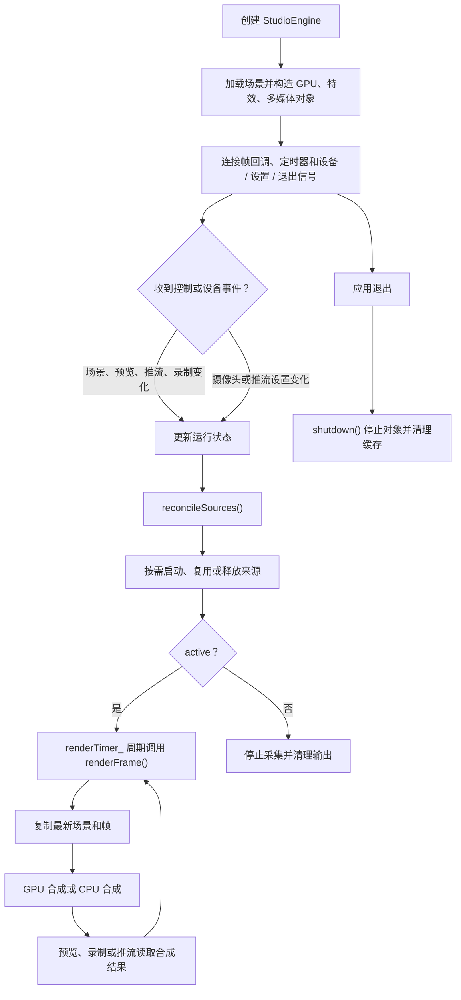
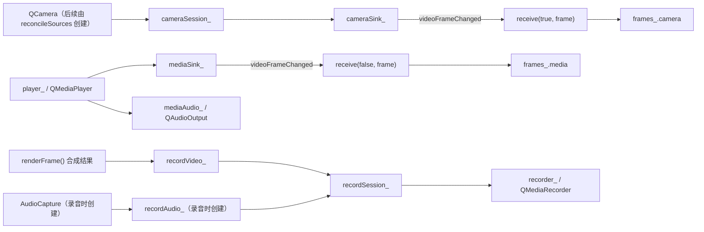
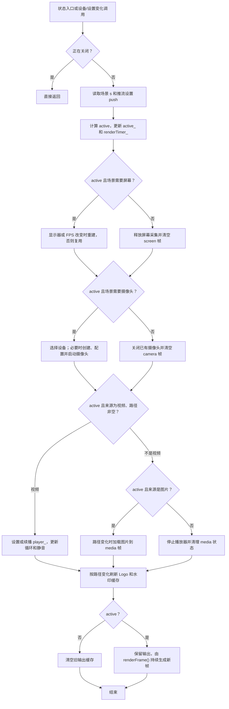
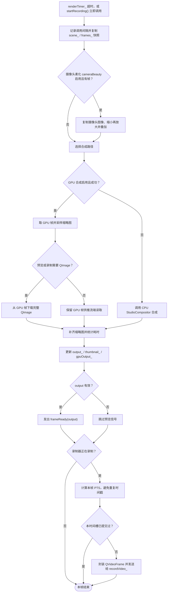

# StudioEngine 代码实现流程

本文按源码执行路径解释 StudioEngine 这个类如何初始化、接收状态变化、协调输入源、合成画面并关闭资源。这里重点讲代码如何串起来；系统层面的数据流和各来源规则见 [[StudioEngine流程]]，摄像头采集细节见 [[StudioEngine摄像头采集与预览合成]]。

主要源码：

- `ClientStreamLive/Pusher/StudioEngine.h`：类成员、对外接口和信号。
- `ClientStreamLive/Pusher/StudioEngine.cpp`：构造、状态入口、来源协调、逐帧合成、录制和关闭。
- `ClientStreamLive/Pusher/StudioScene.cpp`：场景配置的读取、校验和保存。

## 1. 类的运行主线

StudioEngine 的实现可以按下面这条路径阅读：



构造函数负责**准备对象和连接事件**。后续由外部调用或信号触发状态方法，再进入 reconcileSources() 和 renderFrame()。因此，构造完成不等于采集已经开始。

## 2. 构造函数完整流程

构造函数在 `StudioEngine.cpp` 第 102 行附近。其执行分为初始化列表和函数体两部分。

### 2.1 初始化列表：父对象与初始场景

```cpp
StudioEngine::StudioEngine(QObject* parent)
    : QObject(parent), scene_(StudioScene::load())
{
    // 初始化与信号连接
}
```

- `QObject(parent)` 初始化 QObject 基类，并把传入对象设为 Qt 父对象。
- `scene_(StudioScene::load())` 直接初始化成员 scene_。load() 通过 QSettings 读取 `studio/current` 配置，把 JSON 转为 StudioScene 并执行 sanitize()；配置缺失时，fromJson() 从 StudioScene 默认值开始构造。
- C++ 的成员初始化顺序由头文件中的成员声明顺序决定。scene_ 在 mutex_ 之后声明，所以它在前面的成员完成默认初始化后再加载。
- 此时只加载配置；摄像头、屏幕采集和视频播放都还没有启动。

### 2.2 函数体：按源码顺序准备对象

#### 第一步：创建 GPU 合成器

构造 StudioGpuCompositor，调用 initialize() 尝试建立 D3D11 资源，并记录 GPU 合成可用或后续使用 CPU fallback。这里建立的是合成能力，不会立即合成画面。

#### 第二步：创建摄像头特效工作器

创建 CameraEffectsWorker，并注册完成回调。工作器返回结果后：

1. 记录本次特效耗时。
2. 加锁检查返回的 generation 是否仍与 effectsGeneration_ 一致；过期结果直接丢弃。
3. 把有效处理结果写入 frames_.camera。
4. 如果错误内容变化且不为空，记录日志，并通过 queued invoke 回到 Qt 对象线程更新状态。

这样，特效处理在工作器中进行，过期的异步结果不会覆盖新场景的摄像头帧。

#### 第三步：创建 Qt Multimedia 对象并连好对象关系

这一段构造代码把摄像头采集、视频素材播放、合成画面录制三条通路准备好。按功能理解：

- **recorder_ 实现录制功能**：负责录制状态、媒体编码和文件输出。它不负责生成画面；合成帧由 renderFrame() 送入 recordVideo_，再经 recordSession_ 输入 recorder_。
- **player_ 实现视频素材播放**：负责播放场景选中的视频文件，并输出解码后的视频帧和素材音频。视频帧作为场景素材进入合成；最终导播预览由 renderFrame() 合成后通过 frameReady() 交给 StudioWgt 显示，player_ 本身不是最终预览控件。
- **cameraSession_ 组织相机采集通路**：负责把之后选中的 QCamera 接到 cameraSink_。逐帧回调不是 QMediaCaptureSession 直接发出的，而是 cameraSink_ 的 videoFrameChanged 信号触发 receive(true, frame)。

QMediaCaptureSession 是承载媒体输入和输出连接的会话对象；这个类里有两个实例，cameraSession_ 用于相机采集，recordSession_ 用于录制输入。它们类型相同，但连接的对象和用途不同。

构造函数中的代码是：

```cpp
cameraSession_ = new QMediaCaptureSession(this);
cameraSink_ = new QVideoSink(this);
cameraSession_->setVideoSink(cameraSink_);

player_ = new QMediaPlayer(this);
mediaSink_ = new QVideoSink(this);
mediaAudio_ = new QAudioOutput(this);
player_->setVideoSink(mediaSink_);
player_->setAudioOutput(mediaAudio_);

recordSession_ = new QMediaCaptureSession(this);
recorder_ = new QMediaRecorder(this);
recordVideo_ = new QVideoFrameInput(this);
recordSession_->setRecorder(recorder_);
recordSession_->setVideoFrameInput(recordVideo_);
```

这些 Qt 对象都以 this 为 QObject 父对象，生命周期由 StudioEngine 管理。各对象的具体作用如下：

| 对象 | 对应功能 | 构造时建立的关系 |
| --- | --- | --- |
| cameraSession_ | 相机采集会话 | 把 cameraSink_ 注册为视频接收端；稍后由 reconcileSources() 将选中的 QCamera 接入会话 |
| cameraSink_ | 相机帧接收端 | 接收相机输出的 QVideoFrame；videoFrameChanged 随后调用 receive(true, frame) |
| player_ | 视频素材播放器 | 后续由 reconcileSources() 设置 source、播放状态、循环和静音 |
| mediaSink_ | 视频素材帧接收端 | 注册到 player_，接收解码后的素材帧；videoFrameChanged 调用 receive(false, frame) |
| mediaAudio_ | 视频素材声音输出 | 注册到 player_，播放素材自带的音频 |
| recordSession_ | 录制输入会话 | 把 recorder_ 与合成视频帧输入、可选音频输入连接起来；它不是 cameraSession_ |
| recorder_ | 录制控制与编码输出 | 注册到 recordSession_；startRecording() 后设置编码格式、分辨率、帧率、码率和文件路径，再开始录制 |
| recordVideo_ | 合成视频帧输入 | 注册为 recordSession_ 的视频帧输入；renderFrame() 把合成后的 QVideoFrame 送到这里 |

对象与帧的方向如下：



按运行阶段看：

1. **相机采集**：构造时只创建 cameraSession_ 和 cameraSink_ 并把它们连接起来。预览、推流或录制使引擎进入 active，且场景需要摄像头时，reconcileSources() 才选择设备、创建 QCamera、调用 cameraSession_->setCamera(camera_) 和 camera_->start()。QVideoSink 收到帧后发出 videoFrameChanged，连接的回调再把帧转换并写入 frames_.camera，或提交给特效工作器。
2. **视频素材播放**：构造时创建 player_、mediaSink_ 和 mediaAudio_ 并连接输出端。场景来源为 Video 且路径非空时，reconcileSources() 调用 player_->setSource() 和 play()；解码后的视频帧进入 frames_.media，音频由 mediaAudio_ 播放。素材帧参与场景合成，不等同于最终预览画面。
3. **合成画面录制**：构造时创建 recordSession_、recorder_ 和 recordVideo_ 并连接。startRecording() 配好录制参数、输出路径后调用 recorder_->record()；renderFrame() 在录制状态下给合成帧设置时间戳，并调用 recordVideo_->sendVideoFrame()。所以录制拿到的是合成后的导播画面，而不是未经合成的摄像头帧。
4. **录制音频**：recordAudio_ 不在构造函数中创建。startRecording(..., audio=true) 初始化 AudioCapture 后才创建 QAudioBufferInput，并用 recordSession_->setAudioBufferInput() 接入录制会话。随后 audioTimer_ 定时获取混音缓冲并发送给 recordAudio_，与 recordVideo_ 的画面一起交给 recorder_。

因此，这段构造代码的作用是**创建并连接长期复用的媒体对象**。构造结束时没有启动相机、播放素材或开始录制；实际设备和文件由 reconcileSources() 与 startRecording() 在运行阶段接入。

#### 第四步：定义统一的视频帧接收回调

构造函数定义 receive(camera, frame) lambda，供摄像头 sink 和媒体 sink 共用：

```cpp
connect(cameraSink_, &QVideoSink::videoFrameChanged, this,
        [receive](const QVideoFrame& frame) { receive(true, frame); });
connect(mediaSink_, &QVideoSink::videoFrameChanged, this,
        [receive](const QVideoFrame& frame) { receive(false, frame); });
```

第一个参数 camera 表明帧的来源：摄像头传 true，播放器传 false。回调先检查 shuttingDown_；若引擎正在关闭就直接返回。摄像头帧还会记录帧序号、回调间隔、分辨率和像素格式等诊断信息。

### 4.1 根据来源选择转换函数

核心转换语句是：

```cpp
QImage image = camera ? cameraFrameToImage(frame) : frame.toImage();
```

| 条件 | 调用路径 |
| --- | --- |
| 摄像头帧，且格式为 NV12 或 NV21 | 进入 cameraFrameToImage() 的 OpenCV 转换路径 |
| 摄像头帧，其他像素格式 | cameraFrameToImage() 回退到 frame.toImage() |
| 视频素材帧 | 直接调用 frame.toImage() |

因此，并不是所有摄像头帧都会经过 OpenCV。项目只为 NV12/NV21 单独实现了两平面转换，其余格式交给 Qt 的 QVideoFrame::toImage()。

### 4.2 NV12 / NV21 摄像头帧如何转成 QImage

cameraFrameToImage() 的处理顺序如下：

1. **检查帧有效性和像素格式。** 无效帧返回空图像；若不是 NV12 或 NV21，直接调用 frame.toImage()，保留对其他摄像头格式的支持。
2. **检查尺寸。** 宽、高必须为正数且都是偶数，因为 NV12/NV21 的色度平面按 2×2 像素共享采样。
3. **只读映射输入帧。** 代码执行 `QVideoFrame mapped = frame` 后调用 `mapped.map(QVideoFrame::ReadOnly)`。这里的 QVideoFrame 复制是共享帧数据的轻量副本，不是把原始 YUV 平面深拷贝一份；map() 让代码能读取各平面的像素地址。
4. **验证平面布局。** 下面这组条件用 `||` 连接，表示任意一项为真就判定布局无效，记录警告并返回空图像：

   ```cpp
   if (mapped.planeCount() < 2 || !mapped.bits(0) || !mapped.bits(1) ||
       mapped.bytesPerLine(0) < width ||
       mapped.bytesPerLine(1) < width ||
       mapped.mappedBytes(0) < qint64(height - 1) * mapped.bytesPerLine(0) + width ||
       mapped.mappedBytes(1) < qint64(height / 2 - 1) * mapped.bytesPerLine(1) + width) {
       LOG_WARN("[CAMERA FRAME] invalid NV12/NV21 plane layout");
       return {};
   }
   ```

   逐项看：

   - `planeCount() < 2`：NV12/NV21 至少需要两个平面：完整分辨率的 Y 平面，以及交错存放 U、V 的 UV 平面。
   - `!bits(0) || !bits(1)`：任一平面没有可读地址就不能转换。前面的 `planeCount() < 2` 与 `||` 的短路求值也避免了平面不足时继续访问后续指针。
   - `bytesPerLine(0) < width`：Y 平面每行至少要有 width 个有效字节。行跨度可能含对齐填充，所以比较的是 stride 是否至少覆盖图像宽度。
   - `bytesPerLine(1) < width`：UV 平面每行也至少需要 width 字节；每两个像素对应一组 U、V，合起来正好两个字节。
   - `mappedBytes(0) < qint64(height - 1) * strideY + width`：Y 平面必须覆盖到最后一行的最后一个有效像素。这里 `strideY` 就是 `bytesPerLine(0)`。
   - `mappedBytes(1) < qint64(height / 2 - 1) * strideUV + width`：UV 平面有 height/2 行，因此检查它是否覆盖到最后一行的有效数据；`strideUV` 是 `bytesPerLine(1)`。

   两个 `mappedBytes()` 公式都是“最后一行起始偏移 + 该行有效宽度”，不要求最后一行末尾的填充字节存在。若布局不满足这些最小要求，代码就不把这些地址交给 OpenCV。返回时第 8 步中的 qScopeGuard 会负责解除映射。
5. **分配输出图像。** 创建 `QImage(width, height, QImage::Format_RGB32)`。这一步分配由 QImage 持有的目标像素缓冲区。
6. **建立 OpenCV 矩阵视图并转换。** y 和 uv 是输入视图：两个 cv::Mat 分别包装 mapped.bits(0) 和 mapped.bits(1) 指向的 QVideoFrame 平面，它们不复制或拥有这些输入像素。bgra 是输出视图：它包装 image.bits() 指向的像素内存，而这块内存由前一步新建的 QImage 分配并持有。随后 cv::cvtColorTwoPlane(y, uv, bgra, ...) 从 y、uv 读取 YUV 数据，根据 NV12 或 NV21 的排列转换像素，并把 BGRA/RGB32 结果写入 bgra 视图，也就是写进 QImage 的新缓冲区。可以记成：QVideoFrame 的 Y/UV 平面 → y/uv 输入视图 → cvtColorTwoPlane() → bgra 输出视图 → QImage 像素内存。
7. **按帧格式修正图像方向。** `frame.surfaceFormat()` 返回该帧的方向元数据，代码按顺序处理扫描方向、旋转和镜像：

   ```cpp
   const auto format = frame.surfaceFormat();
   if (format.scanLineDirection() == QVideoFrameFormat::BottomToTop)
       image = image.mirrored(false, true);
   if (format.rotation() != QtVideo::Rotation::None)
       image = image.transformed(QTransform().rotate(int(format.rotation())));
   if (format.isMirrored())
       image = image.mirrored(true, false);
   ```

   - `scanLineDirection() == BottomToTop`：源帧扫描行从底部向顶部排列。QImage 按通常的顶部向下方向使用，所以调用 `mirrored(false, true)` 做上下翻转；参数依次是水平翻转、垂直翻转。
   - `rotation() != None`：帧元数据带有旋转角度。把角度传给 `QTransform::rotate()`，再由 `QImage::transformed()` 生成旋转后的图像。Qt 的帧格式旋转角度按顺时针解释。
   - `isMirrored()`：帧格式标记画面需要沿垂直轴镜像，也就是左右反转，因此调用 `mirrored(true, false)`。

   这里处理的是视频帧格式自带的扫描方向、旋转和镜像；导播场景设置的 `cameraMirror` 是另一项效果，留到后续合成时处理。[QtVideo 帧格式说明](https://doc.qt.io/qt-6/qvideoframeformat.html)、[QImage 镜像与变换说明](https://doc.qt.io/qt-6/qimage.html)
8. **离开作用域时解除映射并返回。** `qScopeGuard` 是 Qt 的作用域清理器：`qScopeGuard(lambda)` 创建一个局部 guard，并把 lambda 作为清理动作；创建时不会立即执行，guard 析构、离开作用域时才执行。这里在 map 成功后创建 `const auto unmap = qScopeGuard([&mapped] { mapped.unmap(); });`，lambda 按引用捕获 mapped。guard 声明晚于 mapped，所以离开作用域时会先调用 unmap，再销毁 mapped。后续布局检查失败或 OpenCV 转换失败而提前 return 时会自动解除映射，正常返回时也会解除；因为没有调用 dismiss()，清理动作一直有效。[Qt QScopeGuard 文档](https://doc.qt.io/qt-6/qscopeguard.html) OpenCV 矩阵不被保存；返回的 QImage 使用自己的输出缓冲区，不依赖解除映射后的 YUV 地址。
因此，NV12/NV21 分支确实会分配新的 QImage 像素内存，并将输入帧转换写入其中；这是**独立存储的像素转换**，不是对原始 YUV 字节做原样复制。

### 4.3 其他格式和视频素材的转换

摄像头帧格式不是 NV12/NV21 时，cameraFrameToImage() 直接返回 frame.toImage()；视频素材帧则由 receive(false, frame) 直接调用同一个 Qt 接口。

QVideoFrame::toImage() 按帧的像素数据和表面格式转换出 QImage。当前调用处没有再显式调用 QImage::copy()。QImage 使用隐式共享，因此把返回值赋给局部变量或移动到缓存时，不代表又额外复制了一整份像素数据；但保存下来的 QImage 自己持有其图像数据引用，可以在回调结束后继续使用。

### 4.4 转换结果进入特效或最新帧缓存

转换后先检查 image 是否为空。为空时丢弃该帧；有效时读取当前场景配置：

```cpp
if (!image.isNull()) {
    const auto options = scene();
    if (camera && (options.cvSmooth || options.cvWhiten || options.cvSharpen ||
                   options.cvContrast != 100 || options.faceTrack || options.faceSticker))
        effects_->submit(std::move(image), options, effectsGeneration_.load());
    else {
        std::lock_guard lock(mutex_);
        (camera ? frames_.camera : frames_.media) = std::move(image);
    }
}
```

特效条件对应代码中的 CV 平滑、美白、锐化、非默认对比度、人脸跟踪或贴纸选项。摄像头特效开启时，转换结果被移动给 CameraEffectsWorker；工作器完成后再校验 generation 并更新 frames_.camera。未开启特效时，摄像头图像写入 frames_.camera，视频素材图像写入 frames_.media，并用 mutex_ 保护共享帧。

这里保存的是每个来源的最新图像，renderFrame() 后续按自己的 FPS 读取它们合成；receive() 不会把所有到达帧都排进等待合成的队列。

#### 第五步：连接播放器和录制器的错误、状态信号

- QMediaPlayer 出错时更新状态文字。
- QMediaRecorder 出错时更新状态并调用 stopRecording()。
- 录制器状态变为 StoppedState 时，清除 recordPending_，停止音频定时器，释放 AudioCapture；若录制器没有错误则显示文件保存位置，然后调用 reconcileSources() 重新计算运行状态。
- 每次录制状态变化都会发出 recordingChanged(recording())。

这使录制状态的变化也能影响 active：录制开始后需要渲染；录制停止且没有预览或推流时，来源会在重新协调后关闭。

#### 第六步：配置渲染与音频定时器

- renderTimer_ 使用 Qt::PreciseTimer，timeout 连接 renderFrame()。它的间隔稍后由 reconcileSources() 根据场景 FPS 设置；构造函数中只连接，不启动。
- audioTimer_ 同样使用精确定时器，间隔设为 10 ms，timeout 连接 recordAudio()。它只在音频录制流程启动后使用。

#### 第七步：连接设备、设置和应用退出事件

- 摄像头设备列表变化时，递增 effectsGeneration_，从采集会话中移除并删除旧摄像头，清空 frames_.camera，然后调用 reconcileSources() 尝试按最新设备列表恢复。
- PushSettingsStore 变化时调用 updateAudioSettings()，再调用 reconcileSources()。
- 应用 aboutToQuit 信号连接到 shutdown()，保证退出时统一清理资源。

到构造函数体结束为止，所有基础对象和事件通路均已准备好，但构造函数本身**没有调用 reconcileSources()**，也没有启动渲染定时器、摄像头或播放器。之后的预览、推流、录制或设置变化才会进入来源协调流程。

## 3. 构造之后的主要代码路径

### 3.1 状态入口更新状态，再协调来源

- setScene() 校验场景；若正在推流或录制，则保持当前输出宽、高和 FPS。之后递增 effectsGeneration_，在锁内更新 scene_，按需保存，再调用 reconcileSources() 并发出 sceneChanged()。
- setPreview() 更新 preview_，然后调用 reconcileSources()。
- setStreaming() 将 owner 加入或移出 streamOwners_，再根据集合是否为空更新 streaming_，最后调用 reconcileSources()。
- startRecording() 配置录制参数和音频输入，调用 recorder_->record()，设置录制时钟，再调用 reconcileSources() 并立即调用一次 renderFrame()，让录制尽早拿到首帧。
- 设备变化和推流设置变化也会触发 reconcileSources()。

reconcileSources() 依据 active 和 StudioScene 选择屏幕、摄像头、视频或图片等来源，并更新静态素材。分支细节及来源选择规则见 [[StudioEngine流程]]。


### 3.2 reconcileSources()：按运行状态协调输入源

`reconcileSources()` 是引擎的**来源协调入口**。场景、预览、推流、录制状态或设备设置发生变化时，它重新判断当前要不要运行、哪些采集源和播放器需要启动或释放，并刷新图片、Logo、水印等缓存。它主要管理输入和运行状态；摄像头/屏幕帧到达后由对应回调写入 `frames_`，逐帧合成则由 `renderFrame()` 完成。

#### 先看整体流程



#### 按代码执行顺序看

##### 1. 退出保护、读取配置并判断引擎是否运行

```cpp
if (shuttingDown_)
    return;

const auto s = scene();
const auto push = PushSettingsStore::instance().settings();
const bool active = preview_ || streaming_ || recording();
active_ = active;
```

- `shuttingDown_` 为真时说明引擎正在关闭，函数立即返回，避免关闭过程中重新创建采集对象。
- `scene()` 取得当前场景快照；`settings()` 取得当前推流设置快照。后续屏幕设备、水印等选择都基于这次读取的配置。
- 只要预览、推流或录制任一状态为真，`active` 就为真，并同步写入 `active_`。这个布尔值决定后续是否需要维持输入和渲染。

##### 2. 根据 active 启停逐帧渲染定时器

```cpp
if (active)
    renderTimer_.start(std::max(1, 1000 / s.fps));
else
    renderTimer_.stop();
```

运行期间按场景 FPS 设置定时器间隔，之后 `timeout` 会调用 `renderFrame()`；预览、推流和录制都关闭时停止定时器。此处只是启动/停止周期调度，并没有在这里合成图像。

##### 3. 按需创建或复用屏幕采集

```cpp
if (active && s.needsScreen()) {
    if (!screen_ || monitorId_ != push.monitorDeviceName || screenFps_ != s.fps) {
        screen_.reset();
        {
            std::lock_guard lock(mutex_);
            frames_.screen = {};
        }
        std::vector<WGCscreenCapture::MonitorInfo> monitors;
        if (WGCscreenCapture::enumerateMonitors(monitors) && !monitors.empty()) {
            auto selected = std::find_if(monitors.begin(), monitors.end(), [&](const auto& m) {
                return fromWide(m.deviceName) == push.monitorDeviceName;
            });
            if (selected == monitors.end())
                selected = std::find_if(monitors.begin(), monitors.end(),
                                        [](const auto& m) { return m.isPrimary; });
            if (selected == monitors.end())
                selected = monitors.begin();
            // 使用 selected 的 bounds 初始化并启动屏幕采集
        }
    }
} else {
    screen_.reset();
    std::lock_guard lock(mutex_);
    frames_.screen = {};
}
```

只有引擎运行且场景确实需要屏幕时才保留屏幕采集。若采集对象不存在、显示器设置改变或场景 FPS 改变，就丢弃旧对象、清空旧帧并重新枚举显示器；条件都没变时复用现有对象，避免每次协调都重建。

枚举成功后，优先匹配设置中指定的显示器；找不到时依次回退到主显示器、列表中的第一个显示器。随后用该显示器的边界初始化 `GdiScreenCapture`，宽高会通过 `& ~1` 截成偶数。初始化成功后注册帧回调：

```cpp
screen_->setFrameCallback([this](const uint8_t* data, int w, int h, int stride, int64_t) {
    QImage image(data, w, h, stride, QImage::Format_RGB32);
    auto copy = image.copy();
    std::lock_guard lock(mutex_);
    frames_.screen = std::move(copy);
});
```

`QImage image(...)` 只是用采集回调给出的地址、尺寸和 stride 包装一张图像视图；`image.copy()` 才复制出独立像素内存。这样保存到 `frames_.screen` 的图像不依赖回调返回后可能失效的 `data` 地址。之后调用 `screen_->Start()` 开始采集；初始化、启动或显示器枚举失败时释放采集对象并更新状态文字。场景不再需要屏幕时则释放采集对象并清空屏幕帧。

##### 4. 选择并启动所需摄像头

```cpp
if (active && s.needsCamera()) {
    const auto cameras = QMediaDevices::videoInputs();
    auto selected = std::find_if(cameras.begin(), cameras.end(),
                                 [&](const auto& camera) { return camera.id() == s.cameraId; });
    const QCameraDevice device = s.cameraId.isEmpty()
                                     ? QMediaDevices::defaultVideoInput()
                                     : (selected != cameras.end() ? *selected : QCameraDevice());

    if (device.isNull()) {
        // 关闭已有摄像头，清空 camera 帧并报告设备不可用
    } else if (!camera_ || openedCamera_ != device.id()) {
        // 从 session 移除旧摄像头、清空旧帧，再创建新 QCamera
    }
} else if (camera_) {
    // 场景不需要摄像头时，移除并释放已有 QCamera，清空 camera 帧
}
```

`s.cameraId` 为空时选系统默认摄像头；不为空时按设备 ID 精确查找。明确指定的设备如果不存在，代码不会悄悄换成另一台摄像头，而是关闭旧设备、清空摄像头帧并报告不可用。找到设备后，只有当前没有摄像头或设备 ID 改变时才重新打开；同一设备继续复用。

新建摄像头时还会连接 `errorOccurred` 和 `activeChanged`：错误回调会清除可能过期的 `frames_.camera` 并更新状态，活动状态回调用于记录日志。随后选择设备格式：

```cpp
QCameraFormat best;
for (const auto& f : device.videoFormats())
    if (f.resolution().width() <= 1920 && f.resolution().height() <= 1080 &&
        f.maxFrameRate() >= s.fps &&
        (best.isNull() || f.resolution().width() > best.resolution().width()))
        best = f;

if (!best.isNull())
    camera_->setCameraFormat(best);

cameraSession_->setCamera(camera_);
camera_->start();
```

候选格式限制在不超过 1920×1080、最大帧率不低于场景 FPS 的范围内，并从候选中选宽度最大的格式；没有符合条件的格式时保留后端默认格式。最后把摄像头接入构造阶段创建的 `cameraSession_` 并启动。启动后实际视频帧由 `cameraSink_` 的回调接收和转换，见前面的统一帧接收回调小节。

##### 5. 按场景来源配置视频播放器或图片帧

```cpp
if (active && s.source == StudioScene::Video && !s.mediaPath.isEmpty()) {
    if (loadedMedia_ != s.mediaPath || imageLoaded_) {
        {
            std::lock_guard lock(mutex_);
            frames_.media = {};
        }
        player_->setSource(QUrl::fromLocalFile(s.mediaPath));
        loadedMedia_ = s.mediaPath;
        imageLoaded_ = false;
        player_->play();
    } else if (player_->playbackState() == QMediaPlayer::StoppedState) {
        player_->play();
    }
    player_->setLoops(s.videoLoop ? QMediaPlayer::Infinite : QMediaPlayer::Once);
    mediaAudio_->setMuted(s.videoMuted);
} else {
    player_->stop();
    player_->setSource(QUrl());
    if (active && s.source == StudioScene::Image) {
        // 路径变化或图片尚未加载时，读取图片并写入 frames_.media
    } else {
        // 清空 loadedMedia_、imageLoaded_ 和 frames_.media
    }
}
```

- **视频来源**：新路径到来，或之前加载的是图片时，先清空旧媒体帧，再设置本地文件源并播放；同一路径如果播放器已经停止，则重新播放。随后按场景设置循环次数和素材静音状态。
- **图片来源**：先停止播放器并清除视频源。只有引擎 active 且场景来源为图片时，才在路径改变或尚未加载时调用 `loadImage()`，将图片保存到 `frames_.media`；加载失败且路径非空时更新错误状态。
- **其他来源或引擎不 active**：清除已加载媒体路径、图片加载标记和媒体帧，避免旧素材残留在下一次合成中。

视频解码帧仍由 `mediaSink_` 的回调写入 `frames_.media`；图片则由这里直接加载。两种来源最终共用媒体帧槽，但只有活动场景会按需启动视频或装入图片。

##### 6. 路径变化时刷新 Logo、水印和水印比例

```cpp
if (loadedLogo_ != s.logoPath) {
    const auto image = loadImage(s.logoPath);
    {
        std::lock_guard lock(mutex_);
        frames_.logo = image;
    }
    loadedLogo_ = s.logoPath;
}

const QString wmPath = push.watermarkEnabled ? push.watermarkImagePath : QString();
{
    std::lock_guard lock(mutex_);
    frames_.watermarkWidthRatio = push.watermarkWidthRatio;
}
if (loadedWatermark_ != wmPath) {
    const auto image = loadImage(wmPath);
    // 将 image 写入 frames_.watermark，并更新 loadedWatermark_
}
```

Logo 只有路径变化时才重新读取。水印路径由开关决定：启用时使用设置路径，禁用时使用空路径；宽度比例每次协调都会写入帧状态，而水印图像只在有效路径发生变化时重新加载。图像缓存写入共享 `frames_` 时使用 `mutex_`，使下一次 `renderFrame()` 能拿到一致的素材状态。

##### 7. 引擎停止时清理旧输出并结束协调

```cpp
if (!active) {
    std::lock_guard lock(mutex_);
    output_ = {};
    thumbnail_ = {};
    gpuOutput_.reset();
}
```

没有预览、推流或录制时，清空完整输出图、缩略图和 GPU 输出帧，避免调用方继续读取上一轮运行留下的画面。随后函数结束；若仍 active，`renderTimer_` 会继续调用 `renderFrame()`，它读取这里准备好的来源帧并完成合成。

### 3.3 renderFrame()：逐帧合成与输出

renderFrame() 是引擎的一次逐帧处理。通常由 renderTimer_ 按场景 FPS 周期调用；startRecording() 还会在开始录制时直接调用一次，让录制尽快拿到首帧。

#### 先看整体流程



#### 按源码顺序逐段看

##### 1. 记录调用间隔，取得一致的场景与帧快照

```cpp
const auto calledAt = std::chrono::duration_cast<std::chrono::microseconds>(
                          std::chrono::steady_clock::now().time_since_epoch())
                          .count();
const auto callbackGap = lastRenderCallUs_ ? calledAt - lastRenderCallUs_ : 0;
lastRenderCallUs_ = calledAt;

StudioFrames frames;
StudioScene s;
{
    std::lock_guard lock(mutex_);
    s = scene_;
    frames = frames_;
}
if (callbackGap > std::max<int64_t>(250000, 3000000 / std::max(1, s.fps)))
    LOG_WARN("[STUDIO GAP] renderCallbackGapUs=" + std::to_string(callbackGap) +
             " requestedFps=" + std::to_string(s.fps) +
             " cameraCallbacks=" + std::to_string(cameraReceiveCount_) + " cameraCallbackAgeUs=" +
             std::to_string(lastCameraReceiveUs_ ? calledAt - lastCameraReceiveUs_ : -1));
```

calledAt 使用 steady_clock 记录单调时钟时间，callbackGap 表示距离上次进入 renderFrame() 的微秒数。随后在 mutex_ 保护下把 scene_ 和 frames_ 复制到局部变量。这样本帧用同一份配置和帧快照；锁在复制完成后释放，后续较重的处理不会阻塞摄像头、屏幕等回调更新共享帧。

当 callbackGap 大于 max(250000 微秒, 3000000 / FPS) 时，函数记录帧间隔告警；阈值相当于至少 250 毫秒或约三个目标帧周期中的较大值。这个诊断不改变图像处理路径。

##### 2. 处理 cameraBeauty

**这是做什么的？** `cameraBeauty` 是一个可选的轻度柔化效果：把摄像头图像缩小后再平滑放大，得到模糊层，再以 30% 不透明度叠加到原图上。它会柔化整张摄像头画面，不识别人脸，也不是针对皮肤区域的美颜算法。

代码还在这里生成本帧合成时间戳，并启动耗时统计：

```cpp
QElapsedTimer renderCost;
renderCost.start();
const auto pts = std::chrono::duration_cast<std::chrono::microseconds>(
                     std::chrono::steady_clock::now().time_since_epoch())
                     .count();

if (s.cameraBeauty && !frames.camera.isNull()) {
    auto camera = frames.camera.copy();
    auto blur = camera
                    .scaled(std::max(1, camera.width() / 3),
                            std::max(1, camera.height() / 3),
                            Qt::IgnoreAspectRatio, Qt::SmoothTransformation)
                    .scaled(camera.size(), Qt::IgnoreAspectRatio,
                            Qt::SmoothTransformation);
    QPainter painter(&camera);
    painter.setOpacity(.3);
    painter.drawImage(0, 0, blur);
    painter.end();
    frames.camera = camera;
    s.cameraBeauty = false;
}
```

**代码怎么处理图像：**

1. `renderCost.start()` 开始本帧的耗时统计；`pts` 记录本帧的单调时钟时间，后续 GPU 合成和性能统计会用到它。
2. 只有 `s.cameraBeauty` 为真且摄像头帧有效时才运行柔化。否则跳过整个处理块。
3. `frames.camera.copy()` 复制局部帧快照，避免改动共享缓存里的摄像头原帧。
4. `scaled(... / 3)` 把图像缩小到约三分之一，第二次 `scaled(camera.size(), ...)` 再用平滑变换放回原尺寸，形成模糊层。
5. `QPainter` 在原尺寸的局部副本上绘制模糊层。透明度设为 `.3`，所以结果约为原图 70%、模糊层 30% 的混合，而不是把摄像头画面完全替换成模糊图。
6. `frames.camera = camera` 把处理后的图像放回本帧的局部快照，供后面的 GPU 或 CPU 合成使用；共享的 `frames_.camera` 仍保持原始输入。
7. 把局部 `s.cameraBeauty` 设为 false，避免后续合成器再次处理同一帧。这个修改只影响本次 renderFrame() 的局部场景副本，不会保存回 scene_。

**最终作用：**摄像头画面会轻微变柔，细节和纹理不那么锐利，但整体仍保留原图。处理发生在选择 GPU/CPU 合成路径之前，因此两种合成路径都会使用这份处理后的局部摄像头帧。

##### 3. 选择 GPU 合成或 CPU 回退

```cpp
const bool hardware = s.gpuComposition && gpu_->render(s, frames, pts);
QImage output;
QImage thumbnail;
auto frame = hardware ? gpu_->latest() : nullptr;

if (hardware) {
    thumbnail = gpu_->sampleTexture(frame->texture.Get());
    if (preview_ || recording())
        output = gpu_->download(frame);
} else {
    output = StudioCompositor::render(s, frames);
}
```

只有场景启用了 GPU 合成且 gpu_->render() 成功，hardware 才为 true。GPU 路径从最新纹理采样缩略图；只有预览或录制需要 QImage 时，才把完整 GPU 帧下载为 output。单独推流时可以保留 GPU 帧，让 RTMP 编码端读取纹理，避免每帧完整读回 CPU。

GPU 未启用或渲染失败时，调用 StudioCompositor::render() 走 CPU/QPainter 路径，直接得到 output。随后若缩略图还为空但 output 有效，则把 output 缩放到 64×36 作为备用缩略图。

##### 4. 记录合成耗时和周期性能数据

```cpp
const auto elapsed = renderCost.nsecsElapsed() / 1000;
++renderCount_;
renderTotalUs_ += elapsed;
renderMaxUs_ = std::max(renderMaxUs_, elapsed);

if (pts - lastRenderStatUs_ >= 5000000) {
    LOG_INFO("[STUDIO PERF] compositor=" + std::string(hardware ? "D3D11" : "CPU") +
             " frames=" + std::to_string(renderCount_) +
             " avgUs=" + std::to_string(renderTotalUs_ / std::max<uint64_t>(1, renderCount_)) +
             " maxUs=" + std::to_string(renderMaxUs_) +
             " cameraEffectUs=" + std::to_string(effectsUs_.load()) +
             " effectReplaced=" + std::to_string(effects_->dropped()));
    lastRenderStatUs_ = pts;
    renderCount_ = 0;
    renderTotalUs_ = renderMaxUs_ = 0;
}
```

elapsed 是本次合成耗时，单位微秒。函数累计帧数、总耗时和最大耗时；每满约 5 秒输出一次性能日志，并重置这一统计周期。完整日志还记录 GPU/CPU 后端、摄像头特效耗时和特效工作器丢弃/替换的帧数。

##### 5. 更新最新输出，并通知预览界面

```cpp
{
    std::lock_guard lock(mutex_);
    output_ = output;
    thumbnail_ = thumbnail;
    gpuOutput_ = std::move(frame);
}
if (!output.isNull())
    emit frameReady(output);
```

三种结果都写回共享的最新值：output_ 是完整 QImage，thumbnail_ 是小图，gpuOutput_ 是 GPU 帧。随后仅当 output 有效时才发出 frameReady()。StudioWgt 接到信号后更新最终导播预览控件；它显示的是合成结果，不是摄像头原始帧。

###### frameReady() 信号如何更新预览

这条信号在 `StudioWgt` 中连接到一个 lambda，而不是某个具名槽函数：

```cpp
connect(engine_, &StudioEngine::frameReady, this, [this](const QImage &image) {
    if (!engine_->previewing())
        return;
    preview_->setPixmap(QPixmap::fromImage(image).scaled(
        preview_->size() - QSize(2, 2), Qt::KeepAspectRatio, Qt::SmoothTransformation));
});
```

连接关系和调用过程如下：

1. `engine_` 是信号发送对象，`&StudioEngine::frameReady` 指定要监听的信号；其参数是合成后的 `QImage`。
2. 第三个参数 `this` 是 `StudioWgt` 对象，作为连接的接收上下文；最后一个 lambda 就是实际执行的槽逻辑。这里没有单独命名的槽函数。
3. `renderFrame()` 执行 `emit frameReady(output)` 后，Qt 将 `output` 作为 `image` 传给这个 lambda。若 `previewing()` 为 false，lambda 直接返回，不刷新预览。
4. 预览开启时，`QPixmap::fromImage(image)` 将图像转成适合界面显示的 pixmap；`scaled(...)` 按 `preview_` 的可用尺寸缩放，保持宽高比并使用平滑变换；最后 `preview_->setPixmap(...)` 更新预览控件。

因此，`frameReady` 负责把引擎合成出的图像通知界面，lambda 负责把它适配并显示到预览控件。录制不是由这个 lambda 完成：`renderFrame()` 后续会在录制状态下另行构造 `QVideoFrame` 并提交给 `recordVideo_->sendVideoFrame()`。

在 GPU 推流路径中，即使 output 为空，gpuOutput_ 和 thumbnail_ 仍可能有效，因此推流端仍能读取结果。

##### 6. 录制时为合成帧设置时间戳并提交

```cpp
if (recorder_->recorderState() == QMediaRecorder::RecordingState) {
    const qint64 now = recordClock_.nsecsElapsed() / 1000;
    const qint64 index = now * s.fps / 1000000;
    const qint64 start = index * 1000000 / s.fps;
    if (start <= lastVideoUs_)
        return;

    QVideoFrame video(output);
    video.setStartTime(start);
    video.setEndTime((index + 1) * 1000000 / s.fps);
    if (recordVideo_->sendVideoFrame(video))
        lastVideoUs_ = video.startTime();
}
```

只有录制器处于 RecordingState 才进入这段。函数用录制时钟和场景 FPS 把当前时刻量化到帧序号 index，再计算这一帧的开始和结束时间。

如果 start 不大于 lastVideoUs_，说明当前时间槽已经提交过帧，于是跳过本次录制提交。注意这个 return 发生在 output_ 更新和 frameReady() 发出之后，只跳过重复的录制帧。新时间槽则把合成 output 封装为 QVideoFrame，设置显示时间区间并发送到 recordVideo_；发送成功后才更新 lastVideoUs_。

### 3.3 录制停止与引擎关闭

stopRecording() 停止音频定时器和录制器，清理音频对象与待处理音频缓冲，然后调用 reconcileSources()。录制器进入 StoppedState 后，状态回调还会再次协调来源；此时若没有预览或推流，active 变为 false，来源和渲染计时器停止。

shutdown() 使用 shuttingDown_ 避免重复关闭，标记 inactive 并递增特效 generation；停止特效工作器、渲染和音频定时器、录制器、音频捕获和视频播放器，停止摄像头并释放屏幕采集，最后清空共享帧与合成输出。析构函数也会调用 shutdown()。

## 4. 建议阅读顺序

1. 先读本篇第 2 节，理解构造阶段创建了什么、连接了什么，以及没有启动什么。
2. 再读 StudioEngine.h，查看各状态字段和公开接口。
3. 按 setScene() / setPreview() / setStreaming() → reconcileSources() → renderFrame() 顺序读 StudioEngine.cpp。
4. 最后查看 StudioScene.cpp、StudioGpuCompositor.cpp、StudioCompositor 与 StudioWgt 的调用关系。

