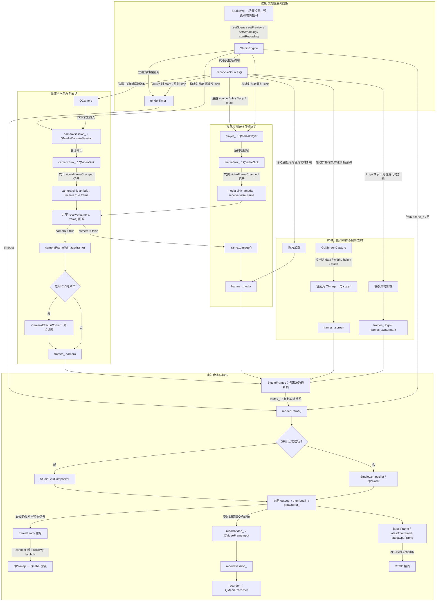

# StudioEngine：Qt Multimedia 摄像头采集与预览合成

本文说明客户端导播引擎如何使用 Qt Multimedia 获取摄像头帧，如何把摄像头、屏幕和素材合成为一张导播画面，以及预览、录像和推流如何消费合成结果。重点对应 `ClientStreamLive/Pusher/StudioEngine.cpp`，并会涉及 `StudioScene`、`StudioGpuCompositor`、`CameraEffectsWorker` 和 `StudioWgt`。

这条链路属于导播工作台的实时合成流程。它和播放器解码后直接显示视频的流程不同：导播引擎会把多个输入整理成统一的 `StudioFrames`，再按场景配置绘制成一个完整画布。

## 一、整体结构



图中把不同输入的“帧到达通知”分开画出：

```cpp
connect(cameraSink_, &QVideoSink::videoFrameChanged, this,
        [receive](const QVideoFrame& frame) { receive(true, frame); });
connect(mediaSink_, &QVideoSink::videoFrameChanged, this,
        [receive](const QVideoFrame& frame) { receive(false, frame); });
```


1. **摄像头和视频素材都使用 `QVideoSink`，但各有独立实例和连接。** `cameraSink_` 的 `videoFrameChanged` 连接到 lambda，再调用共享接收回调 `receive(true, frame)`；`mediaSink_` 的同名信号连接到另一个 lambda，调用 `receive(false, frame)`。`receive()` 根据布尔参数区分摄像头和素材视频，分别调用 `cameraFrameToImage(frame)` 与 `frame.toImage()`，之后直接更新对应帧缓存，或把摄像头帧交给 `CameraEffectsWorker`。
2. **屏幕采集不走 `QVideoSink`。** `reconcileSources()` 为 `GdiScreenCapture` 注册 `setFrameCallback()`；采集器调用该回调时，代码把回调内存包装为 `QImage` 并 `copy()`，再保存为 `frames_.screen`。
3. **图片、Logo 和水印也没有逐帧变化信号。** `reconcileSources()` 在场景来源或资源路径变化时调用 `loadImage()`，更新 `frames_.media`、`frames_.logo` 或 `frames_.watermark`。
4. **输入回调只更新缓存，不直接调用合成器。** `renderTimer_` 的 `timeout` 独立连接到 `renderFrame()`；每次合成时再从 `StudioFrames` 取各路最新帧。因此各输入的到达频率可以不同，合成按场景 FPS 读取当时可用的最新图像。

## 二、参与类和数据对象

| 类 / 对象 | 职责 |
| --- | --- |
| `StudioWgt` | 提供预览按钮、场景选项和预览控件；把控件值写入引擎，并显示引擎发出的帧。 |
| `StudioEngine` | 管理场景、采集对象、输入帧缓存、渲染定时器、录像和输出接口。 |
| `StudioScene` | 描述输入源、输出尺寸、FPS、摄像头区域、镜像、叠加层和特效参数。 |
| `StudioFrames` | 保存当前可用的屏幕、摄像头、图片/视频、Logo、水印图像及水印比例。 |
| `CameraEffectsWorker` | 在独立线程处理磨皮、美白、锐化、对比度和人脸相关操作。 |
| `StudioGpuCompositor` | 用 D3D11 把输入图像合成到输出纹理上。 |
| `StudioCompositor` | 使用 `QPainter` 做 CPU 合成，作为未启用 GPU 或 GPU 合成失败时的路径。 |

`StudioEngine` 是 GUI 应用中的共享引擎实例。`StudioEngine.h` 的线程说明指出，Qt Multimedia 对象在 GUI 线程使用；跨线程共享的场景和图像缓存由互斥锁保护。特效处理线程不直接操作界面控件。

## 三、什么时候开始采集和合成

### 活动状态由三个用途共同决定

引擎用下面的条件决定是否活动：

```cpp
const bool active = preview_ || streaming_ || recording();
```

- `setPreview(true)`：用户点“开始预览”。
- `setStreaming(true, owner)`：推流端申请使用导播画面。引擎用 `streamOwners_` 记录使用者，避免一个输出停止时误关掉另一个仍在使用的输出。
- `startRecording()`：开始本地录像。

其中任何一个为真，`reconcileSources()` 就启动渲染定时器，并按当前场景打开所需的输入源。三者都为假时，停止定时器并释放或停止不再需要的采集源，同时清理输出缓存。入口见 `StudioEngine.cpp` 的 `setPreview()`、`setStreaming()`、`reconcileSources()`。

这意味着用户关闭预览窗口后，如果推流或录像仍在进行，采集和合成会继续；反过来，纯预览停止后也不会继续无用地处理摄像头帧。

### 场景决定要不要打开摄像头

`StudioScene::needsCamera()` 的条件是：摄像头图层可见，并且输入模式为 `Camera` 或 `ScreenCamera`。纯屏幕、图片或视频场景不需要打开摄像头。屏幕加摄像头模式则同时需要屏幕和摄像头输入。

`setScene()` 会先对场景参数执行 `sanitize()`，再保存新场景并调用 `reconcileSources()`。如果正在推流或录像，画布宽、高和 FPS 会沿用当前值，避免输出过程中更改编码参数。

## 四、Qt Multimedia 摄像头接入过程

### 1. 创建采集会话和视频输出

引擎构造时创建：

```cpp
cameraSession_ = new QMediaCaptureSession(this);
cameraSink_ = new QVideoSink(this);
cameraSession_->setVideoSink(cameraSink_);
```

`QMediaCaptureSession` 负责把摄像头输入接到视频输出端；这里输出端是 `QVideoSink`，不是直接显示画面的 `QVideoWidget`。这样每一帧会作为 `QVideoFrame` 交给引擎，后续可参与自定义场景合成。相关对象初始化和 `videoFrameChanged` 连接都在 `StudioEngine.cpp` 构造函数中。

### 2. 按场景选择设备

活动场景需要摄像头时，`reconcileSources()` 查询 `QMediaDevices::videoInputs()`，并按 `StudioScene::cameraId` 匹配设备：

- `cameraId` 为空：使用 `QMediaDevices::defaultVideoInput()`。
- `cameraId` 已设置：只尝试匹配这个设备。
- 显式选择的设备找不到：清空摄像头帧并显示不可用状态，不会悄悄切换到另一台摄像头。

这个行为能避免设备拔掉或设备 ID 改变时，画面无提示地来自另一台摄像头。

### 3. 选择摄像头格式并启动

代码遍历所选设备的 `videoFormats()`，筛选满足以下条件的格式：

- 宽度不超过 1920；
- 高度不超过 1080；
- `maxFrameRate()` 不低于场景 FPS。

在符合条件的格式中，选择宽度较大的格式。找到格式后调用 `camera_->setCameraFormat(best)`，接着执行：

```cpp
cameraSession_->setCamera(camera_);
camera_->start();
```

设备实际支持哪些分辨率和帧率由 Qt Multimedia 后端及摄像头驱动决定。若没有合适格式，代码仍会启动摄像头，让后端采用默认格式。

### 4. 接收每个视频帧

摄像头 sink 的 `videoFrameChanged` 信号连接到 `receive(true, frame)`。接收函数把 `QVideoFrame` 转成 `QImage`：

```cpp
QImage image = frame.toImage();
```

如果图像有效：

- 摄像头特效关闭时，直接把图像移动到 `frames_.camera`；
- 摄像头特效开启时，提交给 `CameraEffectsWorker`；
- 图片或视频 sink 的信号也走相同接收函数，但会写入 `frames_.media`。

这里的缓存策略是覆盖旧帧，而不是逐帧排队。比如摄像头出帧速度高于合成速度时，引擎不会把未处理的摄像头帧越积越多；下一次合成直接读取最近写入的帧。

## 五、摄像头特效和线程边界

摄像头特效分成两类处理：

1. **CV 特效 / 人脸处理**：当磨皮、美白、锐化、非默认对比度、人脸跟踪或贴纸开启时，`receive()` 将输入交给 `CameraEffectsWorker`。OpenCV 处理在线程中执行。人脸检测按约 125 ms 的间隔执行，并对最近的人脸区域做平滑。
2. **简单柔化**：`cameraBeauty` 在 `renderFrame()` 中对本次合成快照里的摄像头图像做低分辨率缩放再放大，并以约 30% 不透明度叠回原图。它不经过 OpenCV worker。

`CameraEffectsWorker` 内部只保存一个待处理帧。如果处理线程正忙，新提交帧会替换旧的待处理帧，并增加 dropped 计数。这是有意的实时取舍：优先保持画面接近当前时刻，而不是处理完一串已经过时的画面。

场景改变或摄像头设备列表改变时，引擎会增加 `effectsGeneration_`。worker 回调只有在 generation 仍匹配时才写入 `frames_.camera`，因此旧场景的迟到结果不会覆盖新场景的数据。特效错误状态通过队列调用切回引擎对象所在的 Qt 线程后再更新 UI 状态。

## 六、其他输入源如何进入同一帧集合

虽然本文重点是摄像头，合成定时器使用的输入结构是统一的 `StudioFrames`：

- **屏幕**：`GdiScreenCapture` 通过帧回调提供图像，回调复制数据后写入 `frames_.screen`。
- **图片**：场景切换到图片时，`loadImage()` 读取图片；超过 3840×2160 的图片会先按比例缩小。图片通常只在路径变化时加载一次。
- **视频素材**：`QMediaPlayer` 输出到另一个 `QVideoSink`；视频帧同样转成 `QImage`，写入 `frames_.media`。循环、静音、暂停和重播由播放器控制。
- **Logo 与水印**：路径变化时读入 `QImage`，作为静态帧参与后续每次合成。水印宽度比例单独存放在 `StudioFrames` 中。

输入源和场景定义见 `StudioScene.h`；加载和启停逻辑集中在 `StudioEngine.cpp` 的 `reconcileSources()`。

## 七、预览合成的调度方式

### 定时器决定输出帧率

构造函数把 `renderTimer_` 设置为 `Qt::PreciseTimer`，并将其 `timeout` 连接到 `renderFrame()`。活动时按场景 FPS 启动：

```cpp
renderTimer_.start(std::max(1, 1000 / s.fps));
```

场景 FPS 会被限制在 5–60。比如 30 FPS 对应整数毫秒间隔约 33 ms。定时器是目标调度节奏，不是摄像头硬件时钟或严格的帧同步器；实际触发时间仍受事件循环负载影响。

### 每次合成读取一致快照

`renderFrame()` 一开始在 `mutex_` 保护下复制 `scene_` 和 `frames_` 到局部变量，然后在锁外绘制。锁外合成的好处是：绘制期间摄像头回调可以继续更新缓存，不会被整段合成过程长期阻塞。

本次合成的 PTS 来自 `std::chrono::steady_clock`，即单调时钟。它不依赖系统日期时间，适合用来衡量经过时间和安排录像时间戳。

输入源不要求同一时刻更新。假设屏幕 30 FPS、摄像头 25 FPS，某次定时触发时会把最新屏幕帧和最新摄像头帧放在一起合成；如果某路暂时没新帧，就沿用它缓存里的上一帧。若输入从未出过帧，则绘制提示占位图。

## 八、如何把图层合成到输出画布

场景包含输出宽高、背景色、输入源、摄像头区域、镜像设置、Logo 区域、字幕和水印。摄像头及 Logo 的区域使用归一化坐标，例如 `cameraRect` 的 `{0.70, 0.62, 0.28, 0.35}` 表示画布右下方约 28% 宽、35% 高的区域。绘制时再乘以输出画布尺寸。

### GPU 路径

引擎初始化时尝试创建 D3D11 GPU 合成器。每帧在 `gpuComposition` 开启且 `gpu_->render()` 成功时使用 GPU 路径。`StudioGpuCompositor` 大致按以下步骤工作：

1. 取得或创建一张目标 D3D11 纹理；目标纹理池最多保留 4 张帧纹理，以便消费者持有上一帧时不覆盖它。
2. 用场景背景色清空目标画布。
3. 将需要绘制的 `QImage` 转成合适的 ARGB 格式，并上传到对应输入纹理；图像 `cacheKey` 未变化时复用已有纹理。
4. 用顶点 / 像素着色器绘制图像矩形；摄像头镜像由 shader 调整纹理坐标。
5. 逐层绘制底图、摄像头、Logo、文字和水印，并把最终纹理设为最新帧。

GPU 绘制顺序可以概括为：

```text
背景
  → 屏幕，或图片 / 视频主画面
  → 摄像头（主画面或画中画）
  → Logo
  → 字幕背景和文字
  → 水印
```

GPU 合成器对应 `StudioGpuCompositor.cpp` 的 `render()` 和 `draw()`。

### CPU 回退路径

如果场景关闭 GPU 合成、GPU 初始化失败，或当次 `gpu_->render()` 返回失败，引擎调用 `StudioCompositor::render()`。CPU 路径使用 `QPainter` 绘制相同类型的图层，并通过 `fitRect()` 保持素材宽高比。

这不是从 Qt 摄像头帧到最终 GPU 纹理的零拷贝路径：当前接收函数先把 `QVideoFrame` 转成 `QImage`；GPU 合成时再将图像上传为 D3D11 输入纹理。GPU 路径减少的是后续图层绘制和推流编码的数据回读，并没有绕过这一步图像转换。

## 九、预览、录像、推流如何消费合成帧

### 界面预览

`renderFrame()` 把本次输出保存到引擎缓存，并在完整 `QImage` 有效时发出 `frameReady(output)`。`StudioWgt` 收到信号后，如果用户仍处于预览状态，就将 `QImage` 转成 `QPixmap`，按预览控件大小等比例缩放并显示。

GPU 合成时，只要预览或录像需要完整画面，引擎就调用 `gpu_->download(frame)` 把目标纹理读回成 `QImage`。因此界面预览走的是自定义合成后的成品帧，而不是单独显示摄像头原始帧。

### 本地录像

录像使用 `QMediaRecorder` 和 `QVideoFrameInput`。合成定时器仍负责产生最终画面；录像状态下 `renderFrame()` 根据 `recordClock_` 和场景 FPS 计算帧序号以及 `startTime` / `endTime`，再把 `QVideoFrame` 发送给 `recordVideo_`。如果定时器在同一输出时间格内重复触发，会跳过重复时间戳。

开始录像时会先 `reconcileSources()`，然后立即调用一次 `renderFrame()`，以便尽早提供视频帧；后续帧由正常的渲染定时器继续提供。

### RTMP 推流

推流端单独按目标 FPS 循环读取最新合成结果。D3D11 / NVENC 可用时，推流侧取得 `latestGpuFrame()` 中的 D3D11 纹理交给 GPU 编码器；同时读取小尺寸 `latestThumbnail()` 用于静态画面判断。软件编码路径则读取 `latestFrame()`。

仅推流、没有打开预览或录像时，GPU 路径不必每帧下载完整尺寸的 `QImage`；引擎仍生成小尺寸缩略帧，并保留 GPU 合成纹理给编码线程。若之后显式请求 `latestFrame()`，而缓存中没有 CPU 输出，则会按需下载 GPU 帧。

## 十、设备变化、错误和释放

- 摄像头设备列表变化时，`QMediaDevices::videoInputsChanged` 会让引擎使旧特效结果失效、移除旧摄像头并清空摄像头帧，然后重新协调当前场景的输入源。
- 摄像头报错时清空 `frames_.camera` 并更新状态信息；摄像头不可用时，合成端会显示占位图，`sourceReady()` 会报告所需源未就绪。
- `sourceReady()` 检查必需的屏幕、摄像头或媒体帧是否为空；它检查的是“有没有有效帧”，不是检测图像内容是否仍然新鲜。
- 预览、推流和录像都停止后，摄像头会从 session 移除并销毁，屏幕采集停止，视频播放器停止，输出缓存清空。
- 应用退出时 `shutdown()` 停止渲染和音频定时器、停止录像和播放器、停止摄像头并释放屏幕采集与特效线程资源。

## 十一、完整时序示例：开启摄像头预览

```text
用户点击“开始预览”
  → StudioWgt 调用 StudioEngine::setPreview(true)
  → reconcileSources() 发现 active=true
  → 根据 StudioScene::needsCamera() 选择设备和格式
  → QCamera 加入 QMediaCaptureSession 并 start()
  → QVideoSink 收到 QVideoFrame
  → receive() 转成 QImage，写入 frames_.camera
  → renderTimer_ 每隔约 1000/FPS 毫秒触发 renderFrame()
  → renderFrame() 复制 scene_ 和 frames_ 快照
  → StudioGpuCompositor 或 StudioCompositor 绘制完整场景
  → GPU 路径按需下载预览图像
  → StudioEngine 发出 frameReady(QImage)
  → StudioWgt 更新预览 QLabel
```

## 十二、读代码的建议顺序

1. `ClientStreamLive/Pusher/StudioEngine.h`：先看引擎维护的状态、输入帧结构和对外接口。
2. `StudioEngine.cpp` 构造函数：看 Qt Multimedia 对象如何创建、sink 信号如何接入。
3. `StudioEngine.cpp` 的 `setPreview()`、`setStreaming()`、`reconcileSources()`：看什么时机打开摄像头并启动定时器。
4. `StudioEngine.cpp` 的 `renderFrame()`：看一次输出帧如何取快照、合成、发给 UI 和录像器。
5. `CameraEffects.cpp`：看特效单帧缓存和工作线程。
6. `StudioScene.cpp` 与 `StudioGpuCompositor.cpp`：看 CPU / GPU 两套图层绘制。
7. `UI/center/StudioWgt.cpp` 的 `frameReady` 连接，以及 `Rtmp/src/RtmppushManager.cpp` 的 `startEncodeStudio()`：看预览和推流如何消费成品帧。

相关阅读：[[项目/远程直播控制/client/StudioWgt|StudioWgt 界面说明]]、[[项目/远程直播控制/流程/视频采集|视频采集]]、[[项目/远程直播控制/流程/视频编码|视频编码]]、[[项目/远程直播控制/流程/视频推拉流|视频推拉流]]。

