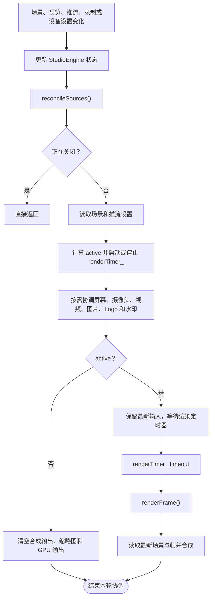
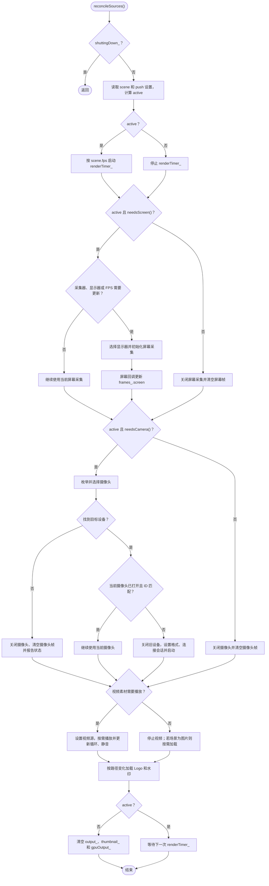
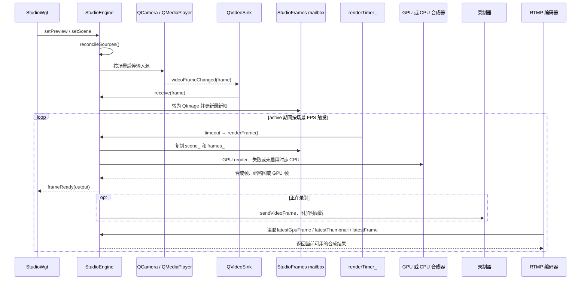
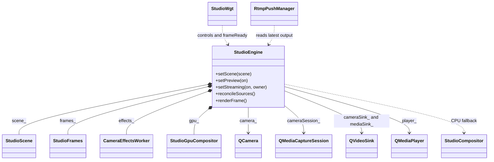

# StudioEngine 流程

本文说明客户端导播引擎如何根据场景和运行状态管理输入源、逐帧合成画面，并向预览、录制和推流提供结果。重点是 **StudioEngine 的协调流程**；摄像头的 Qt Multimedia 采集细节见 [[StudioEngine摄像头采集与预览合成]]。

主要实现位于 `ClientStreamLive/Pusher/StudioEngine.h` 和 `StudioEngine.cpp`。

## 1. 职责与边界

StudioEngine 把控制状态、实时输入和画面输出串起来：

- **StudioScene** 保存当前场景配置，例如来源类型、分辨率、FPS、摄像头与素材路径。
- **StudioFrames** 保存各来源的最新画面，包括屏幕、摄像头、媒体素材、Logo 和水印。
- **reconcileSources()** 根据场景与预览、推流、录制状态启停或更新输入源。
- **renderFrame()** 按定时器读取当前场景和最新画面，调用 GPU 或 CPU 合成器生成输出。
- 合成结果可交给预览界面和录制器；推流编码器通过引擎提供的最新图像、缩略图或 GPU 帧读取结果。

来源管理与逐帧合成是两个阶段：来源回调更新 StudioFrames，renderFrame() 在自己的节奏里取最新状态合成。摄像头回调不会直接把每个到达的帧送进合成队列。

## 2. 引擎何时工作

当前实现用以下条件计算 active：

```cpp
const bool active = preview_ || streaming_ || recording();
```

也就是说，预览、任一推流输出或录制只要有一个在运行，引擎就保持采集和合成。这里的 active 由运行状态决定，不是由 StudioScene::enabled 决定。

常见的 reconcileSources() 触发入口：

- setScene() 更新并校验场景后调用。
- setPreview() 切换预览后调用。
- setStreaming() 更新推流使用者集合后调用；只要仍有一个 owner，streaming_ 就保持为真。
- 推流设置变化、摄像头设备列表变化时调用。
- 录制开始时调用；录制器状态变化或停止录制后也会重新协调来源。

## 3. 总体控制流程



## 4. reconcileSources() 做什么

它先检查 shuttingDown_，然后读取场景和推流设置，计算 active 并按场景 FPS 启停 renderTimer_。随后分别检查每类输入源是否需要运行。



各来源分支的具体行为：

| 来源 | 启动与更新规则 | 不需要时 |
| --- | --- | --- |
| 屏幕 | 仅 active 且 needsScreen() 时启用。显示器或 FPS 改变、采集器不存在时重建；优先使用设置指定的显示器，找不到时回退到主显示器，再回退到枚举结果中的第一个。回调复制图像并更新 frames_.screen。 | 停止采集并清空屏幕帧。 |
| 摄像头 | 仅 active 且 needsCamera() 时启用。needsCamera() 要求场景来源为 Camera 或 ScreenCamera，且 cameraVisible 为真。cameraId 为空时使用默认摄像头；指定 ID 找不到时不会静默切换到别的设备。设备改变时重建 QCamera，并选择不超过 1920×1080 且最大帧率满足场景 FPS 的格式；没有合适格式时使用后端默认格式。 | 关闭摄像头并清空摄像头帧。 |
| 视频 | active、来源为 Video 且路径非空时设置 QMediaPlayer。路径改变后重新设置并播放；同一路径已停止时重新播放。每轮同步循环与静音设置。 | 停止播放器并清除 source。 |
| 图片 | active 且来源为 Image 时加载图片；仅在路径变化或图片尚未加载时读取。 | 清空媒体帧和相关缓存标记。 |
| Logo / 水印 | 文件路径变化时才重新加载图片。水印启用状态会影响实际加载路径，水印宽度比例每轮同步到 StudioFrames。 | 水印关闭时使用空路径。 |

输入回调和渲染线程通过 mutex_ 保护共享的场景、帧和输出数据。摄像头画面需要 CV 效果时会提交给 CameraEffectsWorker；工作线程完成后会检查 effectsGeneration_，避免旧场景下迟到的结果覆盖当前帧。

## 5. 从输入帧到合成输出

renderTimer_ 的 timeout 连接到 renderFrame()。每次调用时，引擎先在锁内复制 scene_ 和 frames_，随后在锁外执行图像处理和合成，减少采集回调等待共享锁的时间。



合成阶段的主要步骤：

1. 从共享状态复制当前 StudioScene 和 StudioFrames。
2. 如启用 cameraBeauty，对摄像头图像执行轻量图像处理。
3. 场景启用 GPU 合成且 GPU render() 成功时使用 D3D11；否则调用 StudioCompositor::render() 走 CPU/QPainter 路径。
4. 更新 output_、thumbnail_ 和 gpuOutput_。
5. 有 QImage 输出时发出 frameReady(output)，预览界面收到后更新预览控件。
6. 录制器处于 RecordingState 时，把输出帧和对应时间戳提交给 QVideoFrameInput。
7. RTMP 编码器通过 latestGpuFrame()、latestThumbnail() 或 latestFrame() 获取当前最新结果。GPU 推流可直接读取 GPU 帧，避免每帧都完整读回 CPU。

GPU 路径只在预览或录制需要 QImage 时执行完整下载；单独推流时，编码端可以读取 GPU 帧。CPU 路径则由合成器返回 QImage。

sourceReady() 只检查当前场景所需的屏幕、摄像头或媒体帧是否已经存在；它不会启动来源，也不代表编码器或输出端已经就绪。

## 6. 关键状态与对象关系

下面是 **Mermaid classDiagram 绘制的 UML 风格类图**，表达主要静态依赖；它不表示运行先后。流程图表达条件分支，sequenceDiagram 表达消息顺序。Mermaid 是图表描述语法，支持 UML 风格的类图和时序图，但不是完整 UML 建模工具。



## 7. 关闭流程

shutdown() 通过 shuttingDown_ 防止重复关闭并阻止后续协调；随后标记 inactive、递增特效 generation、停止特效 worker 和两个定时器，停止录制器与视频播放器，释放音频和屏幕采集对象，最后清空共享帧和所有合成输出。析构函数也会调用 shutdown()。

## 8. 建议阅读顺序

1. StudioEngine.h：成员状态、公开控制接口和信号。
2. StudioEngine.cpp 构造函数：多媒体对象、sink、回调和定时器如何连接。
3. setScene()、setPreview()、setStreaming()：哪些状态变化触发来源协调。
4. reconcileSources()：各类输入源如何按需启停。
5. renderFrame()：最新帧如何合成并交给预览、录制和推流。
6. StudioScene.h、StudioGpuCompositor.cpp 和 StudioCompositor 实现：配置字段及具体绘制行为。

相关文档：[[StudioEngine摄像头采集与预览合成]]。

源码逐段讲解见：[[StudioEngine代码实现流程]]。
