# StudioGpuCompositor.cpp 分段代码与流程解析

源码文件：`D:\c_code\CA\ClientStreamLive\Pusher\StudioGpuCompositor.cpp`

本文解释整个 `.cpp` 文件。每个代码小节都按“**流程图 → 源码片段 → 紧接着解释该片段中的参数、变量和作用**”组织。这样可以一边看代码，一边对照解释。

## 1. 整个文件做什么

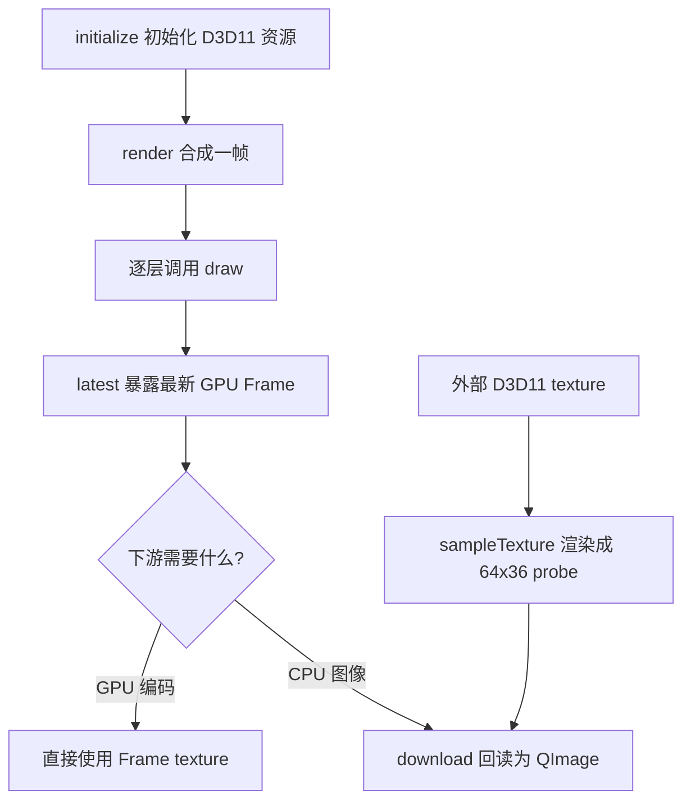

文件中的 include 各自服务于这些步骤：`d3d11_4.h` 提供 D3D11 资源和多线程接口，`d3dcompiler.h` 提供 HLSL 编译函数，`QPainter` 用于占位图和字幕绘制，`cstring` 用于 `strlen()`，`algorithm` 用于 `std::min/std::clamp`。`using Microsoft::WRL::ComPtr` 是后续 COM 智能指针类型的简写。

## 2. HLSL shader：每一层纹理怎样变成像素

### 流程图

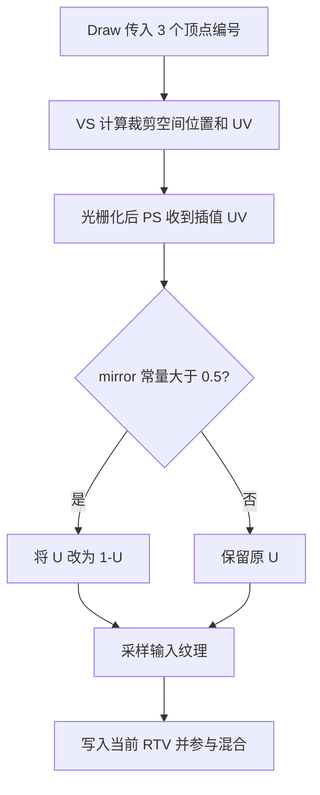

### shader 资源声明

```hlsl
cbuffer Params:register(b0){float mirror;float3 pad;};
Texture2D image:register(t0);SamplerState linearSampler:register(s0);
struct Out{float4 pos:SV_Position;float2 uv:TEXCOORD0;};
```

`Params` 绑定到像素 shader 的常量槽 b0。C++ 在 `draw()` 中写入的 `values[0]` 对应 `mirror`，后三个 float 是填充；四个 float 共 16 字节，和常量缓冲大小一致。`image` 是输入纹理，绑定到 t0；`linearSampler` 是线性采样器，绑定到 s0。`Out` 把 VS 产生的裁剪空间顶点位置 `pos` 和纹理坐标 `uv` 传给光栅化器，再插值后交给 PS。

这里的 `b0`、`t0`、`s0` 是 HLSL 各类资源自己的寄存器槽编号，不是图像格式。C++ 在 `render()` 中调用 `PSSetConstantBuffers(0, 1, &constants)`，把常量缓冲绑定到像素 shader 的 b0；同样在 `render()` 中调用 `PSSetSamplers(0, 1, &sampler)`，把线性采样器绑定到 s0。每次 `draw()` 则调用 `PSSetShaderResources(0, 1, &view)`，把输入纹理对应的 SRV 绑定到 t0。因而 PS 里的 `image.Sample(linearSampler, uv)` 实际是从 t0 的纹理取像素，并使用 s0 的采样规则按 `uv` 过滤。三个 C++ 调用的首参数都是槽位索引 `0`，分别对应 HLSL 的 `b0`、`s0`、`t0`；它们属于不同类型的资源槽位。
### 顶点 shader

```hlsl
Out VS(uint id:SV_VertexID){
    Out o;
    float2 uv=float2((id<<1)&2,id&2);
    o.uv=uv;
    o.pos=float4(uv*float2(2,-2)+float2(-1,1),0,1);
    return o;
}
```

`id` 由 `Draw(3,0)` 自动提供，值分别是 0、1、2。`float2((id<<1)&2,id&2)` 根据这三个编号生成三个 UV 坐标；坐标使用到 2，是为了生成一个超出裁剪区域的大三角形。`uv*float2(2,-2)+float2(-1,1)` 把 UV 变换成裁剪空间位置，并翻转 Y 方向。这个三角形最终覆盖当前 viewport，所以不用建立顶点数组或顶点缓冲。

#### 四行 VS 代码逐行看：从顶点编号到位置和 UV

```hlsl
Out o;
float2 uv = float2((id << 1) & 2, id & 2);
o.uv = uv;
o.pos = float4(uv * float2(2, -2) + float2(-1, 1), 0, 1);
```

- `Out o;`：声明 VS 输出变量。`Out` 包含 `pos`（语义 `SV_Position`，交给光栅化器）和 `uv`（语义 `TEXCOORD0`，作为纹理坐标）。
- `float2 uv = ...;`：`id` 来自 `Draw(3, 0)`，依次为 `0、1、2`。位运算生成三个 UV：`(0,0)`、`(2,0)`、`(0,2)`。坐标到 2 是有意的，用来生成覆盖视口的大三角形。
- `o.uv = uv;`：将纹理坐标放入 VS 输出。光栅化阶段会在三角形覆盖到的像素间插值它，PS 通过 `i.uv` 取得每个像素的坐标。
- `o.pos = ...;`：将 UV 转成裁剪空间位置，公式为 `x=2u-1`、`y=1-2v`；最后两个值 `0,1` 分别是 z、w。y 方向取负是为了匹配图像坐标向下增长的方向。
- `return o;`：把这个顶点的位置和 UV 传给下一阶段。三个编号计算结果如下：

| `id` | `uv` | `pos`（x, y, z, w） |
| --- | --- | --- |
| 0 | `(0, 0)` | `(-1, 1, 0, 1)` |
| 1 | `(2, 0)` | `(3, 1, 0, 1)` |
| 2 | `(0, 2)` | `(-1, -3, 0, 1)` |

`TRIANGLELIST` 下 3 个顶点组成一个三角形，不是两个。超出常规裁剪范围的顶点是为了让三角形覆盖视口；不是 `viewport` 把三角形放大了。`fitRect()` 和 `RSSetViewports()` 只决定图层在画布上的目标矩形。

#### 裁剪和 UV 插值怎样避免读取视口外

VS 输出后，光栅化阶段会先裁剪超出裁剪空间的部分，再映射到 viewport；只为三角形覆盖到的视口内像素生成 PS 输入，并插值 `TEXCOORD0`。这里所有顶点 `w=1`，所以视口范围 `x,y∈[-1,1]` 对应 `u,v∈[0,1]`；左上约为 `(0,0)`，右下约为 `(1,1)`。光栅化的裁剪、视口映射和属性插值见 [Microsoft 文档](https://learn.microsoft.com/en-us/windows/desktop/direct3d11/d3d10-graphics-programming-guide-rasterizer-stage)。

初始化时 `AddressU/AddressV` 还设为 `CLAMP`；若坐标超出 `[0,1]`，采样会取纹理边缘颜色，不会环绕到另一侧。[D3D11 CLAMP 规则](https://learn.microsoft.com/en-us/windows/win32/api/d3d11/ne-d3d11-d3d11_texture_address_mode)。

### 像素 shader

```hlsl
float4 PS(Out i):SV_Target{
    float2 uv=i.uv;
    if(mirror>.5)uv.x=1-uv.x;
    return image.Sample(linearSampler,uv);
}
```

`i.uv` 是光栅化阶段插值出的纹理坐标。C++ 传入的 `mirror` 大于 0.5 时，`uv.x=1-uv.x` 会水平翻转采样位置。最后 `image.Sample(linearSampler,uv)` 使用 s0 的线性 sampler 从 t0 纹理取出颜色，返回到当前 render target。shader 负责采样和镜像，不负责美颜、字幕排版或图层位置计算。

### Pixel Shader、Fragment Shader 和 `uv` 的叫法

Direct3D/HLSL 把这个阶段叫 **Pixel Shader（像素着色器）**，其他图形 API 的资料常叫 **Fragment Shader（片段着色器）**；这里指同一个管线阶段。编译目标 `ps_5_0` 和 `PSSetShader()` 使用 Direct3D 的命名。

这里的 `uv` 是纹理坐标（u 横向、v 纵向），不是 YUV 图像的 U/V 色度分量。`image`（t0）指向输入颜色纹理；`image.Sample(linearSampler, uv)` 按坐标取出该处的 `float4` 像素颜色。本项目先把 `QImage` 转成带 alpha 的 BGRA 纹理再上传，并不是在采样 YUV 平面。`mirror` 只决定是否执行 `uv.x=1-uv.x`；false 时 shader 仍会正常绘制。

## 3. `placeholder()`：没有输入帧时生成提示图

### 流程图

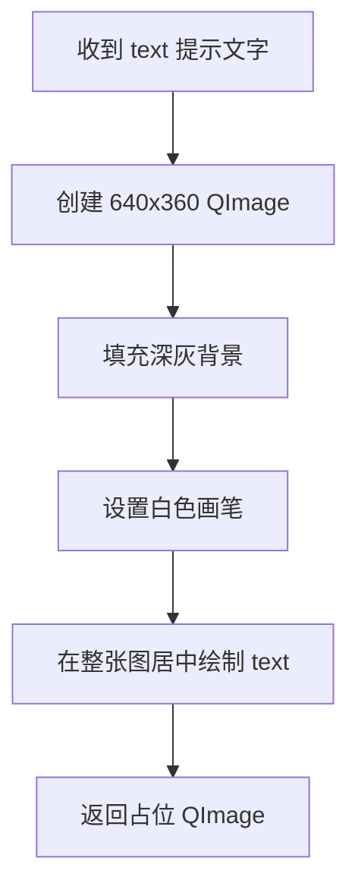

### 源码

```cpp
QImage placeholder(const QString& text)
{
    QImage image(640, 360, QImage::Format_ARGB32_Premultiplied);
    image.fill(QColor(25, 27, 33));
    QPainter p(&image);
    p.setPen(Qt::white);
    p.drawText(image.rect(), Qt::AlignCenter, text);
    return image;
}
```

`text` 是函数调用方给的提示语。`QImage` 构造的三个参数依次是宽 640、高 360、像素格式 `Format_ARGB32_Premultiplied`。`fill(QColor(25,27,33))` 把整张图填成深灰色；`QPainter p(&image)` 把这张图设为绘制设备；`setPen(Qt::white)` 将文字颜色设为白色；`drawText(image.rect(), Qt::AlignCenter, text)` 在整张图的矩形范围内居中绘制传入文字。返回的仍是 CPU 侧 QImage，之后会像普通图层一样传给 `draw()`。

## 4. `initialize()`：准备设备、shader 和绘制状态

### 流程图

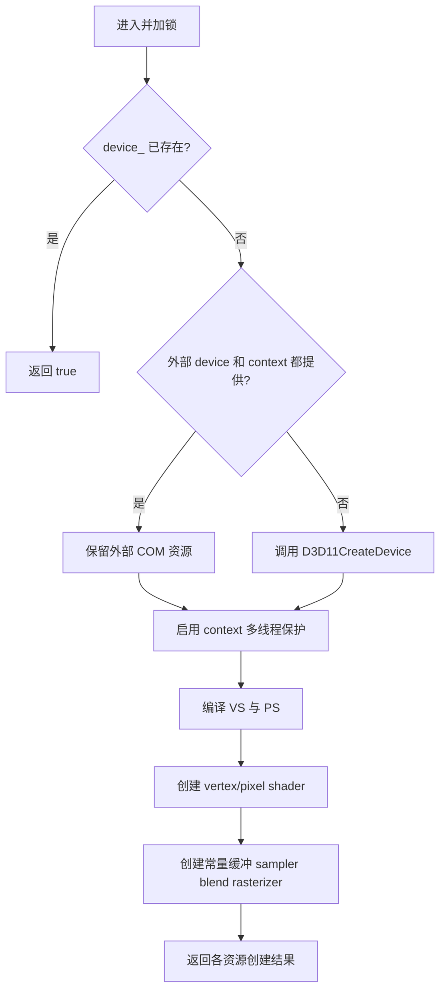

### 函数入口和重复初始化判断

```cpp
bool StudioGpuCompositor::initialize(ID3D11Device* borrowedDevice, ID3D11DeviceContext* borrowedContext)
{
    std::lock_guard lock(mutex_);
    if (device_)
        return true;
```

`borrowedDevice` 和 `borrowedContext` 是可选输入设备与 immediate context。`mutex_` 保护初始化与其它 GPU 方法的共享状态。如果 `device_` 已有值就立即返回 `true`；这里没有同时检查 shader、常量缓冲等后续资源是否完整。

### 复用外部设备或创建硬件设备

```cpp
    D3D_FEATURE_LEVEL level;
    if (borrowedDevice && borrowedContext) {
        device_ = borrowedDevice;
        context_ = borrowedContext;
    } else if (FAILED(D3D11CreateDevice(nullptr, D3D_DRIVER_TYPE_HARDWARE, nullptr,
                                        D3D11_CREATE_DEVICE_BGRA_SUPPORT, nullptr, 0, D3D11_SDK_VERSION,
                                        &device_, &level, &context_)))
        return false;
```

只有两个外部指针都非空时才使用它们；`device_` 和 `context_` 是 `ComPtr`，赋值后保留 COM 引用，不把调用者的所有权转走。否则执行 `D3D11CreateDevice()`：第一个 `nullptr` 让系统选默认 adapter；`HARDWARE` 指定硬件驱动；第二个 `nullptr` 是 software module；`BGRA_SUPPORT` 开启 BGRA 格式支持；feature-level 列表 `nullptr`、数量 `0` 表示用默认列表；`D3D11_SDK_VERSION` 是 SDK 版本参数；后三个地址分别接收 device、实际 `D3D_FEATURE_LEVEL` 和 context。创建失败就返回 `false`。

`level` 只是由 D3D 写入，本文件没有再按它判断能力。只传 `borrowedDevice` 或只传 `borrowedContext` 时，条件不成立，代码会创建一套自己的 device/context，而不是只复用其中一个。

### 尝试打开 D3D 多线程保护

```cpp
    ComPtr<ID3D11Multithread> multithread;
    if (SUCCEEDED(context_.As(&multithread)))
        multithread->SetMultithreadProtected(TRUE);
```

`context_.As(&multithread)` 查询 context 是否支持 `ID3D11Multithread`；查询成功后 `SetMultithreadProtected(TRUE)` 请求 D3D 运行时保护 immediate context 的多线程调用。接口查询失败时这段跳过，不让初始化直接失败。

### 编译 HLSL

```cpp
    ComPtr<ID3DBlob> vs, ps, errors;
    if (FAILED(D3DCompile(shader, std::strlen(shader), nullptr, nullptr, nullptr, "VS", "vs_5_0", 0, 0, &vs,
                          &errors)) ||
        FAILED(D3DCompile(shader, std::strlen(shader), nullptr, nullptr, nullptr, "PS", "ps_5_0", 0, 0, &ps,
                          &errors)))
        return false;
```

两次 `D3DCompile()` 使用同一个 HLSL 字符串 `shader`，长度由 `strlen(shader)` 提供。接下来的三个 `nullptr` 分别是源文件名、宏定义、include handler；`"VS"`/`"PS"` 是入口函数名；`"vs_5_0"`/`"ps_5_0"` 是目标 shader profile；两个 `0` 分别是编译 flags 和 effect flags；`&vs`/`&ps` 接收编译结果，`&errors` 接收诊断信息。`||` 表示任何一次编译失败就返回。代码保存了错误 blob，但没有把里面的消息输出到日志。

### 从编译结果创建 shader 对象

```cpp
    if (FAILED(device_->CreateVertexShader(vs->GetBufferPointer(), vs->GetBufferSize(), nullptr, &vertex_)) ||
        FAILED(device_->CreatePixelShader(ps->GetBufferPointer(), ps->GetBufferSize(), nullptr, &pixel_)))
        return false;
```

每个 `Create...Shader()` 的前两个实参是对应 blob 的字节码首地址和长度；第三个 `nullptr` 表示不提供 class linkage；第四个输出参数把创建好的 COM shader 放进 `vertex_` 或 `pixel_`。任一个创建失败，初始化就返回 `false`。

### 描述常量缓冲和纹理采样器

```cpp
    D3D11_BUFFER_DESC buffer{};
    buffer.ByteWidth = 16;
    buffer.Usage = D3D11_USAGE_DEFAULT;
    buffer.BindFlags = D3D11_BIND_CONSTANT_BUFFER;
    D3D11_SAMPLER_DESC sampler{};
    sampler.Filter = D3D11_FILTER_MIN_MAG_MIP_LINEAR;
    sampler.AddressU = sampler.AddressV = sampler.AddressW = D3D11_TEXTURE_ADDRESS_CLAMP;
    sampler.MaxLOD = D3D11_FLOAT32_MAX;
```

`buffer{}` 先把描述清零。`ByteWidth=16` 给四个 float 的常量数据留 16 字节；`DEFAULT` 表示 GPU 默认资源；`CONSTANT_BUFFER` 将它绑定为 shader 常量缓冲。采样器的 `MIN_MAG_MIP_LINEAR` 设置 min/mag/mip 线性过滤；U、V、W 三个地址模式都设 `CLAMP`，坐标越界时取边界色；`MaxLOD` 允许最大 mip level。

### 描述透明混合和光栅化状态

```cpp
    D3D11_BLEND_DESC blend{};
    auto& target = blend.RenderTarget[0];
    target.BlendEnable = TRUE;
    target.SrcBlend = D3D11_BLEND_ONE;
    target.DestBlend = D3D11_BLEND_INV_SRC_ALPHA;
    target.BlendOp = D3D11_BLEND_OP_ADD;
    target.SrcBlendAlpha = D3D11_BLEND_ONE;
    target.DestBlendAlpha = D3D11_BLEND_INV_SRC_ALPHA;
    target.BlendOpAlpha = D3D11_BLEND_OP_ADD;
    target.RenderTargetWriteMask = D3D11_COLOR_WRITE_ENABLE_ALL;
    D3D11_RASTERIZER_DESC raster{};
    raster.FillMode = D3D11_FILL_SOLID;
    raster.CullMode = D3D11_CULL_NONE;
    raster.DepthClipEnable = TRUE;
```

`target` 是第 0 个 render target 的 blend 描述引用。颜色混合打开，源因子 `ONE`、目标因子 `INV_SRC_ALPHA`、运算 `ADD`，适合预乘 Alpha 图像；Alpha 通道也设同样的因子和加法。`WriteMask=ALL` 表示 RGBA 全部可写。`raster` 设置实心填充、不剔除正反面、启用深度裁剪；本合成器没有绑定深度目标。

### 创建这些状态并返回结果

```cpp
    return SUCCEEDED(device_->CreateBuffer(&buffer, nullptr, &constants_)) &&
           SUCCEEDED(device_->CreateSamplerState(&sampler, &sampler_)) &&
           SUCCEEDED(device_->CreateBlendState(&blend, &blend_)) &&
           SUCCEEDED(device_->CreateRasterizerState(&raster, &raster_));
}
```

每个 API 的第一个参数是前面填好的描述，第二个 `nullptr` 使用默认子资源数据或默认扩展参数，第三个输出到对应的 `ComPtr`。四个 `SUCCEEDED()` 用 `&&` 串联，全部成功才返回 `true`；前面任何一步失败，后面的创建会短路不执行。

初始化失败后 `device_` 可能已经非空。再次调用时开头的 `if (device_) return true` 会提前返回，即使 shader 或状态资源仍不完整；随后 `render()` 的 shader 检查会失败。这是当前重试逻辑需要留意的地方。

## 5. `latest()`：安全地取出最新帧

### 流程图

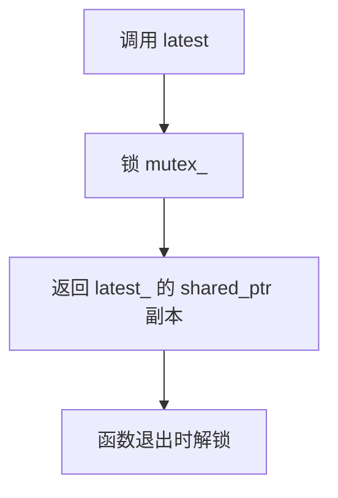

### 源码

```cpp
std::shared_ptr<StudioGpuCompositor::Frame> StudioGpuCompositor::latest() const
{
    std::lock_guard lock(mutex_);
    return latest_;
}
```

这里没有输入参数。锁住 `mutex_` 是为了避免在 `render()` 更新 `latest_` 的同时读取它。`return latest_` 返回 `shared_ptr` 的副本，引用计数增加，因此函数解锁、返回后，调用者持有的 Frame 仍然有效；这不会复制 GPU 纹理像素。尚未成功合成过时，`latest_` 为空，调用者会得到空指针。

## 6. `draw()`：逐段把 QImage 图层上传并绘制

### 流程图

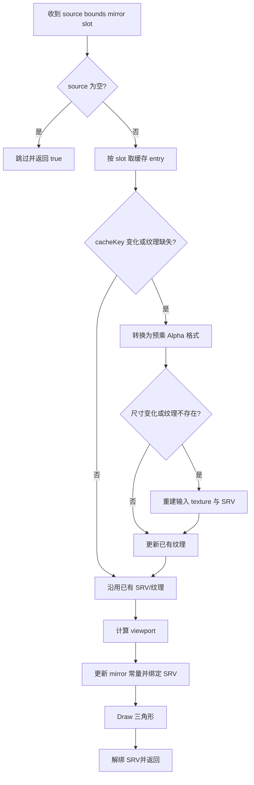

### 函数参数与空图判断

```cpp
bool StudioGpuCompositor::draw(const QImage& source, const QRectF& bounds, bool mirror, int slot)
{
    if (source.isNull())
        return true;
    auto& entry = inputs_[slot];
```

`source` 是当前图层的 QImage，`bounds` 是目标矩形，`mirror` 控制水平镜像，`slot` 选择输入纹理缓存位置。空图直接返回 `true`，意思是“没有这一层可画”而非渲染错误。`inputs_[slot]` 得到缓存项的引用 `entry`，不复制它；调用点传入 0 到 4，函数本身没有检查 slot 是否越界。

#### `inputs_[slot]`、QImage 和 GPU 输入纹理

`inputs_` 在类中声明为 `std::array<ImageTexture, 5>`，每项缓存 key、宽高、GPU `texture` 和 SRV `view`。`auto& entry = inputs_[slot]` 是引用对应缓存项，不复制图像。

| `slot` | 缓存的输入 |
| --- | --- |
| 0 | 屏幕或媒体底图；由互斥分支选择 |
| 1 | 摄像头 |
| 2 | Logo |
| 3 | 文字 overlay |
| 4 | 水印 |

`draw()` 接收 `QImage`，因为当前 `StudioFrames` 保存 CPU 侧图像。函数内部将图像转换为预乘 BGRA，更新 `entry.texture`，并用 `entry.view` 提供 shader 读取入口。`slot` 选择 C++ 缓存项；`PSSetShaderResources(0, 1, &view)` 中的 0 才是 HLSL `register(t0)`。例如摄像头用 `slot=1`，但本次 SRV 仍绑定到 t0。每次 draw 处理一个输入图层，render 连续调用 draw 来合成多层。如果上游直接提供 GPU 纹理，当前 QImage 接口不能直接接收它，需要另一条纹理/SRV 输入路径。

### 判断源图是否变化并转换格式

```cpp
    if (entry.key != source.cacheKey() || !entry.texture) {
        auto image = source.convertToFormat(QImage::Format_ARGB32_Premultiplied);
        if (entry.width != image.width() || entry.height != image.height() || !entry.texture) {
            entry.texture.Reset();
            entry.view.Reset();
```

`entry.key` 保存上一次上传图像的 cache key；与当前 `source.cacheKey()` 不同，或 GPU 纹理不存在，就需要刷新缓存。`convertToFormat()` 生成可用于 BGRA 输入纹理和预乘 Alpha 混合的 `image`。若转换后的宽高不同，或者纹理还不存在，就先释放旧纹理和 SRV。若原图格式已合适，QImage 的隐式共享可能复用底层像素；需要格式转换时会得到转换后像素数据。

### 创建输入纹理的描述

```cpp
            D3D11_TEXTURE2D_DESC desc{};
            desc.Width = image.width();
            desc.Height = image.height();
            desc.MipLevels = desc.ArraySize = 1;
            desc.Format = DXGI_FORMAT_B8G8R8A8_UNORM;
            desc.SampleDesc.Count = 1;
            desc.Usage = D3D11_USAGE_DEFAULT;
            desc.BindFlags = D3D11_BIND_SHADER_RESOURCE;
```

`desc{}` 把未显式设置字段清零。宽高取转换后 `image` 的实际尺寸；mip 层数和数组切片数都为 1；格式为 BGRA8；采样数为 1；用途为 GPU 默认资源；绑定标志只有 `SHADER_RESOURCE`，因为输入纹理要由像素 shader 采样，不作为输出 render target。

### 创建 texture/SRV 并记下尺寸

```cpp
            if (FAILED(device_->CreateTexture2D(&desc, nullptr, &entry.texture)) ||
                FAILED(device_->CreateShaderResourceView(entry.texture.Get(), nullptr, &entry.view)))
                return false;
            entry.width = image.width();
            entry.height = image.height();
        }
```

`CreateTexture2D()` 的参数是纹理描述、空初始像素、接收 texture 的输出位置。像素稍后通过 `UpdateSubresource()` 传入。`CreateShaderResourceView()` 的参数是刚建的 texture、默认视图描述、接收 SRV 的输出位置。任意资源创建失败都返回 `false`；成功后把转换图像尺寸保存到缓存项。

### 上传像素并更新缓存键

```cpp
        context_->UpdateSubresource(entry.texture.Get(), 0, nullptr, image.constBits(), image.bytesPerLine(),
                                    0);
        entry.key = source.cacheKey();
    }
```

`UpdateSubresource()` 的第一个参数是目标 GPU texture；`0` 是 mip 子资源编号；`nullptr` 表示更新整张纹理；`image.constBits()` 是源像素首地址；`image.bytesPerLine()` 是每行字节跨度，不能假设它一定等于 `width*4`；最后的 `0` 是二维纹理不使用的深度跨度。上传成功后把当前源图 cache key 存下，下一次图像没变化就能跳过转换和上传。
#### 这两行分别做什么：上传像素，记录图像版本

```cpp
context_->UpdateSubresource(entry.texture.Get(), 0, nullptr, image.constBits(), image.bytesPerLine(), 0);
entry.key = source.cacheKey();
```

第一行把 CPU 内存中的 `image` 像素字节复制到 GPU 纹理 `entry.texture`。它不是执行 shader，也不是把 `QImage` 对象本身传给 GPU。`UpdateSubresource()` 的参数含义也可参阅 [Microsoft 文档](https://learn.microsoft.com/en-us/windows/win32/api/d3d11/nf-d3d11-id3d11devicecontext-updatesubresource)。

| 参数 | 本次传入 | 作用 |
| --- | --- | --- |
| `pDstResource` | `entry.texture.Get()` | 目标 GPU 资源。`Get()` 取出 `ComPtr` 中的 `ID3D11Texture2D*`；这里传的是 Texture，不是供 shader 读取的 `entry.view`。 |
| `DstSubresource` | `0` | 更新第 0 个子资源。此纹理只有一个 mip 和一个数组元素，所以它就是整张纹理。 |
| `pDstBox` | `nullptr` | 不指定局部矩形，更新整张纹理。 |
| `pSrcData` | `image.constBits()` | CPU 端转换后图像的像素首地址。 |
| `SrcRowPitch` | `image.bytesPerLine()` | 相邻两行起点之间的字节数。使用 QImage 的实际行跨度，因为行尾可能有对齐填充，不能总是假设为 `width * 4`。 |
| `SrcDepthPitch` | `0` | 3D 纹理的切片跨度；本代码是 2D 纹理，不使用它。 |

数据流是：CPU 像素地址 `image.constBits()` → `UpdateSubresource()` → GPU 输入纹理 `entry.texture` → 后续由 `entry.view` 提供给 shader 读取。

第二行 `entry.key = source.cacheKey();` 把当前源 `QImage` 的版本标识存进缓存。下次调用时，前面的条件比较 `entry.key` 和 `source.cacheKey()`：如果 key 相同且纹理存在，就跳过转换和上传、复用 GPU 纹理；如果图像版本变化或纹理不存在，就重新上传，再记录新 key。它只是“缓存对应哪一版源图”的标记，不是纹理内容，也不是 shader 的 t0。静态 Logo 通常能复用缓存；摄像头新帧变化后则需要更新。


### 设置 viewport 和镜像常量

```cpp
    const auto fit = StudioCompositor::fitRect(source.size(), bounds);
    D3D11_VIEWPORT viewport{float(fit.x()), float(fit.y()), float(fit.width()), float(fit.height()), 0, 1};
    context_->RSSetViewports(1, &viewport);
    const float values[4] = {mirror ? 1.f : 0.f, 0, 0, 0};
    context_->UpdateSubresource(constants_.Get(), 0, nullptr, values, 0, 0);
```

`fitRect()` 接收源图原始尺寸和目标区域，计算保持宽高比的实际绘制矩形。viewport 六个值依次是左上 X、左上 Y、宽、高、最小深度和最大深度，深度范围固定 0 到 1。`RSSetViewports(1,&viewport)` 表示绑定一个 viewport。`values[0]` 是镜像开关，其余 3 个 float 填充到 16 字节；第二次 `UpdateSubresource()` 的目标换成常量缓冲，子资源为 0，区域为空表示更新整个 buffer，源数据是 `values`，buffer 的 row/depth pitch 都设为 0。

#### viewport、mirror 和三角形顶点分别控制什么

`fitRect()` 与 `RSSetViewports()` 设置图层在画布上的目标矩形；VS 的 `o.pos` 计算三角形顶点。viewport 不会把三角形放大。`values[0]` 经常量缓冲 b0 传给 PS，只控制是否水平翻转 UV，不控制 shader 是否执行。

`PSSetShaderResources(0, 1, &view)` 只绑定当前图层 SRV；`Draw(3, 0)` 才触发 VS → 光栅化 → PS，并把结果写到 render 已绑定的 RTV。`mirror=false` 时仍正常绘制，只是不翻转。

### 绑定输入纹理、绘制、解绑

```cpp
    auto* view = entry.view.Get();
    context_->PSSetShaderResources(0, 1, &view);
    context_->Draw(3, 0);
    view = nullptr;
    context_->PSSetShaderResources(0, 1, &view);
    return true;
}
```

`view` 是从 `ComPtr` 取出的临时 SRV 裸指针，不接管资源所有权。`PSSetShaderResources(0,1,&view)` 从像素 shader 槽位 0 绑定一个 SRV。`Draw(3,0)` 发出 3 个顶点、从顶点索引 0 开始的绘制命令；VS 用顶点编号生成三角形，PS 采样输入纹理。先把局部 `view` 置空，再调用一次 `PSSetShaderResources()`，才真正清掉槽位绑定。`Draw()` 本身没有 HRESULT 返回，所以 `true` 表示显式资源步骤没有失败并已发出绘制命令。

整个 `draw()` 的流程是：空图跳过；非空图按 slot 查询缓存；内容变化时转换格式并按需创建/上传；再计算 viewport、设置镜像、绑定 SRV、绘制并解绑。输入是 QImage，因此内容改变时需要 CPU 到 GPU 的上传，不是零拷贝输入。

#### `draw()` 的返回值与最终输出纹理

`draw()` 的签名返回 `bool`，所以它返回的是绘制状态，不是纹理。源图为空时它返回 `true`（表示这一层无需绘制，不算失败）；创建 texture/SRV 失败时返回 `false`。`context_->Draw(3, 0)` 本身也不返回纹理，它把 shader 的像素输出写入当前绑定的渲染目标。

要区分两张纹理：`entry.texture` 是当前图层的**输入 GPU 纹理**，由 `source` 的 QImage 上传得到；最终合成结果是 `render()` 创建/复用的 `frame->texture`。`render()` 先将 `frame->target` 绑定为 RTV，再调用多个 `draw()`，所以各图层会连续画到同一个 `frame->texture`。

完整路径是：`source QImage → entry.texture → entry.view/SRV → shader → 当前 RTV → frame->texture`。所有图层成功绘制后，`render()` 把这个 Frame 保存到 `latest_` 并返回 `true`。调用方通过 `latest()` 取得 Frame，再读取 `frame->texture`；不是从 `draw()` 取得纹理。

## 7. `render()`：创建一帧导播合成结果

### 流程图

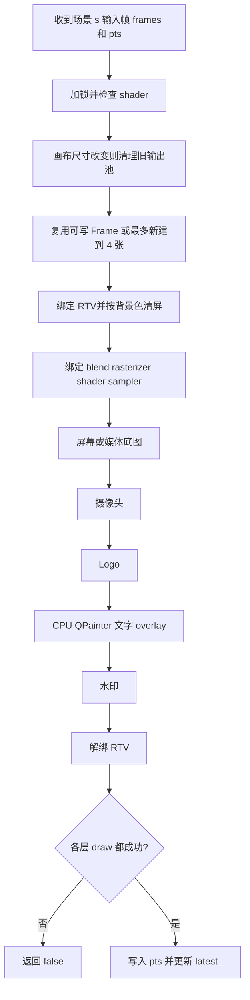

### 入口锁和初始化检查

```cpp
bool StudioGpuCompositor::render(const StudioScene& s, const StudioFrames& frames, int64_t pts)
{
    std::lock_guard lock(mutex_);
    if (!vertex_ || !pixel_)
        return false;
```

`s` 提供画布/排版参数，`frames` 提供图像，`pts` 是输出时间戳。`lock(mutex_)` 保护帧池、纹理缓存和 immediate context。`!vertex_ || !pixel_` 检查初始化是否准备好两个 shader；任一为空就返回失败。

### 画布尺寸变化时清理旧资源

```cpp
    if (!pool_.empty() && (pool_[0]->width != s.width || pool_[0]->height != s.height)) {
        pool_.clear();
        latest_.reset();
        staging_.Reset();
    }
```

`!pool_.empty()` 防止访问空池的 `pool_[0]`。已有第一帧的宽/高与 `s.width/s.height` 任一不同时，清除旧池引用，重置 `latest_`，并释放给 `download()` 使用的旧尺寸 staging 纹理。清池不会销毁仍被外部 `shared_ptr` 持有的帧。

### 找空闲输出帧

```cpp
    std::shared_ptr<Frame> frame;
    for (auto& item : pool_)
        if (item.use_count() == 1) {
            frame = item;
            break;
        }
    if (!frame) {
        if (pool_.size() >= 4)
            return false;
```

`frame` 是本次绘制的目标，开始为空。`auto& item` 用引用遍历，避免遍历时复制 shared pointer。`use_count()==1` 表示当前只有帧池持有该 Frame，可以覆盖纹理；`frame=item` 会复制 shared pointer 句柄、增加引用计数，但不会复制 Frame 或像素。没找到空闲帧时，`pool_.size()>=4` 表示池已满，函数返回 `false`。

### 新建输出 texture 和 RTV

```cpp
        frame = std::make_shared<Frame>();
        frame->width = s.width;
        frame->height = s.height;
        D3D11_TEXTURE2D_DESC desc{};
        desc.Width = s.width;
        desc.Height = s.height;
        desc.MipLevels = desc.ArraySize = 1;
        desc.Format = DXGI_FORMAT_B8G8R8A8_UNORM;
        desc.SampleDesc.Count = 1;
        desc.Usage = D3D11_USAGE_DEFAULT;
        desc.BindFlags = D3D11_BIND_RENDER_TARGET | D3D11_BIND_SHADER_RESOURCE;
        if (FAILED(device_->CreateTexture2D(&desc, nullptr, &frame->texture)) ||
            FAILED(device_->CreateRenderTargetView(frame->texture.Get(), nullptr, &frame->target)))
            return false;
        pool_.push_back(frame);
    }
```

`make_shared<Frame>()` 新建帧对象；宽高来自场景 `s`。`desc` 的 `Width/Height` 是纹理像素尺寸；`MipLevels` 和 `ArraySize` 都为 1；格式是 BGRA8；采样数 1；用途是 GPU 默认资源；`BindFlags` 同时允许 render target 写入和 shader resource 读取。`CreateTexture2D(&desc,nullptr,&frame->texture)` 以该描述创建无初始像素的纹理；`CreateRenderTargetView(texture,nullptr,&target)` 用默认 RTV 描述为纹理创建输出视图。两者任一个失败就返回 `false`。`pool_.push_back(frame)` 把同一 Frame 的 shared pointer 加入池中。

### 绑定输出目标并清背景

```cpp
    auto* target = frame->target.Get();
    context_->OMSetRenderTargets(1, &target, nullptr);
    const float background[] = {float(s.background.redF()), float(s.background.greenF()),
                                float(s.background.blueF()), 1};
    context_->ClearRenderTargetView(target, background);
```

`target` 是借用的 RTV 裸指针。`OMSetRenderTargets(1,&target,nullptr)` 的参数分别表示绑定 1 个颜色目标、RTV 数组地址、不使用深度视图。`background` 由 `s.background` 的 RGB 浮点通道和 Alpha=1 构成。`ClearRenderTargetView(target,background)` 用它清空输出纹理，防止复用纹理残留上一帧。

### 绑定混合、shader 和 sampler 状态

```cpp
    context_->OMSetBlendState(blend_.Get(), nullptr, 0xffffffff);
    context_->RSSetState(raster_.Get());
    context_->IASetInputLayout(nullptr);
    context_->IASetPrimitiveTopology(D3D11_PRIMITIVE_TOPOLOGY_TRIANGLELIST);
    context_->VSSetShader(vertex_.Get(), nullptr, 0);
    context_->PSSetShader(pixel_.Get(), nullptr, 0);
    auto* constants = constants_.Get();
    auto* sampler = sampler_.Get();
    context_->PSSetConstantBuffers(0, 1, &constants);
    context_->PSSetSamplers(0, 1, &sampler);
```

`OMSetBlendState` 的三个参数是混合状态、默认 blend factor、全开启的 sample mask。`RSSetState` 绑定光栅化状态。输入布局传空，因为顶点 shader 用 `SV_VertexID` 生成坐标；`TRIANGLELIST` 表示三角形图元。`VSSetShader`/`PSSetShader` 分别绑定 VS 和 PS，class linkage 为空、数量为 0。`constants` 和 `sampler` 是借用指针；两个 `PSSet...` 调用都从槽位 0 开始各绑定一个资源。后续每个图层都复用这些固定状态。

### 建立画布坐标和屏幕/媒体/摄像头/Logo 图层

```cpp
    const QRectF canvas(0, 0, s.width, s.height);
    auto scale = [&](const QRectF& r) {
        return QRectF(r.x() * s.width, r.y() * s.height, r.width() * s.width, r.height() * s.height);
    };
    bool ok = true;
    if (s.needsScreen())
        ok &= draw(frames.screen.isNull() ? placeholder(QStringLiteral("等待屏幕画面")) : frames.screen,
                   canvas, false, 0);
    else if (s.source == StudioScene::Image || s.source == StudioScene::Video)
        ok &= draw(frames.media.isNull() ? placeholder(QStringLiteral("请选择可用素材")) : frames.media,
                   canvas, false, 0);
    if (s.needsCamera())
        ok &= draw(frames.camera.isNull() ? placeholder(QStringLiteral("摄像头未出帧")) : frames.camera,
                   s.source == StudioScene::Camera ? canvas : scale(s.cameraRect), s.cameraMirror, 1);
    if (s.logoVisible)
        ok &= draw(frames.logo, scale(s.logoRect), false, 2);
```

`canvas(0,0,width,height)` 是像素坐标的整张画布。`scale(r)` 接收场景中相对画布的矩形，把 x/宽乘画布宽、y/高乘画布高，转为像素位置。`ok` 初值为成功，后续累积 `draw()` 的结果。

屏幕分支用 `s.needsScreen()` 判断是否要画屏幕；第一个 `draw()` 实参在 `frames.screen` 和占位图之间二选一，第二个 `canvas` 表示铺满画布，第三个 `false` 表示不镜像，第四个 `0` 是缓存槽位。只有屏幕分支不成立且源类型为 Image/Video 时，`else if` 才画媒体；媒体也占满画布且使用 slot 0，所以屏幕和媒体底图互斥。

#### `frames.screen` 和 `frames.media` 的区别

| 输入 | 图像从哪里来 | 对应场景类型 |
| --- | --- | --- |
| `frames.screen` | 从所选显示器持续捕获的实时屏幕画面；捕获回调把最新帧写入这里。 | `Screen`、`ScreenCamera`，由 `s.needsScreen()` 判断。 |
| `frames.media`（Image） | 从 `mediaPath` 读取的一张静态图片。 | `StudioScene::Image`。 |
| `frames.media`（Video） | `QMediaPlayer` 播放视频后，由视频帧回调持续更新。 | `StudioScene::Video`。 |

所以屏幕是“正在捕获的桌面”，媒体是“选择的图片或视频文件”。这段 `if/else if` 选择全画布底图：场景需要屏幕时使用 `frames.screen`；否则，只有 Image/Video 场景才使用 `frames.media`。它们不是同一张图，也不会在这段分支里同时绘制。两者都传 `slot=0`，只是因为它们互为底图选项、共用一个输入缓存槽位；不代表屏幕和媒体来源相同。

例如 `ScreenCamera` 场景先走屏幕分支，把屏幕铺满画布；后面的摄像头分支再把摄像头画到 `cameraRect`。Image/Video 场景则把媒体铺满画布，且不会满足 `needsScreen()`。
摄像头分支要求 `s.needsCamera()` 成立。其图像为空时用占位图；目标矩形在摄像头是主源时取 `canvas`，否则取像素化的 `cameraRect`；镜像值来自 `s.cameraMirror`；slot 是 1。Logo 仅在 `s.logoVisible` 为真时绘制，位置是 `scale(s.logoRect)`，不镜像，使用 slot 2。`ok &= draw(...)` 会累计失败，但 `&=` 不短路，前面失败后仍会执行后续绘制。

### 文字 overlay

```cpp
    if (s.textVisible && !s.text.trimmed().isEmpty()) {
        QImage overlay(s.width, s.height, QImage::Format_ARGB32_Premultiplied);
        overlay.fill(Qt::transparent);
        QPainter p(&overlay);
        QRectF box(s.width * .03, s.height * .80, s.width * .94, s.height * .17);
        p.fillRect(box, QColor(0, 0, 0, 145));
        QFont f;
        f.setPixelSize(s.textSize);
        p.setFont(f);
        p.setPen(s.textColor);
        p.drawText(box.adjusted(12, 4, -12, -4), Qt::AlignVCenter | Qt::TextWordWrap, s.text);
        p.end();
        ok &= draw(overlay, canvas, false, 3);
    }
```

文字开关和去掉首尾空白后的文本都要有效。overlay 的构造参数是画布宽、高和预乘 Alpha 格式；透明填充使未写字区域不遮挡底图。`QPainter p(&overlay)` 在 CPU 图像上作画。`box` 从画布宽的 3%、高的 80% 开始，占 94% 宽、17% 高；`QColor(0,0,0,145)` 是半透明黑色底框。`setPixelSize(s.textSize)` 的单位是像素；画笔颜色来自 `s.textColor`。`drawText(rect,flags,s.text)` 中，rect 是内缩后的排版区域，flags 要求垂直居中并自动换行，最后一个参数是文字内容。结束 QPainter 后，整张 overlay 作为不镜像、slot 3 的图层交给 `draw()`。因此字幕排版由 CPU 完成，随后再上传 GPU。

### 水印图层

```cpp
    if (!frames.watermark.isNull()) {
        const double width = s.width * std::clamp(frames.watermarkWidthRatio, .03f, .6f);
        const double height =
            std::min(s.height * .9, width * frames.watermark.height() / frames.watermark.width());
        ok &=
            draw(frames.watermark, {s.width * .98 - width, s.height * .96 - height, width, height}, false, 4);
    }
```

水印非空才进入分支。宽度是画布宽乘 `watermarkWidthRatio`，比例由 `clamp()` 限在 3% 到 60%。高度由水印原始宽高比计算，并由 `min()` 限制到画布高的 90%。目标矩形四个参数是 x、y、宽、高；x 放在画布宽 98% 减水印宽处，y 放在画布高 96% 减水印高处，靠右下角。`draw()` 的其余参数 `false` 表示不镜像，`4` 是水印纹理缓存槽。

### 完成本帧并发布

```cpp
    context_->OMSetRenderTargets(0, nullptr, nullptr);
    if (!ok)
        return false;
    frame->ptsUs = pts;
    latest_ = frame;
    return true;
}
```

`OMSetRenderTargets(0,nullptr,nullptr)` 解绑 render target。若任一图层的 `draw()` 失败，`ok` 为假，本帧不登记为最新结果。全部成功后，`pts` 写入 `frame->ptsUs`，`latest_=frame` 复制 shared pointer 的所有权关系，让成员与局部变量指向同一个 Frame，不复制 GPU 纹理。最终返回 `true`。同尺寸下失败时旧 `latest_` 可能仍在，因此调用方必须判断本次 `render()` 的返回值。

## 8. `download()`：把 GPU 纹理回读成 QImage

### 流程图

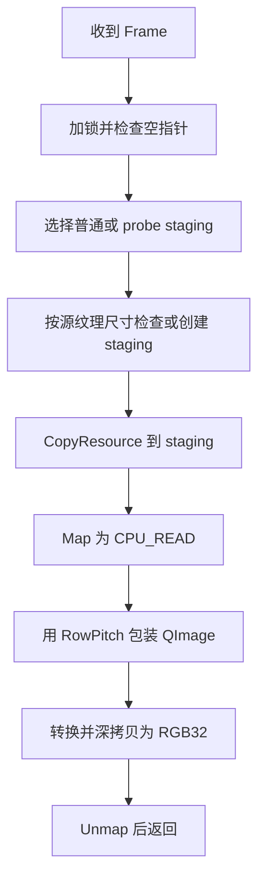

### 检查 Frame 并选 staging

```cpp
QImage StudioGpuCompositor::download(const std::shared_ptr<Frame>& frame)
{
    std::lock_guard lock(mutex_);
    if (!frame)
        return {};
    auto& staging = frame == probe_ ? probeStaging_ : staging_;
    D3D11_TEXTURE2D_DESC desc{};
    frame->texture->GetDesc(&desc);
```

`frame` 是要回读的共享帧。锁住 `mutex_` 后，空帧直接返回空 QImage。`frame == probe_` 用于区分 64×36 缩略图；probe 使用独立的 `probeStaging_`，普通输出使用 `staging_`。`GetDesc(&desc)` 将源 GPU texture 的尺寸和格式读到描述中。

### 检查 staging 尺寸

```cpp
    if (staging) {
        D3D11_TEXTURE2D_DESC old{};
        staging->GetDesc(&old);
        if (old.Width != desc.Width || old.Height != desc.Height)
            staging.Reset();
    }
```

如果已经有 staging，就读出它的尺寸到 `old`。宽或高与源纹理不匹配时释放它，下一段会按新尺寸重新创建。这样可复用同尺寸 staging，避免每次回读都重新分配。

### 创建 CPU 可读 staging

```cpp
    if (!staging) {
        desc.BindFlags = 0;
        desc.Usage = D3D11_USAGE_STAGING;
        desc.CPUAccessFlags = D3D11_CPU_ACCESS_READ;
        if (FAILED(device_->CreateTexture2D(&desc, nullptr, &staging)))
            return {};
    }
```

`BindFlags=0` 表示该资源不再作为 RTV/SRV；`Usage=STAGING` 表示它用于资源传输；`CPUAccessFlags=CPU_ACCESS_READ` 允许 CPU 读取。`CreateTexture2D()` 使用刚从源纹理复制并修改过的描述，初始像素为空，输出资源放入 `staging`。失败则返回空 QImage。

### 从 GPU 源纹理复制并映射

```cpp
    context_->CopyResource(staging.Get(), frame->texture.Get());
    D3D11_MAPPED_SUBRESOURCE map{};
    if (FAILED(context_->Map(staging.Get(), 0, D3D11_MAP_READ, 0, &map)))
        return {};
```

`CopyResource(destination, source)` 的第一个参数是 staging 目标，第二个是 Frame 的 GPU 源纹理；两者必须尺寸和格式兼容。`Map()` 的参数依次是 staging 资源、子资源索引 0、只读模式、Map flags 0、输出映射结构 `&map`。Map 可能等待 GPU 拷贝完成；失败时返回空图。

### 包装映射内存并返回独立图像

```cpp
    QImage image(static_cast<const uchar*>(map.pData), frame->width, frame->height, map.RowPitch,
                 QImage::Format_ARGB32_Premultiplied);
    auto result = image.convertToFormat(QImage::Format_RGB32).copy();
    context_->Unmap(staging.Get(), 0);
    return result;
}
```

`QImage` 构造参数是映射像素地址、帧宽、帧高、每行实际字节数 `RowPitch` 和源像素格式。`RowPitch` 可能含对齐填充，不能用 `width*4` 替代。`convertToFormat(RGB32).copy()` 在 Unmap 前把映射数据转换并深拷贝到独立 CPU 内存；随后 `Unmap(staging,0)` 释放映射，返回的 `result` 因此仍有效。

## 9. `sampleTexture()`：生成 64×36 缩略图

### 流程图

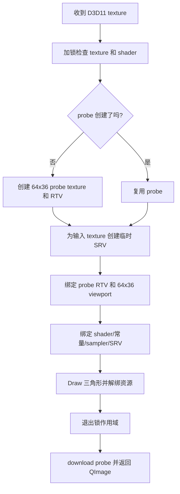

### 检查参数并首次创建 probe

```cpp
QImage StudioGpuCompositor::sampleTexture(ID3D11Texture2D* texture)
{
    {
        std::lock_guard lock(mutex_);
        if (!texture || !vertex_ || !pixel_)
            return {};
        if (!probe_) {
            probe_ = std::make_shared<Frame>();
            probe_->width = 64;
            probe_->height = 36;
            D3D11_TEXTURE2D_DESC d{};
            d.Width = 64;
            d.Height = 36;
            d.MipLevels = d.ArraySize = 1;
            d.Format = DXGI_FORMAT_B8G8R8A8_UNORM;
            d.SampleDesc.Count = 1;
            d.BindFlags = D3D11_BIND_RENDER_TARGET;
```

`texture` 是调用方传入的源 D3D11 纹理；函数不接管它的所有权。空纹理或 shader 未初始化时返回空图。`probe_` 只在第一次调用时创建，宽高固定 64×36。描述 `d` 只设置一个 mip/数组项、BGRA8、单采样和 RTV 绑定；省略字段为零，即默认 usage。

### 创建 probe 资源和输入 SRV

```cpp
            if (FAILED(device_->CreateTexture2D(&d, nullptr, &probe_->texture)) ||
                FAILED(device_->CreateRenderTargetView(probe_->texture.Get(), nullptr, &probe_->target))) {
                probe_.reset();
                return {};
            }
        }
        ComPtr<ID3D11ShaderResourceView> view;
        if (FAILED(device_->CreateShaderResourceView(texture, nullptr, &view)))
            return {};
```

`CreateTexture2D(&d,nullptr,&probe_->texture)` 按 64×36 描述创建空纹理；`CreateRenderTargetView(probe texture,nullptr,&probe_->target)` 为它创建默认 RTV。任一步失败会 `reset()` probe 并返回空图。接着为输入 `texture` 创建一个临时 SRV；三个参数分别是源纹理、默认 SRV 描述、输出 SRV。这里每次调用都重新创建 SRV。

### 绑定 probe 输出并设固定 viewport

```cpp
        auto* target = probe_->target.Get();
        context_->OMSetRenderTargets(1, &target, nullptr);
        context_->OMSetBlendState(nullptr, nullptr, 0xffffffff);
        context_->RSSetState(raster_.Get());
        D3D11_VIEWPORT viewport{0, 0, 64, 36, 0, 1};
        context_->RSSetViewports(1, &viewport);
        context_->IASetInputLayout(nullptr);
        context_->IASetPrimitiveTopology(D3D11_PRIMITIVE_TOPOLOGY_TRIANGLELIST);
        context_->VSSetShader(vertex_.Get(), nullptr, 0);
        context_->PSSetShader(pixel_.Get(), nullptr, 0);
```

`target` 是 probe 的 RTV 借用指针；`OMSetRenderTargets(1,&target,nullptr)` 绑定一个颜色输出且不绑定深度视图。`OMSetBlendState(nullptr,nullptr,0xffffffff)` 使用默认混合状态，mask 全开；`RSSetState()` 绑定初始化时的 rasterizer。viewport 从 `(0,0)` 开始，宽高为 64×36，深度范围 0 到 1。随后设置和 `draw()` 相同的三角形图元与 shader。这里 viewport 固定，没有调用 `fitRect()`，因此非 16:9 输入会被拉伸到 probe 大小。

### 设置常量、绑定输入并绘制

```cpp
        float values[4]{};
        context_->UpdateSubresource(constants_.Get(), 0, nullptr, values, 0, 0);
        auto* cb = constants_.Get();
        auto* sampler = sampler_.Get();
        auto* input = view.Get();
        context_->PSSetConstantBuffers(0, 1, &cb);
        context_->PSSetSamplers(0, 1, &sampler);
        context_->PSSetShaderResources(0, 1, &input);
        context_->Draw(3, 0);
        input = nullptr;
        context_->PSSetShaderResources(0, 1, &input);
        context_->OMSetRenderTargets(0, nullptr, nullptr);
    }
    return download(probe_);
}
```

`values{}` 四项全零，所以 shader 的 `mirror` 为 0。`UpdateSubresource()` 更新常量缓冲；`cb`、`sampler`、`input` 分别是常量缓冲、采样器、SRV 的借用指针。三个 `PSSet...` 调用均从槽位 0 各绑定一个资源。`Draw(3,0)` 将输入采样到 probe；之后先解绑 SRV，再用 `OMSetRenderTargets(0,nullptr,nullptr)` 解绑输出。大括号结束后释放 `mutex_`，最后才调用 `download(probe_)`。

`download()` 也会锁同一把非递归 mutex，因此不能在锁内调用它，否则会死锁。由于 probe 纹理会被重复覆盖，如果多个线程并发调用 `sampleTexture()`，一次绘制结束、另一次回写 probe、第一次开始 download 之间可能读到后一次的内容；当前逻辑适合串行采样。

## 10. 调用方如何使用这个类

### 流程图

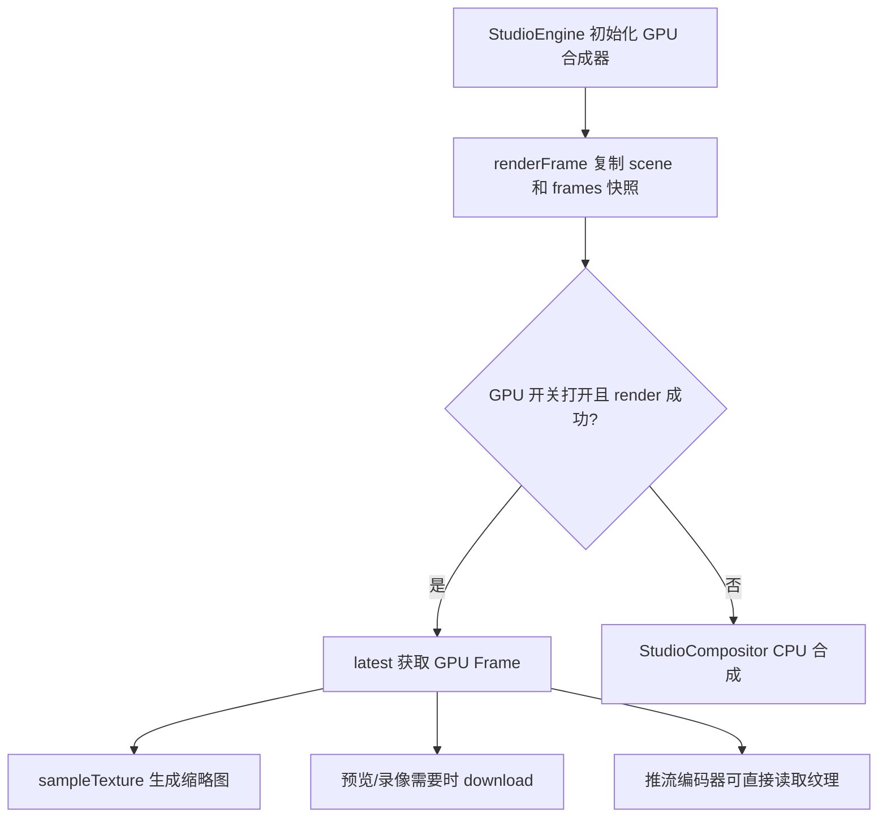

### 调用代码

```cpp
const bool hardware = s.gpuComposition && gpu_->render(s, frames, pts);
auto frame = hardware ? gpu_->latest() : nullptr;
if (hardware) {
    thumbnail = gpu_->sampleTexture(frame->texture.Get());
    if (preview_ || recording())
        output = gpu_->download(frame);
} else {
    output = StudioCompositor::render(s, frames);
}
```

`gpuComposition` 为假时，`&&` 短路，不调用 GPU `render()`。GPU 开关为真时，只有 `render()` 返回成功，`hardware` 才为真，接着 `latest()` 拿到输出 Frame。缩略图由 `sampleTexture(frame->texture.Get())` 生成；若预览或录像需要完整 CPU QImage，才调用 `download(frame)`。GPU 未启用或合成失败时，调用 CPU 版 `StudioCompositor::render()`。推流编码线程还可以取得 `latestGpuFrame()`，让 GPU 编码器直接用 Frame 的 D3D11 纹理。

## 11. 读完整文件时要串起的执行关系

`initialize()` 先创建设备、shader 和 pipeline 状态。一次导播帧到来后，`StudioEngine` 在短锁内复制 `scene_` 和 `frames_` 作为本轮快照，再调用 `render()`。`render()` 准备输出纹理并按场景顺序调用 `draw()`；每个 `draw()` 负责复用/上传一个输入纹理并发出采样绘制。所有图层成功后，`render()` 给 Frame 写入 PTS 并更新 `latest_`。下游若能直接消费 GPU 纹理就无需完整回读；需要 CPU QImage 时调用 `download()`。独立输入纹理要缩略图时，`sampleTexture()` 先用 probe shader 缩放，再复用 `download()`。

`Frame` 池最多四张，shared pointer 由池、`latest_` 和消费者共同持有；消费者释放句柄后纹理才能复用。`download()` 的 `Map()` 会等待 GPU 拷贝并产生 CPU 回读成本。函数返回 `true` 代表代码路径未检测到显式资源失败且已发布新 Frame，不代表窗口显示或编码已经成功。

## 12. 补充理解：Shader 与 D3D11 怎样配合

> 以下内容只追加在原文后面，不替换或删除原有内容。可以先记住：CPU 准备图像和绘制命令，D3D11 把纹理、shader 和绘制状态交给 GPU，shader 决定顶点位置及像素颜色。


### 先理解定义，再看流程图

| 名词 | 定义和作用 | 本文件中的例子 |
| --- | --- | --- |
| Shader（着色器） | 在 GPU 上运行的小程序，处理顶点或像素。 | HLSL 编译成 VS 和 PS。 |
| VS（顶点着色器） | 计算顶点的位置和附带数据（如 UV），不逐像素读取图像。 | `VS()` 用 `SV_VertexID` 生成三角形顶点和 UV。 |
| PS（像素着色器） | 对覆盖到的像素计算颜色，通常从纹理采样。 | `PS()` 用 `image.Sample(...)` 读取颜色并处理镜像。 |
| `ID3D11Device` | 创建 D3D11 资源和状态对象。 | 创建 Texture、SRV、RTV、shader、sampler。 |
| `ID3D11DeviceContext` | 设置 GPU 绘制状态并提交命令。 | 绑定 RTV、shader、SRV、viewport，调用 `Draw()`。 |
| Texture（`ID3D11Texture2D`） | GPU 上存放像素的二维资源。 | `inputs_[slot].texture` 是输入图；`frame->texture` 是合成结果。 |
| SRV | 让 shader 读取 Texture 的视图。 | 输入图的 `entry.view` 绑定给 PS 的 t0。 |
| RTV | 让 GPU 向 Texture 写入绘制结果的视图。 | `frame->target` 是合成输出的绘制目标。 |
| Sampler | 定义纹理取样方式，例如缩放过滤、边缘处理。 | 线性过滤、边缘钳制；对应 HLSL 的 s0。 |
| Viewport（视口） | 定义本次绘制落在输出画布的哪个矩形。 | `draw()` 根据 `fitRect()` 设置图层位置和尺寸。 |
| `Draw(3, 0)` | D3D11 非索引、非实例化绘制调用；第一个参数 `VertexCount=3` 表示处理 3 个顶点，第二个参数 `StartVertexLocation=0` 表示从顶点 0 开始。 | 这里的 VS 根据 `SV_VertexID` 生成编号为 0、1、2 的三个顶点。 |

本文件中的 `Draw(3, 0)` 不是画 3 个像素。VS 用 `SV_VertexID` 生成一个覆盖当前 viewport 的大三角形及其 UV；PS 再按 UV 从 t0 采样，并把像素写到当前 RTV。`Draw()` 提交绘制命令，不返回纹理；合成结果通过 `latest()` 获取。

简单记忆：Texture 保存像素；SRV 用于读；RTV 用于写。VS 决定三角形和 UV，PS 按 UV 从 SRV 取色，再把结果写入当前绑定的 RTV。

补充看这两个调用的分工：`PSSetShaderResources(0, 1, &view)` 只把一张输入图的 SRV 绑定到像素 shader 的 t0，不会绘制图形；`Draw(3, 0)` 才提交顶点绘制。当前拓扑是 `D3D11_PRIMITIVE_TOPOLOGY_TRIANGLELIST`，顶点数为 3，所以是**一个三角形**，不是两个。

这个三角形由 VS 刻意生成得比画布大；超出 viewport 的部分被裁掉，留下的部分覆盖整个 viewport。因此一个三角形就能把 t0 中的一整张图画出来。普通矩形通常拆成两个三角形、需要 6 个顶点；这里使用的是全屏三角形写法。

### 12.1 总体流程图

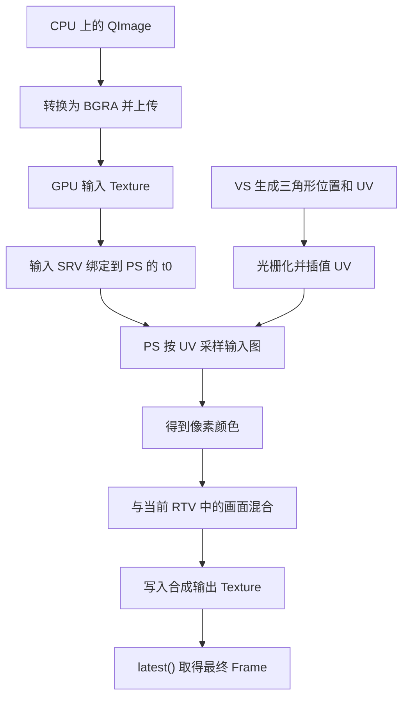

### 12.2 Shader 是什么，VS 和 PS 各做什么

**Shader（着色器）**是交给 GPU 执行的小程序。本文件的一段 HLSL 被分别编译为 VS（Vertex Shader，顶点着色器）和 PS（Pixel Shader，像素着色器）。它们是一次绘制的两个阶段，不是两套不同的合成器。

`VS(uint id : SV_VertexID)` 根据 `Draw(3, 0)` 提供的三个顶点编号，计算三角形顶点的位置和 UV。VS 不负责读取整张图像或计算每个图像像素的颜色；它告诉 GPU“绘制区域在哪里，以及区域上的位置对应源图的哪个 UV”。这里由三个顶点构造覆盖视口的大三角形，所以没有显式顶点缓冲区。

`PS(Out i)` 收到光栅化阶段插值得到的 `i.uv`。若 `mirror` 大于 0.5，就执行 `uv.x = 1 - uv.x`；接着 `image.Sample(linearSampler, uv)` 从输入纹理读取这个 UV 位置的颜色，并把颜色作为像素输出。它写入哪个纹理，由 D3D11 当前绑定的渲染目标决定。

可以把 VS 想成先铺一块带 UV 坐标的幕布；PS 再按幕布每个位置的 UV，从源纹理取色并填上去。

#### `mirror` 控制水平翻转，不控制是否执行 shader

`mirror` 是一个布尔绘制参数，只决定输入图像是否左右翻转。它不负责启用 VS/PS，也不决定要不要画三角形。每次 `draw()` 都会设置常量缓冲，然后执行 `context_->Draw(3, 0)`；VS 始终生成三角形，PS 始终采样并输出颜色。

```hlsl
float2 uv = i.uv;
if (mirror > .5) uv.x = 1 - uv.x;
return image.Sample(linearSampler, uv);
```

`mirror=false` 时用原始 `uv` 取样，正常显示；`mirror=true` 时只把水平方向坐标 `u` 换成 `1-u`，因此画面左右翻转。三角形的位置、大小和绘制次数都不受这个判断影响。

本文件不是自动分析画面来决定是否镜像，而是由 `render()` 给每个图层传参数：

| 图层 | 传给 `draw()` 的 `mirror` |
| --- | --- |
| 屏幕 / 媒体 | `false` |
| 摄像头 | `s.cameraMirror`（场景配置；默认值为 `true`） |
| Logo、文字、水印 | `false` |

所以需要镜像时，当前实现主要看摄像头的 `cameraMirror` 配置；即使值为 `false`，摄像头仍然会照常执行 shader 并绘制，只是不翻转。

#### 一次 `draw()` 中 VS、光栅化和 PS 怎样接力

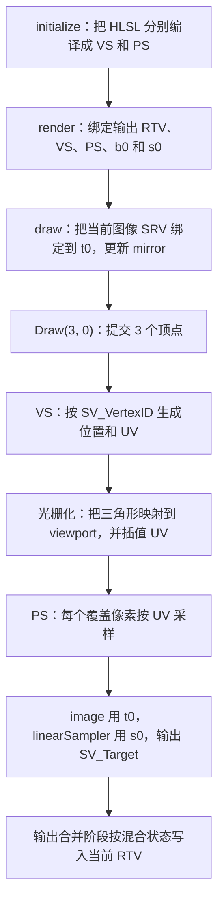

这是“一个 shader 文件里有两个入口函数”的流水过程：`initialize()` 调用 `D3DCompile()` 时分别指定入口名 `VS` / `PS` 和目标类型 `vs_5_0` / `ps_5_0`，因此得到两个 shader 对象；`render()` 再用 `VSSetShader()`、`PSSetShader()` 把它们放进绘制管线。调用 `Draw(3, 0)` 后，GPU 才按管线顺序执行它们。

**第一步：VS 生成三角形顶点。** `Draw(3, 0)` 让 VS 处理编号 `0、1、2` 的三个顶点。由于 shader 使用 `SV_VertexID` 自己生成数据，不需要从顶点缓冲区读取位置。按当前代码计算，三个顶点的 UV 分别是 `(0,0)`、`(2,0)`、`(0,2)`，对应裁剪空间位置 `(-1,1)`、`(3,1)`、`(-1,-3)`。这是一枚刻意放大的三角形，覆盖整个 viewport。

**第二步：光栅化把三角形变成待着色的像素。** GPU 将 VS 输出的 `SV_Position` 映射到 `draw()` 设置的 viewport，并为三角形覆盖到的像素生成 PS 输入。三角形顶点上的 `TEXCOORD0`（也就是 `uv`）会在这些像素之间自动插值，所以 PS 每次都能得到当前像素对应的纹理坐标 `i.uv`。

**第三步：PS 为每个像素算颜色。** PS 从常量缓冲 b0 读取 `mirror`；若为真，就把当前像素的横向纹理坐标改为 `1-u`。然后 `image.Sample(linearSampler, uv)` 从 t0 绑定的图像纹理取样，使用 s0 的过滤规则得到一个 `float4` 颜色，并通过 `SV_Target` 输出。

**第四步：输出合并阶段写入合成画布。** `render()` 事先通过 `OMSetRenderTargets()` 绑定了 `frame->target`。PS 输出的颜色到达这个 RTV 后，D3D11 按已绑定的 alpha 混合状态与画布原有颜色合成，写进 `frame->texture`。下一层再次调用 `draw()` 时，VS/PS 管线照常运行，只是 t0 换成下一层的 SRV；输出仍是同一张画布。

#### `viewport` 和“大三角形”是两件事

你贴的这几行**不是把三角形放大**：

```cpp
const auto fit = StudioCompositor::fitRect(source.size(), bounds);
D3D11_VIEWPORT viewport{float(fit.x()), float(fit.y()), float(fit.width()), float(fit.height()), 0, 1};
context_->RSSetViewports(1, &viewport);
const float values[4] = {mirror ? 1.f : 0.f, 0, 0, 0};
context_->UpdateSubresource(constants_.Get(), 0, nullptr, values, 0, 0);
```

`fitRect()` 算出图层在目标画布中的实际绘制矩形；`viewport` 把这个矩形的 x、y、宽、高交给 D3D11；`RSSetViewports()` 设置光栅化阶段使用的绘制区域。它决定图层最终落在画布哪里、占多大区域，但不会改 VS 生成的顶点坐标。

`values[0]` 和 `UpdateSubresource()` 做的是另一件事：把 `mirror` 的 0/1 写到 b0 常量缓冲区，供 PS 决定是否执行 `uv.x = 1 - uv.x`。它也不会改变三角形形状。

真正生成“大三角形”的是 HLSL 的 VS：

```hlsl
float2 uv = float2((id << 1) & 2, id & 2);
o.pos = float4(uv * float2(2, -2) + float2(-1, 1), 0, 1);
```

| `SV_VertexID` | VS 算出的 `uv` | VS 输出的 `pos` |
| --- | --- | --- |
| `0` | `(0, 0)` | `(-1, 1)` |
| `1` | `(2, 0)` | `(3, 1)` |
| `2` | `(0, 2)` | `(-1, -3)` |

后两个坐标超出了普通全屏矩形的边界，因此这是一个覆盖范围更大的三角形；光栅化时只留下当前 viewport 内覆盖到的部分。简单区分：**VS 坐标决定三角形形状；viewport 决定把它映射到画布的哪个矩形；mirror 只决定采样时是否左右翻转。**

### 12.3 `register(b0/t0/s0)` 与 C++ 绑定的对应关系

```hlsl
cbuffer Params : register(b0) { float mirror; float3 pad; };
Texture2D image : register(t0);
SamplerState linearSampler : register(s0);
```

| HLSL 声明 | 意思 | 本文件中对应的 C++ 操作 |
| --- | --- | --- |
| `register(b0)` | 常量缓冲区槽位 0，例如 `mirror` 参数 | `UpdateSubresource()` 写值，`PSSetConstantBuffers(0, ...)` 绑定 |
| `register(t0)` | shader 读取纹理的槽位 0 | `PSSetShaderResources(0, ...)` 把输入纹理的 SRV 绑定进来 |
| `register(s0)` | 采样器槽位 0 | `PSSetSamplers(0, ...)` 绑定采样器状态 |

这些编号是按资源类型分别编号的槽位，不是纹理格式或显存地址。HLSL 声明 `register(t0)` 不会自动放入纹理；C++ 还必须把 SRV 绑定到像素 shader 的第 0 个纹理槽位。`linearSampler` 在 C++ 中设置为线性过滤和边缘钳制，分别影响缩放取样和 UV 超出边界时的处理。

对应关系的简化例子：

```cpp
// 第一个 float 对应 HLSL 的 mirror；常量缓冲区按 16 字节准备。
const float values[4] = { mirror ? 1.f : 0.f, 0, 0, 0 };
context_->UpdateSubresource(constants_.Get(), 0, nullptr, values, 0, 0);

// 在 render() 中绑定常量缓冲区和 sampler；draw() 为当前图层绑定 SRV。
context_->PSSetConstantBuffers(0, 1, &constants);
context_->PSSetSamplers(0, 1, &sampler);
context_->PSSetShaderResources(0, 1, &view);
context_->Draw(3, 0);
```

#### 把 C++ 变量逐个对应到 HLSL 资源

看绑定代码时，先看每个变量实际指向什么对象，再看它被放到哪个 shader 槽位。`constants` 不是 `values` 数组本身：`values` 是要上传的数据，`constants_` 是 GPU 常量缓冲区对象，`constants` 是指向该对象的临时接口指针。

| HLSL 中的资源 | C++ 变量实际指向的对象 | 绑定调用 | 绑定后 shader 如何使用 |
| --- | --- | --- | --- |
| `Params : register(b0)` | `constants_`，类型为 `ID3D11Buffer*`，用来保存 16 字节常量数据 | `PSSetConstantBuffers(0, 1, &constants)` | PS 通过 `mirror` 读取镜像开关 |
| `linearSampler : register(s0)` | `sampler_`，类型为 `ID3D11SamplerState*`，包含线性过滤、边缘钳制设置 | `PSSetSamplers(0, 1, &sampler)` | `image.Sample(linearSampler, uv)` 使用这套取样规则 |
| `image : register(t0)` | `entry.view`，类型为 `ID3D11ShaderResourceView*`，是当前输入纹理的读取视图 | `PSSetShaderResources(0, 1, &view)` | `image.Sample(...)` 从这张输入纹理取颜色 |

**1. 先把常量缓冲区和采样器绑定一次。** 在 `render()` 中，`constants_.Get()` 取出之前创建的 GPU 常量缓冲区，`sampler_.Get()` 取出采样器对象：

```cpp
auto* constants = constants_.Get();
auto* sampler = sampler_.Get();
context_->PSSetConstantBuffers(0, 1, &constants);
context_->PSSetSamplers(0, 1, &sampler);
```

以 `PSSetConstantBuffers(0, 1, &constants)` 为例：第一个 `0` 表示从像素 shader 的常量缓冲槽位 0 开始，正好对应 `register(b0)`；第二个 `1` 表示绑定一个缓冲区；第三个 `&constants` 是“常量缓冲区接口指针”的地址，供 D3D11 读取要绑定的对象。这里绑定的是 `constants_` 这个 GPU 缓冲区，不是直接把 `values` 数组当成槽位。

**2. 每个图层绘制前，把本次镜像值写进已绑定的常量缓冲区。** `draw()` 中的代码是：

```cpp
const float values[4] = {mirror ? 1.f : 0.f, 0, 0, 0};
context_->UpdateSubresource(constants_.Get(), 0, nullptr, values, 0, 0);
```

`values[0]` 对应 HLSL `cbuffer` 的第一个成员 `float mirror`：`1.0` 表示在 PS 中翻转 U 坐标，`0.0` 表示不翻转。后面三个 `0` 对应 `float3 pad`，用于补齐到 4 个 float、共 16 字节。`UpdateSubresource()` 是把这些数据复制到 `constants_` 这块 GPU 缓冲区；由于 `constants_` 已在 `render()` 中绑定到 b0，随后这次 `Draw()` 执行时，PS 就能从 b0 读到刚写入的 `mirror` 值。

**3. 每个图层绘制时，把当前输入图的 SRV 绑定到 t0。** `draw()` 先根据自己的缓存编号取得当前图层的 `entry`，再取它的 shader 读取视图：

```cpp
auto& entry = inputs_[slot];
auto* view = entry.view.Get();
context_->PSSetShaderResources(0, 1, &view);
context_->Draw(3, 0);
```

`entry.texture` 是 GPU 上存放这张输入图像像素的 Texture；`entry.view` 是由这个 Texture 创建出来的 SRV。`PSSetShaderResources(0, 1, &view)` 中的 `0` 是 PS 的纹理资源槽位，对应 HLSL 的 `register(t0)`，`1` 表示绑定一个 SRV，`&view` 提供要绑定的 SRV 指针。调用后，HLSL 里的 `image` 就代表这个 SRV 所指向的当前输入纹理。

整个对应关系可以读成：CPU 图像先更新 `entry.texture`，`entry.view` 给 shader 提供读取入口；C++ 把 `entry.view` 放入 t0，把 `sampler_` 放入 s0，把 `constants_` 放入 b0；PS 最后通过 `image.Sample(linearSampler, uv)` 读取 t0，并用 s0 的规则取样，同时从 b0 读取 `mirror`。

注意：`draw()` 的 `slot` 是 `inputs_[slot]` 的 CPU 缓存编号，不是 HLSL 槽位。例如摄像头的缓存编号可以是 `slot=1`，但 `PSSetShaderResources(0, ...)` 仍把这次摄像头 SRV 绑定到 t0。b0、t0、s0 虽然都编号为 0，但它们分别属于常量缓冲、纹理和采样器三种不同资源类型。

#### `uv` 是纹理坐标，不是 YUV 的 U/V 分量

这里容易混淆，因为两个概念都写着 U、V。Shader 变量 `uv` 表示**纹理坐标**：`u` 表示图像水平方向的位置，`v` 表示垂直方向的位置，通常用 0 到 1 的归一化坐标表示。它回答的是“去输入纹理的哪个位置取颜色”，不是 YUV 格式中的 U、V 色度数据。

当前 `draw()` 收到的是 `QImage`，代码先将其转换为 `QImage::Format_ARGB32_Premultiplied`，再创建 `DXGI_FORMAT_B8G8R8A8_UNORM` 的输入纹理。因此 t0 绑定的是一张 BGRA 颜色纹理（带 alpha），不是 Y、U、V 分平面的 YUV 纹理。PS 的 `image.Sample(linearSampler, uv)` 用 `uv` 作为坐标，从这张颜色纹理取样；返回值是该位置的像素颜色 `float4`，而 `uv` 本身不是颜色。

例如 `uv = (0, 0)` 表示纹理左上角，`uv = (0.5, 0.5)` 表示中间，`uv = (1, 1)` 表示右下角。`linearSampler` 决定坐标落在像素之间时如何插值。**因此这里是“按 UV 坐标采样 RGB(A) 颜色纹理”，不是“采样 YUV 的 UV 色度纹理”。**

### 12.4 D3D11 对象的定义和作用

| 对象 | 通俗理解 | 本文件里的作用 |
| --- | --- | --- |
| `ID3D11Device`（`device_`） | GPU 资源的创建者 | 创建纹理、SRV、RTV、shader、sampler 等 |
| `ID3D11DeviceContext`（`context_`） | 向 GPU 下达绘制命令、设置当前状态的入口 | 绑定渲染目标、shader、纹理、viewport，然后执行 `Draw()` |
| `ID3D11Texture2D` | GPU 上存放像素的二维纹理 | `inputs_[slot].texture` 存输入图；`frame->texture` 存合成结果 |
| SRV（Shader Resource View） | 让 shader 读取纹理的视图 | `entry.view` 绑定到 t0，PS 通过它采样输入图 |
| RTV（Render Target View） | 让 GPU 向纹理写入绘制结果的视图 | `frame->target` 绑定后，各图层写入 `frame->texture` |
| Viewport（视口） | 输出纹理中本次绘制占用的矩形 | `draw()` 用 `fitRect()` 设置图层位置和大小 |

Texture 保存像素；SRV 和 RTV 是访问 Texture 的不同用途视图。输入图要被 shader 读取，因此需要 SRV；合成结果要被 GPU 写入，因此需要 RTV。输出纹理还创建了 SRV 能力，方便后续其他 GPU 操作读取。

#### 本文件中的 `OMSetRenderTargets()`

`OMSetRenderTargets()` 把一个或多个渲染目标视图（RTV）绑定到 D3D11 的输出合并阶段（Output-Merger，OM）。它本身不画图，只是在告诉后续绘制“像素结果写到哪里”。Microsoft 对该函数的说明是：绑定渲染目标和可选的深度模板视图。

```cpp
auto* target = frame->target.Get();
context_->OMSetRenderTargets(1, &target, nullptr);
context_->ClearRenderTargetView(target, background);
// 设置 shader 等状态后，后续 Draw() 的像素输出写入这个 RTV。
```

逐个看参数：

- `1`：要绑定的 RTV 数量。这里绑定一个，所以它是当前输出目标的第 0 个槽位；这个 `1` 表示“数量”，不是槽位编号。
- `&target`：要绑定的 RTV 指针数组的地址。`target` 来自 `frame->target.Get()`，它是 `frame->texture` 对应的输出视图；GPU 通过它把合成像素写进 `frame->texture`。
- `nullptr`：不绑定深度模板视图。这个合成过程按图层顺序绘制 2D 图像，不需要深度测试。

绑定之后，`ClearRenderTargetView()` 用背景色清空同一目标；随后摄像头、Logo 等各次 `Draw()` 都继续写入这个目标。代码最后调用 `OMSetRenderTargets(0, nullptr, nullptr)`，表示解绑当前渲染目标。

### 12.5 用摄像头图层看一次实际绘制

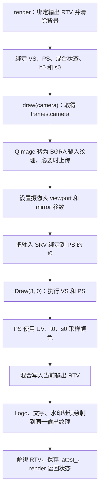

`render()` 先将 `frame->target` 绑定为当前 RTV 并清背景，然后绑定 VS、PS、混合状态、常量缓冲和 sampler。摄像头的 `draw()` 把 `frames.camera` 转换为 `QImage::Format_ARGB32_Premultiplied`，必要时更新 GPU 输入纹理；接着设置摄像头 viewport、更新镜像参数、把当前输入 SRV 绑定到 t0，再调用 `Draw(3, 0)`。

VS 和 PS 执行后，摄像头像素写入 render() 已绑定的输出纹理。随后 Logo、文字、水印的 `draw()` 仍画到同一张输出纹理，只更换输入图和 viewport；图层的调用顺序就是叠放顺序。所有图层绘完后，`render()` 解除输出绑定并将 `frame` 存入 `latest_`。

### 12.6 `slot`、shader 槽位和函数返回值不要混淆

- `draw(..., slot)` 中的 `slot` 是 `inputs_[slot]` 的缓存编号，用来区分各图层的输入纹理。当前调用使用 0 到 4；`draw()` 没有做越界检查，调用方必须传有效值。

`inputs_` 是类里的固定数组，声明类型为 `std::array<ImageTexture, 5>`，可以把它想成 5 个“输入图层缓存格”。`slot` 是格子的编号；`auto& entry = inputs_[slot]` 就是取出对应格子的引用，`entry` 不是新复制出来的图像，也不是 shader 的纹理槽位。

| `slot` 编号 | 当前合成器用它缓存的输入 |
| --- | --- |
| `0` | 屏幕画面或媒体画面；两者在 `render()` 中走互斥分支，共用这个缓存格 |
| `1` | 摄像头画面 |
| `2` | Logo |
| `3` | 文字 overlay 图像 |
| `4` | 水印 |

每个 `ImageTexture` 缓存项保存 `key`、宽高、GPU `texture` 和它的 SRV `view`。因此 `entry.texture` 是当前输入图像对应的 GPU 像素资源，`entry.view` 是让 pixel shader 读取这张 texture 的视图。`draw()` 会比较输入图像的 `cacheKey()`：图像没变时复用这个缓存项；图像变化或资源不存在时才创建或更新 GPU 纹理并更新缓存。

举例：摄像头绘制调用传入 `slot=1`，所以 `entry` 指向 `inputs_[1]`，也就是摄像头的缓存项。接下来 `entry.view` 会通过 `PSSetShaderResources(0, 1, &view)` 绑定到 shader 的 t0。**`slot=1` 选择的是 C++ 里的缓存格；`0` 才是 shader 的 t0 槽位。**不同图层轮流使用同一个 t0，只是每次绑定的 SRV 不同。

- `PSSetShaderResources(0, 1, &view)` 中的 `0` 才是 shader 的资源槽位，对应 `register(t0)`。因此摄像头可用缓存 `slot=1`，但它每次仍绑定到 shader 的 t0。
- `draw()` 返回 `bool`，表示绘制是否成功，不返回纹理。合成结果在 `render()` 的 `frame->texture` 中；成功后通过 `latest()` 获取 Frame，再访问其 texture。

### 12.7 例子与常见坑点

例如先绘制不透明摄像头，再绘制带透明背景的 Logo：摄像头的 PS 输出写入当前 RTV；Logo 的透明像素通过混合保留下层摄像头画面，半透明像素与下层颜色合成。这里混合状态使用 `SrcBlend = ONE`、`DestBlend = INV_SRC_ALPHA`，所以输入必须是预乘 Alpha 格式；`draw()` 将输入转换成 `QImage::Format_ARGB32_Premultiplied`，正好与这个混合配置配套。

阅读或修改时检查：

1. `register(b0/t0/s0)` 要与 C++ 的 `PSSetConstantBuffers/PSSetShaderResources/PSSetSamplers` 槽位对应。
2. `draw()` 不决定输出纹理；`render()` 事先绑定的 RTV 才是所有图层共同的绘制目标。
3. `Draw(3, 0)` 的 `3` 是顶点数，不是像素数；顶点由 `SV_VertexID` 在 VS 中生成。
4. 输入 SRV 在绘制后解除绑定，输出 RTV 在 render 结束时解除绑定，避免同一纹理同时作为 shader 输入和输出目标。
5. `render()` 返回成功状态；GPU 图像需通过 `latest()` 取得，而不是从 `draw()` 的返回值取。