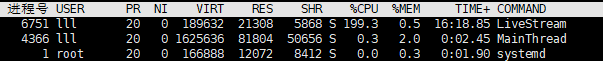
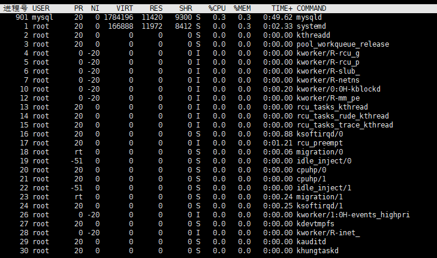

# CPU占用率过高

## 情况

> 使用`top`命令查看进程的CPU使用率，发现占用率 197%
>
> 

## 原因

```c++
void TaskScheduler::Start()
{
    is_shutdown_ = false;
    while(!is_shutdown_) {
        // 处理定时事件
        this->timer_queue_.HandleTimeEvent();
        // 处理IO事件
        this->HandleEvent();
    }
}
```

> 首先处理放入定时器的任务，然后再执行`epoll`放入的`fd`任务，但是`epoll_wait()`设置的计时器为0，所以每次`while`循环都会调用到`epoll_wait`一直在空转，直到计时任务到点

## 解决方案

## 思路

现在定时器的触发路径是：

```
循环转一圈 → 主动问 TimerQueue“到点了吗” → 才知道
```

升级后要从主动轮询到被动唤醒：

```
内核里的定时器到期 → 往 timerfd 写 8 字节 → epoll 返回 → 处理
```

> 将循环查看定时器的任务，放入到`epoll`中
>
> ```
> TimerQueue 说"还有 5000ms"
>     → timerfd_settime(5000ms)       ← 给内核装上闹钟
>     → 5000ms 后内核写 tfd
>     → epoll_wait 返回
>     → read 排空 + HandleTimeEvent()  ← 执行回调
>     → 重新 settime 到下一个到期时刻    ← 循环闭合
> ```

### 解决空转问题

#### 增加timerfd_

```c++
    timerfd_ = timerfd_create(CLOCK_MONOTONIC, TFD_NONBLOCK | TFD_CLOEXEC);
```

> 创建一个内核定时器对象，返回一个 fd;
>
> 1. **第一个参数**
>
> | 时钟              | 含义                              | 特点                                                         |
> | :---------------- | :-------------------------------- | :----------------------------------------------------------- |
> | `CLOCK_REALTIME`  | 系统墙上时间（`date` 看到的那个） | 会被 NTP 校时、手动改时间、夏令时影响，**可能突然前跳或后跳** |
> | `CLOCK_MONOTONIC` | 从开机起单调递增                  | 不受系统时间修改影响，只增不减；**不包含系统休眠的时间**     |
> | `CLOCK_BOOTTIME`  | 同上的，但包含休眠时间            | 笔记本挂起唤醒后仍然算数                                     |
>
> 2. **第二个参数**
>
> > **`TFD_NONBLOCK`** —— 把这个 fd 设成非阻塞。它直接决定了读回调能不能这么写：
> >
> > ```cpp
> > while (::read(timerfd_, &expirations, sizeof(expirations)) > 0) {}
> > ```
> >
> > 没有过期事件时，`read` 会返回 `-1` + `errno == EAGAIN`，循环自然退出。
> > **不加这个 flag，最后一次 `read` 就会永久阻塞在回调里**，整个事件线程就此卡死——这是非阻塞标志在这里的唯一作用，但很关键。
> >
> > **`TFD_CLOEXEC`** —— close-on-exec。进程 `exec` 成别的程序时，内核自动关掉这个 fd，避免泄漏到子进程里。服务端程序的标准做法。

#### 将`timerfd`包装成`channel`然后放入任务调度器中，使用epoll调用

> `timer_channel`回调函数执行所有到期的计时器的回调函数；
>
> ### `timerfd`倒计时之后会发送信息唤醒
>
> > 会返回对应**`uint64_t`，自上次读取以来这个定时器到期了几次**。
> >
> > 1. | 读到 | 含义                                                         |
> >    | :--- | :----------------------------------------------------------- |
> >    | `1`  | 到期了一次（正常情况，绝大多数都是这个）                     |
> >    | `7`  | 期间累积了 7 次——说明回调处理太慢，定时器在两次处理之间又响了 6 次 |
> >    | `0`  | **不可能**。counter 为 0 时 fd 就不是可读状态了，`read` 会返回 `-1` + `EAGAIN` |
> >
> > 2. 所以这个数只有两个用途：
> >
> > 3. 1. **告诉你“迟到了几次”** —— 但我们完全不用（代码里 `expirations` 读完就再没被引用）
>
> 需要`while`循环读取对应的信息，排空信息；
>
> ```c++
> while (::read(wakeupfd_, &value, sizeof(value)) > 0) {}
> ```

#### 修改`timmerfd`的倒计时时间

> 1. 修改时间需要加锁
>
>    > 否则会旧值覆盖新值
>    >
>    > ```
>    > 线程A 读到 delay=100ms（被抢占）
>    > 线程B 加了 10ms 定时器，settime(10ms)
>    > 线程A                    settime(100ms)  ← 10ms 的定时器晚 90ms
>    > ```
>    >
>    > 读取最新到期时间的时候，又加了新的，但是被旧的值给修改了
>
> 1. 首先获取目前`timmer_queue`中的第一个计时任务，还有多久到点
>
> ```c++
> int64_t delay = GetNextTimeoutMs();
> ```
>
> 3. 使用 ` struct itimerspec its;`记录时间，然后对`timerfd`设置时间`timerfd_settime`
>
> ```c++
>     struct itimerspec its;
>     memset(&its, 0, sizeof(its));
> 
>     if (delay < 0) {
>         // 没有定时器：it_value 全 0 的语义就是 disarm（关闭闹钟），此后不会再有事件
>     }
>     else if (delay == 0) {
>         // 已经到期：绝对不能填 0！it_value 全 0 表示"关闭定时器"，不是"立刻触发"，
>         // 填 0 会让这个定时器永远不再响。给 1ns 让它马上到期。
>         its.it_value.tv_nsec = 1;
>     }
>     else {
>         its.it_value.tv_sec  = delay / 1000;
>         its.it_value.tv_nsec = (delay % 1000) * 1000000;     // 毫秒 -> 纳秒
>     }
>     // timerfd_settime 是线程安全的，可以从任意线程调用。
>     // 这正是它比"改 epoll_wait 的 timeout 参数"强的地方：睡着的线程也能被重新安排闹钟。
>     if (timerfd_settime(timerfd_, 0, &its, nullptr) == -1) {
>         LOG_ERROR("EpoolTaskScheduler::RearmTimer: timerfd_settime failed, errno = " + std::to_string(errno));
>     }
> ```

#### 将 `epoll_wait `改为无限期阻塞

```c++
    int num_events = epoll_wait(epollfd_, events, 1024, -1);
```

### 改为阻塞等待后，唤醒结束线程

#### 设置`wakeupfd`

```c++
    wakeupfd_ = eventfd(0, EFD_NONBLOCK | EFD_CLOEXEC);
```

#### 同上

```c++
    wakeupfd_ = eventfd(0, EFD_NONBLOCK | EFD_CLOEXEC);
    if (wakeupfd_ == -1) {
        LOG_ERROR("EpoolTaskScheduler: eventfd failed");
        return;
    }
    AddChannel(wakeupfd_, [this]() {
        uint64_t value = 0;
        while (::read(wakeupfd_, &value, sizeof(value)) > 0) {}
    });
```

> 包装`channel`，添加到任务调度器中；非阻塞读取信息

#### 发送信息，以便循环判断是否关闭

```
① 内核：wakeupfd_ 变可读
        ↓
② 该 fd 已注册在 epoll 里（LT 模式，状态可读就一直报）
   epoll_wait(-1) 立刻返回，num_events = 1
        ↓
③ HandleEvent 的 for 循环：
   events[i].data.ptr → 指向 wakeup 那个 Channel
   Channel::HandleEvent(EPOLLIN) → 调用 read_callback_
        ↓
④ 你注册的那个 lambda 执行：
   while (::read(wakeupfd_, &value, 8) > 0) {}
   第一次 read 读走 8 字节，拿到 value = 1，counter 归 0
   第二次 read 返回 -1 + EAGAIN，循环退出
        ↓
⑤ HandleEvent 返回 true
        ↓
⑥ 回到 Start() 的循环顶部：
   while (!is_shutdown_)  →  此时已经是 false
   → 退出 while  → 线程函数返回  → join() 返回
```

## 解决后


